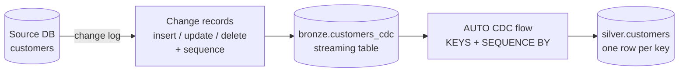

# Change Data Capture

Mastery: `INPUT[inlineSelect(option(new), option(learning), option(solid)):mastery]`

> [!story] Context
> [[Expectations and Data Quality]] keep invalid rows out. The sources so far only add rows. Operational databases also update and delete rows. Reloading full tables is slow, and append-only [[Streaming Tables|streaming tables]] cannot represent an update or delete.

> [!eli5] Summary
> Change data capture copies only the changes from a database: which rows were added, edited, or deleted. Databricks applies those changes in the correct order so its copy matches the source.

> [!renamed] Renamed
> The pipeline APIs for applying changes were called **APPLY CHANGES** (SQL `APPLY CHANGES INTO`, Python `dlt.apply_changes()`). They are now **AUTO CDC**: SQL `AUTO CDC INTO`, Python `dp.create_auto_cdc_flow()`, and `dp.create_auto_cdc_from_snapshot_flow()` (which replaces `apply_changes_from_snapshot()` with the same signature). The rename came with the 2025 move from DLT to Lakeflow pipelines; old code still runs.

> [!analogy]- Analogy: a bank statement
> | Bank statement | Change data capture |
> |---|---|
> | Account balance | The source table |
> | Statement lines with dates | Change records with a sequence column |
> | Budgeting app that applies new lines in date order | The AUTO CDC flow |
> | A late line dated last week | An out-of-order change, handled by `SEQUENCE BY` |

## Background

There are three common ways to copy a changing table, in increasing order of accuracy:

1. **Full reload every night.** Simple, but slow and costly for big tables, and you can't see what changed.
2. **"Updated since" query.** Pull rows where `updated_at > last_run`. Cheaper, but it misses hard deletes and needs a reliable timestamp.
3. **Change data capture.** Read the database's own change log (SQL Server CDC or change tracking, MySQL binlog, Postgres logical replication). You get every insert, update, and delete, with ordering.

Applying CDC by hand requires a [[MERGE and Upserts|MERGE]] that deduplicates each batch, handles deletes, and copes with events arriving out of order. Errors in that logic cause the copy to drift from the source. AUTO CDC implements this logic in the engine.

## Overview

AUTO CDC is a flow type in [[Lakeflow Spark Declarative Pipelines|Lakeflow pipelines]] that applies a stream of change records to a target streaming table. The docs note the AUTO CDC APIs are available only in Lakeflow pipelines (not open-source Spark Declarative Pipelines).

You tell it:

| Setting | Meaning | Example |
|---|---|---|
| `KEYS` | The column(s) that identify a row | `customer_id` |
| `SEQUENCE BY` | The column that orders changes (later wins) | `updated_at` or a log sequence number |
| `APPLY AS DELETE WHEN` | How to recognise a delete | `operation = 'DELETE'` |
| `APPLY AS TRUNCATE WHEN` | How to recognise a full truncate (SCD type 1 only) | `operation = 'TRUNCATE'` |
| `COLUMNS` | Which columns to keep | `* EXCEPT (operation, _rescued_data)` |
| `STORED AS` | `SCD TYPE 1` (default, latest only) or `SCD TYPE 2` (history) | see [[Slowly Changing Dimensions]] |

Change records come from one of these sources:

- **[[Lakeflow Connect]] database connectors** (SQL Server) read the source's change log and apply changes for you. You don't write AUTO CDC yourself.
- **Debezium or similar via [[Apache Kafka]]**: change events land in a bronze table, then you write the AUTO CDC flow.
- **Snapshots only**: if the source can only give you full extracts, `create_auto_cdc_from_snapshot_flow` compares snapshots and works out the changes.
- **Another Delta table's [[Change Data Feed]].**

## How it works



A batch of change records for one customer:

| customer_id | email | city | operation | updated_at |
|---|---|---|---|---|
| 42 | a@x.com | Austin | INSERT | 2026-10-01 09:00 |
| 42 | a@y.com | Austin | UPDATE | 2026-10-03 12:00 |
| 42 | a@y.com | Denver | UPDATE | 2026-10-02 08:00 |

The Denver row arrived last but is older. With `SEQUENCE BY updated_at`, the result is email `a@y.com`, city **Austin**, because the 12:00 change is newest. A naive MERGE in arrival order would wrongly say Denver.

### SQL (in a pipeline)

```sql
-- bronze: raw change events, for example from Debezium JSON files
CREATE OR REFRESH STREAMING TABLE customers_cdc
AS SELECT * FROM STREAM read_files('/Volumes/shop/bronze/landing/crm_cdc/', format => 'json');

-- silver: current state, one row per customer
CREATE OR REFRESH STREAMING TABLE customers;

CREATE FLOW customers_apply AS AUTO CDC INTO customers
FROM STREAM(customers_cdc)
KEYS (customer_id)
APPLY AS DELETE WHEN operation = 'DELETE'
SEQUENCE BY updated_at
COLUMNS * EXCEPT (operation, _rescued_data)
STORED AS SCD TYPE 1;
```

### Python (in a pipeline)

```python
from pyspark import pipelines as dp
from pyspark.sql.functions import col, expr

dp.create_streaming_table("customers")

dp.create_auto_cdc_flow(
    target="customers",
    source="customers_cdc",
    keys=["customer_id"],
    sequence_by=col("updated_at"),
    apply_as_deletes=expr("operation = 'DELETE'"),
    except_column_list=["operation", "_rescued_data"],
    stored_as_scd_type=1,
)
```

### From snapshots (no change log available)

```python
from pyspark import pipelines as dp

dp.create_streaming_table("products")

dp.create_auto_cdc_from_snapshot_flow(
    target="products",
    source="shop.bronze.products_snapshot",   # a table overwritten with each full extract
    keys=["product_id"],
    stored_as_scd_type=2,
)
```

### Without pipelines: MERGE

Outside a pipeline, the same result takes a hand-written [[MERGE and Upserts|MERGE]] that first keeps only the latest change per key:

```sql
MERGE INTO shop.silver.customers AS t
USING (
  SELECT * FROM shop.bronze.customers_cdc_batch
  QUALIFY ROW_NUMBER() OVER (PARTITION BY customer_id ORDER BY updated_at DESC) = 1
) AS s
ON t.customer_id = s.customer_id
WHEN MATCHED AND s.operation = 'DELETE' THEN DELETE
WHEN MATCHED AND s.updated_at > t.updated_at THEN UPDATE SET *
WHEN NOT MATCHED AND s.operation != 'DELETE' THEN INSERT *;
```

That works, but you must also track which batch you processed and handle deletes that arrive before inserts. AUTO CDC does both.

## Small-business considerations

> [!smallbiz] Small-business considerations
> Most small businesses never write CDC code. If your data is in SaaS apps (Shopify, QuickBooks), the connector or export handles it. If you run your own SQL Server, the [[Lakeflow Connect]] SQL Server connector does CDC end to end. You only need AUTO CDC yourself when changes arrive as raw events (from Kafka or a vendor's change files) or as daily full snapshots, which is common with older accounting or point-of-sale systems: `create_auto_cdc_from_snapshot_flow` is made for that.

## Cloud differences

> [!azure]- Azure Databricks
> The AUTO CDC APIs are identical. Common sources are Azure SQL Database and SQL Managed Instance (through the SQL Server connector) and Azure Event Hubs carrying Debezium events through its Kafka endpoint.

> [!aws]- Databricks on AWS
> Identical APIs. Common sources are SQL Server on RDS, and AWS DMS or Debezium on Amazon MSK writing change files to S3.

> [!gcp]- Databricks on Google Cloud
> Identical APIs. Change events often arrive through Pub/Sub or as files in Cloud Storage.

## Advanced topics

> [!deepdive]- Advanced topics (301–401)
> - **Sequencing must be total.** `SEQUENCE BY` must give a strict order per key. If two changes share a timestamp, use a struct: `SEQUENCE BY STRUCT(updated_at, lsn)`.
> - **Deletes and tombstones.** Deletes that arrive out of order are kept as tombstones for a while, so a late "insert" for a deleted key doesn't bring it back. For SCD type 2, the docs describe the deleted row being retained as a tombstone in the underlying Delta table, with a view that filters it out.
> - **Truncates** (`APPLY AS TRUNCATE WHEN`) are supported only for SCD type 1.
> - **Bitemporal** storage (`STORED AS BITEMPORAL`) is in Beta and requires `SYSTEM SEQUENCE BY`.
> - **Don't write to the target yourself.** The AUTO CDC target is owned by the flow. To fix data, fix the source or run a full refresh.
> - **Mixing flows.** Combining an AUTO CDC flow and a snapshot flow on the same target has restrictions. Check the advanced AUTO CDC page before designing that.
> - **Reading changes downstream.** The target table can expose a [[Change Data Feed]] so the next layer can process only changed rows, too.

## Common misconceptions

> [!confusion] CDC is not Change Data Feed
> **CDC** reads changes *from a source system* into Databricks. [[Change Data Feed]] is a Delta table feature that *emits* the changes made to a Delta table, so others can read them. AUTO CDC often consumes one and can produce the other.

> [!confusion] AUTO CDC is not a connector
> AUTO CDC applies change records you already have. Getting the changes out of the database is a separate job: a [[Lakeflow Connect]] connector, Debezium, or a vendor tool.

## Recall

What does CDC capture that an "updated since" query misses?::Hard deletes (and every intermediate change, in order).
What was AUTO CDC called before?::APPLY CHANGES (`APPLY CHANGES INTO`, `dlt.apply_changes()`).
What does `SEQUENCE BY` do?::Orders change records per key so the latest change wins, even if records arrive out of order.
What is the default `STORED AS` for AUTO CDC?::SCD type 1 (latest value only).
Which Python function builds changes from full snapshots?::`dp.create_auto_cdc_from_snapshot_flow()`.
Is `APPLY AS TRUNCATE WHEN` supported for SCD type 2?::No, only SCD type 1.
Are AUTO CDC APIs in open-source Spark Declarative Pipelines?::No, they are available only in Lakeflow pipelines on Databricks.
How do you break ties when two changes share a timestamp?::Sequence by a struct, such as `STRUCT(updated_at, lsn)`.

## Next steps

> [!path] Learning path
> **Needs first:** [[Streaming Tables]], [[MERGE and Upserts]], [[Relational Databases]]
> **Unlocks next:** [[Slowly Changing Dimensions]]

> [!nextup] Next
> [[Slowly Changing Dimensions]] covers whether to overwrite changed attributes or keep their history.

> [!sources]- Sources (last verified: 2026-10-25)
> - [The AUTO CDC APIs: Simplify change data capture with pipelines (AWS)](https://docs.databricks.com/aws/en/ldp/cdc)
> - [create_auto_cdc_flow (AWS)](https://docs.databricks.com/aws/en/ldp/developer/ldp-python-ref-apply-changes)
> - [create_auto_cdc_from_snapshot_flow (AWS)](https://docs.databricks.com/aws/en/ldp/developer/ldp-python-ref-apply-changes-from-snapshot)
> - [AUTO CDC INTO (pipelines, AWS)](https://docs.databricks.com/aws/en/ldp/developer/ldp-sql-ref-apply-changes-into)
> - [AUTO CDC INTO (pipelines, Azure)](https://learn.microsoft.com/en-us/azure/databricks/ldp/developer/ldp-sql-ref-apply-changes-into)
> - [CREATE FLOW (pipelines, AWS)](https://docs.databricks.com/aws/en/ldp/developer/ldp-sql-ref-create-flow)
> - [Advanced AUTO CDC topics (AWS)](https://docs.databricks.com/aws/en/ldp/cdc-advanced)
> - [Tutorial: Build an ETL pipeline using change data capture (AWS)](https://docs.databricks.com/aws/en/ldp/tutorial-pipelines)
> - [CREATE STREAMING TABLE ... FLOW AUTO CDC (Databricks SQL, AWS)](https://docs.databricks.com/aws/en/sql/language-manual/sql-ref-syntax-ddl-create-streaming-table-auto-cdc)
> - [What happened to Delta Live Tables (DLT)? (AWS)](https://docs.databricks.com/aws/en/ldp/concepts/where-is-dlt)
> - [Managed database connectors (GCP)](https://docs.databricks.com/gcp/en/ingestion/lakeflow-connect/cdc-overview)
> - **Unconfirmed:** the search budget ran out before these details could be re-checked against official docs, so treat them as unverified: sequencing by `STRUCT(...)`, out-of-order delete handling for SCD type 1, the MERGE fallback, and the per-cloud source examples.
