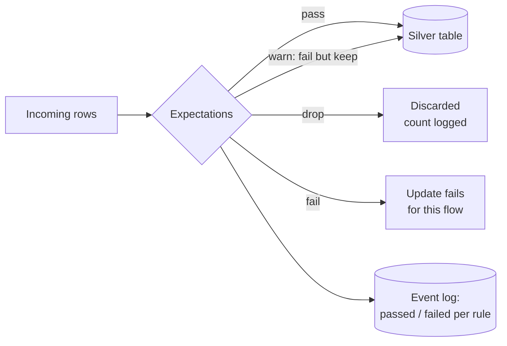

# Expectations and Data Quality

Mastery: `INPUT[inlineSelect(option(new), option(learning), option(solid)):mastery]`

> [!story] Context
> [[Streaming Tables]] and [[Materialized Views]] refresh automatically, which also propagates bad source data automatically. A malformed export with missing order IDs reaches the gold layer unless each layer enforces quality rules.

> [!eli5] Summary
> An expectation is a rule attached to a table, such as "every order has an ID" or "prices are not negative". For each rule you choose what happens to rows that break it: count them, remove them, or stop the run until someone investigates.

> [!analogy]- Analogy: quality control on a production line
> | Production line | Expectations |
> |---|---|
> | Inspector's checklist | The list of expectations |
> | Log the defect and let the item pass | Warn |
> | Remove the item from the line | Drop |
> | Stop the line | Fail |
> | Daily defect report | Pass and fail counts in the event log |

## Background

[[Schema Enforcement and Evolution|Schema enforcement]] in [[Delta Lake]] stops the wrong *types* (text in a number column). It does not stop wrong *values*: a null ID, a negative quantity, an order date in the future. Before expectations, teams wrote separate validation jobs that ran after the load, if at all, so bad data was already in the report by the time anyone noticed.

Expectations put the rule in the table definition. The check runs as the data flows, every time, and its results are recorded.

## Overview

An expectation has three parts:

1. **A name**, such as `valid_order_id`.
2. **A constraint**: a SQL boolean expression, such as `order_id IS NOT NULL`. It can use any SQL that works in a `WHERE` clause on one row.
3. **An action** on violation:

| Action | SQL | Python | Effect |
|---|---|---|---|
| **Warn** (default) | `EXPECT (...)` | `@dp.expect` | Bad rows are written; counts appear in metrics |
| **Drop** | `EXPECT (...) ON VIOLATION DROP ROW` | `@dp.expect_or_drop` | Bad rows are removed before writing; counts are logged |
| **Fail** | `EXPECT (...) ON VIOLATION FAIL UPDATE` | `@dp.expect_or_fail` | The flow stops at the first bad row; needs a person to fix |

For several rules at once, Python has `@dp.expect_all`, `@dp.expect_all_or_drop`, and `@dp.expect_all_or_fail`, which take a dictionary of name-to-constraint.

Expectations work on [[Streaming Tables|streaming tables]] and [[Materialized Views|materialized views]] in [[Lakeflow Spark Declarative Pipelines|pipelines]], and on standalone ones created in Databricks SQL.

## How it works



### SQL

```sql
CREATE OR REFRESH STREAMING TABLE shop.silver.orders (
  CONSTRAINT valid_order_id  EXPECT (order_id IS NOT NULL)            ON VIOLATION DROP ROW,
  CONSTRAINT positive_total  EXPECT (total >= 0)                      ON VIOLATION DROP ROW,
  CONSTRAINT sane_date       EXPECT (order_date >= '2015-01-01'),     -- warn only
  CONSTRAINT known_currency  EXPECT (currency IN ('USD', 'CAD'))      ON VIOLATION FAIL UPDATE
)
AS SELECT * FROM STREAM(shop.bronze.orders_raw);
```

### Python

```python
from pyspark import pipelines as dp

order_rules = {
    "valid_order_id": "order_id IS NOT NULL",
    "positive_total": "total >= 0",
}

@dp.table
@dp.expect_all_or_drop(order_rules)
@dp.expect("sane_date", "order_date >= '2015-01-01'")
@dp.expect_or_fail("known_currency", "currency IN ('USD', 'CAD')")
def orders():
    return spark.readStream.table("shop.bronze.orders_raw")
```

### Quarantine instead of losing rows

Dropping rows is safe for the report but hides what went wrong. A common pattern from the docs is to split good and bad rows into two tables, so someone can review the rejects:

```python
from pyspark import pipelines as dp

rules = {"valid_order_id": "order_id IS NOT NULL", "positive_total": "total >= 0"}
all_ok = " AND ".join(f"({c})" for c in rules.values())

@dp.table
@dp.expect_all_or_drop(rules)
def orders_valid():
    return spark.readStream.table("shop.bronze.orders_raw")

@dp.table(comment="Rows that broke at least one rule, for review")
def orders_quarantine():
    return spark.readStream.table("shop.bronze.orders_raw").where(f"NOT COALESCE({all_ok}, false)")  # nulls count as failures
```

### Reading the results

Every update writes pass and fail counts to the pipeline's event log. Query it like a table:

```sql
SELECT timestamp,
       details:flow_progress.data_quality.expectations AS expectations
FROM event_log(TABLE(shop.silver.orders))
WHERE event_type = 'flow_progress'
  AND details:flow_progress.data_quality IS NOT NULL
ORDER BY timestamp DESC;
```

The `event_log()` function can be called only by the owner of the streaming table or materialized view. The pipeline UI shows the same numbers per table, except for standalone tables created in Databricks SQL, where you query the event log instead. Put a [[SQL Alerts|SQL alert]] on that query to get an email when the drop rate jumps.

### Recommended actions by layer

| Layer | Suggested action | Why |
|---|---|---|
| Bronze | None, or warn | Keep everything raw so you can reprocess |
| Silver | Drop (or quarantine) for row-level junk | Clean data for everything downstream |
| Silver/gold | Fail for "this can't happen" rules | Better no report than a wrong one |
| Gold | Warn on business sanity checks | Flag odd days without blocking |

## Small-business considerations

> [!smallbiz] Small-business considerations
> Five or six rules catch most real problems: IDs not null, money not negative, dates in a sane range, status in a known list, and foreign keys that point somewhere. Put them on your silver tables. Use **fail** sparingly: a failed nightly run means no dashboard in the morning, which may be worse than a dashboard with one dropped row. Check the dropped-row counts weekly, or alert on them.

## Cloud differences

> [!azure]- Azure Databricks
> Nothing differs between clouds. Expectations are part of the pipeline engine and behave the same on Azure, AWS, and Google Cloud.

## Advanced topics

> [!deepdive]- Advanced topics (301–401)
> - **Fail is scoped to one flow:** In a triggered pipeline, a failing expectation stops that flow, and the docs say it does not fail other parallel flows. In a continuous pipeline, it stops the flow and all flows that depend on it. Either way, the update does not succeed, and a person must fix the data or code before reprocessing.
> - **Row-level only:** A constraint sees one row. For checks across rows (uniqueness, row counts, referential integrity), build a materialized view that computes the check (for example `COUNT(*) - COUNT(DISTINCT order_id) AS dupes`) and put an expectation on *that* view, such as `EXPECT (dupes = 0) ON VIOLATION FAIL UPDATE`. The docs' "advanced patterns" page shows this.
> - **Rules as data:** Store rules in a Delta table and load them into the `expect_all_*` dictionary at pipeline start. Business users can then maintain rules without code changes.
> - **Classic edition:** On classic compute, expectations need the Advanced product edition. Serverless pipelines require the Advanced edition, so they include them.
> - **Beyond pipelines:** For tables built without pipelines, Delta `CHECK` constraints (`ALTER TABLE ... ADD CONSTRAINT ... CHECK (...)`) make a write fail when any row breaks the rule, and [[Data Quality Monitoring]] watches freshness, volume, and drift across the catalog.
> - **dbt tests** are the dbt-world equivalent, running after a model builds. See [[dbt on Databricks]] and [[Testing Data Pipelines]].

## Common misconceptions

> [!confusion] Expectations are not Delta CHECK constraints
> A Delta `CHECK` constraint fails the **whole transaction** if any row breaks it, and works on any Delta table. `ADD CONSTRAINT` also checks existing rows before it adds the rule. An expectation is a pipeline feature that can **warn, drop, or fail** per row, and records metrics.

> [!confusion] "Warn" still writes the bad rows
> The default action only counts violations. If you need bad rows out of the table, use drop or quarantine.

## Recall

What are the three expectation actions?::Warn (keep and count), drop (remove the row), and fail (stop the update).
What is the SQL for dropping rows that break a rule?::`CONSTRAINT name EXPECT (condition) ON VIOLATION DROP ROW`.
What is the SQL for stopping the update on a bad row?::`ON VIOLATION FAIL UPDATE`.
Which Python decorator applies several drop rules at once?::`@dp.expect_all_or_drop({...})`.
Where are expectation pass and fail counts recorded?::The pipeline event log (flow_progress events), also shown in the pipeline UI.
How do you check uniqueness with expectations?::Compute duplicates in a materialized view and put an expectation on that view.
What is the quarantine pattern?::Write rows that pass the rules to one table and rows that fail to a separate table for review.

## Next steps

> [!path] Learning path
> **Needs first:** [[Lakeflow Spark Declarative Pipelines]], [[Data Quality]]
> **Unlocks next:** [[Testing Data Pipelines]], [[Data Quality Monitoring]]

> [!nextup] Next
> [[Change Data Capture]] covers sources whose rows are updated and deleted, and how AUTO CDC applies those changes in order.

> [!sources]- Sources (last verified: 2026-10-25)
> - [Manage data quality with pipeline expectations (AWS)](https://docs.databricks.com/aws/en/ldp/expectations)
> - [Expectations Python reference (AWS)](https://docs.databricks.com/aws/en/ldp/developer/ldp-python-ref-expectations)
> - [Expectations Python reference (Azure)](https://learn.microsoft.com/en-us/azure/databricks/ldp/developer/ldp-python-ref-expectations)
> - [Expectation recommendations and advanced patterns (AWS)](https://docs.databricks.com/aws/en/ldp/expectation-patterns)
> - [Best practices for Lakeflow pipelines (AWS)](https://docs.databricks.com/aws/en/ldp/best-practices/)
> - [CREATE STREAMING TABLE (pipelines, AWS)](https://docs.databricks.com/aws/en/ldp/developer/ldp-sql-ref-create-streaming-table)
> - [CREATE MATERIALIZED VIEW (pipelines, AWS)](https://docs.databricks.com/aws/en/ldp/developer/ldp-sql-ref-create-materialized-view)
> - [Pipeline event log (AWS)](https://docs.databricks.com/aws/en/ldp/monitor-event-logs)
> - [event_log table-valued function (AWS)](https://docs.databricks.com/aws/en/sql/language-manual/functions/event_log)
> - [Configure pipelines: choose a product edition (AWS)](https://docs.databricks.com/aws/en/ldp/configure-pipeline)
> - [Constraints on Databricks (AWS)](https://docs.databricks.com/aws/en/tables/constraints)
