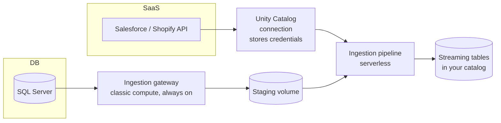

# Lakeflow Connect

Mastery: `INPUT[inlineSelect(option(new), option(learning), option(solid)):mastery]`

> [!story] Context
> [[Lakeflow]] divides data engineering into ingestion, transformation, and orchestration. Ingestion from external systems is the most failure-prone stage: APIs change, enforce rate limits, and time out. [[Fivetran and ELT Tools|Third-party ingestion tools]] were built for this job. Lakeflow Connect provides it inside Databricks.

> [!eli5] Summary
> Lakeflow Connect is a set of ready-made connections to common business applications and databases, such as Salesforce or SQL Server. You sign in once, choose what to copy, and Databricks keeps an up-to-date copy in your own tables without custom code.

> [!analogy]- Analogy: a mail forwarding service
> | Mail forwarding | Lakeflow Connect |
> |---|---|
> | Old addresses | Source applications and databases |
> | Forwarding service that knows each post office | The managed connector |
> | Forwarding only new mail | Incremental ingestion and [[Change Data Capture\|change data capture]] |
> | The new mailbox | [[Streaming Tables\|Streaming tables]] in [[Unity Catalog]] |

## Background

Extracting data from a [[SaaS PaaS and IaaS|SaaS]] application requires handling:

- [[OAuth]] tokens that expire
- API rate limits
- Pagination (fetching results one page at a time)
- Deleted records
- New fields that appear without warning
- Retries when the API is down Databases add another requirement: re-copying a large table every night is slow and costly, so incremental loads need [[Change Data Capture|CDC]].

Teams used to either write these scripts themselves or pay a separate ingestion vendor. Both meant another system to secure and another place where [[Data Lineage|lineage]] stopped. Lakeflow Connect puts the connectors inside Databricks, so the data lands straight in governed tables.

## Overview

Lakeflow Connect is the Databricks component that copies data from external applications, databases, and files into [[Unity Catalog]] tables.

Databricks says managed connectors "extend Lakeflow pipelines functionality to also include source-specific authentication, CDC, edge case handling, long-term API maintenance, automated retries, automated schema evolution" (see [[Schema Enforcement and Evolution]]). Under the hood, each managed connector is an **ingestion pipeline** that writes [[Streaming Tables|streaming tables]].

Lakeflow Connect covers these kinds of connector:

| Kind | Examples | How you use it |
|---|---|---|
| **Managed SaaS connectors** | Salesforce, Workday, ServiceNow, Google Analytics, Shopify | Pick objects in a UI or bundle. Databricks runs and maintains it. |
| **Managed database connectors** | MySQL, PostgreSQL, Microsoft SQL Server, Oracle | CDC (or, for SQL Server, snapshot) from a database, usually through an ingestion gateway |
| **Managed file connectors** | SharePoint, Google Drive, OneDrive | Copy files from an enterprise file service into tables |
| **Query-based connectors** | Databases with a reliable "last updated" column | Incremental pulls by querying the source directly, with no CDC setup |
| **Standard connectors** | [[Auto Loader]] for files, [[Apache Kafka\|Kafka]] and other streams, `read_files` | You write the pipeline code; more control, more work |

### Connector status as of October 2026

Release status changes often. The table reflects each connector's docs page and the Databricks release notes, checked on 2026-10-25. Always check the connector's own page before you depend on it.

| Connector | Type | Status (checked 2026-10-25) |
|---|---|---|
| Salesforce | SaaS | Generally Available (since April 2025) |
| Workday Reports | SaaS | Generally Available (since April 2025); incremental ingestion for reports is in Beta |
| Workday HCM | SaaS | Beta |
| Google Analytics Raw Data | SaaS | Generally Available (since September 2025) |
| Google Analytics Aggregated | SaaS | Beta |
| ServiceNow | SaaS | Generally Available (since August 2025) |
| SharePoint (managed) | Files | Generally Available (since August 2026); structured file ingestion is in Beta |
| Shopify | SaaS | Beta (an admin enables it on the Previews page; OAuth M2M only) |
| Microsoft SQL Server | Database (CDC) | Generally Available (since August 2025) |
| MySQL | Database (CDC) | Public Preview on the connector page; the October 2026 release notes announce the integrated CDC pipeline for MySQL as GA |
| PostgreSQL | Database (CDC) | Public Preview (enroll through your account team) |
| Oracle | Database (CDC) | Beta |
| Query-based connectors | Database (cursor column) | Generally Available (since May 2026) |
| QuickBooks | none | No managed connector in the docs; use file exports plus [[Auto Loader]], or a partner tool |

Databricks' product page advertises "100+" connectors, which counts managed, standard, and partner options together.

## How it works



1. **Connection.** A user with the `CREATE CONNECTION` privilege on the metastore (usually an admin) creates a Unity Catalog **connection** that stores the credentials (OAuth for SaaS, a login for databases). Users who have `USE CONNECTION` (or `ALL PRIVILEGES`) on it can build pipelines from it without seeing the secret.
2. **Ingestion pipeline.** You choose source objects and a destination catalog and schema. For SaaS sources the [[Serverless Compute|serverless]] pipeline calls the API directly.
3. **Gateway (databases only).** For a database source such as SQL Server, an **ingestion gateway** runs continuously on classic compute (compute in your own cloud account; see [[Compute Types]]), reads snapshots and change logs, and stages them in a Unity Catalog [[Volumes|volume]]. Staged data is purged after 30 days. The ingestion pipeline then applies those changes to the destination tables. SQL Server and MySQL also offer an integrated CDC pipeline that runs extraction inside each pipeline update, with no separate gateway.
4. **Schedule.** You run the pipeline from a [[Lakeflow Jobs|job]], for example nightly or every 15 minutes.

You can build all of this in the UI (**Data Ingestion** in the sidebar). For a repeatable setup, define it in a [[Declarative Automation Bundles|bundle]]. A sketch of a Salesforce ingestion pipeline (the connection is created first in Catalog Explorer):

```yaml
resources:
  pipelines:
    salesforce_ingest:
      name: salesforce-ingest
      catalog: raw
      schema: salesforce
      ingestion_definition:
        connection_name: salesforce_prod      # Unity Catalog connection
        objects:
          - table:
              source_schema: objects
              source_table: Account
              destination_catalog: raw
              destination_schema: salesforce
          - table:
              source_schema: objects
              source_table: Opportunity
              destination_catalog: raw
              destination_schema: salesforce
```

Then deploy and run it with the [[Databricks CLI]]:

```bash
databricks bundle deploy -t dev
databricks bundle run salesforce_ingest -t dev
```

Once it has run, the data is ordinary SQL:

```sql
SELECT StageName, COUNT(*) AS deals, SUM(Amount) AS pipeline_value
FROM raw.salesforce.opportunity
WHERE IsClosed = false
GROUP BY StageName;
```

## Small-business considerations

> [!smallbiz] Small-business considerations
> Managed connectors remove the need to write and maintain API extraction code. Guidance:
> - **Use a managed connector when one exists and is GA** for your source. It saves you from maintaining API code forever.
> - **Beta connectors (like Shopify in October 2026) are fine for a pilot**, but expect changes and keep a fallback, such as Shopify's own CSV export into a volume.
> - **Where no connector exists, export files.** For QuickBooks, a scheduled CSV export into a volume plus [[Auto Loader]] is a low-cost option. A partner tool from [[Partner Connect]] is the other option.
> - **For occasional queries against a database**, [[Lakehouse Federation]] reads it in place without copying.
>
> Managed connectors are billed by the serverless compute the ingestion pipeline uses (and, for databases, the gateway's classic compute). See [[How Databricks Pricing Works]].

## Cloud differences

> [!azure]- Azure Databricks
> The connectors and setup are the same. For SQL Server, the gateway runs on classic compute in your workspace's VNet (see [[VNet Injection]]) and needs a network path to the database (Azure SQL, SQL Managed Instance, or SQL Server on a VM): [[Azure Private Link]], VNet peering, VPN, Azure ExpressRoute, or a public endpoint. Teams that already use [[Azure Data Factory with Databricks|Azure Data Factory]] copy activities can keep them; Lakeflow Connect is the in-platform alternative.

> [!aws]- Databricks on AWS
> Same connectors. For SQL Server on RDS or EC2, the gateway runs on classic compute in your workspace's VPC (see [[Customer-Managed VPC on AWS]]) and must reach the database through Private Link, VPC peering, VPN, AWS Direct Connect, or a public endpoint.

> [!gcp]- Databricks on Google Cloud
> The SaaS connector pages exist for GCP. Some connectors and previews arrive on GCP later, so check each connector's GCP page before planning around it. Database gateways need network reach through your [[Customer-Managed VPC on Google Cloud|VPC]].

## Advanced topics

> [!deepdive]- Advanced topics (301–401)
> - **Destination tables are streaming tables.** That is why connectors handle schema evolution and incremental updates: the [[Lakeflow Spark Declarative Pipelines|pipeline engine]] does it. You can read them like any table, but don't write to them yourself.
> - **History tracking.** Many managed connectors, including Salesforce, Google Analytics, and SQL Server, can store the destination as SCD type 1 (latest only) or SCD type 2 (full history). Check the feature availability table on the connector's page. See [[Slowly Changing Dimensions]].
> - **Gateway sizing and cost.** The database gateway runs continuously on classic compute so it captures changes before the source truncates its change logs. You pay for that compute even when the ingestion pipeline is idle, and an undersized gateway can fail the initial snapshot. A query-based connector avoids the gateway when the source has a good cursor column, at the cost of more load on the source. It tracks soft deletes through a `deletion_condition`; hard-delete tracking is in Beta.
> - **Query-based connectors** track changes with a single cursor column, which the docs describe as a monotonically increasing timestamp or integer. If rows can be updated without changing that column, you will miss updates.
> - **Customizable vs managed.** Databricks says standard connectors "offer higher levels of ingestion pipeline customization". If you need unusual filtering or parsing at ingest, a standard connector in your own pipeline may fit better than a managed one.

## Common misconceptions

> [!confusion] Lakeflow Connect is not Lakehouse Federation
> Lakeflow Connect **copies** data into Delta tables on a schedule. [[Lakehouse Federation]] **queries** the source live, without copying. Use Connect for regular reporting, Federation for occasional lookups or migrations.

> [!confusion] Lakeflow Connect is not Partner Connect
> [[Partner Connect]] is a shortcut for setting up third-party tools (Fivetran, dbt Cloud, and others). Lakeflow Connect is Databricks' own connectors.

## Recall

What does a managed connector write into?::Streaming tables in a Unity Catalog catalog and schema, maintained by an ingestion pipeline.
Which Unity Catalog object stores a connector's credentials?::A connection.
Why do database connectors need an ingestion gateway?::To read snapshots and change data continuously from the database and stage them for the ingestion pipeline.
What is a query-based connector?::A connector that pulls database changes by querying a cursor column (a steadily increasing timestamp or ID), with no CDC setup.
What was the Shopify connector's status in October 2026?::Beta, enabled by an admin from the Previews page, OAuth M2M only.
How would a small shop ingest QuickBooks data, given no managed connector?::Export files into a volume and load them with Auto Loader, or use a partner ingestion tool.
Copy or query in place: Lakeflow Connect vs Lakehouse Federation?::Lakeflow Connect copies; Lakehouse Federation queries in place.

## Next steps

> [!path] Learning path
> **Needs first:** [[Lakeflow]], [[Unity Catalog]]
> **Unlocks next:** [[Auto Loader]], [[Change Data Capture]], [[Lakeflow Jobs]]

> [!nextup] Next
> [[Auto Loader]] covers file-based ingestion: detecting new files in cloud storage and loading each one exactly once.

> [!sources]- Sources (last verified: 2026-10-25)
> - [What is Lakeflow Connect? (AWS)](https://docs.databricks.com/aws/en/ingestion/overview)
> - [Lakeflow Connect connector concepts (AWS)](https://docs.databricks.com/aws/en/ingestion/lakeflow-connect/)
> - [Lakeflow Connect connector concepts (Azure)](https://learn.microsoft.com/en-us/azure/databricks/ingestion/lakeflow-connect/)
> - [Managed SaaS connectors (AWS)](https://docs.databricks.com/aws/en/ingestion/lakeflow-connect/saas-overview)
> - [Managed SaaS connectors (Azure)](https://learn.microsoft.com/en-us/azure/databricks/ingestion/lakeflow-connect/saas-overview)
> - [Managed SaaS connectors (GCP)](https://docs.databricks.com/gcp/en/ingestion/lakeflow-connect/saas-overview)
> - [Managed database connectors (GCP)](https://docs.databricks.com/gcp/en/ingestion/lakeflow-connect/cdc-overview)
> - [Managed connector FAQs (Azure)](https://learn.microsoft.com/en-us/azure/databricks/ingestion/lakeflow-connect/faq)
> - [Query-based connectors (AWS)](https://docs.databricks.com/aws/en/ingestion/lakeflow-connect/query-based-overview)
> - [Create a query-based ingestion pipeline (AWS)](https://docs.databricks.com/aws/en/ingestion/lakeflow-connect/query-based-pipeline)
> - [Shopify connector (AWS)](https://docs.databricks.com/aws/en/ingestion/lakeflow-connect/shopify)
> - [File connectors (GCP)](https://docs.databricks.com/gcp/en/ingestion/lakeflow-connect/file-connectors-overview)
> - [Ingest files from SharePoint (Azure)](https://learn.microsoft.com/en-us/azure/databricks/ingestion/sharepoint)
> - [Databricks platform release notes (GCP)](https://docs.databricks.com/gcp/en/release-notes/product/)
> - [Lakeflow Connect product page](https://www.databricks.com/product/data-engineering/lakeflow-connect)
> - [Managed database connectors (AWS)](https://docs.databricks.com/aws/en/ingestion/lakeflow-connect/cdc-overview)
> - [File connectors (AWS)](https://docs.databricks.com/aws/en/ingestion/lakeflow-connect/file-connectors-overview)
> - [Ingest data from Salesforce (AWS)](https://docs.databricks.com/aws/en/ingestion/lakeflow-connect/salesforce-pipeline)
> - [Salesforce ingestion connector (AWS)](https://docs.databricks.com/aws/en/ingestion/lakeflow-connect/salesforce-concepts)
> - [Microsoft SQL Server ingestion connector (AWS)](https://docs.databricks.com/aws/en/ingestion/lakeflow-connect/sql-server-overview)
> - [Configure MySQL for ingestion (AWS)](https://docs.databricks.com/aws/en/ingestion/lakeflow-connect/mysql-source-setup)
> - [Configure PostgreSQL for ingestion (AWS)](https://docs.databricks.com/aws/en/ingestion/lakeflow-connect/postgresql-source-setup)
> - [Oracle integrated CDC connector (AWS)](https://docs.databricks.com/aws/en/ingestion/lakeflow-connect/oracle-integrated-overview)
> - [Workday HCM connector (AWS)](https://docs.databricks.com/aws/en/ingestion/lakeflow-connect/workday-hcm-overview)
> - [Google Analytics Aggregated connector (AWS)](https://docs.databricks.com/aws/en/ingestion/lakeflow-connect/google-analytics-aggregated)
> - [Monitor managed ingestion pipeline cost (AWS)](https://docs.databricks.com/aws/en/ingestion/lakeflow-connect/monitor-costs)
> - Release notes (AWS) for connector status changes: [April 2025](https://docs.databricks.com/aws/en/release-notes/product/2025/april), [August 2025](https://docs.databricks.com/aws/en/release-notes/product/2025/august), [September 2025](https://docs.databricks.com/aws/en/release-notes/product/2025/september), [December 2025](https://docs.databricks.com/aws/en/release-notes/product/2025/december), [March 2026](https://docs.databricks.com/aws/en/release-notes/product/2026/march), [May 2026](https://docs.databricks.com/aws/en/release-notes/product/2026/may), [June 2026](https://docs.databricks.com/aws/en/release-notes/product/2026/june), [August 2026](https://docs.databricks.com/aws/en/release-notes/product/2026/august), [September 2026](https://docs.databricks.com/aws/en/release-notes/product/2026/september), [October 2026](https://docs.databricks.com/aws/en/release-notes/product/2026/october)
