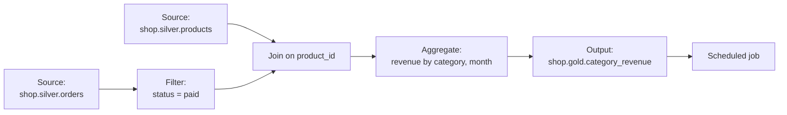

# Lakeflow Designer

Mastery: `INPUT[inlineSelect(option(new), option(learning), option(solid)):mastery]`

> [!story] Context
> [[Tasks Triggers and Schedules]] completed the code-first toolset for building and scheduling pipelines. Lakeflow Designer provides the same outcome for users who do not write SQL or Python.

> [!eli5] Summary
> Lakeflow Designer is a visual canvas for preparing data. You connect boxes that load, clean, join, and summarize tables, and you can describe a step in plain words for the AI assistant to build. Every canvas is backed by generated code, so it can be versioned in Git and run on a schedule as a job.

> [!analogy]- Analogy: a flowchart that runs
> | Flowchart | Lakeflow Designer |
> |---|---|
> | Boxes | Operators (source, filter, join, aggregate, output) |
> | Arrows | The flow of data between operators |
> | Preview of each step | Data preview at every operator, without running the whole workflow |
> | Printing the flowchart on a timer | Scheduling the result as a [[Lakeflow Jobs\|job]] |

## Background

Many business analysts prepare data in [[Spreadsheets|spreadsheets]] or in desktop data-prep tools. Those workflows are hard to schedule, version, and govern, and they often copy data out of the platform. Code-based pipelines solve those problems but exclude people who do not write code.

Databricks announced Lakeflow Designer at the Data + AI Summit in June 2025 as a no-code [[ETL vs ELT|ETL]] builder for analysts, released it to Public Preview (April 2026 blog post), and made it generally available on June 16, 2026.

## Overview

Lakeflow Designer is a visual, no-code data preparation canvas in the Databricks workspace. Key properties:

| Property | Detail |
|---|---|
| Status | Generally Available since June 16, 2026 (AWS and Azure release notes). Earlier stages: Private Preview (2025) and Public Preview (April 2026). Workspaces with the compliance security profile were listed as coming soon at GA. |
| Entry point | **New > Visual data prep** in the workspace sidebar |
| Output | A visual data prep file, stored as a notebook named `<name>.designer.ipynb` and backed by generated code. Its Output operators write to a Unity Catalog table, a materialized view, or a file in a volume |
| Previews | Each operator is previewed on a sample of rows, without running the whole visual data prep |
| Version control | Place the file in a [[Git Folders and Workspace Files\|Git folder]] and track it like any other notebook in [[Git]] |
| Scheduling | Schedule the file directly, or add it to a [[Lakeflow Jobs\|job]] as a **Visual data prep** task |
| AI assistance | [[Genie Code]] adds or changes operators from a natural-language description |
| Governance | Workflows read and write data governed by [[Unity Catalog]] |

The October 2026 roundup lists new operators for data cleaning, deduplication, quality checks, more flexible joins, and parameterized inputs and outputs. It lists [[Databricks Apps]] integration, data profiling on full outputs, a Custom Report operator, and migration tooling with [[Lakebridge]] as upcoming.

## How it works



To build a visual data prep in Designer:

1. Click **New** in the sidebar and select **Visual data prep**.
2. Add a source operator and select a Unity Catalog table.
3. Add operators (filter, join, aggregate, and others) and connect them. Check the preview at each step.
4. Add an Output operator that writes to a target table.
5. Move the file into a Git folder if your team uses version control.
6. Click **Schedule** to run it as a job.

The canvas above computes the same result as this SQL, which an engineer could instead write by hand as a materialized view in a [[Lakeflow Spark Declarative Pipelines|pipeline]]:

```sql
CREATE OR REFRESH MATERIALIZED VIEW shop.gold.category_revenue AS
SELECT p.category,
       DATE_TRUNC('MONTH', o.ordered_at) AS month,
       SUM(o.total)                      AS revenue
FROM shop.silver.orders o
JOIN shop.silver.products p ON p.product_id = o.product_id
WHERE o.financial_status = 'paid'
GROUP BY p.category, DATE_TRUNC('MONTH', o.ordered_at);
```

## Small-business considerations

> [!smallbiz] Small-business considerations
> Designer suits an owner, bookkeeper, or operations lead who builds monthly reports in spreadsheets today. A typical split:
> - The data person ingests sources (Shopify, QuickBooks exports) into clean silver tables (see [[Medallion Architecture]]).
> - Business users build gold tables and reports in Designer on top of silver.
>
> Restrict Designer users to write access on a `gold` or `sandbox` schema only, so they cannot modify silver tables. Designer runs are billed for the compute they use, like other notebooks and jobs. See [[How Databricks Pricing Works]].

## Cloud differences

> [!aws]- Databricks on AWS
> Documentation for Designer is published for AWS, Azure, and Google Cloud, and the GA entry appears in both the AWS and Azure release notes. No cloud-specific behavior is documented.

> [!gcp]- Databricks on Google Cloud
> A Google Cloud documentation page exists for Designer. No GCP-specific behavior is documented.

## Advanced topics

> [!deepdive]- Advanced topics (301–401)
> - **Code underneath.** Every visual data prep is backed by generated code in a `.designer.ipynb` notebook, so engineers can review it in Git and deploy it with [[Declarative Automation Bundles]] as a `notebook_task` (see [[CI-CD for Data Pipelines]]). If the generated code is changed outside the editor, Designer locks that operator until you choose **Regenerate code**.
> - **Migration.** The roadmap entry for [[Lakebridge]] integration targets moving workflows from legacy visual ETL tools into Designer. See [[Migrating ETL Tools]].
> - **Review AI-generated steps.** Natural-language steps produce real transformations. Check the preview and row counts at each operator before scheduling.

## Common misconceptions

> [!confusion] Designer is not a separate engine
> Designer generates ordinary code that runs on Databricks compute as a notebook or job task, under Unity Catalog governance. Scheduled runs appear in the Jobs task graph like any other job.

> [!confusion] Designer is not a BI tool
> Designer prepares and writes tables. Charts and dashboards are built in [[AI-BI Dashboards]] or another [[BI Tools|BI tool]].

## Recall

What is Lakeflow Designer?::A visual, no-code data preparation canvas backed by generated code, with AI assistance from Genie Code.
Where do you start a Designer workflow in the workspace?::**New > Visual data prep** in the sidebar.
How is a visual data prep stored?::As a notebook file named `<name>.designer.ipynb`, backed by generated code.
When did Lakeflow Designer become generally available?::June 16, 2026.
Can you preview intermediate steps in Designer?::Yes. Each operator is previewed on a sample of rows without running the whole workflow.

## Next steps

> [!path] Learning path
> **Needs first:** [[Lakeflow]], [[Catalogs Schemas and Tables]]
> **Unlocks next:** [[Lakeflow Jobs]], [[Lakeflow Spark Declarative Pipelines]]

> [!nextup] Next
> [[Structured Streaming on Databricks]] covers low-latency processing for sources such as Kafka, including checkpoints and real-time mode.

> [!sources]- Sources (last verified: 2026-10-25)
> - [What is Lakeflow Designer? (AWS)](https://docs.databricks.com/aws/en/designer/what-is-lakeflow-designer)
> - [What is Lakeflow Designer? (GCP)](https://docs.databricks.com/gcp/en/designer/what-is-lakeflow-designer)
> - [What's New in Lakeflow Designer - October 2026 Roundup (Databricks blog)](https://www.databricks.com/blog/whats-new-lakeflow-designer-october-2026-roundup)
> - [Announcing the Public Preview of Lakeflow Designer (Databricks blog)](https://www.databricks.com/blog/announcing-public-preview-lakeflow-designer)
> - [Announcing Lakeflow Designer: No-Code ETL (Databricks blog)](https://www.databricks.com/blog/announcing-lakeflow-designer-no-code-etl)
> - [Databricks Unveils Lakeflow Designer (press release)](https://www.databricks.com/company/newsroom/press-releases/databricks-unveils-lakeflow-designer-data-analysts-build-reliable)
> - [Announcing the General Availability of Databricks Lakeflow (Databricks blog)](https://www.databricks.com/blog/announcing-general-availability-databricks-lakeflow)
> - [What is Lakeflow Designer? (Azure)](https://learn.microsoft.com/en-us/azure/databricks/designer/what-is-lakeflow-designer)
> - [Databricks platform release notes, June 2026 (AWS)](https://docs.databricks.com/aws/en/release-notes/product/2026/june)
> - [Azure Databricks platform release notes, June 2026 (Azure)](https://learn.microsoft.com/en-us/azure/databricks/release-notes/product/2026/june)
> - [Built-in operators in Lakeflow Designer (AWS)](https://docs.databricks.com/aws/en/designer/built-in-operators)
> - [Tutorial: Build a visual data prep (AWS)](https://docs.databricks.com/aws/en/designer/build-transformation)
> - [Move a visual data prep file to production (AWS)](https://docs.databricks.com/aws/en/designer/production)
