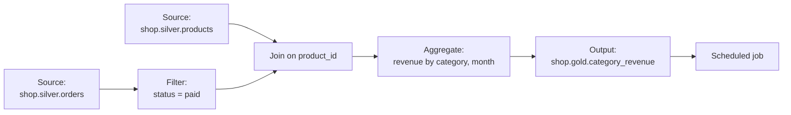

# Lakeflow Designer

Mastery: `INPUT[inlineSelect(option(new), option(learning), option(solid)):mastery]`

> [!story] Context
> [[Tasks Triggers and Schedules]] completed the code-first toolset for building and scheduling pipelines. Lakeflow Designer provides the same outcome for users who do not write SQL or Python.

> [!eli5] Summary
> Lakeflow Designer is a visual canvas for preparing data. You connect boxes that load, clean, join, and summarize tables, and you can describe a step in plain words for the AI assistant to build. The result is a real pipeline that can run on a schedule.

> [!analogy]- Analogy: a flowchart that runs
> | Flowchart | Lakeflow Designer |
> |---|---|
> | Boxes | Operators (source, filter, join, aggregate, output) |
> | Arrows | The flow of data between operators |
> | Preview of each step | Data preview at every operator, without running the whole pipeline |
> | Printing the flowchart on a timer | Scheduling the result as a [[Lakeflow Jobs\|job]] |

## Background

Many business analysts prepare data in [[Spreadsheets|spreadsheets]] or in desktop data-prep tools. Those workflows are hard to schedule, version, and govern, and they often copy data out of the platform. Code-based pipelines solve those problems but exclude people who do not write code.

Databricks announced Lakeflow Designer at the Data + AI Summit in June 2025 as a no-code ETL builder for analysts, then released it to Public Preview (April 2026 blog post).

## Overview

Lakeflow Designer is a visual, no-code data preparation canvas in the Databricks workspace. Key properties:

| Property | Detail |
|---|---|
| Status | Generally Available in all workspaces per the Databricks October 2026 roundup and the June 2026 Data + AI Summit announcement. Earlier sources describe Private Preview (2025) and Public Preview (April 2026). The exact GA date is not confirmed. |
| Entry point | **+ New > Visual data prep** in the workspace |
| Output | A Lakeflow pipeline, so the result has the same lineage, governance, and monitoring as a code pipeline |
| Previews | Each intermediate step can be previewed without running the entire pipeline |
| Version control | Designer work can be stored in Git |
| Scheduling | Results can be scheduled as a [[Lakeflow Jobs\|job]] |
| AI assistance | Steps can be described in natural language and generated by the assistant |
| Governance | Reads and writes [[Unity Catalog]] tables with the user's permissions |

The October 2026 roundup lists new operators for data cleaning, deduplication, quality checks, more flexible joins, and parameterized inputs and outputs. It lists [[Databricks Apps]] integration, data profiling on full outputs, a Custom Report operator, and migration tooling with [[Lakebridge]] as upcoming.

## How it works



To build a pipeline in Designer:

1. Click **+ New** in the top left of the workspace and select **Visual data prep**.
2. Add a source operator and select a Unity Catalog table.
3. Add operators (filter, join, aggregate, and others) and connect them. Check the preview at each step.
4. Add an output operator that writes to a target table.
5. Save the work to a Git-backed folder if your team uses version control.
6. Schedule it as a job.

The canvas above produces a pipeline equivalent to this SQL. Writing it by hand in a [[Lakeflow Spark Declarative Pipelines|pipeline]] gives the same result:

```sql
CREATE OR REFRESH MATERIALIZED VIEW shop.gold.category_revenue AS
SELECT p.category,
       DATE_TRUNC('MONTH', o.ordered_at) AS month,
       SUM(o.total)                      AS revenue
FROM shop.silver.orders o
JOIN shop.silver.products p ON p.product_id = o.product_id
WHERE o.financial_status = 'paid'
GROUP BY p.category, DATE_TRUNC('MONTH', o.ordered_at);
```

## Small-business considerations

> [!smallbiz] Small-business considerations
> Designer suits an owner, bookkeeper, or operations lead who builds monthly reports in spreadsheets today. A typical split:
> - The data person ingests sources (Shopify, QuickBooks exports) into clean silver tables.
> - Business users build gold tables and reports in Designer on top of silver.
>
> Restrict Designer users to write access on a `gold` or `sandbox` schema only, so they cannot modify silver tables. Designer pipelines are billed by the compute they run on, like other pipelines. See [[How Databricks Pricing Works]].

## Cloud differences

> [!aws]- Databricks on AWS
> Documentation for Designer is published for AWS and Google Cloud. No cloud-specific behavior is documented. Azure availability was not confirmed in this review; check the Azure Databricks release notes for your region.

> [!gcp]- Databricks on Google Cloud
> A Google Cloud documentation page exists for Designer. No GCP-specific behavior is documented.

## Advanced topics

> [!deepdive]- Advanced topics (301–401)
> - **Code underneath.** Because Designer output is a Lakeflow pipeline, engineers can inspect, test, and review it with the same tools as code pipelines (see [[Testing Data Pipelines]] and [[CI-CD for Data Pipelines]]).
> - **Migration.** The roadmap entry for [[Lakebridge]] integration targets moving workflows from legacy visual ETL tools into Designer. See [[Migrating ETL Tools]].
> - **Review AI-generated steps.** Natural-language steps produce real transformations. Check the preview and row counts at each operator before scheduling.

## Common misconceptions

> [!confusion] Designer is not a separate engine
> Designer builds Lakeflow pipelines. The runtime, governance, and monitoring are the same as for SQL or Python pipelines.

> [!confusion] Designer is not a BI tool
> Designer prepares and writes tables. Charts and dashboards are built in [[AI-BI Dashboards]] or another [[BI Tools|BI tool]].

## Recall

What is Lakeflow Designer?::A visual, no-code data preparation canvas that builds Lakeflow pipelines, with AI assistance.
Where do you start a Designer pipeline in the workspace?::**+ New > Visual data prep**.
What does a Designer pipeline produce under the hood?::A Lakeflow pipeline, governed by Unity Catalog.
What was Designer's status in October 2026?::Generally Available, per Databricks' October 2026 roundup (exact GA date unconfirmed).
Can you preview intermediate steps in Designer?::Yes. Each step can be previewed without running the whole pipeline.

## Next steps

> [!path] Learning path
> **Needs first:** [[Lakeflow]], [[Catalogs Schemas and Tables]]
> **Unlocks next:** [[Lakeflow Jobs]], [[Lakeflow Spark Declarative Pipelines]]

> [!nextup] Next
> [[Structured Streaming on Databricks]] covers low-latency processing for sources such as Kafka, including checkpoints and real-time mode.

> [!sources]- Sources (last verified: 2026-10-25)
> - [What is Lakeflow Designer? (AWS)](https://docs.databricks.com/aws/en/designer/what-is-lakeflow-designer)
> - [What is Lakeflow Designer? (GCP)](https://docs.databricks.com/gcp/en/designer/what-is-lakeflow-designer)
> - [What's New in Lakeflow Designer - October 2026 Roundup (Databricks blog)](https://www.databricks.com/blog/whats-new-lakeflow-designer-october-2026-roundup)
> - [Announcing the Public Preview of Lakeflow Designer (Databricks blog)](https://www.databricks.com/blog/announcing-public-preview-lakeflow-designer)
> - [Announcing Lakeflow Designer: No-Code ETL (Databricks blog)](https://www.databricks.com/blog/announcing-lakeflow-designer-no-code-etl)
> - [Databricks Unveils Lakeflow Designer (press release)](https://www.databricks.com/company/newsroom/press-releases/databricks-unveils-lakeflow-designer-data-analysts-build-reliable)
> - [Announcing the General Availability of Databricks Lakeflow (Databricks blog)](https://www.databricks.com/blog/announcing-general-availability-databricks-lakeflow)
> - **Unconfirmed:** the search budget ran out before these details could be re-checked: the exact GA date, Azure availability, and the operator names in the diagram (illustrative).
