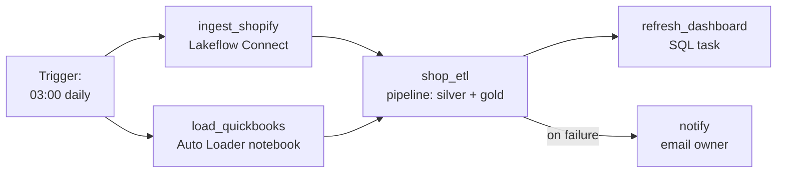

# Lakeflow Jobs

Mastery: `INPUT[inlineSelect(option(new), option(learning), option(solid)):mastery]`

> [!story] Context
> The previous notes, through [[Slowly Changing Dimensions]], produced connectors, pipelines, notebooks, and SQL queries. Each one must run regularly, in the correct order, with retries and failure notifications. Lakeflow Jobs provides that orchestration inside Databricks.

> [!eli5] Summary
> Lakeflow Jobs is the scheduler for data work. You list the steps, specify which steps wait for others, and choose when the job runs. It runs the steps, retries temporary failures, and sends a notification when a run fails.

> [!renamed] Renamed
> Lakeflow Jobs was called **Databricks Workflows**, and before that **Databricks Jobs**. The rename took effect on June 11, 2025, when Lakeflow became generally available at the Data + AI Summit. The release note for that date reads "Databricks Jobs is now Lakeflow Jobs", and the GA announcement describes it as evolving Workflows into Lakeflow Jobs. No migration is required. The jobs [[System Tables|system tables]] show the same history: the `lakeflow` schema was previously called `workflow`, and both hold identical content. In the workspace UI, jobs live under **Jobs & Pipelines**.

> [!analogy]- Analogy: a stage manager
> | Theater | Lakeflow Jobs |
> |---|---|
> | Script of scenes | A job and its tasks |
> | Cues between scenes | Task dependencies |
> | Curtain time | The schedule or trigger |
> | Repeating a missed cue | A retry |
> | Show report | Run history |

## Background

Before a built-in [[Orchestration|orchestrator]], teams scheduled Databricks work from outside: cron (the standard Unix scheduler) on a server, [[Apache Airflow]], or [[Azure Data Factory with Databricks|Azure Data Factory]]. That works, but you run and secure another system, credentials have to be shared with it, and the orchestrator can't see inside Databricks (which table a task wrote, what compute it used).

Lakeflow Jobs puts orchestration in the platform. It knows about notebooks, pipelines, connectors, [[SQL Warehouses|SQL warehouses]], and Unity Catalog tables, so it can, for example, start a job when a table changes.

## Overview

Lakeflow Jobs is the Databricks orchestrator: it runs notebooks, pipelines, SQL queries, and other work in a set order, on a schedule or trigger, with retries and notifications.

A **job** is a set of **tasks** with dependencies between them, which forms a [[DAG]]. The docs describe a job as consisting of one or more tasks that run notebooks, pipelines, managed connectors, SQL queries, machine learning training, and model deployment and inference.

The main pieces:

| Piece | What it is | More in |
|---|---|---|
| **Task** | One unit of work: notebook, pipeline, SQL, dbt, Python script or wheel (packaged Python code), JAR (packaged Java or Scala code), another job, and more | [[Tasks Triggers and Schedules]] |
| **Dependencies** | "Run B after A", plus conditions such as "run if any failed" | [[Tasks Triggers and Schedules]] |
| **Control flow** | If/else condition tasks and for-each loops | [[Tasks Triggers and Schedules]] |
| **Trigger** | Schedule (cron), file arrival, table update, or continuous | [[Tasks Triggers and Schedules]] |
| **Compute** | [[Serverless Compute\|Serverless]], [[Jobs Compute\|job clusters]], or SQL warehouses for SQL tasks | [[Compute Types]] |
| **Parameters** | Job-level values passed to tasks, plus task values passed between tasks | |
| **Notifications** | Email or [[Webhook\|webhooks]] on start, success, failure, or long runs | |
| **Run as** | The identity the job runs with, ideally a service principal | [[Users Groups and Service Principals]] |

Lakeflow Jobs is procedural: you say what runs in which order. [[Lakeflow Spark Declarative Pipelines|Pipelines]] are declarative. A typical job runs one or more pipelines as tasks, plus anything a pipeline can't do (send a report, call an API, train a model).

## How it works

The nightly job for the example Shopify and QuickBooks shop:



Define it in YAML in a [[Declarative Automation Bundles|bundle]] (the UI builds the same thing):

```yaml
resources:
  jobs:
    nightly_shop_refresh:
      name: nightly-shop-refresh
      schedule:
        quartz_cron_expression: "0 0 3 * * ?"
        timezone_id: America/Chicago
      email_notifications:
        on_failure: [owner@example.com]
      max_concurrent_runs: 1
      tasks:
        - task_key: ingest_shopify
          pipeline_task:
            pipeline_id: ${resources.pipelines.shopify_ingest.id}

        - task_key: load_quickbooks
          notebook_task:
            notebook_path: ../src/load_quickbooks.py
          max_retries: 2
          min_retry_interval_millis: 300000     # wait 5 minutes between tries

        - task_key: shop_etl
          depends_on:
            - task_key: ingest_shopify
            - task_key: load_quickbooks
          pipeline_task:
            pipeline_id: ${resources.pipelines.shop_etl.id}

        - task_key: refresh_dashboard
          depends_on: [{ task_key: shop_etl }]
          sql_task:
            warehouse_id: ${var.warehouse_id}
            file:
              path: ../src/sql/post_refresh_checks.sql
```

Deploy and run it with the [[Databricks CLI]]:

```bash
databricks bundle deploy -t prod
databricks bundle run nightly_shop_refresh -t prod     # run now, outside the schedule
```

Without bundles, the Jobs API and CLI work directly, for example `databricks jobs list` and `databricks jobs run-now <job-id>`.

### Watching runs

Each run shows a graph of tasks, their status, duration, and output. The same data is in system tables, so you can query failures across all jobs:

```sql
SELECT job_id, run_id, result_state, period_start_time, period_end_time
FROM system.lakeflow.job_run_timeline
WHERE result_state = 'FAILED'
  AND period_start_time > current_timestamp() - INTERVAL 7 DAYS;
```

### Lakeflow Jobs vs Airflow

| | Lakeflow Jobs | [[Apache Airflow]] |
|---|---|---|
| Where it runs | Inside Databricks, nothing to host | Your own servers or a managed service |
| Defined in | UI, YAML bundles, API, Python SDK | Python DAG files |
| Knows about Databricks objects | Yes (tables, pipelines, warehouses) | Through operators that call the API |
| Orchestrates other systems | Some (API calls from notebooks, webhooks) | Hundreds of providers |
| Best when | Most work happens in Databricks | Many systems outside Databricks need coordinating |

Many companies use both: Airflow or Azure Data Factory (ADF) at the top for cross-system steps, and Lakeflow Jobs inside Databricks.

## Small-business considerations

> [!smallbiz] Small-business considerations
> A small business usually needs one nightly job. Recommended setup:
> - One job per business process (for example "nightly sales refresh").
> - A failure email to a shared inbox.
> - Two retries on anything that talks to the outside world.
> - Serverless compute, so there are no clusters to size.
> - Run as a service principal rather than your own login, so the job keeps working if you leave.
>
> The job itself costs nothing extra; you pay for the compute its tasks use (see [[How Databricks Pricing Works]]).

## Cloud differences

> [!azure]- Azure Databricks
> Lakeflow Jobs is the same. Azure-heavy teams often have [[Azure Data Factory with Databricks|Azure Data Factory]] pipelines that call Databricks jobs. That still works; a common move is to let ADF trigger one Databricks job and let Lakeflow Jobs handle the steps inside Databricks.

> [!aws]- Databricks on AWS
> Same features. Teams on Amazon Managed Workflows for Apache Airflow (MWAA) can keep it for cross-service steps and trigger Databricks jobs with the Databricks provider's `DatabricksRunNowOperator`, which calls the Jobs `run-now` API.

> [!gcp]- Databricks on Google Cloud
> Same features. Google's managed Airflow service (Cloud Composer, now named Managed Service for Apache Airflow) can trigger Databricks jobs with the same Databricks provider operators.

## Advanced topics

> [!deepdive]- Advanced topics (301–401)
> - **Pipeline tasks.** A pipeline task runs a pipeline update and succeeds or fails with it. Use it rather than scheduling the pipeline on its own, so ingestion, transformation, and reporting share one run history.
> - **Disabled tasks.** You can disable a task to skip it without deleting it. The docs warn that an If/else condition task fails if the upstream task that supplies its condition value is disabled.
> - **Concurrency.** `max_concurrent_runs` defaults to 1, which stops a slow run overlapping the next scheduled one. Without queueing, Databricks skips a run that would exceed the limit. With queueing enabled (`queue: {enabled: true}`, the default for jobs created in the UI since April 15, 2024), the run waits in a queue for up to 48 hours instead.
> - **Run as a service principal** in production, and give it only the grants it needs. Jobs owned by a person who leaves the company break.
> - **Observability.** The `system.lakeflow` tables (`jobs`, `job_tasks`, `job_run_timeline`, `job_task_run_timeline`) let you build reliability and cost dashboards across every job in the account.

## Common misconceptions

> [!confusion] A job is not a pipeline
> A [[Lakeflow Spark Declarative Pipelines|pipeline]] builds tables from declarations. A job runs tasks on a schedule, and one task can be "run this pipeline". Pipelines can also be scheduled alone, but a job gives you dependencies, notifications, and other task types.

> [!confusion] "Workflows" in old docs and blog posts means Lakeflow Jobs
> Same product, older name. The bundle and API resource is still called `jobs`.

## Recall

What was Lakeflow Jobs called before?::Databricks Workflows (and earlier, Databricks Jobs).
What is a job made of?::One or more tasks with dependencies between them, plus triggers, compute, parameters, and notifications.
Procedural or declarative: Lakeflow Jobs?::Procedural. You define the order of tasks.
Which system table schema holds job run history?::`system.lakeflow` (previously `system.workflow`).
Why run production jobs as a service principal?::So they don't depend on a person's account, and get only the permissions they need.
What setting stops a job's runs from overlapping?::`max_concurrent_runs: 1` (the default for new jobs).
When might you keep Airflow alongside Lakeflow Jobs?::When you must coordinate many systems outside Databricks.

## Next steps

> [!path] Learning path
> **Needs first:** [[Lakeflow]], [[Notebooks]], [[Compute Types]]
> **Unlocks next:** [[Tasks Triggers and Schedules]], [[CI-CD for Data Pipelines]]

> [!nextup] Next
> [[Tasks Triggers and Schedules]] covers task types, Run if conditions, If/else and for-each control flow, and the four trigger types.

> [!sources]- Sources (last verified: 2026-10-25)
> - [Lakeflow Jobs (AWS)](https://docs.databricks.com/aws/en/jobs/)
> - [Lakeflow Jobs (Azure)](https://learn.microsoft.com/en-us/azure/databricks/jobs/)
> - [Configure and edit tasks in Lakeflow Jobs (AWS)](https://docs.databricks.com/aws/en/jobs/configure-task)
> - [Control the flow of tasks within Lakeflow Jobs (AWS)](https://docs.databricks.com/aws/en/jobs/control-flow)
> - [Disabled tasks in Lakeflow Jobs (AWS)](https://docs.databricks.com/aws/en/jobs/disabled-tasks)
> - [Pipeline task for jobs (AWS)](https://docs.databricks.com/aws/en/jobs/tasks/pipeline)
> - [Add tasks to jobs in Declarative Automation Bundles (AWS)](https://docs.databricks.com/aws/en/dev-tools/bundles/job-task-types)
> - [Jobs system table reference (AWS)](https://docs.databricks.com/aws/en/admin/system-tables/jobs)
> - [Jobs system table reference (Azure)](https://learn.microsoft.com/en-us/azure/databricks/admin/system-tables/jobs)
> - [Automate jobs with schedules and triggers (AWS)](https://docs.databricks.com/aws/en/jobs/triggers)
> - [Data engineering with Databricks (AWS)](https://docs.databricks.com/aws/en/data-engineering/)
> - [Databricks platform release notes, June 2025 (AWS)](https://docs.databricks.com/aws/en/release-notes/product/2025/june)
> - [Announcing the General Availability of Databricks Lakeflow (Databricks blog, June 12, 2025)](https://www.databricks.com/blog/announcing-general-availability-databricks-lakeflow)
> - [Declarative Automation Bundles resources (AWS)](https://docs.databricks.com/aws/en/dev-tools/bundles/resources)
> - [Jobs API: Create a new job](https://docs.databricks.com/api/workspace/jobs/create)
> - [Configure and edit Lakeflow Jobs (AWS)](https://docs.databricks.com/aws/en/jobs/advanced)
> - [Orchestrate Lakeflow Jobs with Apache Airflow (AWS)](https://docs.databricks.com/aws/en/jobs/how-to/use-airflow-with-jobs)
> - [What is Amazon MWAA? (AWS docs)](https://docs.aws.amazon.com/mwaa/latest/userguide/what-is-mwaa.html)
> - [Managed Airflow overview (Google Cloud docs)](https://cloud.google.com/composer/docs/composer-3/composer-overview)
