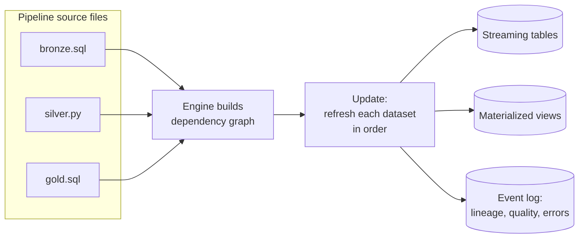

# Lakeflow Spark Declarative Pipelines

Mastery: `INPUT[inlineSelect(option(new), option(learning), option(solid)):mastery]`

> [!story] Context
> [[Auto Loader]] and [[COPY INTO]] load raw files into bronze tables. A [[Medallion Architecture|medallion]] build has many more tables, each derived from others. Hand-written scripts for this must run in order, track processed data, retry failures, and avoid partial writes. Declarative pipelines move that work into the engine.

> [!eli5] Summary
> Instead of writing step-by-step instructions, you describe what each table should contain. Databricks works out which tables depend on which, builds them in the right order, keeps them up to date, and reports problems.

> [!renamed] Renamed
> - **Delta Live Tables (DLT)**, the original name (2021 to mid-2025).
> - **Lakeflow Declarative Pipelines**, from June 2025.
> - **Lakeflow Spark Declarative Pipelines**, from November 2025. The docs also use the short form **Lakeflow pipelines**.
> - The open-source core is **Apache Spark Declarative Pipelines (SDP)**, part of Apache Spark from version 4.1.
> - In Python, `import dlt` became `from pyspark import pipelines as dp`. Old DLT code keeps working with no migration.

> [!analogy]- Analogy: a recipe book
> | Kitchen | Declarative pipelines |
> |---|---|
> | A to-do list of steps | A procedural script |
> | A recipe book listing what each dish is made of | Dataset definitions |
> | Kitchen manager who orders the work and remakes only what ran out | The pipeline engine and incremental refresh |
> | Kitchen log | The pipeline event log |

## Background

Hand-written Spark ETL has the same problems every time:

- **Ordering.** You must keep a [[DAG]] of dependencies in your head or in an orchestrator.
- **Incremental processing.** You must track checkpoints and watermarks so you only process new data.
- **Failures.** A crash halfway can leave tables inconsistent, and retries must not double-load.
- **Quality.** Checks are bolted on after the fact, if at all.
- **Infrastructure.** Someone has to size clusters and turn them off.

DLT was Databricks' answer in 2021: declare datasets, and let the engine handle the rest. In 2025 Databricks contributed the core framework to Apache Spark, and the Databricks product took its current name.

## Overview

A **pipeline** is the unit of development and execution. Its source files (SQL or Python) declare **datasets** and the **flows** that fill them:

| Dataset | What it is | Typical layer | Note |
|---|---|---|---|
| **Streaming table** | A Delta table that processes each new input row once (append or CDC) | Bronze, silver | [[Streaming Tables]] |
| **Materialized view** | A Delta table holding a query's result, refreshed incrementally when possible | Silver, gold | [[Materialized Views]] |
| **Temporary view** | A named query used inside the pipeline only, not published | Intermediate steps | |
| **Sink** | An external target such as Kafka or an external Delta table (GA as of May 2026) | Outputs | |

Around those datasets the pipeline adds:

- **Automatic dependency graph** from the queries themselves.
- **[[Expectations and Data Quality|Expectations]]** for data quality.
- **AUTO CDC** flows for [[Change Data Capture]] and [[Slowly Changing Dimensions]].
- **An event log** with lineage, row counts, quality metrics, and errors.
- **Managed compute**, serverless by default for new pipelines, or classic clusters.

## How it works



A run of a pipeline is called an **update**. Each update either refreshes everything that has new input (incrementally) or, on request, does a **full refresh** that rebuilds from scratch.

Pipelines run in **triggered** mode (process what is available, then stop; the usual choice, run from a [[Lakeflow Jobs|job]]) or **continuous** mode (always on, for low latency).

### SQL version of the shop pipeline

```sql
-- bronze: Shopify orders exported as JSON into a volume
CREATE OR REFRESH STREAMING TABLE orders_raw
COMMENT 'Raw Shopify order files, loaded once each'
AS SELECT *, _metadata.file_path AS source_file
FROM STREAM read_files('/Volumes/shop/bronze/landing/shopify/orders/', format => 'json');

-- silver: typed and checked
CREATE OR REFRESH STREAMING TABLE orders_clean (
  CONSTRAINT valid_id    EXPECT (order_id IS NOT NULL) ON VIOLATION DROP ROW,
  CONSTRAINT valid_total EXPECT (total >= 0)
) AS SELECT
  CAST(id AS BIGINT)                  AS order_id,
  CAST(created_at AS TIMESTAMP)       AS ordered_at,
  CAST(total_price AS DECIMAL(12,2))  AS total,
  customer.id                         AS customer_id,
  financial_status
FROM STREAM(orders_raw);

-- gold: recomputed incrementally when possible
CREATE OR REFRESH MATERIALIZED VIEW daily_sales AS
SELECT DATE(ordered_at) AS day, COUNT(*) AS orders, SUM(total) AS revenue
FROM orders_clean
WHERE financial_status = 'paid'
GROUP BY DATE(ordered_at);
```

### The same pipeline in Python

```python
from pyspark import pipelines as dp
from pyspark.sql import functions as F

@dp.table(comment="Raw Shopify order files, loaded once each")
def orders_raw():
    return (spark.readStream.format("cloudFiles")
            .option("cloudFiles.format", "json")
            .load("/Volumes/shop/bronze/landing/shopify/orders/")
            .withColumn("source_file", F.col("_metadata.file_path")))

@dp.table
@dp.expect_or_drop("valid_id", "order_id IS NOT NULL")
@dp.expect("valid_total", "total >= 0")
def orders_clean():
    return (spark.readStream.table("orders_raw")
            .select(F.col("id").cast("bigint").alias("order_id"),
                    F.col("created_at").cast("timestamp").alias("ordered_at"),
                    F.col("total_price").cast("decimal(12,2)").alias("total"),
                    F.col("customer.id").alias("customer_id"),
                    "financial_status"))

@dp.materialized_view
def daily_sales():
    return (spark.read.table("orders_clean")
            .where("financial_status = 'paid'")
            .groupBy(F.to_date("ordered_at").alias("day"))
            .agg(F.count("*").alias("orders"), F.sum("total").alias("revenue")))
```

`@dp.table` over a streaming read creates a streaming table. `@dp.materialized_view` over a batch read creates a materialized view. `@dp.temporary_view` (formerly `@dlt.view`) creates a view that lives only inside the pipeline.

### Creating and running it

In the workspace, choose **New > ETL pipeline**. The **pipeline editor** (the Lakeflow Pipelines Editor) is a multi-file IDE: you see the source files, a live graph of datasets, data previews, and per-table metrics side by side. Set the default **catalog** and **schema** (for example `shop` and `silver`), and leave compute on **serverless**.

As code, a pipeline is a [[Declarative Automation Bundles|bundle]] resource:

```yaml
resources:
  pipelines:
    shop_etl:
      name: shop-etl
      catalog: shop
      schema: silver
      serverless: true
      libraries:
        - file:
            path: ../src/pipelines/orders.sql
        - file:
            path: ../src/pipelines/invoices.py
```

```bash
databricks bundle deploy -t dev
databricks bundle run shop_etl -t dev                 # incremental update
databricks bundle run shop_etl -t dev --full-refresh-all
```

## Small-business considerations

> [!smallbiz] Small-business considerations
> Declarative pipelines reduce the code a one-person team maintains. A complete bronze-silver-gold build for Shopify and QuickBooks fits in two or three short SQL files. Retries, lineage, and quality checks are built in, and with serverless compute you pay only while an update runs. Start in SQL, which is easier for a successor to read, run the pipeline in triggered mode from one nightly job, and add Python only where SQL is insufficient.

## Cloud differences

> [!azure]- Azure Databricks
> Nothing differs in the code or the editor. Serverless pipelines run in Databricks' serverless compute plane in your Azure region. For classic pipelines, compute runs in your subscription and follows your [[VNet Injection]] setup.

> [!aws]- Databricks on AWS
> Nothing differs in the code. Classic pipeline clusters run in your AWS account and can use [[Spot Instances|spot instances]] through the cluster settings.

> [!gcp]- Databricks on Google Cloud
> Nothing differs in the code. Check the GCP release notes for previews (such as real-time mode) that may arrive later than on AWS and Azure.

## Advanced topics

> [!deepdive]- Advanced topics (301–401)
> - **Flows.** A dataset can have more than one flow writing to it. `CREATE FLOW ... AS INSERT INTO` (SQL) or `@dp.append_flow` (Python) lets several sources append into one streaming table, such as orders from two Shopify stores. `@dp.update_flow` (GA June 2026) writes to sinks in update mode.
> - **Incremental MVs need serverless.** Materialized views refresh incrementally only on serverless pipelines; on classic compute they always fully recompute. See [[Materialized Views]].
> - **Product editions on classic compute.** Classic pipelines have Core, Pro, and Advanced editions. Pro is needed for CDC and Advanced for expectations. Serverless pipelines require the Advanced edition, so they include all features.
> - **The event log** is queryable: `SELECT * FROM event_log(TABLE(shop.silver.orders_clean))`. Its `flow_progress` events hold row counts and expectation results. Use it to build quality dashboards.
> - **2026 changes.** Release notes for 2026 add real-time mode for pipelines (Public Preview, May 2026), sinks GA, `import_checkpoint` to adopt an existing stream's checkpoint during migration, and a cap on concurrent updates.
> - **Open source vs Databricks.** Apache Spark 4.1 ships `pyspark.pipelines`, so the same decorators run on open-source Spark. AUTO CDC, expectations UI, serverless, and the editor are Databricks additions.
> - **Run behavior.** Triggered updates started from the pipeline editor or monitoring UI use fast-start behavior: they reuse the cluster (two hours by default) and disable retries, which speeds up iteration. Updates started from jobs or the API, and all continuous updates, retry on recoverable errors and shut the cluster down after the run.

## Common misconceptions

> [!confusion] Declarative does not mean "no code"
> You still write SQL or Python. The code describes the result instead of the steps. The no-code builder is [[Lakeflow Designer]].

> [!confusion] A pipeline is not a job
> A pipeline builds a set of tables. A [[Lakeflow Jobs|job]] schedules work, and one of its tasks can be "run this pipeline". You usually need both.

> [!confusion] You can't write to a pipeline's tables from outside
> Streaming tables and materialized views belong to the pipeline that defines them. Change the pipeline code, not the table.

## Recall

What was Lakeflow Spark Declarative Pipelines called before?::Delta Live Tables (DLT), then Lakeflow Declarative Pipelines.
What is the Python import for pipelines today?::`from pyspark import pipelines as dp`.
Which decorator creates a materialized view?::`@dp.materialized_view`.
What does `@dp.table` create when it returns a streaming DataFrame?::A streaming table.
What is one run of a pipeline called?::An update.
What are the two pipeline modes?::Triggered (process available data, then stop) and continuous (always on).
What did `@dlt.view` become?::`@dp.temporary_view`.
In which Apache Spark version did Spark Declarative Pipelines arrive?::Spark 4.1.
Where can you query a pipeline's lineage and quality metrics?::The event log, for example `event_log(TABLE(...))`.

## Next steps

> [!path] Learning path
> **Needs first:** [[Delta Lake]], [[Medallion Architecture]], [[Auto Loader]], [[DataFrames]]
> **Unlocks next:** [[Streaming Tables]], [[Materialized Views]], [[Expectations and Data Quality]], [[Change Data Capture]]

> [!nextup] Next
> [[Streaming Tables]] covers the first pipeline dataset type: tables that process each new input row once.

> [!sources]- Sources (last verified: 2026-10-25)
> - [What are pipelines? (AWS)](https://docs.databricks.com/aws/en/ldp/concepts/pipelines)
> - [What are pipelines? (GCP)](https://docs.databricks.com/gcp/en/ldp/concepts/pipelines)
> - [What happened to Delta Live Tables (DLT)? (AWS)](https://docs.databricks.com/aws/en/ldp/concepts/where-is-dlt)
> - [What happened to Delta Live Tables (DLT)? (Azure)](https://learn.microsoft.com/en-us/azure/databricks/ldp/concepts/where-is-dlt)
> - [Lakeflow pipelines Python language reference (AWS)](https://docs.databricks.com/aws/en/ldp/developer/python-ref)
> - [Lakeflow pipelines Python language reference (Azure)](https://learn.microsoft.com/en-us/azure/databricks/ldp/developer/python-ref)
> - [Develop pipeline code with Python (GCP)](https://docs.databricks.com/gcp/en/ldp/developer/python-dev)
> - [CREATE STREAMING TABLE (pipelines) (AWS)](https://docs.databricks.com/aws/en/ldp/developer/ldp-sql-ref-create-streaming-table)
> - [CREATE MATERIALIZED VIEW (pipelines) (AWS)](https://docs.databricks.com/aws/en/ldp/developer/ldp-sql-ref-create-materialized-view)
> - [Triggered vs. continuous pipeline mode (AWS)](https://docs.databricks.com/aws/en/ldp/pipeline-mode)
> - [Develop pipelines with Declarative Automation Bundles (AWS)](https://docs.databricks.com/aws/en/dev-tools/bundles/pipelines-tutorial)
> - [Best practices for Lakeflow pipelines (AWS)](https://docs.databricks.com/aws/en/ldp/best-practices/)
> - [Lakeflow pipelines release notes 2026 (AWS)](https://docs.databricks.com/aws/en/release-notes/dlt/2026)
> - [May 2026 release notes (AWS)](https://docs.databricks.com/aws/en/release-notes/product/2026/may)
> - [June 2026 release notes (AWS)](https://docs.databricks.com/aws/en/release-notes/product/2026/june)
> - [Databricks on AWS GovCloud release notes 2025](https://docs.databricks.com/aws/en/release-notes/gov-cloud/2025)
> - [Configure pipelines (AWS)](https://docs.databricks.com/aws/en/ldp/configure-pipeline)
> - [Run a pipeline update (AWS)](https://docs.databricks.com/aws/en/ldp/updates)
> - [Load and process data incrementally with Lakeflow pipeline flows (AWS)](https://docs.databricks.com/aws/en/ldp/flows)
> - [CREATE FLOW (pipelines) (AWS)](https://docs.databricks.com/aws/en/ldp/developer/ldp-sql-ref-create-flow)
> - [event_log table-valued function (AWS)](https://docs.databricks.com/aws/en/sql/language-manual/functions/event_log)
> - [Pipeline event log (AWS)](https://docs.databricks.com/aws/en/ldp/monitor-event-logs)
> - [Incremental refresh for materialized views (AWS)](https://docs.databricks.com/aws/en/optimizations/incremental-refresh)
> - [bundle command group (AWS)](https://docs.databricks.com/aws/en/dev-tools/cli/bundle-commands)
