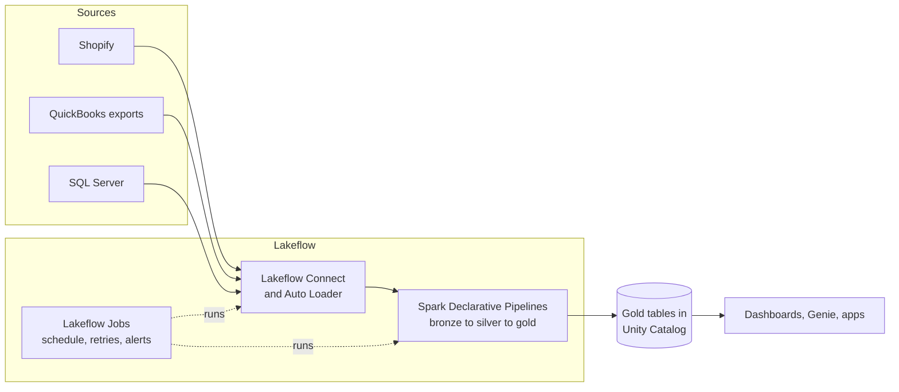

# Lakeflow

Mastery: `INPUT[inlineSelect(option(new), option(learning), option(solid)):mastery]`

> [!story] Context
> [[Chapter 07 - Unity Catalog and Governance|Chapter 07]] established one governed home for every table. Data still has to be brought in from source systems, cleaned, and refreshed on a schedule. In the [[Chapter 04 - The Modern Data Stack|modern data stack]] that required three or four separate tools. Lakeflow is the Databricks product family for these jobs.

> [!eli5] Summary
> Lakeflow is the part of Databricks that moves and prepares data. It copies data from the applications a business already uses, turns it into clean tables, and runs that process on a schedule so reports stay current.

> [!analogy]- Analogy: a restaurant kitchen
> | Kitchen | Lakeflow |
> |---|---|
> | Delivery dock that receives supplies | [[Lakeflow Connect]] |
> | Prep line that turns ingredients into dishes | [[Lakeflow Spark Declarative Pipelines]] ([[Medallion Architecture\|bronze, silver, gold]]) |
> | Ticket rail that sets the order and timing | [[Lakeflow Jobs]] |
> | Picture menu for staff who do not cook | [[Lakeflow Designer]] |

## Background

Before Lakeflow, a typical data team combined:

- an [[Ingestion|ingestion]] tool (often [[Fivetran and ELT Tools|Fivetran]] or hand-written scripts) to copy data from apps and databases,
- [[Apache Spark|Spark]] [[Notebooks|notebooks]] or [[dbt]] to transform it,
- an [[Orchestration|orchestrator]] such as [[Apache Airflow]] or [[Azure Data Factory with Databricks|Azure Data Factory]] to run it on a schedule,
- and something else again for data quality checks and alerts.

Each tool had its own login, its own bill, its own permissions, and its own idea of what a "failed run" meant. When a number on a [[Dashboard|dashboard]] looked wrong, you had to trace it across four systems. Lakeflow folds those jobs into the platform, under [[Unity Catalog]], so [[Data Lineage|lineage]], permissions, and monitoring cover the whole path from source to report.

## Overview

Lakeflow is the Databricks product family for bringing data in, transforming it, and running that work on a schedule.

Databricks describes Lakeflow as "a unified solution for ingestion, transformation, and orchestration of your data". It is a family name, not one feature. As of October 2026 it has four members:

| Piece | Job | Replaces (roughly) | Note |
|---|---|---|---|
| **Lakeflow Connect** | Pull data in from [[SaaS PaaS and IaaS\|SaaS]] apps, databases, files, and streams | Fivetran, Airbyte, custom scripts | [[Lakeflow Connect]], [[Auto Loader]] |
| **Lakeflow Spark Declarative Pipelines** | Declare the tables you want; Databricks works out the order, retries, and incremental updates | Hand-written Spark jobs, some dbt | [[Lakeflow Spark Declarative Pipelines]] |
| **Lakeflow Jobs** | Schedule and chain tasks of any kind | Airflow, cron, ADF | [[Lakeflow Jobs]] |
| **Lakeflow Designer** | Build pipelines visually, with AI help, without code | Alteryx-style tools | [[Lakeflow Designer]] |

Two names cause confusion. The docs often say **"Lakeflow pipelines"** for the Databricks product, and **Apache Spark Declarative Pipelines (SDP)** for the open-source framework it is built on (part of Apache Spark from version 4.1). Both trace back to the product once called Delta Live Tables. And **Lakeflow Jobs** is what used to be called Databricks Workflows.

## How it works

Data flows left to right. Each piece writes [[Delta Lake]] tables that Unity Catalog governs.



### Worked example: a small shop, end to end

This example uses a 12-person online shop. Orders are in **Shopify**, and invoices and expenses are in **QuickBooks**. The goal is one dashboard, refreshed before each business day, showing the previous day's sales and cash collected. The steps follow the order of this chapter.

**1. Set up the catalog** (see [[Catalogs Schemas and Tables]]):

```sql
CREATE CATALOG IF NOT EXISTS shop;
CREATE SCHEMA IF NOT EXISTS shop.bronze;
CREATE SCHEMA IF NOT EXISTS shop.silver;
CREATE SCHEMA IF NOT EXISTS shop.gold;
CREATE VOLUME IF NOT EXISTS shop.bronze.landing;  -- files land here
```

**2. Ingest.** Shopify has a managed [[Lakeflow Connect]] connector (in Beta as of October 2026). It writes tables such as `shop.bronze.orders` for you. QuickBooks has no managed connector in the docs as of October 2026, so the shop exports a nightly CSV of invoices into the `landing` [[Volumes|volume]] (or uses a partner tool), and [[Auto Loader]] picks it up.

**3. Transform** with a pipeline, one SQL file (see [[Lakeflow Spark Declarative Pipelines]]):

```sql
-- bronze: new QuickBooks CSVs, loaded incrementally
CREATE OR REFRESH STREAMING TABLE qb_invoices_raw
AS SELECT *, _metadata.file_path AS source_file
FROM STREAM read_files('/Volumes/shop/bronze/landing/quickbooks/', format => 'csv', header => true);

-- silver: typed, cleaned, with a quality rule
CREATE OR REFRESH STREAMING TABLE shop.silver.invoices (
  CONSTRAINT has_id EXPECT (invoice_id IS NOT NULL) ON VIOLATION DROP ROW
) AS SELECT
  CAST(invoice_id AS STRING)          AS invoice_id,
  CAST(txn_date AS DATE)              AS invoice_date,
  CAST(amount AS DECIMAL(12,2))       AS amount,
  CAST(balance AS DECIMAL(12,2))      AS balance_due
FROM STREAM(qb_invoices_raw);

CREATE OR REFRESH MATERIALIZED VIEW shop.silver.orders AS
SELECT id AS order_id, CAST(created_at AS DATE) AS order_date,
       CAST(total_price AS DECIMAL(12,2)) AS total, financial_status
FROM shop.bronze.orders;

-- gold: what the owner actually looks at
CREATE OR REFRESH MATERIALIZED VIEW shop.gold.daily_summary AS
SELECT d.day,
       COALESCE(o.sales, 0)     AS sales,
       COALESCE(i.collected, 0) AS cash_collected
FROM (SELECT DISTINCT order_date AS day FROM shop.silver.orders) d
LEFT JOIN (SELECT order_date, SUM(total) AS sales FROM shop.silver.orders
           WHERE financial_status = 'paid' GROUP BY order_date) o ON o.order_date = d.day
LEFT JOIN (SELECT invoice_date, SUM(amount - balance_due) AS collected
           FROM shop.silver.invoices GROUP BY invoice_date) i ON i.invoice_date = d.day;
```

**4. Orchestrate** with a nightly job (see [[Lakeflow Jobs]]), defined as code in a [[Declarative Automation Bundles|bundle]]:

```yaml
resources:
  jobs:
    nightly_shop_refresh:
      name: nightly-shop-refresh
      schedule:
        quartz_cron_expression: "0 0 3 * * ?"   # 03:00 every day
        timezone_id: America/Chicago
      email_notifications:
        on_failure: [owner@example.com]
      tasks:
        - task_key: ingest_shopify
          pipeline_task:
            pipeline_id: ${resources.pipelines.shopify_ingest.id}
        - task_key: transform
          depends_on: [{ task_key: ingest_shopify }]
          pipeline_task:
            pipeline_id: ${resources.pipelines.shop_etl.id}
```

**5. Use it.** A dashboard or [[Genie Agents|Genie Agent]] reads `shop.gold.daily_summary`. That is [[Chapter 09 - SQL BI and Apps|chapter 09]].

## Small-business considerations

> [!smallbiz] Small-business considerations
> Lakeflow lets a one-person data team run production pipelines without hosting an orchestrator, licensing a separate ingestion tool, or writing retry logic.
>
> Start with the smallest version of the example above: one connector, one pipeline, one nightly job, all on [[Serverless Compute|serverless compute]], so nothing runs (or bills) between runs.
>
> Lakeflow has no separate license fee. Connectors, pipelines, and jobs are billed by the compute they use, measured in [[DBUs]]. See [[How Databricks Pricing Works]] and [[Estimating Costs for a Small Business]].

## Cloud differences

> [!azure]- Azure Databricks
> Lakeflow works the same way. Many Azure shops already run [[Azure Data Factory with Databricks|Azure Data Factory]]. ADF can keep calling Databricks jobs, but for pipelines that start and end inside Databricks, Lakeflow Jobs removes a hop. Files usually land in [[Azure Data Lake Storage|ADLS Gen2]] (`abfss://...`).

> [!aws]- Databricks on AWS
> Same features. Files land in [[Amazon S3]] (`s3://...`). Teams moving off AWS Glue jobs or Step Functions usually move them to pipelines and Lakeflow Jobs.

> [!gcp]- Databricks on Google Cloud
> Same features. Files land in [[Google Cloud Storage]] (`gs://...`). Individual connectors and preview features sometimes reach GCP later than AWS and Azure, so check each feature's page for your cloud.

## Advanced topics

> [!deepdive]- Advanced topics (301–401)
> - **Declarative vs procedural.** The docs draw the line clearly. Lakeflow Jobs is procedural: you say "run task A, then B". Pipelines are declarative: you say "table C is defined by this query", and the engine works out the order from the dependencies. Most production setups use both: a job that runs one or more pipelines plus a few notebook or SQL tasks.
> - **Everything is a pipeline underneath.** Managed connectors in Lakeflow Connect run as ingestion pipelines, and Designer builds pipelines too. So the same event log, lineage, and monitoring apply to all of them.
> - **Open core.** The declarative framework is in Apache Spark itself (`pyspark.pipelines`, Spark 4.1+). Databricks adds things on top, such as the AUTO CDC APIs, which the docs say are only available in Lakeflow pipelines.
> - **Agents.** Databricks positions 2026 Lakeflow features around "agentic data engineering": [[Genie Code]] can write and debug pipeline code in the editor. Treat its output like any other code: review it and test it.

## Common misconceptions

> [!confusion] Lakeflow is not one product
> It is the family name for Connect, Pipelines, Jobs, and Designer. "We use Lakeflow" tells you very little. Ask which piece.

> [!confusion] "Lakeflow pipelines", "Spark Declarative Pipelines", and "DLT" are the same lineage
> DLT (Delta Live Tables) became Lakeflow Declarative Pipelines in June 2025, then Lakeflow Spark Declarative Pipelines in November 2025. The docs now often use the short form "Lakeflow pipelines". Old `import dlt` code still runs.

## Recall

What are the four parts of Lakeflow?::Lakeflow Connect (ingestion), Lakeflow Spark Declarative Pipelines (transformation), Lakeflow Jobs (orchestration), and Lakeflow Designer (no-code building).
What was Lakeflow Jobs called before?::Databricks Workflows.
What was Lakeflow Spark Declarative Pipelines called before?::Delta Live Tables (DLT), then Lakeflow Declarative Pipelines.
Which Lakeflow piece is procedural and which is declarative?::Jobs is procedural (you order the tasks); pipelines are declarative (the engine orders the tables from their dependencies).
How is Lakeflow billed?::By the compute it uses, in DBUs. There is no separate Lakeflow license.
In which Apache Spark version did declarative pipelines arrive?::Spark 4.1, through the `pyspark.pipelines` module.
Where should a small shop land exported files for Lakeflow to pick up?::In a Unity Catalog volume, such as `/Volumes/shop/bronze/landing/`.

## Next steps

> [!path] Learning path
> **Needs first:** [[Delta Lake]], [[Medallion Architecture]], [[Unity Catalog]]
> **Unlocks next:** [[Lakeflow Connect]], [[Lakeflow Spark Declarative Pipelines]], [[Lakeflow Jobs]]

> [!nextup] Next
> [[Lakeflow Connect]] covers the first stage: managed connectors that ingest data from SaaS applications and databases without custom API code.

> [!sources]- Sources (last verified: 2026-10-25)
> - [Data engineering with Databricks (AWS)](https://docs.databricks.com/aws/en/data-engineering/)
> - [Data engineering with Databricks (Azure)](https://learn.microsoft.com/en-us/azure/databricks/data-engineering/)
> - [Data engineering with Databricks (GCP)](https://docs.databricks.com/gcp/en/data-engineering/)
> - [What are pipelines? (AWS)](https://docs.databricks.com/aws/en/ldp/concepts/pipelines)
> - [What happened to Delta Live Tables (DLT)? (AWS)](https://docs.databricks.com/aws/en/ldp/concepts/where-is-dlt)
> - [What is Lakeflow Connect? (AWS)](https://docs.databricks.com/aws/en/ingestion/overview)
> - [Shopify connector (AWS)](https://docs.databricks.com/aws/en/ingestion/lakeflow-connect/shopify)
> - [Pipeline task for jobs (AWS)](https://docs.databricks.com/aws/en/jobs/tasks/pipeline)
> - [Tutorial: Build an ETL pipeline with Lakeflow pipelines (AWS)](https://docs.databricks.com/aws/en/getting-started/data-pipeline-get-started)
> - [Databricks on AWS GovCloud release notes 2025 (rename to Lakeflow Spark Declarative Pipelines)](https://docs.databricks.com/aws/en/release-notes/gov-cloud/2025)
> - [Announcing the General Availability of Databricks Lakeflow (blog)](https://www.databricks.com/blog/announcing-general-availability-databricks-lakeflow)
> - [Lakeflow: A new era of agentic data engineering (blog)](https://www.databricks.com/blog/lakeflow-new-era-agentic-data-engineering)
> - **Unconfirmed:** the search budget ran out before these details could be re-checked against official docs, so treat them as unverified: the Assistant's role in writing pipeline code; the claim that Lakeflow has no separate license fee.
