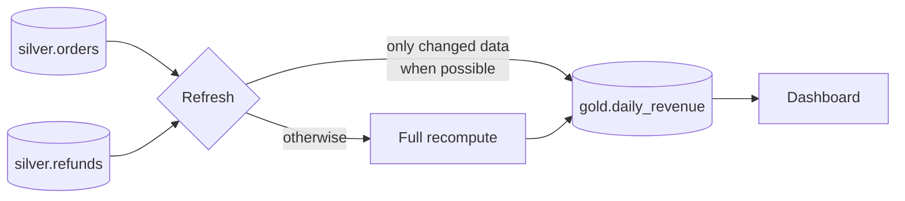

# Materialized Views

Mastery: `INPUT[inlineSelect(option(new), option(learning), option(solid)):mastery]`

> [!story] Context
> [[Streaming Tables]] process each new row once and do not revisit old rows. Gold tables such as revenue by day must change when a late order or refund arrives for an earlier day. These tables need to match their defining query after every refresh.

> [!eli5] Summary
> A materialized view is a stored answer to a query, such as sales per day. Databricks computes it ahead of time so reports load quickly, and updates it when the underlying data changes, recomputing only the changed part when it can.

> [!analogy]- Analogy: a scoreboard
> | Scoreboard | Materialized view |
> |---|---|
> | Recounting every point whenever asked | A plain view |
> | The scoreboard showing the current score | The stored result |
> | Updating the board with the latest points | An incremental refresh |
> | Correcting the board when a point is overturned | Reflecting source updates and deletes |

## Background

Dashboards run the same heavy queries over and over. A plain view recomputes every time, which is slow and costly. Copying results into a table with a nightly `CREATE TABLE AS SELECT` works, but it rebuilds everything every night, and nothing tracks whether it is stale.

[[Data Warehouses|Classic warehouses]] had materialized views for decades, usually with many restrictions. Databricks materialized views are defined in SQL or Python, live in [[Unity Catalog]], and refresh **incrementally** on serverless compute when the query allows it.

## Overview

A materialized view (MV) is a Delta table whose contents are the result of a query, kept up to date by a pipeline. Unlike a [[Streaming Tables|streaming table]], it reflects updates and deletes in its sources: after a refresh, its rows are what the query would return right now.

You can create one in two places:

| Where | Refreshed by | Typical use |
|---|---|---|
| In a [[Lakeflow Spark Declarative Pipelines\|pipeline]] | The pipeline's updates | Silver and gold layers of a pipeline |
| In [[Databricks SQL]] (standalone) | A serverless pipeline Databricks manages for that MV, on a schedule or manually | Analyst-owned summary tables |

## How it works



On each refresh a cost model decides how to bring the result up to date. An incremental refresh is possible only on serverless compute, from supported sources (Delta tables, materialized views, streaming tables, and Unity Catalog managed Iceberg tables), and for a supported query shape (`SELECT` expressions with deterministic functions, `WHERE`, `GROUP BY`, `UNION ALL`, inner and outer joins, and window functions with `PARTITION BY`). When incremental refresh is possible and cheaper, the engine processes only the changed data. Otherwise it recomputes in full. You get the same answer either way; the difference is cost.

### Standalone, in the SQL editor

```sql
CREATE OR REPLACE MATERIALIZED VIEW shop.gold.daily_revenue
SCHEDULE EVERY 1 DAY
COMMENT 'Net revenue per day, refunds included'
AS
SELECT o.order_date,
       COUNT(DISTINCT o.order_id)                AS orders,
       SUM(o.total)                              AS gross,
       SUM(COALESCE(r.refund_amount, 0))         AS refunds,
       SUM(o.total) - SUM(COALESCE(r.refund_amount, 0)) AS net
FROM shop.silver.orders o
LEFT JOIN shop.silver.refunds r ON r.order_id = o.order_id
GROUP BY o.order_date;
```

```sql
REFRESH MATERIALIZED VIEW shop.gold.daily_revenue;       -- run now
REFRESH MATERIALIZED VIEW shop.gold.daily_revenue FULL;  -- force a full recompute
DESCRIBE EXTENDED shop.gold.daily_revenue;               -- refresh status and schedule
```

### In a pipeline (Python)

```python
from pyspark import pipelines as dp
from pyspark.sql import functions as F

@dp.materialized_view(comment="Customer lifetime value")
def customer_ltv():
    orders = spark.read.table("shop.silver.orders")
    return (orders.groupBy("customer_id")
                  .agg(F.sum("total").alias("lifetime_value"),
                       F.min("order_date").alias("first_order"),
                       F.count("*").alias("orders")))
```

### Choosing a dataset type

| Need | Use |
|---|---|
| Ingest new rows from files or a stream | [[Streaming Tables\|Streaming table]] |
| Joins and aggregates that must reflect changes | Materialized view |
| A KPI with one definition, sliced many ways in BI | [[Metric Views\|Metric view]] (often on top of an MV) |
| A query you rarely run | Plain view |

## Small-business considerations

> [!smallbiz] Small-business considerations
> Your gold layer should mostly be materialized views. "Sales per day", "top products this month", and "unpaid invoices by customer" are each one short `CREATE MATERIALIZED VIEW`. Dashboards then load in a second instead of scanning raw orders. Schedule them right after your nightly ingestion (or let the pipeline refresh them in the same update) and you have a reporting layer with no extra tools.

## Cloud differences

> [!azure]- Azure Databricks
> Nothing differs. Standalone MVs need a serverless-enabled workspace in a region that supports serverless SQL warehouses. Check that your Azure region supports serverless.

> [!aws]- Databricks on AWS
> Nothing differs. The same serverless region check applies.

> [!gcp]- Databricks on Google Cloud
> Nothing differs. The same serverless region check applies.

## Advanced topics

> [!deepdive]- Advanced topics (301–401)
> - **Incremental refresh needs serverless:** MVs that do not use serverless pipelines are always fully recomputed. Standalone MVs always refresh on a serverless pipeline; MVs in a pipeline need the pipeline set to serverless.
> - **Enable change tracking on sources:** Some incremental techniques require row tracking on the source Delta tables. Databricks recommends enabling deletion vectors, row tracking, and change data feed on all MV source tables: `ALTER TABLE t SET TBLPROPERTIES (delta.enableDeletionVectors = true, delta.enableRowTracking = true, delta.enableChangeDataFeed = true)`.
> - **Non-deterministic functions:** Time functions such as `current_date()` and `current_timestamp()` are supported in `WHERE` clauses. Other non-deterministic functions (such as `rand()`) prevent incremental refresh. So do recursive CTEs, sources such as volumes and foreign catalogs, and `SUM` or `AVG` over `FLOAT` or `DOUBLE` columns (cast to `DECIMAL` instead).
> - **Check what happened:** Query the event log for `planning_information` events. Each records the chosen technique, such as `FULL_RECOMPUTE`, `NO_OP`, `ROW_BASED`, or `GROUP_AGGREGATE`. The pipeline editor's **Incrementalization** column shows the same per update. Run `EXPLAIN CREATE MATERIALIZED VIEW` to test a query before you create it.
> - **Refresh policy:** `REFRESH POLICY` (`AUTO`, `INCREMENTAL`, `INCREMENTAL STRICT`, or `FULL`) controls whether a refresh may fall back to a full recompute. `INCREMENTAL STRICT` fails the refresh instead.
> - **Permissions:** Readers need `SELECT` on the MV plus `USE CATALOG` and `USE SCHEMA` on its parents, not access to the sources. The owner needs `SELECT` on the sources. That makes MVs a clean way to publish a summary to people who must not see the raw rows.
> - **dbt:** The dbt-databricks adapter can materialize a model as `materialized_view`. See [[dbt on Databricks]].

## Common misconceptions

> [!confusion] A materialized view is not a view
> A **view** stores a query and runs it every time. A **materialized view** stores the result and refreshes it. Querying an MV costs about the same as reading a table.

> [!confusion] "Incremental" is an optimization, not a different result
> Whether a refresh is incremental or full, the MV ends up with the same rows. An incremental refresh costs less.

## Recall

What is a materialized view?::A table that stores a query's result and is refreshed by a pipeline so it matches the query.
How is a materialized view different from a streaming table?::An MV reflects updates and deletes in its sources; a streaming table only processes new input once.
Which compute is required for incremental MV refresh?::Serverless (MVs that do not use serverless pipelines always recompute in full).
How do you force a full recompute?::`REFRESH MATERIALIZED VIEW name FULL`.
What can block incremental refresh?::Classic compute, missing row tracking on sources, unsupported sources or operators, or non-deterministic functions such as `rand()` (time functions are allowed in `WHERE`).
Which Python decorator defines an MV in a pipeline?::`@dp.materialized_view`.

## Next steps

> [!path] Learning path
> **Needs first:** [[Lakeflow Spark Declarative Pipelines]], [[SQL]]
> **Unlocks next:** [[Expectations and Data Quality]], [[AI-BI Dashboards]]

> [!nextup] Next
> [[Expectations and Data Quality]] covers rules that warn about, drop, or block invalid rows as tables refresh.

> [!sources]- Sources (last verified: 2026-10-25)
> - [CREATE MATERIALIZED VIEW (pipelines, AWS)](https://docs.databricks.com/aws/en/ldp/developer/ldp-sql-ref-create-materialized-view)
> - [What are pipelines? (AWS)](https://docs.databricks.com/aws/en/ldp/concepts/pipelines)
> - [Lakeflow pipelines Python language reference (AWS)](https://docs.databricks.com/aws/en/ldp/developer/python-ref)
> - [Use Python with standalone pipelines (AWS)](https://docs.databricks.com/aws/en/sql/mv-st/using-python)
> - [Best practices for Lakeflow pipelines (AWS)](https://docs.databricks.com/aws/en/ldp/best-practices/)
> - [Incremental refresh for materialized views (AWS)](https://docs.databricks.com/aws/en/optimizations/incremental-refresh)
> - [CREATE MATERIALIZED VIEW (Databricks SQL, AWS)](https://docs.databricks.com/aws/en/sql/language-manual/sql-ref-syntax-ddl-create-materialized-view)
> - [REFRESH (MATERIALIZED VIEW or STREAMING TABLE) (AWS)](https://docs.databricks.com/aws/en/sql/language-manual/sql-ref-syntax-ddl-refresh-full)
> - [Use standalone materialized views (AWS)](https://docs.databricks.com/aws/en/views/materialized)
> - [Requirements for standalone pipelines (AWS)](https://docs.databricks.com/aws/en/sql/mv-st/compute)
> - [Pipeline event log (AWS)](https://docs.databricks.com/aws/en/ldp/monitor-event-logs)
> - [Databricks configurations (dbt docs)](https://docs.getdbt.com/reference/resource-configs/databricks-configs)
