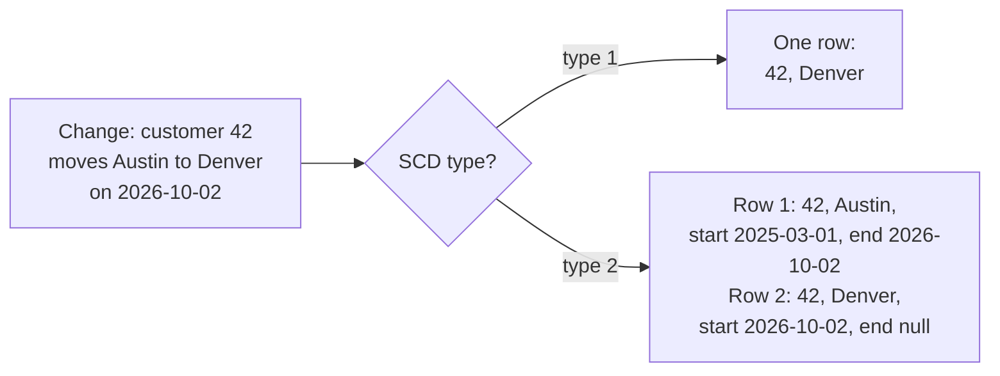

# Slowly Changing Dimensions

Mastery: `INPUT[inlineSelect(option(new), option(learning), option(solid)):mastery]`

> [!story] Context
> [[Change Data Capture]] keeps one current row per key. That leaves a modeling decision: when a customer moves from Austin to Denver, reports on past sales must either follow the customer's current city or keep the city at the time of each sale.

> [!eli5] Summary
> Some attributes of customers or products change occasionally, such as an address or a price tier. You can overwrite the old value, or keep it with the dates it was valid and add the new value alongside. Overwriting is simpler; keeping history answers questions about the past.

> [!analogy]- Analogy: a contacts list and a passport
> | Record | SCD type |
> |---|---|
> | A contacts list where the old address is overwritten | Type 1 |
> | Passport visas, each with start and end dates | Type 2 |
> | The dates on each visa | `__START_AT` and `__END_AT` |

## Background

In a [[Star Schema|star schema]], [[Fact Table|facts]] (orders, payments) point at [[Dimension Table|dimensions]] (customers, products, stores). Facts never change once they happen. Dimensions change, but slowly: a customer's region, a product's category, a sales rep's team. The term "slowly changing dimension" comes from classic [[Data Warehouses|data warehouse]] design, which numbered the ways to handle those changes.

With type 1, if a customer moves from the West region to the Central region, all of their past sales move to Central too. Last year's regional report changes without notice. With type 2, past sales stay with West and new ones go to Central.

## Overview

The two types that matter in practice:

| | SCD type 1 | SCD type 2 |
|---|---|---|
| On change | Overwrite the row | Close the old row, add a new one |
| Rows per key | One | One per version |
| History | Lost (though Delta [[Time Travel]] keeps it for a while) | Kept, with validity dates |
| Use for | Corrections, attributes without historical reporting needs (email, phone) | Attributes that change reports (region, tier, price list, owner) |
| AUTO CDC | `STORED AS SCD TYPE 1` (default) | `STORED AS SCD TYPE 2` |

In Databricks, both come from the same AUTO CDC flow (see [[Change Data Capture]]). For type 2, the target table gets two extra columns, `__START_AT` and `__END_AT`, with the same type as the `SEQUENCE BY` column. The current version of each key has `__END_AT` set to null.

## How it works



### Type 2 with AUTO CDC (SQL, in a pipeline)

```sql
CREATE OR REFRESH STREAMING TABLE dim_customers;

CREATE FLOW dim_customers_scd2 AS AUTO CDC INTO dim_customers
FROM STREAM(customers_cdc)
KEYS (customer_id)
APPLY AS DELETE WHEN operation = 'DELETE'
SEQUENCE BY updated_at
COLUMNS * EXCEPT (operation, _rescued_data)
STORED AS SCD TYPE 2
TRACK HISTORY ON * EXCEPT (email, phone);   -- email/phone changes overwrite, no new version
```

`TRACK HISTORY ON` (Python: `track_history_column_list` / `track_history_except_column_list`) specifies the subset of output columns whose changes generate a new history record. You can list the columns to track, or use `* EXCEPT (...)` to list the columns to exclude. The default is `TRACK HISTORY ON *`: a change to any output column creates a new version. Excluding noisy columns such as email keeps the table small.

### Type 2 in Python

```python
from pyspark import pipelines as dp
from pyspark.sql.functions import col, expr

dp.create_streaming_table("dim_customers")

dp.create_auto_cdc_flow(
    target="dim_customers",
    source="customers_cdc",
    keys=["customer_id"],
    sequence_by=col("updated_at"),
    apply_as_deletes=expr("operation = 'DELETE'"),
    except_column_list=["operation", "_rescued_data"],
    stored_as_scd_type=2,
    track_history_except_column_list=["email", "phone"],
)
```

### Querying a type 2 table

```sql
-- Current state only
SELECT customer_id, city, region
FROM shop.silver.dim_customers
WHERE __END_AT IS NULL;

-- Point in time: the customer's region at the time of each order
SELECT o.order_id, o.ordered_at, c.region, o.total
FROM shop.silver.orders o
JOIN shop.silver.dim_customers c
  ON  o.customer_id = c.customer_id
  AND o.ordered_at >= c.__START_AT
  AND (o.ordered_at < c.__END_AT OR c.__END_AT IS NULL);
```

The second query shows the purpose of type 2: each order is matched to the version of the customer that was true at the time.

## Small-business considerations

> [!smallbiz] Small-business considerations
> Default to type 1. It is simpler to query and most small-business questions are about "now". Switch a dimension to type 2 when someone will ask a question about the past that depends on it: commission by sales rep's team at the time of sale, revenue by the price tier a customer was on, or regional results that shouldn't shift when customers move. For our shop, `dim_products` as type 2 is a good first candidate, because prices and categories change and margin reports need the old values.

## Cloud differences

> [!azure]- Azure Databricks
> Nothing differs between clouds. SCD handling is part of the pipeline engine and behaves the same on Azure, AWS, and Google Cloud.

## Advanced topics

> [!deepdive]- Advanced topics (301–401)
> - **Schema for type 2 targets:** If you declare the target's schema yourself in `create_auto_cdc_flow()`, the docs say you must include `__START_AT` and `__END_AT` with the same data type as the `sequence_by` fields.
> - **Deletes in type 2:** The docs describe the deleted row being kept temporarily as a tombstone in the underlying Delta table, with a view in the metastore that filters out tombstones. Query the published table, not the internal one.
> - **Truncate** (`APPLY AS TRUNCATE WHEN`) is supported only for type 1.
> - **Snapshots to type 2:** `create_auto_cdc_from_snapshot_flow(..., stored_as_scd_type=2)` builds history from a series of full extracts, which suits sources with no change log.
> - **Bitemporal:** `STORED AS BITEMPORAL` (Beta, requires `SYSTEM SEQUENCE BY`) tracks both when something was true in the business and when the system learned of it.
> - **Other SCD patterns:** AUTO CDC implements types 1 and 2 (plus bitemporal) directly. Model any other pattern with ordinary SQL if you need it.
> - **Surrogate keys:** In classic dimensional modeling, each type 2 version gets a surrogate key so fact tables link to the right version. Databricks' dimensional modeling blog generates it with an identity column on a hand-built dimension table. Identity columns are not supported on AUTO CDC targets, so for those, join on the natural key plus time range as shown above.

## Common misconceptions

> [!confusion] Time Travel is not SCD type 2
> [[Time Travel]] lets you query a table as it was at an older *version*, and only until old files are vacuumed. SCD type 2 keeps business history permanently, as rows you can join on.

> [!confusion] "Slowly" is about the business, not the speed of the pipeline
> It means the attribute changes rarely compared with how often facts arrive. The pipeline can refresh every minute.

## Recall

What does SCD type 1 do on a change?::Overwrites the row; history is not kept.
What does SCD type 2 do on a change?::Closes the old row (sets its end) and inserts a new current row.
Which columns does AUTO CDC add for SCD type 2?::`__START_AT` and `__END_AT`.
How do you find the current rows in an SCD type 2 table?::`WHERE __END_AT IS NULL`.
How do you stop changes to some columns from creating new versions?::`TRACK HISTORY ON * EXCEPT (...)` in SQL, or `track_history_except_column_list` in Python.
What is the default SCD type for AUTO CDC?::Type 1.
Why use type 2 for a sales region dimension?::So past sales stay attributed to the region the customer was in at the time.

## Next steps

> [!path] Learning path
> **Needs first:** [[Change Data Capture]], [[Dimension Table]], [[Star Schema]]
> **Unlocks next:** [[Metric Views]], [[Lakeflow Jobs]]

> [!nextup] Next
> [[Lakeflow Jobs]] covers running ingestion, pipelines, and other tasks on a schedule in dependency order, with retries and notifications.

> [!sources]- Sources (last verified: 2026-10-25)
> - [The AUTO CDC APIs: Simplify change data capture with pipelines (AWS)](https://docs.databricks.com/aws/en/ldp/cdc)
> - [create_auto_cdc_flow (AWS)](https://docs.databricks.com/aws/en/ldp/developer/ldp-python-ref-apply-changes)
> - [create_auto_cdc_from_snapshot_flow (AWS)](https://docs.databricks.com/aws/en/ldp/developer/ldp-python-ref-apply-changes-from-snapshot)
> - [AUTO CDC INTO (pipelines, AWS)](https://docs.databricks.com/aws/en/ldp/developer/ldp-sql-ref-apply-changes-into)
> - [AUTO CDC INTO (pipelines, Azure)](https://learn.microsoft.com/en-us/azure/databricks/ldp/developer/ldp-sql-ref-apply-changes-into)
> - [Advanced AUTO CDC topics (AWS)](https://docs.databricks.com/aws/en/ldp/cdc-advanced)
> - [AUTO CDC FLOW clause (Databricks SQL, GCP)](https://docs.databricks.com/gcp/en/sql/language-manual/sql-ref-syntax-ddl-create-streaming-table-auto-cdc)
> - [Pipeline limitations (AWS)](https://docs.databricks.com/aws/en/ldp/limitations)
> - [Change data capture and snapshots (AWS)](https://docs.databricks.com/aws/en/data-engineering/what-is-cdc)
> - [Implementing a Dimensional Data Warehouse with Databricks SQL: Part 1 (Databricks blog)](https://www.databricks.com/blog/implementing-dimensional-data-warehouse-databricks-sql-part-1)
> - [Implementing a Dimensional Data Warehouse with Databricks SQL: Part 2 (Databricks blog)](https://www.databricks.com/blog/implementing-dimensional-data-warehouse-databricks-sql-part-2)
