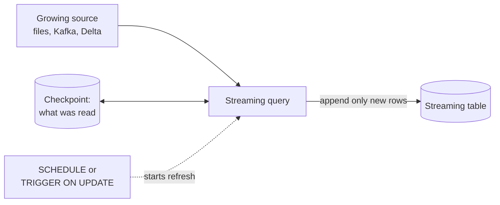

# Streaming Tables

Mastery: `INPUT[inlineSelect(option(new), option(learning), option(solid)):mastery]`

> [!story] Context
> [[Lakeflow Spark Declarative Pipelines]] build tables from declarations. The first dataset type is for data that keeps arriving, such as new files, events, or appended rows, where each new record should be processed once and existing records left unchanged.

> [!eli5] Summary
> A streaming table adds only new data. On each refresh it reads what arrived since the last refresh, appends it, and records where it stopped. It does not re-read data it has already processed.

> [!analogy]- Analogy: a diary
> | Diary | Streaming table |
> |---|---|
> | Each day's entry | A batch of new rows |
> | Writing only today's page | Incremental processing |
> | The bookmark | The [[Checkpoint\|checkpoint]] |
> | Rewriting the diary from original notes | A full refresh, which requires the source data to still exist |

## Background

Most raw data grows by appending: orders, clicks, invoices, log lines. Recomputing a whole table from all of history every night is costly, and for large sources impractical. [[Structured Streaming]] solved incremental processing, but it asked you to manage checkpoints, triggers, and clusters yourself. Streaming tables wrap that in a table definition, written in a pipeline or directly in the [[SQL Editor|SQL editor]].

## Overview

A streaming table is a [[Delta Lake|Delta]] table with a streaming query attached. Each refresh reads only input that arrived since the last refresh and processes each row once. Typical sources:

- files in cloud storage or a [[Volumes|volume]], through `read_files` ([[Auto Loader]] under the hood),
- message buses such as [[Apache Kafka]], Kinesis, Event Hubs, or Pub/Sub,
- another Delta table that only gets appends (or its [[Change Data Feed]]),
- a CDC feed, through an AUTO CDC flow ([[Change Data Capture]]).

There are two ways to create one:

| Where | How it runs | When to use |
|---|---|---|
| **Inside a pipeline** | Refreshed by the pipeline's updates | Multi-table builds (the normal case) |
| **Standalone, in Databricks SQL** | Databricks creates and manages a serverless pipeline for that one table | An analyst loading one source with a schedule |

The current docs say standalone streaming tables run on serverless pipelines for both creation and refresh. Older pages describe creation on a SQL warehouse, so you may see both.

## How it works



### A standalone streaming table with a schedule

Run this in the SQL editor:

```sql
CREATE OR REFRESH STREAMING TABLE shop.bronze.web_events
SCHEDULE EVERY 1 HOUR
COMMENT 'Website click events, appended hourly'
AS SELECT *
FROM STREAM read_files(
  '/Volumes/shop/bronze/landing/web_events/',
  format => 'json',
  includeExistingFiles => true      -- false = only files that arrive after creation
);
```

Manage it afterwards:

```sql
REFRESH STREAMING TABLE shop.bronze.web_events;           -- run now
ALTER STREAMING TABLE shop.bronze.web_events
  ALTER SCHEDULE CRON '0 0 2 * * ?' AT TIME ZONE 'America/Chicago';
DESCRIBE TABLE EXTENDED shop.bronze.web_events;           -- shows refresh info
```

The cron string is a six-field Quartz expression (seconds first). Instead of a fixed schedule you can use `TRIGGER ON UPDATE`, which refreshes the table when an upstream source is updated, at most once every minute by default (set `AT MOST EVERY` for a longer minimum gap). The upstream sources must be Delta tables (including materialized views and streaming tables) or managed views over them, with no more than 10 upstream sources per table.

### Inside a pipeline, reading another table

```sql
CREATE OR REFRESH STREAMING TABLE orders_clean
AS SELECT * EXCEPT (_rescued_data)
FROM STREAM(orders_raw)              -- STREAM(...) = read only new rows
WHERE order_id IS NOT NULL;
```

The `STREAM` keyword is what makes the read incremental. Without it you get a batch read of the whole table.

### From Kafka

```sql
CREATE OR REFRESH STREAMING TABLE shop.bronze.order_events
AS SELECT CAST(value AS STRING) AS payload, timestamp
FROM STREAM read_kafka(
  bootstrapServers => 'broker-1:9092',
  subscribe => 'shop.orders'
);
```

### Comparison with materialized views

| | Streaming table | [[Materialized Views\|Materialized view]] |
|---|---|---|
| Reads | Only new input | Whatever is needed to make the result correct |
| Source changes (updates, deletes) | Not seen (append only), unless you use AUTO CDC | Reflected in the result |
| Good for | Ingestion, bronze, append-only silver, CDC targets | Joins, aggregates, gold |
| Full refresh | Reprocesses all input still available | Recomputes |

## Small-business considerations

> [!smallbiz] Small-business considerations
> Use streaming tables for the "landing" side of every source: Shopify files, QuickBooks exports, website events. They are cheap because each refresh only touches new rows. A standalone streaming table with `SCHEDULE EVERY 1 DAY` is the simplest possible pipeline, with no job or Python needed. Once you have several related tables, move them into one pipeline.

## Cloud differences

> [!azure]- Azure Databricks
> Nothing differs in the SQL. For streaming sources, Azure Event Hubs provides an Apache Kafka compatible interface, so you read it with the Kafka connector.

> [!aws]- Databricks on AWS
> Nothing differs in the SQL. Read Amazon Kinesis with `read_kinesis` and Amazon MSK (managed Kafka) with `read_kafka`.

> [!gcp]- Databricks on Google Cloud
> Nothing differs in the SQL. Read Google Cloud Pub/Sub with `read_pubsub`, which supports only streaming queries.

## Advanced topics

> [!deepdive]- Advanced topics (301–401)
> - **Append-only assumption:** A streaming read of a Delta table expects appends. If an `UPDATE`, `DELETE`, `MERGE INTO`, or overwrite modifies the source table, the stream fails unless you skip those changes (the `skipChangeCommits` reader option, which processes only appends) or read the source's change feed. For real changes, use AUTO CDC.
> - **Changing the query:** Editing a streaming table's query only affects new data. Rows already written stay as they were. To apply new logic to history, run a full refresh (if the source still has the data).
> - **Full refresh danger:** If the source is Kafka with 7 days of retention, a full refresh loses everything older than 7 days. Protect important bronze tables with the table property `pipelines.reset.allowed = false` (default `true`), which blocks full refreshes of that table.
> - **Stateful operations:** Aggregations and joins in a streaming table need [[Watermark|watermarks]] to bound state. Without one, state grows forever. Often the better answer is to aggregate in a materialized view instead.
> - **Python standalone tables:** You can create standalone tables from a notebook on serverless compute, but the docs note you can't refresh or schedule them with `REFRESH`, `SCHEDULE`, or `TRIGGER ON UPDATE` when defined with Python decorators. Define them in SQL or schedule the notebook as a job.

## Common misconceptions

> [!confusion] A streaming table is not "real time"
> It is incremental. A daily refresh is a common schedule. Low latency comes from continuous mode or [[Structured Streaming on Databricks|real-time mode]], not from the table type.

> [!confusion] Streaming tables don't see updates to the source
> If yesterday's order changes in the source, an append-only streaming table won't change. Use [[Change Data Capture|AUTO CDC]] or a materialized view when the source updates rows.

## Recall

What does a streaming table read on each refresh?::Only the input that arrived since the last refresh.
What keyword makes a SQL read incremental in a pipeline?::`STREAM`, as in `FROM STREAM(orders_raw)` or `STREAM read_files(...)`.
What runs a standalone streaming table created in Databricks SQL?::A serverless pipeline that Databricks creates and manages for that table.
How do you schedule a standalone streaming table hourly?::Add `SCHEDULE EVERY 1 HOUR` to `CREATE OR REFRESH STREAMING TABLE`.
What does `includeExistingFiles => false` do?::Loads only files that arrive after the table is created.
Why is a full refresh risky with a Kafka source?::Kafka only keeps data for its retention period, so older data is lost.
Streaming table or materialized view for a daily revenue aggregate?::Materialized view.

## Next steps

> [!path] Learning path
> **Needs first:** [[Lakeflow Spark Declarative Pipelines]], [[Batch vs Streaming]], [[Auto Loader]]
> **Unlocks next:** [[Change Data Capture]], [[Expectations and Data Quality]]

> [!nextup] Next
> [[Materialized Views]] covers the second dataset type: stored query results that reflect updates and deletes in their sources.

> [!sources]- Sources (last verified: 2026-10-25)
> - [Use standalone streaming tables (AWS)](https://docs.databricks.com/aws/en/ldp/dbsql/streaming)
> - [Use standalone streaming tables (Azure)](https://learn.microsoft.com/en-us/azure/databricks/ldp/dbsql/streaming)
> - [Use standalone streaming tables (GCP)](https://docs.databricks.com/gcp/en/ldp/dbsql/streaming)
> - [CREATE STREAMING TABLE (Databricks SQL, AWS)](https://docs.databricks.com/aws/en/sql/language-manual/sql-ref-syntax-ddl-create-streaming-table)
> - [CREATE STREAMING TABLE (pipelines, AWS)](https://docs.databricks.com/aws/en/ldp/developer/ldp-sql-ref-create-streaming-table)
> - [CREATE STREAMING TABLE (pipelines, Azure)](https://learn.microsoft.com/en-us/azure/databricks/ldp/developer/ldp-sql-ref-create-streaming-table)
> - [Use Python with standalone pipelines (AWS)](https://docs.databricks.com/aws/en/sql/mv-st/using-python)
> - [read_files table-valued function (Azure)](https://learn.microsoft.com/en-us/azure/databricks/sql/language-manual/functions/read_files)
> - [ALTER STREAMING TABLE (AWS)](https://docs.databricks.com/aws/en/sql/language-manual/sql-ref-syntax-ddl-alter-streaming-table)
> - [read_kafka table-valued function (AWS)](https://docs.databricks.com/aws/en/sql/language-manual/functions/read_kafka)
> - [read_kinesis streaming table-valued function (AWS)](https://docs.databricks.com/aws/en/sql/language-manual/functions/read_kinesis)
> - [read_pubsub streaming table-valued function (GCP)](https://docs.databricks.com/gcp/en/sql/language-manual/functions/read_pubsub)
> - [Load data in pipelines, including Azure Event Hubs (Azure)](https://learn.microsoft.com/en-us/azure/databricks/ldp/load)
> - [Delta table streaming reads and writes (AWS)](https://docs.databricks.com/aws/en/structured-streaming/delta-lake)
> - [Pipeline properties reference (AWS)](https://docs.databricks.com/aws/en/ldp/properties)
