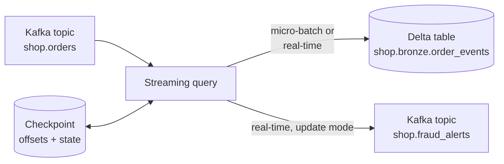

# Structured Streaming on Databricks

Mastery: `INPUT[inlineSelect(option(new), option(learning), option(solid)):mastery]`

> [!story] Context
> [[Lakeflow Designer]] and [[Lakeflow Spark Declarative Pipelines|pipelines]] hide the streaming engine behind tables. This note covers the engine itself: [[Structured Streaming]] queries written directly in Python or Scala, and the Databricks-specific real-time mode for sub-second [[Latency|latency]].

> [!eli5] Summary
> Structured Streaming processes data continuously as it arrives, such as orders from a message queue, instead of waiting for a nightly batch. Databricks runs these streams, remembers how far each one has read so it can restart safely, and offers a real-time mode for cases where results are needed within a fraction of a second.

> [!analogy]- Analogy: a conveyor belt with a counter
> | Conveyor belt | Structured Streaming |
> |---|---|
> | Items on the belt | Records from Kafka, files, or a Delta table |
> | Worker processing items in small groups | Micro-batches |
> | Worker processing each item as it passes | Real-time mode |
> | Counter showing the last item handled | The [[Checkpoint\|checkpoint]] |

## Background

Apache Spark introduced Structured Streaming in Spark 2.x as a streaming API built on [[DataFrames]]: the same query runs on a growing, unbounded table. Running it in production requires choices that the API leaves open: where to store checkpoints, how often to trigger, how to restart after failure, and how to reach latencies below the overhead of a micro-batch.

On Databricks, most streaming work runs inside [[Streaming Tables|streaming tables]] and pipelines. Direct Structured Streaming remains the right tool for custom sinks, complex stateful logic, and low-latency operational use cases.

## Overview

| Concept | Description |
|---|---|
| **Source** | Where records come from: [[Apache Kafka\|Kafka]], [[Auto Loader]] (`cloudFiles`), Delta tables, and cloud message services |
| **Sink** | Where results go: Delta tables (`toTable`), Kafka, or `foreachBatch` for custom logic |
| **Checkpoint** | A storage location holding offsets and state, which gives [[Exactly-Once Processing\|exactly-once]] results with replayable sources and idempotent sinks |
| **Trigger** | When processing runs: default micro-batches, a fixed interval, `availableNow` (process everything available, then stop), or `realTime` (real-time mode) |
| **Output mode** | `append`, `update`, or `complete` |
| **[[Watermark\|Watermark]]** | A bound on how late data can arrive, which limits state for aggregations and joins |

### Real-time mode

Real-time mode (RTM) is a Databricks trigger for operational workloads that need sub-second latency. The documentation states:

- RTM processes records as they arrive, with end-to-end latency as low as five milliseconds. The trigger reference gives tail latency under one second, and around 300 ms in common cases.
- Set it in Python with `.trigger(realTime="5 minutes")`, or in Scala with `RealTimeTrigger.apply()`. The interval controls the duration of a long-running batch and the checkpoint interval, not per-record latency. The docs suggest 5 minutes as a starting point.
- RTM is supported only in `update` output mode.
- `display()` with a real-time trigger requires Databricks Runtime 17.1 or above. Stream-to-stream joins with multiple other streams on the same cluster require Databricks Runtime 18 LTS or above.
- For queries that repartition, set `spark.sql.execution.sortBeforeRepartition` to `false`, because sorting is not supported in repartition with RTM.
- RTM for direct Structured Streaming queries entered Public Preview on July 22, 2025. RTM for Spark Declarative Pipelines entered Public Preview on May 27, 2026. No general-availability announcement for either appears in the release notes through October 2026.
- Direct RTM queries run on classic compute with Databricks Runtime 16.4 LTS or above. Serverless notebooks and jobs do not support them; use RTM in Lakeflow pipelines for serverless.
- Supported sources are Kafka, Event Hubs (through the Kafka connector), Kinesis, and Amazon MSK. Supported sinks are Kafka, Event Hubs, and custom sinks through `forEach`. Delta and Pub/Sub are not supported as RTM sources or sinks.

## How it works



### Kafka to Delta with micro-batches

```python
from pyspark.sql import functions as F

bootstrap = dbutils.secrets.get(scope="kafka", key="bootstrap_servers")

orders = (spark.readStream
    .format("kafka")
    .option("kafka.bootstrap.servers", bootstrap)
    .option("subscribe", "shop.orders")
    .option("startingOffsets", "earliest")
    .load()
    .select(F.col("key").cast("string").alias("order_id"),
            F.col("value").cast("string").alias("payload"),
            F.col("timestamp").alias("kafka_ts")))

(orders.writeStream
    .option("checkpointLocation", "/Volumes/shop/bronze/checkpoints/order_events")
    .trigger(processingTime="1 minute")
    .toTable("shop.bronze.order_events"))
```

Store broker credentials in a secret scope, not in code. See [[Secrets Management]].

### Kafka to Kafka in real-time mode

```python
alerts = (orders
    .withColumn("total", F.get_json_object("payload", "$.total_price").cast("double"))
    .where("total > 1000")
    .select(F.col("order_id").alias("key"), F.col("payload").alias("value")))

(alerts.writeStream
    .format("kafka")
    .option("kafka.bootstrap.servers", bootstrap)
    .option("topic", "shop.large_order_alerts")
    .option("checkpointLocation", "/Volumes/shop/bronze/checkpoints/large_order_alerts")
    .outputMode("update")                 # required for real-time mode
    .trigger(realTime="5 minutes")
    .start())
```

### Choosing a trigger

| Trigger | Latency | Cost profile | Use for |
|---|---|---|---|
| `availableNow=True` | Minutes to hours (depends on schedule) | Compute runs only while catching up | Scheduled incremental batch |
| Default or `processingTime` | Seconds | Cluster always on | Near-real-time dashboards |
| `realTime` | Milliseconds to sub-second | Cluster always on | Fraud checks, alerts, operational systems |

Run long-lived streams as a [[Lakeflow Jobs|job]] with a continuous trigger or with retries, so a failure restarts the stream from its checkpoint.

## Small-business considerations

> [!smallbiz] Small-business considerations
> Most small businesses do not need always-on streaming. Hourly or nightly incremental loads cover sales and finance reporting at a fraction of the compute. Use the streaming APIs with `trigger(availableNow=True)`, or use [[Streaming Tables|streaming tables]], to keep incremental semantics without paying for a cluster that never stops. Consider real-time mode only when a business process must react within seconds, for example blocking a suspicious order before it ships.

## Cloud differences

> [!azure]- Azure Databricks
> Azure Event Hubs is read through the Kafka connector. In Databricks Runtime 16.1 and above, the connector can authenticate to Event Hubs with a Unity Catalog service credential. Checkpoints live on ADLS Gen2 or in a volume. A real-time mode page is published on Microsoft Learn.

> [!aws]- Databricks on AWS
> Amazon MSK (managed Kafka) is read through the Kafka connector, and Amazon Kinesis through a built-in Kinesis connector. Real-time mode supports both as sources but not as sinks. Checkpoints live on S3 or in a volume.

> [!gcp]- Databricks on Google Cloud
> Google Cloud Pub/Sub has a built-in connector with exactly-once processing semantics for rows from the subscriber. Kafka, including Google Cloud Managed Kafka, is read through the Kafka connector. Real-time mode does not support Pub/Sub. Checkpoints live on Cloud Storage or in a volume.

## Advanced topics

> [!deepdive]- Advanced topics (301–401)
> - **One checkpoint per query:** Never share a checkpoint between queries or point a new query at an old checkpoint with different logic. Changing stateful operations usually requires a new checkpoint.
> - **Checkpoint migration:** Lakeflow pipelines added `import_checkpoint` in 2026, which lets a pipeline adopt an existing stream's checkpoint so a migration from a hand-written stream to a pipeline does not reprocess data.
> - **State size:** Aggregations, deduplication, and stream-stream joins keep state. Bound it with watermarks (`withWatermark("event_time", "10 minutes")`), or state grows without limit.
> - **`foreachBatch`** turns each micro-batch into a batch DataFrame, which allows `MERGE` into Delta and writes to sinks without streaming support. Real-time mode does not support `foreachBatch`; use `forEach` for custom sinks in real-time mode.
> - **Monitoring:** Streaming queries report input rate, processing rate, and batch duration in the [[Spark UI]] and query progress events. Alert when processing rate falls below input rate for a sustained period.
> - **Exactly-once** requires a replayable source (Kafka offsets, files) and an idempotent or transactional sink (Delta). Apache Kafka supports only at-least-once write semantics, so a Kafka sink can write duplicates; consumers must tolerate them, for example by deduplicating on a unique key.

## Common misconceptions

> [!confusion] Streaming does not require an always-on cluster
> `trigger(availableNow=True)` runs a streaming query as a batch job that stops when it has caught up. The checkpoint still guarantees each record is processed once.

> [!confusion] Real-time mode is not the same as continuous processing
> Spark's older experimental continuous processing trigger is a different feature. The Databricks docs recommend real-time mode for low-latency use cases.

## Recall

What does a streaming checkpoint store?::The source offsets and query state, so a restarted query resumes where it stopped.
How do you enable real-time mode in Python?::`.trigger(realTime="5 minutes")`.
Which output mode does real-time mode require?::`update`.
What end-to-end latency do the docs cite for real-time mode?::As low as five milliseconds; under one second at the tail and around 300 ms in common cases.
Which runtime is needed for `display()` with a real-time trigger?::Databricks Runtime 17.1 or above.
Which trigger runs a stream as a batch that stops when caught up?::`availableNow=True`.
What bounds state in streaming aggregations?::A watermark.
When did real-time mode for Spark Declarative Pipelines enter Public Preview?::May 2026.
Can you use `foreachBatch` in real-time mode?::No. Use `forEach` for custom sinks instead.

## Next steps

> [!path] Learning path
> **Needs first:** [[Structured Streaming]], [[Batch vs Streaming]], [[Apache Kafka]]
> **Unlocks next:** [[Streaming Tables]], [[Lakeflow Jobs]]

> [!nextup] Next
> [[dbt on Databricks]] covers running SQL transformation projects built with dbt against Databricks SQL warehouses and as job tasks.

> [!sources]- Sources (last verified: 2026-10-25)
> - [Real-time mode in Structured Streaming (Azure)](https://learn.microsoft.com/en-us/azure/databricks/structured-streaming/real-time/)
> - [Real-time mode concepts (GCP)](https://docs.databricks.com/gcp/en/structured-streaming/real-time)
> - [Set up real-time mode (GCP)](https://docs.databricks.com/gcp/en/structured-streaming/real-time/setup)
> - [Real-time mode examples (AWS)](https://docs.databricks.com/aws/en/structured-streaming/real-time/examples)
> - [Real-time mode examples (Azure)](https://learn.microsoft.com/en-us/azure/databricks/structured-streaming/real-time-examples)
> - [Configure Structured Streaming trigger intervals (AWS)](https://docs.databricks.com/aws/en/structured-streaming/triggers)
> - [Configure Structured Streaming trigger intervals (Azure)](https://learn.microsoft.com/en-us/azure/databricks/structured-streaming/triggers)
> - [Structured Streaming concepts (AWS)](https://docs.databricks.com/aws/en/structured-streaming/concepts)
> - [May 2026 release notes (AWS)](https://docs.databricks.com/aws/en/release-notes/product/2026/may)
> - [Lakeflow pipelines release notes 2026 (AWS)](https://docs.databricks.com/aws/en/release-notes/dlt/2026)
> - [Real-time mode reference (AWS)](https://docs.databricks.com/aws/en/structured-streaming/real-time/reference)
> - [Set up real-time mode (AWS)](https://docs.databricks.com/aws/en/structured-streaming/real-time/setup)
> - [July 2025 release notes (AWS)](https://docs.databricks.com/aws/en/release-notes/product/2025/july)
> - [Structured Streaming + Kafka integration guide (Apache Spark)](https://spark.apache.org/docs/latest/streaming/structured-streaming-kafka-integration.html)
> - [Stream processing with Apache Kafka (AWS)](https://docs.databricks.com/aws/en/connect/streaming/kafka)
> - [Kafka authentication, including Event Hubs (Azure)](https://learn.microsoft.com/en-us/azure/databricks/connect/streaming/kafka/authentication)
> - [Connect to Amazon Kinesis (AWS)](https://docs.databricks.com/aws/en/connect/streaming/kinesis)
> - [Subscribe to Google Pub/Sub (GCP)](https://docs.databricks.com/gcp/en/connect/streaming/pub-sub)
