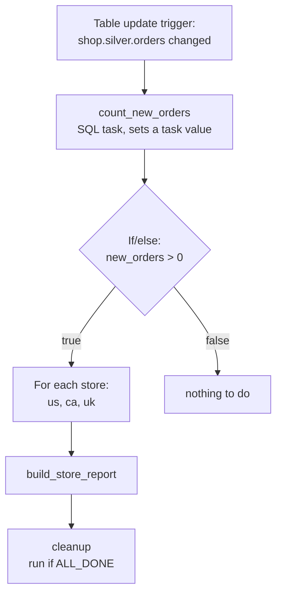

# Tasks Triggers and Schedules

Mastery: `INPUT[inlineSelect(option(new), option(learning), option(solid)):mastery]`

> [!story] Context
> [[Lakeflow Jobs]] chains work together and runs it on a schedule. This note covers the components of a job: task types, the conditions that decide whether a task runs, control flow, and the ways a job can start.

> [!eli5] Summary
> A job is made of steps, and each step does one kind of work, such as running a notebook or a SQL query. Steps can wait for other steps, run only when something failed, or repeat once per item in a list. A job can start at a set time, when new files arrive, or when a table receives new data.

> [!analogy]- Analogy: a household routine
> | Routine | Jobs feature |
> |---|---|
> | Individual chores | Tasks |
> | "Fold after the dryer finishes" | Dependencies |
> | "If the dryer broke, call for repair" | Run if |
> | "If the fridge is empty, go shopping" | If/else condition |
> | "Water each plant on the list" | For each |
> | Every Saturday, or when the mail arrives | Scheduled and event-based triggers |

## Background

Production pipelines are rarely linear. They fan out (load five stores in parallel), branch (send the report only if there is new data), clean up after failures, and start when data is ready rather than at a fixed time. Cron supports only time-based starts. Job control flow and triggers express the rest.

## Overview

### Task types

| Task type | Runs | Typical use |
|---|---|---|
| Notebook | A notebook | Ad hoc logic, Auto Loader loads, API calls |
| Python script / Python wheel | A `.py` file or a packaged library | Tested, versioned code |
| JAR | Compiled Scala or Java | Legacy Spark apps |
| SQL | A query, file, dashboard, or alert on a SQL warehouse | Checks, reports, post-refresh steps |
| Pipeline | A Lakeflow pipeline update | Your bronze/silver/gold build |
| Ingestion (managed connector) | A [[Lakeflow Connect]] ingestion pipeline | Pull from Salesforce, SQL Server, Shopify |
| dbt | dbt commands against a SQL warehouse | [[dbt on Databricks]] |
| Run Job | Another job | Reusing a job as a step |
| If/else condition | Compares two values | Branching |
| For each | Another task once per input | Loops over stores, dates, tables |

The task-type menu also includes Visual data prep, Spark Submit, Dashboards, Power BI, SQL Alert, Clean Room notebook, and other specialized types. See [Configure and edit tasks](https://docs.databricks.com/aws/en/jobs/configure-task) for the current list.

### Dependencies and Run if

A task runs when its dependencies finish. **Run if** decides which outcome counts:

| Run if | The task runs when... |
|---|---|
| `ALL_SUCCESS` (default) | every dependency succeeded |
| `AT_LEAST_ONE_SUCCESS` | at least one dependency succeeded |
| `NONE_FAILED` | no dependency failed (some may be skipped) |
| `ALL_DONE` | every dependency finished, whatever the result |
| `AT_LEAST_ONE_FAILED` | at least one dependency failed |
| `ALL_FAILED` | every dependency failed |

### Triggers

| Trigger | Starts a run when... | Good for |
|---|---|---|
| **Scheduled** | A cron schedule fires | Nightly and hourly jobs |
| **File arrival** | New files land in a monitored Unity Catalog location | Partner drops, exports |
| **Table update** | A monitored source table changes | Downstream jobs that should follow upstream data |
| **Continuous** | The previous run finishes or fails (always one run going) | Streaming jobs |

You can combine triggers on one job. When any active trigger fires, a run starts. The docs give the example of a table update trigger as the main start plus a scheduled trigger as a backup.

## How it works



### File arrival trigger

```yaml
resources:
  jobs:
    load_quickbooks_on_arrival:
      name: load-quickbooks-on-arrival
      trigger:
        pause_status: UNPAUSED
        file_arrival:
          url: /Volumes/shop/bronze/landing/quickbooks/
          min_time_between_triggers_seconds: 300
      tasks:
        - task_key: load
          notebook_task:
            notebook_path: ../src/load_quickbooks.py
```

### Table update trigger

```yaml
      trigger:
        table_update:
          table_names: [shop.silver.orders, shop.silver.invoices]
          condition: ANY_UPDATED
          min_time_between_triggers_seconds: 600
          wait_after_last_change_seconds: 300
```

The docs explain the timing controls: with both set, the trigger waits the minimum time between triggers, then waits the set time after the last change, so a burst of small writes produces one run. Both settings accept 60 seconds or more. With several tables, `condition` is `ANY_UPDATED` or `ALL_UPDATED`.

### Passing values, branching, and looping

A notebook task sets a **task value**:

```python
# In the count_new_orders notebook
n = spark.sql("""
  SELECT COUNT(*) AS n FROM shop.silver.orders
  WHERE order_date = current_date() - INTERVAL 1 DAY
""").first()["n"]
dbutils.jobs.taskValues.set(key="new_orders", value=n)
```

Later tasks read it with a dynamic value reference such as `{{tasks.count_new_orders.values.new_orders}}`:

```yaml
        - task_key: has_new_orders
          depends_on: [{ task_key: count_new_orders }]
          condition_task:
            op: GREATER_THAN
            left: "{{tasks.count_new_orders.values.new_orders}}"
            right: "0"

        - task_key: per_store
          depends_on:
            - task_key: has_new_orders
              outcome: "true"
          for_each_task:
            inputs: '["us", "ca", "uk"]'
            concurrency: 3
            task:
              task_key: per_store_iteration
              notebook_task:
                notebook_path: ../src/build_store_report.py
                base_parameters:
                  store: "{{input}}"

        - task_key: cleanup
          depends_on: [{ task_key: per_store }]
          run_if: ALL_DONE
          notebook_task:
            notebook_path: ../src/cleanup.py
```

`outcome` applies only to dependencies on a `condition_task`: the dependent task runs only if the condition evaluated to that outcome. In `for_each_task`, `inputs` is a JSON array string or a reference to an array (at most 5,000 characters), `task` is the nested task, and `{{input}}` passes the current element to it.

### Retries

Each task can retry a set number of times on error (`max_retries`, with `min_retry_interval_millis` between attempts). For most configurations the default is no retries, and serverless jobs auto-optimize retries by default. Make tasks [[Idempotency|idempotent]] (safe to run twice) before you add retries: [[Auto Loader]], [[COPY INTO]], and pipelines already are; a plain `INSERT INTO` is not. In continuous mode Databricks retries automatically with exponential backoff.

## Small-business considerations

> [!smallbiz] Small-business considerations
> Start with a scheduled trigger and add others only when timing hurts. Two upgrades pay off early. First, a **file arrival trigger** on the folder your bookkeeper or a partner drops files into, so data loads within minutes instead of the next morning. Second, a **cleanup or alert task with `run_if: AT_LEAST_ONE_FAILED`** that posts to your team chat through a webhook. Loops and branches can wait until you need them.

## Cloud differences

> [!azure]- Azure Databricks
> Nothing differs in task types or triggers. File arrival triggers watch Unity Catalog locations on ADLS Gen2 or volumes. Turning on file events for the external location makes them more efficient, as on the other clouds.

> [!aws]- Databricks on AWS
> Same features. File arrival triggers watch S3 locations governed by Unity Catalog.

> [!gcp]- Databricks on Google Cloud
> Same features. File arrival triggers watch Cloud Storage locations governed by Unity Catalog.

## Advanced topics

> [!deepdive]- Advanced topics (301–401)
> - **File events help triggers:** The docs recommend enabling file events on the external location: it makes table update triggers more efficient and unlocks faster Auto Loader and file arrival triggers.
> - **Trigger type in system tables:** `system.lakeflow.job_run_timeline` records a trigger type per run: `CRON`, `FILE_ARRIVAL`, `TABLE`, `CONTINUOUS`, and `ONETIME_RETRY` (a retry of an earlier failed run). Use it to tell scheduled runs from event-driven ones.
> - **Dynamic value references** cover more than task values: job parameters, job and run IDs, start times, and the trigger time. Use the trigger time rather than `current_date()` for [[Backfill|backfills]] and reruns, so a rerun of Tuesday's run still processes Tuesday.
> - **Disabled upstream tasks** break If/else tasks that read their values. Disable with care.
> - **Fan-out limits:** The for-each `concurrency` setting accepts 1 to 100 parallel iterations, and the UI default is 1. Keep it modest when each iteration hits an external API with rate limits.

## Common misconceptions

> [!confusion] A file arrival trigger is not Auto Loader
> The trigger only **starts a job** when files land. The job still needs something, usually [[Auto Loader]], to **load** them exactly once.

> [!confusion] Run if is not If/else
> **Run if** looks at whether upstream tasks *succeeded or failed*. **If/else** compares *values* (task values, parameters) to choose a branch.

## Recall

What are the four kinds of job trigger?::Scheduled (cron), file arrival, table update, and continuous.
What is the default Run if condition?::`ALL_SUCCESS`.
Which Run if value runs a task whatever happened upstream?::`ALL_DONE`.
How does one task pass a value to another?::`dbutils.jobs.taskValues.set(...)`, read with `{{tasks.<task>.values.<key>}}`.
What is the bundle field for an If/else task?::`condition_task`.
What does `outcome: "true"` on a dependency mean?::Run only if the upstream condition task evaluated to true.
Can a job have more than one trigger?::Yes. Any active trigger that fires starts a run.
Which trigger type marks a run that retried an earlier failure?::`ONETIME_RETRY`.

## Next steps

> [!path] Learning path
> **Needs first:** [[Lakeflow Jobs]], [[DAG]]
> **Unlocks next:** [[CI-CD for Data Pipelines]], [[dbt on Databricks]]

> [!nextup] Next
> [[Lakeflow Designer]] covers building pipelines on a visual canvas without writing code.

> [!sources]- Sources (last verified: 2026-10-25)
> - [Automate jobs with schedules and triggers (AWS)](https://docs.databricks.com/aws/en/jobs/triggers)
> - [Automate jobs with schedules and triggers (GCP)](https://docs.databricks.com/gcp/en/jobs/triggers)
> - [Trigger jobs when source tables are updated (AWS)](https://docs.databricks.com/aws/en/jobs/trigger-table-update)
> - [Control the flow of tasks within Lakeflow Jobs (AWS)](https://docs.databricks.com/aws/en/jobs/control-flow)
> - [Control the flow of tasks within Lakeflow Jobs (Azure)](https://learn.microsoft.com/en-us/azure/databricks/jobs/control-flow)
> - [Configure task dependencies (Azure)](https://learn.microsoft.com/en-us/azure/databricks/jobs/run-if)
> - [Configure and edit tasks in Lakeflow Jobs (AWS)](https://docs.databricks.com/aws/en/jobs/configure-task)
> - [Add tasks to jobs in Declarative Automation Bundles (AWS)](https://docs.databricks.com/aws/en/dev-tools/bundles/job-task-types)
> - [Dynamic value references (AWS)](https://docs.databricks.com/aws/en/jobs/dynamic-value-references)
> - [Disabled tasks in Lakeflow Jobs (AWS)](https://docs.databricks.com/aws/en/jobs/disabled-tasks)
> - [Jobs system table reference (AWS)](https://docs.databricks.com/aws/en/admin/system-tables/jobs)
> - [Use a For each task to run another task in a loop (AWS)](https://docs.databricks.com/aws/en/jobs/for-each)
> - [Use task values to pass information between tasks (AWS)](https://docs.databricks.com/aws/en/jobs/task-values)
> - [Trigger jobs when new files arrive (AWS)](https://docs.databricks.com/aws/en/jobs/file-arrival-triggers)
> - [Declarative Automation Bundles resources (AWS)](https://docs.databricks.com/aws/en/dev-tools/bundles/resources)
> - [Jobs API: Create a new job](https://docs.databricks.com/api/workspace/jobs/create)
