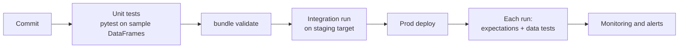

# Testing Data Pipelines

Mastery: `INPUT[inlineSelect(option(new), option(learning), option(solid)):mastery]`

> [!story] Context
> [[CI-CD for Data Pipelines]] runs automated checks before each deployment. This note covers what those checks are: tests of transformation logic, tests of the data itself, and the runtime safeguards that catch problems in production.

> [!eli5] Summary
> Testing a data pipeline means checking two things: that the code does the right calculation, and that the data coming out looks right. Code checks run on small, made-up examples before a change goes live. Data checks run on the real data every time the pipeline runs.

> [!analogy]- Analogy: a bakery
> | Bakery | Data pipeline testing |
> |---|---|
> | Testing the recipe with a small batch | Unit tests on small sample DataFrames |
> | Checking every loaf on the line | Expectations on every row |
> | Weighing the day's total output | Table-level data tests (counts, uniqueness, totals) |
> | A trial run in the test kitchen | Integration tests on a staging target |

## Background

Application code is tested with fixed inputs and expected outputs. Data pipelines add a second failure source: the code can be correct while the input data changes (a new column, a duplicated export, a currency the code does not handle). A test strategy for pipelines covers both:

- **Logic errors** in transformations, caught before deployment.
- **Data errors** in sources, caught at run time.

## Overview

| Layer | What it checks | When it runs | Tools |
|---|---|---|---|
| **Unit tests** | One transformation function on small, hand-built input | Every commit, in CI | `pytest`, PySpark, [[Databricks Connect]] |
| **Configuration validation** | Bundle and pipeline definitions are well formed | Every commit, in CI | `databricks bundle validate` |
| **Integration tests** | The whole pipeline on sample data in a staging target | Pull requests, before prod | Bundle deploy and run to a staging target |
| **Inline data checks** | Row-level rules on real data | Every pipeline update | [[Expectations and Data Quality\|Expectations]] |
| **Table-level data tests** | Uniqueness, row counts, referential integrity, reconciliations | After each run | Expectations on aggregate views, dbt tests, SQL tasks |
| **Monitoring** | Freshness, volume, and drift over time | Continuously | [[Data Quality Monitoring]], [[SQL Alerts]] |

## How it works



### 1. Structure code so it can be tested

Put transformation logic in plain functions that take and return DataFrames. Keep reading and writing outside those functions.

`src/shop/transforms.py`:

```python
from pyspark.sql import DataFrame, functions as F

def paid_daily_revenue(orders: DataFrame) -> DataFrame:
    """Revenue per day from paid orders only."""
    return (orders
            .where(F.col("financial_status") == "paid")
            .groupBy(F.to_date("ordered_at").alias("day"))
            .agg(F.sum("total").alias("revenue")))
```

The pipeline file imports and calls it:

```python
from pyspark import pipelines as dp
from shop.transforms import paid_daily_revenue

@dp.materialized_view
def daily_revenue():
    return paid_daily_revenue(spark.read.table("orders_clean"))
```

### 2. Unit test with pytest

`tests/unit/test_transforms.py`:

```python
from datetime import datetime
from decimal import Decimal

import pytest
from pyspark.sql import SparkSession
from pyspark.testing import assertDataFrameEqual

from shop.transforms import paid_daily_revenue


@pytest.fixture(scope="session")
def spark():
    return SparkSession.builder.master("local[1]").getOrCreate()


def test_only_paid_orders_count(spark):
    orders = spark.createDataFrame(
        [
            (1, datetime(2026, 10, 24, 9), Decimal("50.00"), "paid"),
            (2, datetime(2026, 10, 24, 11), Decimal("20.00"), "refunded"),
            (3, datetime(2026, 10, 25, 8), Decimal("30.00"), "paid"),
        ],
        "order_id INT, ordered_at TIMESTAMP, total DECIMAL(12,2), financial_status STRING",
    )

    result = paid_daily_revenue(orders)

    expected = spark.createDataFrame(
        [(datetime(2026, 10, 24).date(), Decimal("50.00")),
         (datetime(2026, 10, 25).date(), Decimal("30.00"))],
        "day DATE, revenue DECIMAL(22,2)",
    )
    assertDataFrameEqual(result, expected)
```

Run locally with `pytest tests/unit`. To run the same tests against Databricks compute instead of local Spark, create the session with [[Databricks Connect]] (`from databricks.connect import DatabricksSession`).

### 3. Table-level data tests as expectations

Expectations check one row at a time. For checks across rows, compute the check in a view and apply an expectation to the view, a pattern from the Databricks expectations guidance:

```sql
CREATE OR REFRESH MATERIALIZED VIEW orders_tests (
  CONSTRAINT unique_order_id EXPECT (duplicate_ids = 0)  ON VIOLATION FAIL UPDATE,
  CONSTRAINT has_rows        EXPECT (row_count > 0)      ON VIOLATION FAIL UPDATE
) AS
SELECT COUNT(*)                                AS row_count,
       COUNT(*) - COUNT(DISTINCT order_id)     AS duplicate_ids
FROM orders_clean;
```

### 4. Reconciliation as a job task

A SQL task at the end of the nightly [[Lakeflow Jobs|job]] can compare totals between layers and fail the run if they disagree:

```sql
-- post_refresh_checks.sql
SELECT assert_true(
  ABS(
    (SELECT SUM(total) FROM shop.silver.orders WHERE financial_status = 'paid'
       AND DATE(ordered_at) = current_date() - INTERVAL 1 DAY)
    -
    (SELECT revenue FROM shop.gold.daily_sales WHERE day = current_date() - INTERVAL 1 DAY)
  ) < 0.01,
  'gold daily_sales does not match silver orders'
);
```

### 5. dbt tests

If gold models are built with dbt, `dbt build` runs schema tests (`not_null`, `unique`, `relationships`, `accepted_values`) after each model. See [[dbt on Databricks]].

## Small-business considerations

> [!smallbiz] Small-business considerations
> A small team gets most of the value from three items:
> 1. Expectations on silver tables (IDs not null, amounts not negative).
> 2. One reconciliation check per gold table that matters to the business, such as daily revenue matching the sum of paid orders.
> 3. A failure notification on the nightly job.
>
> Add unit tests when transformation logic becomes non-trivial (discount rules, currency conversion, tax), or when a second person starts changing the code.

## Cloud differences

> [!azure]- Azure Databricks
> Testing tools and patterns are identical on Azure, AWS, and Google Cloud. Only the CI system and authentication setup differ (see [[CI-CD for Data Pipelines]]).

## Advanced topics

> [!deepdive]- Advanced topics (301–401)
> - **Test data.** Build unit-test inputs in code, as above, so each test documents its own edge cases. For integration tests, use a small, de-identified sample catalog rather than production data, in line with [[Least Privilege|least privilege]].
> - **Idempotency tests.** Run the pipeline twice on the same input in staging and assert that row counts do not change. This catches non-[[Idempotency|idempotent]] steps, such as `INSERT INTO` without deduplication.
> - **Schema change tests.** Add a test file with an extra column to staging and confirm that [[Auto Loader]] evolves or rescues it as configured.
> - **Rules as data.** Storing expectation rules in a table lets business owners maintain them, but rule changes then bypass code review. Version the rules table or review changes to it.
> - **Failing vs warning.** In production, `FAIL UPDATE` stops a flow and blocks downstream tasks. Reserve it for conditions where no output is better than wrong output; use warn or drop elsewhere and alert on the metrics.

## Common misconceptions

> [!confusion] Expectations do not replace unit tests
> Expectations validate data at run time. They cannot detect a correct-looking but wrong calculation, such as revenue that includes refunded orders. Unit tests with known inputs catch that.

> [!confusion] A passing CI run does not guarantee good data
> CI tests code on sample data. Source data can still change after deployment, which is why run-time checks and monitoring are part of the strategy.

## Recall

What are the two kinds of failure a pipeline test strategy covers?::Logic errors in code and errors in the incoming data.
How should transformation logic be structured for unit testing?::As functions that take and return DataFrames, with reading and writing kept outside.
Which PySpark helper compares DataFrames in tests?::`pyspark.testing.assertDataFrameEqual`.
How do you test uniqueness with pipeline expectations?::Compute a duplicate count in a materialized view and add an expectation such as `EXPECT (duplicate_ids = 0)` on it.
Which CLI command validates bundle configuration in CI?::`databricks bundle validate`.
What SQL function fails a query when a condition is false?::`assert_true(condition, message)`.
What does an idempotency test check?::That running the pipeline twice on the same input produces the same result.

## Next steps

> [!path] Learning path
> **Needs first:** [[CI-CD for Data Pipelines]], [[Expectations and Data Quality]], [[PySpark]]
> **Unlocks next:** [[Chapter 09 - SQL BI and Apps]], [[Data Quality Monitoring]]

> [!nextup] Next
> [[Chapter 09 - SQL BI and Apps]] covers how people use the clean, tested gold tables: SQL warehouses, dashboards, Genie, and apps.

> [!sources]- Sources (last verified: 2026-10-25)
> - [Manage data quality with pipeline expectations (AWS)](https://docs.databricks.com/aws/en/ldp/expectations)
> - [Expectation recommendations and advanced patterns (AWS)](https://docs.databricks.com/aws/en/ldp/expectation-patterns)
> - [Best practices for Lakeflow pipelines (AWS)](https://docs.databricks.com/aws/en/ldp/best-practices/)
> - [What are Declarative Automation Bundles? (AWS)](https://docs.databricks.com/aws/en/dev-tools/bundles/)
> - [Declarative Automation Bundles FAQs (AWS)](https://docs.databricks.com/aws/en/dev-tools/bundles/faqs)
> - [Develop pipelines with Declarative Automation Bundles (AWS)](https://docs.databricks.com/aws/en/dev-tools/bundles/pipelines-tutorial)
> - [Use dbt transformations in Lakeflow Jobs (AWS)](https://docs.databricks.com/aws/en/jobs/how-to/use-dbt-in-workflows)
> - **Unconfirmed:** the search budget ran out before these details could be re-checked: `pyspark.testing.assertDataFrameEqual`, the `databricks.connect.DatabricksSession` import, the `assert_true` SQL function, importing local modules into pipeline source files, and the result type `DECIMAL(22,2)` in the test.
