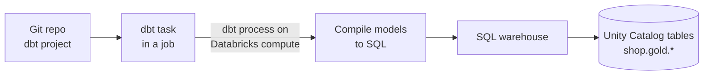

# dbt on Databricks

Mastery: `INPUT[inlineSelect(option(new), option(learning), option(solid)):mastery]`

> [!story] Context
> [[Structured Streaming on Databricks]] covered the low-latency end of data engineering. Many analytics teams instead build their transformations as SQL models in [[dbt]], a tool from the [[Chapter 04 - The Modern Data Stack|modern data stack]]. This note covers how dbt projects run on Databricks.

> [!eli5] Summary
> dbt is a popular tool for writing data transformations as a folder of SQL files with tests and documentation. Databricks can run those SQL files on its own compute, and a scheduled Databricks job can run the dbt project every night next to the rest of the pipeline.

> [!analogy]- Analogy: a recipe binder and a kitchen
> | Recipe binder and kitchen | dbt on Databricks |
> |---|---|
> | Binder of recipes, each referring to others | The dbt project: models that `ref()` each other |
> | The kitchen that cooks them | A Databricks [[SQL Warehouses\|SQL warehouse]] |
> | The kitchen schedule | A dbt task in a [[Lakeflow Jobs\|job]] |

## Background

dbt (data build tool) lets analysts define each table as a `SELECT` statement, declare dependencies with `ref()`, and add tests and documentation in [[YAML]]. dbt compiles the project to SQL and sends it to a data platform through an adapter. It became a standard part of the modern data stack.

Databricks supports dbt in two ways: the `dbt-databricks` adapter, which lets dbt run against Databricks from anywhere, and a dbt task type in Lakeflow Jobs, which runs a dbt project as a step in a job.

## Overview

| Option | Where dbt runs | Where SQL runs | Best for |
|---|---|---|---|
| **dbt task in Lakeflow Jobs** (recommended by Databricks for production) | Databricks compute | A SQL warehouse (or all-purpose compute) | Scheduling dbt with the rest of the pipeline |
| **dbt Core locally or in CI** | Your laptop or CI runner | A SQL warehouse | Development and CI checks |
| **dbt platform (dbt Cloud)** | dbt Labs' service | A SQL warehouse | Teams already on dbt's hosted IDE and scheduler; available through [[Partner Connect]] |

Facts from the Databricks docs:

- By default, the dbt task runs the dbt Python process on Databricks compute and runs the dbt-generated SQL against the selected SQL warehouse.
- Only a SQL warehouse or all-purpose compute can be the target for a dbt task. Job compute cannot be the target.
- The `dbt_task` block accepts `commands` (up to 10), `warehouse_id`, `project_directory`, `schema`, and `catalog`. The `catalog` field requires `dbt-databricks` 1.1.1 or later. `profiles_directory` can only be set when no `warehouse_id` is given.
- [[Declarative Automation Bundles]] include a `dbt-sql` template that creates a project with a job containing a dbt task.
- The most common failure is "profiles.yml not found", which occurs when the file is not at the root of the dbt project.

## How it works



### Adapter and profile for local development

```bash
pip install dbt-databricks
dbt init shop_dbt
```

`profiles.yml` (keep secrets out of the file; read them from environment variables):

```yaml
shop_dbt:
  target: dev
  outputs:
    dev:
      type: databricks
      catalog: shop
      schema: dbt_dev
      host: "{{ env_var('DATABRICKS_HOST') }}"
      http_path: /sql/1.0/warehouses/abc123def456
      token: "{{ env_var('DATABRICKS_TOKEN') }}"
      threads: 4
```

The dbt documentation also describes service principal and OAuth authentication, and the `connect_timeout` (default 200 seconds) and `connect_retries` (default 1) settings for warehouses that take time to start.

### A model

`models/gold/daily_sales.sql`:

```sql
{{ config(materialized='table') }}

select
  date(ordered_at)  as day,
  count(*)          as orders,
  sum(total)        as revenue
from {{ ref('orders_clean') }}
where financial_status = 'paid'
group by date(ordered_at)
```

`models/gold/schema.yml`:

```yaml
version: 2
models:
  - name: daily_sales
    columns:
      - name: day
        data_tests: [not_null, unique]
```

### A dbt task in a job

```yaml
resources:
  jobs:
    nightly_dbt:
      name: nightly-dbt
      schedule:
        quartz_cron_expression: "0 30 3 * * ?"
        timezone_id: America/Chicago
      tasks:
        - task_key: dbt_build
          dbt_task:
            project_directory: ../dbt/shop_dbt
            commands:
              - dbt deps
              - dbt build
            warehouse_id: ${var.warehouse_id}
            catalog: shop
            schema: gold
          job_cluster_key: dbt_cluster
          libraries:
            - pypi:
                package: dbt-databricks>=1.8.0,<2.0.0
      job_clusters:
        - job_cluster_key: dbt_cluster
          new_cluster:
            spark_version: 15.4.x-scala2.12
            num_workers: 0
            node_type_id: ${var.small_node_type}
            spark_conf:
              spark.master: "local[*, 4]"
              spark.databricks.cluster.profile: singleNode
            custom_tags:
              ResourceClass: SingleNode
```

The single-node job cluster settings (`num_workers: 0`, the `singleNode` profile, and the `SingleNode` tag) follow the Databricks dbt task example. Pick any supported runtime version and node type for your workspace. The cluster runs only the dbt process; the SQL itself runs on the warehouse. `dbt build` runs models, tests, snapshots, and seeds in dependency order. `data_tests` is the current dbt property name for tests in YAML.

### dbt or Lakeflow pipelines?

| | dbt | [[Lakeflow Spark Declarative Pipelines\|Lakeflow pipelines]] |
|---|---|---|
| Language | SQL with Jinja templating; Python models also run on Databricks | SQL or Python |
| Incremental ingestion from files or streams | Through the adapter's `streaming_table` materialization (requires Unity Catalog and serverless SQL warehouses) | Built in (streaming tables, Auto Loader) |
| CDC and SCD type 2 | Snapshots (type 2 SCD) and incremental models | AUTO CDC |
| Data quality | dbt data tests (run after each model in `dbt build`) | Expectations (inline) |
| Portability | Runs on many data platforms through adapters | Databricks (core framework in Apache Spark) |

A common split: pipelines for bronze and silver ingestion, dbt for gold business models.

## Small-business considerations

> [!smallbiz] Small-business considerations
> If you already have a dbt project (for example, from a previous warehouse), keep it. Point the adapter at a SQL warehouse, then schedule it with a dbt task in the same job that runs ingestion. If you are starting from nothing, Lakeflow pipelines alone are usually simpler for a one-person team: one tool, one run history, no extra package to maintain. Costs come from the SQL warehouse and the small cluster that runs the dbt process. See [[How Databricks Pricing Works]].

> [!bridge]- In Databricks today
> dbt itself remains a separate open-source tool from dbt Labs. On Databricks, its role (SQL transformations with dependencies and tests) overlaps with Lakeflow pipelines, [[Materialized Views|materialized views]], and expectations. Databricks supports dbt directly through the dbt task, the `dbt-databricks` adapter, and a bundle template. See [[Open Source vs Databricks - Who Replaced What]].

## Cloud differences

> [!azure]- Azure Databricks
> The dbt task and adapter work identically on all three clouds. Only the `host` value differs (`adb-<id>.<n>.azuredatabricks.net` on Azure, `<name>.cloud.databricks.com` on AWS, `<id>.<n>.gcp.databricks.com` on Google Cloud).

## Advanced topics

> [!deepdive]- Advanced topics (301–401)
> - **Migrating from dbt-spark.** dbt Labs publishes a guide for moving from the older `dbt-spark` adapter to `dbt-databricks`, which adds Unity Catalog and Databricks SQL features.
> - **Databricks-specific configs.** The adapter documents Databricks configurations for models (file format, clustering, table properties, and materializations). Check the adapter reference for supported options before relying on a materialization.
> - **Custom profiles in jobs.** To use your own `profiles.yml` in a dbt task, commit it at the project root, point it at a SQL warehouse, and read the token from an environment variable rather than storing it in the file.
> - **Lineage.** Tables built by dbt are ordinary Unity Catalog tables, so [[Data Lineage|lineage]] is captured from the SQL that the warehouse runs.

## Common misconceptions

> [!confusion] The dbt task does not run SQL on job compute
> The dbt process can run on job compute, but the generated SQL must target a SQL warehouse or all-purpose compute.

> [!confusion] dbt is not an ingestion tool
> dbt transforms data that is already in the platform. Ingestion is done by [[Lakeflow Connect]], [[Auto Loader]], or another tool.

## Recall

What is the name of the Databricks adapter for dbt?::`dbt-databricks`.
Which compute can a dbt task target for its SQL?::A SQL warehouse or all-purpose compute, not job compute.
How many commands can a dbt task run?::Up to 10.
Which bundle template creates a dbt project with a job?::`dbt-sql`.
What causes the most common dbt task error?::`profiles.yml` not being at the root of the dbt project.
Which minimum adapter version supports the `catalog` field in a dbt task?::`dbt-databricks` 1.1.1.
What does `dbt build` do?::Runs models, tests, snapshots, and seeds in dependency order.

## Next steps

> [!path] Learning path
> **Needs first:** [[dbt]], [[SQL Warehouses]], [[Lakeflow Jobs]]
> **Unlocks next:** [[CI-CD for Data Pipelines]], [[Testing Data Pipelines]]

> [!nextup] Next
> [[CI-CD for Data Pipelines]] covers promoting pipelines, jobs, and dbt projects from development to production with Declarative Automation Bundles and automated deployment.

> [!sources]- Sources (last verified: 2026-10-25)
> - [Use dbt transformations in Lakeflow Jobs (AWS)](https://docs.databricks.com/aws/en/jobs/how-to/use-dbt-in-workflows)
> - [Use dbt transformations in Lakeflow Jobs (Azure)](https://learn.microsoft.com/en-us/azure/databricks/jobs/how-to/use-dbt-in-workflows)
> - [Use dbt transformations in Lakeflow Jobs (GCP)](https://docs.databricks.com/gcp/en/jobs/how-to/use-dbt-in-workflows)
> - [Connect to dbt Core (AWS)](https://docs.databricks.com/aws/en/partners/prep/dbt)
> - [Add tasks to jobs in Declarative Automation Bundles (AWS)](https://docs.databricks.com/aws/en/dev-tools/bundles/job-task-types)
> - [Declarative Automation Bundles project templates (AWS)](https://docs.databricks.com/aws/en/dev-tools/bundles/templates)
> - [Databricks setup (dbt docs)](https://docs.getdbt.com/docs/local/connect-data-platform/databricks-setup)
> - [Databricks configurations (dbt docs)](https://docs.getdbt.com/reference/resource-configs/databricks-configs)
> - [Migrate from dbt-spark to dbt-databricks (dbt docs)](https://docs.getdbt.com/guides/migrate-from-spark-to-databricks)
> - [About profiles.yml (dbt docs)](https://docs.getdbt.com/docs/local/profiles.yml)
> - [About data tests property (dbt docs)](https://docs.getdbt.com/reference/resource-properties/data-tests)
> - [Add snapshots to your DAG (dbt docs)](https://docs.getdbt.com/docs/build/snapshots)
> - [About dbt build command (dbt docs)](https://docs.getdbt.com/reference/commands/build)
> - [Python models (dbt docs)](https://docs.getdbt.com/docs/build/python-models)
> - [Databricks platform release notes, June 2025: AUTO CDC (AWS)](https://docs.databricks.com/aws/en/release-notes/product/2025/june)
> - [Databricks Runtime release notes versions and compatibility (AWS)](https://docs.databricks.com/aws/en/release-notes/runtime/)
> - [Get identifiers for workspace objects (AWS)](https://docs.databricks.com/aws/en/workspace/workspace-details)
> - [Get identifiers for workspace objects (Azure)](https://learn.microsoft.com/en-us/azure/databricks/workspace/workspace-details)
> - [Get identifiers for workspace objects (GCP)](https://docs.databricks.com/gcp/en/workspace/workspace-details)
