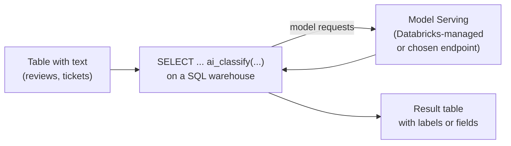

# AI Functions in SQL

Mastery: `INPUT[inlineSelect(option(new), option(learning), option(solid)):mastery]`

> [!story] Context
> [[Partner Connect]] and the BI connectors bring outside tools to the data. AI Functions bring a [[LLM|large language model]] into SQL itself, so an analyst can classify reviews, summarize support tickets, or extract fields from text with a function call in a `SELECT`.

> [!eli5] Summary
> AI Functions are commands you can use in an ordinary database query to have an AI model read text for you. For example, one line can label a thousand customer reviews as positive or negative, or pull the order number out of each complaint email. The results land in a table like any other query result.

## Background

Free-text data such as reviews, emails, and support tickets has traditionally needed a separate machine learning project to analyze: export the text, write Python, call a model API, and load the results back. Analysts who work in SQL could not do this themselves.

AI Functions are built-in SQL functions that call models served by Databricks [[Model Serving]]. They run on [[Databricks SQL]] warehouses, notebooks, and pipelines, so the same query that aggregates sales can also label text.

## Overview

Databricks groups AI Functions into task-specific functions and one general-purpose function. The docs recommend a task-specific function when one fits the task.

| Function | What it does |
|---|---|
| `ai_classify` | Assigns one or more labels from a list you supply. Version 2.1 adds label descriptions, multi-label output, and optional confidence scores and rationales. Version 1.0 is a legacy interface. |
| `ai_extract` | Extracts named fields (such as a product or an order number) from text |
| `ai_summarize` | Summarizes text |
| `ai_translate` | Translates text into a target language |
| `ai_mask` | Masks specified kinds of information in text |
| `ai_similarity` | Scores how similar two texts are |
| `ai_parse_document` | Extracts structured content from documents such as PDFs |
| `ai_query` | General purpose. Calls any supported model serving endpoint with your own prompt, parameters, and output format. |

Additional facts:

- Task-specific functions use Databricks-managed models. You do not choose or deploy a model.
- `ai_query` requires Databricks Runtime 15.4 LTS or above, and Databricks recommends Runtime 18.2 or above. Some `ai_query` documentation marks parts of the function as Public Preview.
- For production batch workloads with `ai_query`, Databricks recommends Databricks-hosted foundation models (endpoints prefixed `databricks-`), which are fully managed and suited to batch processing. See [[Foundation Model APIs]].

## How it works



### Example: label customer reviews

A bakery stores online reviews in `shop.feedback.reviews` with columns `review_id`, `store_id`, and `review_text`.

```sql
-- Label each review with one topic from a fixed list
SELECT
  review_id,
  store_id,
  review_text,
  ai_classify(
    review_text,
    ARRAY('product quality', 'service', 'wait time', 'price', 'other')
  ) AS topic
FROM shop.feedback.reviews
WHERE review_date >= current_date() - INTERVAL 30 DAYS;
```

```sql
-- Summarize and translate in the same query
SELECT
  review_id,
  ai_summarize(review_text, 20)     AS short_summary,   -- at most about 20 words
  ai_translate(review_text, 'en')   AS review_in_english
FROM shop.feedback.reviews
LIMIT 100;
```

```sql
-- Pull structured fields out of complaint emails
SELECT
  email_id,
  ai_extract(email_body, ARRAY('order number', 'product', 'store')) AS fields
FROM shop.feedback.complaint_emails;
```

### Example: a custom prompt with ai_query

Use `ai_query` when no task-specific function fits, or when you need a specific model or output format. Replace the endpoint name with a model serving endpoint listed on the **Serving** page of your workspace.

```sql
SELECT
  review_id,
  ai_query(
    'databricks-<model-name>',   -- a Databricks-hosted foundation model endpoint
    CONCAT(
      'Rate the urgency of this customer complaint as low, medium, or high. ',
      'Reply with one word only. Complaint: ', review_text
    ),
    failOnError => false
  ) AS urgency
FROM shop.feedback.reviews;
```

With `failOnError => false` (Databricks Runtime 15.3 and above), the function returns a struct containing the response and an error message instead of failing the whole query on one bad row. Databricks recommends this pattern for large workloads.

### Save results

Run the classification once and store it, rather than calling the model each time a dashboard loads:

```sql
CREATE OR REPLACE TABLE shop.feedback.reviews_labeled AS
SELECT review_id, store_id, review_date,
       ai_classify(review_text, ARRAY('product quality', 'service', 'wait time', 'price', 'other')) AS topic
FROM shop.feedback.reviews;
```

## Small-business considerations

> [!smallbiz] Small-business considerations
> - **Good first uses:** tagging reviews and support tickets by topic, summarizing long feedback, translating messages from customers, and extracting order numbers from emails.
> - **Test on 100 rows first** with `LIMIT 100`. Check the labels by hand before running on the full table.
> - **Store the results** in a table and refresh new rows on a schedule, for example in a [[Lakeflow Jobs|job]], instead of recomputing in every dashboard query.
> - **Do not send sensitive data you have not reviewed.** Check whether text contains [[PII]] and your policy for model use before processing it.
>
> Cost: task-specific functions run inference on Databricks-managed serverless GPU infrastructure through Model Serving. That inference is billed in addition to the query's SQL warehouse compute. `ai_query` is billed according to the endpoint it calls, usually per [[Token|token]]. See the official pricing page and [[How Databricks Pricing Works]].

## Cloud differences

> [!azure]- Azure Databricks
> AI Functions have limited regional availability. The Azure "features with limited regional availability" table lists `ai_query` batch inference support per region (for example East US, Central US, West US 2, UK South, and Switzerland North). Check the table for your workspace region and whether cross-geo processing is enabled.

> [!aws]- Databricks on AWS
> Availability depends on the workspace region and the model. Check the AWS limited regional availability page before planning a workload.

> [!gcp]- Databricks on Google Cloud
> As of October 2026, the GCP availability table lists `ai_query` support in regions including `us-central1`, `us-east1`, `us-east4`, `us-west1`, `europe-west2`, `europe-west3`, `asia-south1`, and `asia-southeast1`, and not in several others such as `europe-west1` and `asia-northeast1`. Check the current table.

## Advanced topics

> [!deepdive]- Advanced topics (301–401)
> - **Structured output.** `ai_query` accepts `responseFormat` (Databricks Runtime 15.4 LTS and above) with `text`, `json_object`, or `json_schema` types, so responses can be parsed into columns reliably.
> - **Model parameters.** Pass settings such as `max_tokens` and `temperature` through the `modelParameters` argument.
> - **Custom endpoints.** For a custom model endpoint without a schema, the signature includes `returnType` to declare the output type.
> - **Batch at scale.** For large backfills, run them in a pipeline or job, and use `failOnError => false` so one malformed row does not stop the run.
> - **Pipelines and Designer.** AI Functions can be used inside [[Lakeflow Spark Declarative Pipelines]] to label new rows incrementally, and [[Lakeflow Designer]] exposes them as built-in operators.
> - **Governance.** Calls to endpoints can be governed and logged with [[AI Gateway]]. Because outputs are model predictions, treat them as estimates and validate a sample (see [[Hallucination]]).

## Common misconceptions

> [!confusion] AI Functions do not train a model on your data
> They send rows to an existing model for [[Inference|inference]] and return the output. To adapt a model to your own examples, see [[Fine-Tuning]].

> [!confusion] Task-specific functions still incur inference charges
> You do not deploy an endpoint for them, but their inference runs on Databricks-managed infrastructure and is billed in addition to the warehouse.

> [!confusion] A label is not a fact
> A classification is a model's judgment. Review a sample and track accuracy before reporting counts based on it.

## Recall

Which AI Function is general purpose?::`ai_query`, which calls any supported model serving endpoint with a custom prompt.
When does Databricks recommend a task-specific AI Function over `ai_query`?::Whenever a task-specific function fits the task.
Name four task-specific AI Functions.::For example `ai_classify`, `ai_extract`, `ai_summarize`, and `ai_translate` (also `ai_mask`, `ai_similarity`, `ai_parse_document`).
What is the minimum Databricks Runtime for `ai_query`?::15.4 LTS (18.2 or above recommended).
What does `failOnError => false` do in `ai_query`?::Returns a struct with the response and an error message instead of failing the whole query.
Which models does Databricks recommend for production batch inference with `ai_query`?::Databricks-hosted foundation models, with endpoint names prefixed `databricks-`.
How are task-specific AI Functions billed?::Inference on Databricks-managed serverless GPU infrastructure, billed in addition to query compute.
Which `ai_classify` version adds multi-label output and confidence scores?::Version 2.1.

## Next steps

> [!path] Learning path
> **Needs first:** [[SQL]], [[Databricks SQL]], [[LLM]]
> **Unlocks next:** [[Foundation Model APIs]], [[Model Serving]], [[Generative AI and LLMs]], [[Agent Bricks]]

> [!nextup] Next
> [[Databricks Apps]] covers hosting internal web applications next to the data, for workflows that need a form or custom interface instead of a query.

> [!sources]- Sources (last verified: 2026-10-25)
> - [Transform unstructured data using AI Functions (AWS)](https://docs.databricks.com/aws/en/large-language-models/ai-functions)
> - [Use ai_query (AWS)](https://docs.databricks.com/aws/en/large-language-models/ai-query)
> - [ai_query function (AWS)](https://docs.databricks.com/aws/en/sql/language-manual/functions/ai_query)
> - [ai_query function (Azure Databricks)](https://learn.microsoft.com/en-us/azure/databricks/sql/language-manual/functions/ai_query)
> - [ai_query function (GCP)](https://docs.databricks.com/gcp/en/sql/language-manual/functions/ai_query)
> - [ai_classify function (AWS)](https://docs.databricks.com/aws/en/sql/language-manual/functions/ai_classify)
> - [Built-in functions (AWS)](https://docs.databricks.com/aws/en/sql/language-manual/sql-ref-functions-builtin)
> - [Analyze customer reviews using AI Functions (AWS)](https://docs.databricks.com/aws/en/large-language-models/ai-functions-example)
> - [Built-in operators in Lakeflow Designer (GCP)](https://docs.databricks.com/gcp/en/designer/built-in-operators)
> - [Features with limited regional availability (Azure Databricks)](https://learn.microsoft.com/en-us/azure/databricks/resources/feature-region-support)
> - [Features with limited regional availability (AWS)](https://docs.databricks.com/aws/en/resources/feature-region-support)
> - [Features with limited regional availability (GCP)](https://docs.databricks.com/gcp/en/resources/feature-region-support)
