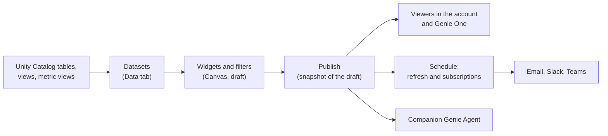

# AI-BI Dashboards

Mastery: `INPUT[inlineSelect(option(new), option(learning), option(solid)):mastery]`

> [!story] Context
> [[Query Performance and Caching]] covered how Databricks SQL makes repeated queries fast. Business users rarely read query results directly. They need pages of charts and filters that they can open, share, and receive by email. AI/BI dashboards provide that inside Databricks.

> [!eli5] Summary
> An AI/BI dashboard is a page of charts and numbers built from company data inside Databricks. Builders create it with help from an AI assistant, publish it, and share it with colleagues, who can open it in a browser, get it by email, or ask follow-up questions in plain language.

> [!renamed] Renamed
> AI/BI dashboards were originally called **Lakeview dashboards**. They became generally available in April 2024 and appear in the UI as **Dashboards**. The older Databricks SQL dashboards were relabeled **legacy dashboards** and have reached end of life (details under Background).

## Background

Before AI/BI dashboards, Databricks offered Databricks SQL dashboards, which were built from individual saved queries. Many teams also exported data to a separate [[BI Tools|BI tool]], which meant a second license, a second copy of the data, and a second set of permissions.

AI/BI dashboards replaced the legacy dashboards. The legacy timeline:

| Date | Event |
|---|---|
| April 2024 | Lakeview (AI/BI) dashboards become generally available |
| April 10, 2025 | Official support for legacy dashboards ends. Creating or cloning them through the UI or API stops. |
| January 12, 2026 | Legacy dashboards and their APIs are no longer directly accessible. Conversion to AI/BI dashboards remains possible. |
| March 2, 2026 | The migration page is removed |
| 2026 | Release notes state legacy dashboards have reached end of life |

AI/BI dashboards do not support every legacy feature. To move dashboards from other tools, see [[Migrating BI Reports]].

## Overview

An AI/BI dashboard has three parts: datasets, a canvas of widgets, and a publishing configuration.

| Capability | Description |
|---|---|
| **Datasets** | The data behind the dashboard. A dataset is a table, a view, a [[Metric Views\|metric view]], or a custom SQL query. Datasets inherit [[Unity Catalog]] permissions. |
| **Visualizations** | Charts, counters, tables, and maps built from a dataset. In draft mode you can view the SQL a widget runs, including applied filters. |
| **Filters** | Global, page-level, or widget-level filters. For small datasets, field filters run in the browser without rerunning the query. |
| **Parameters** | Values defined on the **Data** tab and exposed to viewers through filter widgets |
| **AI-assisted authoring** | Genie Code (formerly [[Genie Code]]) plans and builds visualizations, multi-page layouts, and filters, and fixes errors |
| **Companion Genie Agent** | Each published dashboard includes a [[Genie Agents]] Agent so viewers can ask questions that the charts do not answer |
| **Sharing** | Share with users and groups in the account, including account users who are not workspace members (view-only) |
| **Schedules and subscriptions** | Refresh on a schedule and send snapshots by email, Slack, or Microsoft Teams |
| **Embedding** | Embed published dashboards in other websites or apps through an iframe |

Dashboards run their queries on a [[SQL Warehouses|SQL warehouse]], which you select when you create or publish the dashboard.

## How it works



### Draft and published versions

A dashboard has a **draft** that authors edit and a **published** version that viewers see. The published version is a snapshot. Changes to the draft do not reach viewers until you publish again.

When you publish, you choose the data permissions:

| Option | Viewers query with | Use when |
|---|---|---|
| **Shared data permissions** (default) | The publisher's credentials | Viewers do not have their own access to the tables, and every viewer may see the same data |
| **Individual data permissions** | Each viewer's own Unity Catalog permissions | Different viewers must see different rows, for example through [[Row Filters and Column Masks\|row filters]] |

### Worked example: daily sales by store

This example builds a one-page dashboard for a three-store bakery.

1. In the sidebar, click **New** > **Dashboard**.
2. Open the **Data** tab and click **Create from SQL**.
3. Paste the dataset query below and name the dataset `daily_sales`.
4. Return to the canvas and add a **Visualization** widget.
5. Set the widget to a bar chart with `order_date` on the X axis, `revenue` on the Y axis, and `store_name` as the color.
6. Add a **Counter** widget that shows the sum of `revenue` for the latest day.
7. Add a **Filter** widget on `store_name`.
8. Click **Publish**, keep **Shared data permissions**, and share the dashboard with the `viewers` group.
9. Click **Schedule** and add a daily refresh at 6:00 a.m. with the owner as a subscriber.

```sql
-- Dataset: daily_sales
SELECT
  o.order_date,
  s.store_name,
  SUM(o.amount)              AS revenue,
  COUNT(DISTINCT o.order_id) AS orders
FROM shop.sales.orders AS o
JOIN shop.sales.stores AS s
  ON o.store_id = s.store_id
WHERE o.order_date >= current_date() - INTERVAL 90 DAYS
GROUP BY o.order_date, s.store_name;
```

If `revenue` is already defined as a measure in a metric view, use the metric view as the dataset instead of rewriting the calculation. See [[Metric Views]].

### Schedules and subscriptions

- A schedule refreshes the dashboard's datasets. A refresh also warms the query cache, so the first viewer of the day does not wait.
- Subscribers receive a snapshot. Email subscriptions include a PDF and can attach the data as CSV, TSV, or Excel files. Slack and Microsoft Teams destinations are configured by an admin as notification destinations.
- A schedule can have up to 100 subscribers.
- A workspace admin can turn off dashboard subscriptions for the workspace. That setting overrides all others.

### Caching

Dashboards cache dataset results for up to 24 hours. A dashboard can therefore show results up to 24 hours old even after the underlying table has changed. Schedule a refresh after the pipeline that updates the tables finishes. See [[Query Performance and Caching]].

## Small-business considerations

> [!smallbiz] Small-business considerations
> AI/BI dashboards are often enough for a small business that has no BI license yet.
> - **Start with one dashboard per audience**, such as an owner's daily summary and a store manager's view, rather than one dashboard per question.
> - **Use shared data permissions** for an internal team that may see all stores. Switch to individual data permissions when managers must see only their own store.
> - **Schedule the refresh after the nightly pipeline**, and subscribe the owner, so the summary arrives by email before opening time.
> - **Keep the existing BI tool** if reports in Power BI or Tableau already work. See [[Connecting Power BI]].
>
> Dashboards have no separate license charge. Queries run on the SQL warehouse, which is billed in [[DBUs]] while it runs. Scheduled refreshes start the warehouse, so a refresh every 15 minutes costs more than a daily one. See [[How Databricks Pricing Works]].

## Cloud differences

> [!azure]- All clouds
> Nothing differs between clouds. The authoring UI, publishing options, schedules, and embedding are the same on Azure Databricks, Databricks on AWS, and Databricks on Google Cloud. Features can roll out on different dates per cloud, so check the AI/BI release notes for your cloud.

## Advanced topics

> [!deepdive]- Advanced topics (301–401)
> - **Embedding for external users.** Only published dashboards can be embedded. Workspace admins must approve the external domains. For users outside your organization, Databricks recommends individual data permissions with a [[Users Groups and Service Principals|service principal]]. Embedding requires third-party cookies in the viewer's browser.
> - **Local metric views.** A metric view defined inside a dashboard (a local metric view) became generally available in August 2026. It is separate from a Unity Catalog metric view and is not reusable by other tools.
> - **Dashboards as code.** The dashboard REST API still uses the `lakeview` path (`/api/2.0/lakeview/dashboards`). Dashboards can be exported, stored in [[Git Folders and Workspace Files|Git folders]], and deployed with [[Declarative Automation Bundles]].
> - **Field references in titles.** Typing `@` in a widget title or description inserts a field reference that shows a formatted value, such as a sum, which responds to filters.
> - **Filters that skip widgets.** A widget can be configured to ignore selected dashboard filters while the filters still apply to the rest of the page.
> - **Sizing for concurrency.** Many viewers opening a dashboard at the same time produce concurrent queries on the warehouse. Use serverless and see [[SQL Warehouses]] for scaling.

## Common misconceptions

> [!confusion] "Dashboard" in older docs may mean a legacy dashboard
> Pages and screenshots from before 2024 often describe Databricks SQL dashboards, which are now end of life. Current docs describe AI/BI dashboards.

> [!confusion] Publishing does not update automatically
> Editing the draft changes nothing for viewers. Publish again to update the published version.

> [!confusion] Cached is not live
> The dashboard cache can serve results up to 24 hours old. The generic query result cache, by contrast, is invalidated when tables change.

## Recall

What were AI/BI dashboards originally called?::Lakeview dashboards.
What are the older Databricks SQL dashboards now called, and what is their status?::Legacy dashboards. They have reached end of life (creation stopped April 10, 2025).
What can a dashboard dataset be built from?::A table, a view, a metric view, or a custom SQL query.
What is the difference between shared and individual data permissions?::Shared runs queries with the publisher's credentials. Individual runs them with each viewer's own Unity Catalog permissions.
Do edits to a draft dashboard reach viewers immediately?::No. The published version is a snapshot until you publish again.
How old can dashboard results be because of the dashboard cache?::Up to 24 hours.
Which channels can dashboard subscriptions deliver to?::Email (PDF, optionally with CSV, TSV, or Excel data), Slack, and Microsoft Teams.
What is the maximum number of subscribers on a dashboard schedule?::100.
What does each published dashboard include for follow-up questions?::A companion Genie Agent.

## Next steps

> [!path] Learning path
> **Needs first:** [[Databricks SQL]], [[SQL Editor]], [[SQL Warehouses]]
> **Unlocks next:** [[Genie Agents]], [[Metric Views]], [[SQL Alerts]], [[Genie One]]

> [!nextup] Next
> [[Genie Agents]] covers Genie Agents, which answer plain-language questions about the same tables that dashboards display.

> [!sources]- Sources (last verified: 2026-10-25)
> - [Dashboards (AWS)](https://docs.databricks.com/aws/en/dashboards/)
> - [Dashboards (Azure Databricks)](https://learn.microsoft.com/en-us/azure/databricks/dashboards/)
> - [Dashboard concepts (AWS)](https://docs.databricks.com/aws/en/dashboards/concepts)
> - [Create a dashboard (AWS)](https://docs.databricks.com/aws/en/dashboards/tutorials/create-dashboard)
> - [Create and manage dashboard datasets (AWS)](https://docs.databricks.com/aws/en/dashboards/manage/data-modeling/datasets)
> - [Dashboard visualizations (AWS)](https://docs.databricks.com/aws/en/dashboards/manage/visualizations/)
> - [Use dashboard filters (AWS)](https://docs.databricks.com/aws/en/dashboards/manage/filters/)
> - [Work with dashboard parameters (AWS)](https://docs.databricks.com/aws/en/dashboards/manage/filters/parameters)
> - [Use Genie Code for dashboard authoring (AWS)](https://docs.databricks.com/aws/en/dashboards/manage/dashboard-agent)
> - [Manage scheduled dashboard updates and subscriptions (AWS)](https://docs.databricks.com/aws/en/dashboards/share/schedule-subscribe)
> - [Manage scheduled dashboard updates and subscriptions (Azure Databricks)](https://learn.microsoft.com/en-us/azure/databricks/dashboards/share/schedule-subscribe)
> - [Embed a dashboard (AWS)](https://docs.databricks.com/aws/en/dashboards/share/embedding)
> - [Manage dashboard and Genie Agent embedding (AWS)](https://docs.databricks.com/aws/en/ai-bi/admin/embed)
> - [Dataset optimization and caching for dashboards (AWS)](https://docs.databricks.com/aws/en/dashboards/caching)
> - [Clone a legacy dashboard to an AI/BI dashboard (AWS)](https://docs.databricks.com/aws/en/dashboards/clone-legacy-to-aibi)
> - [Databricks SQL release notes 2024 (AWS)](https://docs.databricks.com/aws/en/sql/release-notes/2024)
> - [AI/BI and Genie One release notes 2026 (AWS)](https://docs.databricks.com/aws/en/ai-bi/release-notes/2026)
> - [Use dashboard APIs to create and manage dashboards (AWS)](https://docs.databricks.com/aws/en/dashboards/tutorials/dashboard-crud-api)
