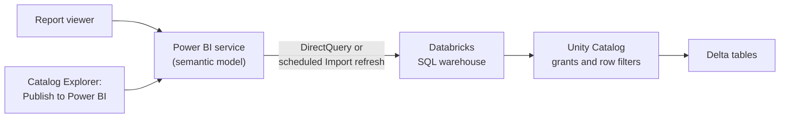

# Connecting Power BI

Mastery: `INPUT[inlineSelect(option(new), option(learning), option(solid)):mastery]`

> [!story] Context
> [[SQL Alerts]] and [[AI-BI Dashboards]] are native Databricks features. Many companies already run their reporting in Microsoft Power BI. Power BI can query Databricks tables directly on a [[SQL Warehouses|SQL warehouse]], so existing reports keep working while the data moves to the lakehouse.

> [!eli5] Summary
> Power BI is Microsoft's reporting tool. It can read data from Databricks either live, each time someone opens a report, or as a copy refreshed on a schedule. Databricks can also create the Power BI dataset in a few clicks, and each viewer can be limited to the data they are allowed to see.

## Background

Power BI is the most common [[BI Tools|BI tool]] in Microsoft-centric organizations. Before the lakehouse, Power BI typically read from a separate [[Data Warehouses|data warehouse]] or from exported files. Connecting Power BI to Databricks removes that copy: Power BI queries [[Unity Catalog]] tables through a Databricks SQL warehouse, and Unity Catalog permissions apply.

This note covers the cloud-neutral basics. Azure-specific features (Microsoft Entra ID single sign-on and the publishing integration) are in [[Power BI on Azure Databricks]].

## Overview

| Capability | Description | Status (October 2026) |
|---|---|---|
| **Databricks connector** | Power BI Desktop and service connector for SQL warehouses and clusters. Named **Azure Databricks** on Azure and **Databricks** on AWS and Google Cloud. | Available |
| **ADBC driver** | Arrow Database Connectivity driver that replaces the embedded Simba Spark ODBC driver | Default for new connections since February 2026. GA on October 15, 2026. |
| **Publish to Power BI service** | Creates or updates a Power BI semantic model from Unity Catalog tables in Catalog Explorer | Available |
| **Power BI task in Lakeflow Jobs** | Republishes and refreshes semantic models as a job task | Public Preview |
| **Partner Connect tile** | Downloads a connection file for Power BI Desktop | Available. See [[Partner Connect]]. |

### Storage modes

| Mode | Where queries run | Use when |
|---|---|---|
| **DirectQuery** | On the Databricks SQL warehouse each time visuals load | Large or frequently changing data, or per-viewer Unity Catalog security |
| **Import** | In the Power BI model, after a scheduled refresh | Small, slowly changing data that needs the fastest visuals |

Databricks recommends SQL warehouses (rather than all-purpose clusters) for DirectQuery.

### Authentication

| Method | Use for |
|---|---|
| **OAuth** (single sign-on through your identity provider) | People. Databricks recommends OAuth because it gives per-user access control and auditing. |
| **Service principal (OAuth machine-to-machine)** | Scheduled refreshes that must not depend on one person's account |
| **Personal access token** | Fallback when OAuth is not available |

See [[Authentication - Tokens and OAuth]] and [[Users Groups and Service Principals]].

## How it works



### Connect from Power BI Desktop

1. In Databricks, open **SQL Warehouses**, select the warehouse, and open the **Connection details** tab.
2. Copy the **Server hostname** and **HTTP path**.
3. In Power BI Desktop (version 2.145.1105.0 or later for the ADBC driver), select **Get data** and search for **Databricks** (or **Azure Databricks**).
4. Paste the server hostname and HTTP path.
5. Choose **DirectQuery** or **Import**.
6. Sign in with OAuth.
7. In the navigator, select the catalog, schema, and tables, for example `shop.analytics.daily_sales`.

To switch an existing connection to ADBC, open **Transform data** > **Advanced Editor** and add `Implementation = "2.0"` to the connector's options record. Use one driver type for every Databricks connection in a semantic model.

### Publish from Unity Catalog

Publishing creates the semantic model from Databricks instead of building it by hand in Desktop.

1. In Catalog Explorer, select a schema or a set of tables.
2. Choose the option to publish to a Power BI workspace, and select a SQL warehouse.
3. Authenticate to Power BI.
4. Select the Power BI workspace, the storage mode, and a new or existing semantic model.
5. Choose OAuth for the data source credentials.

Requirements: the data must be in Unity Catalog (the Hive metastore and the `samples` catalog are not supported), and the Power BI workspace needs a Premium license (Premium capacity, Premium Per User, or a Fabric capacity) with the XMLA endpoint set to **Read Write**.

### Shape data for Power BI in Databricks

Prepare a narrow, aggregated table or view in the gold layer so Power BI sends small queries:

```sql
CREATE OR REPLACE VIEW shop.analytics.daily_sales AS
SELECT
  o.order_date,
  s.store_name,
  SUM(o.amount)              AS revenue,
  COUNT(DISTINCT o.order_id) AS orders
FROM shop.sales.orders AS o
JOIN shop.sales.stores AS s ON o.store_id = s.store_id
WHERE o.status = 'completed'
GROUP BY o.order_date, s.store_name;

GRANT SELECT ON VIEW shop.analytics.daily_sales TO `powerbi_readers`;
```

## Small-business considerations

> [!smallbiz] Small-business considerations
> - **Keep the reports that work:** Point existing Power BI reports at a Databricks SQL warehouse instead of rebuilding them as AI/BI dashboards on day one.
> - **Start with DirectQuery on a small serverless warehouse** so there is one copy of the data and Unity Catalog permissions apply. Switch large, static tables to Import if visuals are slow.
> - **Pre-aggregate in Databricks:** A daily-sales view with one row per store per day is faster and cheaper than letting Power BI scan every order.
> - **License check:** Publishing from Catalog Explorer requires Premium, Premium Per User, or Fabric capacity. With Power BI Pro only, connect from Power BI Desktop and publish the report as usual.
>
> DirectQuery reports send queries whenever visuals load, which keeps the SQL warehouse running during business hours. Import mode runs the warehouse only during refreshes. Warehouse time is billed in [[DBUs]]. See [[How Databricks Pricing Works]].

## Cloud differences

> [!azure]- Azure Databricks
> - The connector is named **Azure Databricks**. Sign-in uses Microsoft Entra ID, and DirectQuery SSO passes each viewer's Entra identity to Databricks.
> - Publishing uses the **Databricks Dataset Publishing Integration** Entra application.
> - Fabric mirroring of Unity Catalog is a separate path. See [[Power BI on Azure Databricks]] and [[Microsoft Fabric and OneLake vs Databricks]].

> [!aws]- Databricks on AWS
> - The connector is named **Databricks**. Sign in with OAuth through your identity provider, a service principal, or a personal access token.
> - The workspace hostname looks like `dbc-a1b2345c-d6e7.cloud.databricks.com`.

> [!gcp]- Databricks on Google Cloud
> - The connector is the same **Databricks** connector as on AWS, with the same authentication options. Check the GCP Power BI page for feature availability.

## Advanced topics

> [!deepdive]- Advanced topics (301–401)
> - **Query tags:** With ADBC, Power BI context is attached to queries as Databricks SQL query tags, which helps attribute warehouse load and cost to reports. ODBC connections do not support this.
> - **Native queries:** The `Databricks.Query` data source is not supported with semantic model DirectQuery mode.
> - **Scheduled republish:** The Power BI task in [[Lakeflow Jobs]] (Public Preview) republishes semantic models after upstream tables refresh. It requires a Unity Catalog Power BI connection and `USE CONNECTION` on it.
> - **Metric views:** Power BI support for querying Unity Catalog [[Metric Views|metric views]] changed several times during 2026, and Microsoft removed the Metric View BI Compatibility Mode option from the connector. Check the current Databricks page before building on it.
> - **Concurrency:** Each open DirectQuery report page sends several queries. Size the warehouse for concurrent viewers and use [[Query Performance and Caching|query profiles]] to tune slow visuals.
> - **Service principal token lifetime:** Automation that uses an Entra ID-managed service principal fails if it runs longer than one hour, because the token expires.

## Common misconceptions

> [!confusion] DirectQuery is not "no cost"
> DirectQuery avoids copying data, but every visual interaction runs a query on the SQL warehouse.

> [!confusion] Publishing does not turn on per-viewer security by itself
> After publishing, viewers query with the publisher's credentials until per-viewer SSO is configured in the semantic model's data source credentials (see [[Power BI on Azure Databricks]]).

> [!confusion] Power BI semantic models and metric views overlap
> Both define metrics. Choose one primary place for each metric so Power BI and Databricks tools return the same numbers.

## Recall

What are the two Power BI storage modes for Databricks data?::DirectQuery (queries run on the SQL warehouse at report time) and Import (data copied into the model on refresh).
Which compute does Databricks recommend for DirectQuery?::SQL warehouses.
Which two values identify a SQL warehouse to Power BI?::The Server hostname and the HTTP path, from the warehouse's Connection details tab.
Which driver is the default for new Power BI connections since February 2026?::ADBC (Arrow Database Connectivity), GA on October 15, 2026.
How do you switch an existing Power BI connection to ADBC?::Add `Implementation = "2.0"` to the connector options in Advanced Editor.
Which authentication method does Databricks recommend for Power BI?::OAuth, because it gives per-user access control and auditing.
What Power BI license does publishing from Catalog Explorer require?::Premium capacity, Premium Per User, or a Fabric capacity, with the XMLA endpoint set to Read Write.
Which data cannot be published to Power BI from Catalog Explorer?::Hive metastore tables and the `samples` catalog.

## Next steps

> [!path] Learning path
> **Needs first:** [[BI Tools]], [[SQL Warehouses]], [[Unity Catalog]]
> **Unlocks next:** [[Power BI on Azure Databricks]], [[Migrating BI Reports]], [[Connecting Tableau and Other BI Tools]]

> [!nextup] Next
> [[Connecting Tableau and Other BI Tools]] covers Tableau, Looker, Sigma, Excel, and any tool that connects through JDBC or ODBC.

> [!sources]- Sources (last verified: 2026-10-25)
> - [Power BI with Databricks (AWS)](https://docs.databricks.com/aws/en/partners/bi/power-bi/)
> - [Power BI with Databricks (GCP)](https://docs.databricks.com/gcp/en/partners/bi/power-bi/)
> - [Power BI with Azure Databricks](https://learn.microsoft.com/en-us/azure/databricks/partners/bi/power-bi/)
> - [Connect Power BI Desktop to Databricks (AWS)](https://docs.databricks.com/aws/en/partners/bi/power-bi/desktop)
> - [Configure ADBC or ODBC driver for Power BI (Azure Databricks)](https://learn.microsoft.com/en-us/azure/databricks/partners/bi/power-bi/adbc)
> - [Publish to the Power BI service from Databricks (AWS)](https://docs.databricks.com/aws/en/partners/bi/power-bi/service)
> - [Power BI task for jobs (Azure Databricks)](https://learn.microsoft.com/en-us/azure/databricks/jobs/powerbi)
> - [Databricks Power Query connector (Microsoft)](https://learn.microsoft.com/en-us/power-query/connectors/databricks)
> - [Get connection details for a compute resource (Azure Databricks)](https://learn.microsoft.com/en-us/azure/databricks/integrations/compute-details)
> - [Business intelligence tools (AWS)](https://docs.databricks.com/aws/en/ai-bi/tools)
