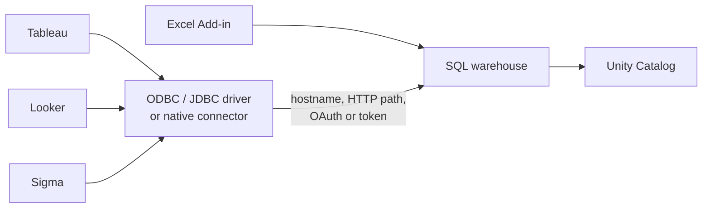

# Connecting Tableau and Other BI Tools

Mastery: `INPUT[inlineSelect(option(new), option(learning), option(solid)):mastery]`

> [!story] Context
> [[Connecting Power BI]] covered Microsoft's BI tool. Other teams use Tableau, Looker, Sigma, or Excel, or a tool that speaks only [[JDBC and ODBC]]. All of them connect to the same [[SQL Warehouses|SQL warehouse]] with the same three pieces of information: a hostname, an HTTP path, and credentials.

> [!eli5] Summary
> Most reporting and spreadsheet tools can read data stored in Databricks. You give the tool the address of a Databricks computer that answers questions, and you sign in. The tool then shows the same tables everyone else uses, limited to what you are allowed to see.

## Background

[[BI Tools]] such as Tableau and Looker predate the lakehouse and were designed to query databases and warehouses over standard drivers. Databricks SQL warehouses expose a standard SQL endpoint, so these tools connect to the lakehouse the same way they connect to a warehouse. Native connectors add features such as OAuth sign-in and [[Unity Catalog]] catalog browsing.

## Overview

| Tool | Connection method | Notes |
|---|---|---|
| **Tableau Desktop, Tableau Cloud, Tableau Server** | Native Databricks connector using the Databricks ODBC driver | OAuth recommended. Tableau Desktop and Tableau Cloud are enabled by default as partner OAuth apps. Tableau Server must be enabled manually. |
| **Looker** | Connection with the Databricks dialect | Needs server hostname, port, HTTP path, and a token |
| **Sigma** | Partner Connect or manual connection to a SQL warehouse | Partner Connect creates a `SIGMA_USER` service principal |
| **Microsoft Excel** | **Databricks Excel Add-in** | Browse and import tables without SQL, run custom SQL, schedule refreshes, write back to Unity Catalog tables, and use Genie |
| **Any JDBC or ODBC tool** | Databricks JDBC or ODBC driver | For tools without a native connector |
| **Python, Node.js, scripts** | Databricks SQL Connector for Python, SQLAlchemy dialect, Node.js driver, SQL CLI | See [[Databricks SDKs and REST API]] |

### Connection details

Every connection uses the values on the SQL warehouse's **Connection details** tab (**SQL Warehouses** > select a warehouse):

| Field | Example |
|---|---|
| Server hostname | `dbc-a1b2345c-d6e7.cloud.databricks.com` (AWS), `adb-1234567890123456.7.azuredatabricks.net` (Azure) |
| Port | `443` |
| HTTP path | `/sql/1.0/warehouses/<warehouse-id>` |

For an all-purpose cluster, the same values are under **Advanced options** > **JDBC/ODBC**. Databricks recommends SQL warehouses for BI workloads.

## How it works



### Connect Tableau Desktop

1. Install the Databricks ODBC driver (version 2.6.19 or later is required for Unity Catalog data).
2. In Tableau Desktop, under **Connect** > **To a Server**, select **Databricks**.
3. Enter the **Server hostname** and **HTTP path** from the warehouse's Connection details tab.
4. For **Authentication**, select **OAuth** and sign in through the browser.
5. Select a catalog and schema, then drag the `daily_sales` view onto the canvas.

Notes for Tableau:

- The default OAuth token lifetime for Tableau is 90 days. An account admin can change it with a policy override.
- Service principal (machine-to-machine OAuth) authentication requires Tableau Cloud or Tableau Desktop 2025.2 or later and Databricks ODBC driver 2.8.2 or later.
- The open-source Databricks ODBC driver is available as a Beta option for SQL warehouses.

### Connect Looker

1. In Looker, open **Admin** > **Connections** and add a connection.
2. Select the Databricks dialect.
3. Enter the server hostname, port `443`, and the HTTP path.
4. Enter the credentials: a personal access token, or a Microsoft Entra ID token on Azure.
5. Change the persistent derived table (PDT) refresh schedule from the default (every 5 minutes). Frequent PDT checks keep the SQL warehouse running.

### Connect Excel

Install the Databricks Excel Add-in (supported on Excel for the web, Windows, and macOS). Sign in, browse to a table such as `shop.analytics.daily_sales`, and import it, or run custom SQL. Refreshes can run on a schedule. The add-in can also write data back to Unity Catalog tables.

### Use a SQL query from any tool

Every tool sends standard SQL. A query a Tableau or Looker user might run against the warehouse:

```sql
SELECT store_name, order_date, revenue
FROM shop.analytics.daily_sales
WHERE order_date >= current_date() - INTERVAL 30 DAYS;
```

## Small-business considerations

> [!smallbiz] Small-business considerations
> - **Excel is often the first connection.** The Excel Add-in replaces CSV exports: a manager refreshes a sheet instead of asking for a new file. See [[Spreadsheets]].
> - **Keep existing Tableau or Looker workbooks** and repoint them at a Databricks SQL warehouse. Rebuild only the reports that need changes. See [[Migrating BI Reports]].
> - **Use OAuth for people and a service principal for scheduled extracts**, rather than one person's token.
> - **Pre-aggregate** in gold tables or [[Metric Views]] so BI tools send small queries.
>
> Each BI tool has its own license. On the Databricks side, queries run on the SQL warehouse, which is billed in [[DBUs]] while it runs. Frequent background refreshes (Tableau extracts, Looker PDTs) keep it running. See [[How Databricks Pricing Works]].

## Cloud differences

> [!azure]- Azure Databricks
> - Hostnames follow the `adb-<workspace-id>.<n>.azuredatabricks.net` pattern.
> - Tools that support it can authenticate with Microsoft Entra ID tokens instead of personal access tokens. See [[Microsoft Entra ID Integration]].
> - The Partner Connect BI list on Azure differs from AWS and GCP.

> [!aws]- Databricks on AWS
> - Hostnames follow the `dbc-<id>.cloud.databricks.com` pattern. OAuth goes through the Databricks account's identity provider configuration.

> [!gcp]- Databricks on Google Cloud
> - Connection steps match AWS. Hostnames use the `gcp.databricks.com` domain. Check the GCP BI tools page for which partner tools are listed.

## Advanced topics

> [!deepdive]- Advanced topics (301–401)
> - **Partner OAuth applications.** Account admins can enable or disable partner OAuth apps (such as Tableau Server) in the account console. Disabling an app blocks OAuth sign-in from that tool.
> - **Live versus extract.** Tableau extracts and Looker PDTs copy data out of Databricks on a schedule. Live connections query the warehouse on each interaction. Choose per workbook based on data size and freshness needs.
> - **Driver versions.** Unity Catalog features (three-level names, catalog browsing) require recent drivers. Pin driver versions on shared Tableau Server or gateway machines and upgrade deliberately.
> - **Service principals.** For scheduled extracts, use a [[Users Groups and Service Principals|service principal]] with `SELECT` on only the gold schema.
> - **Programmatic access.** For custom scripts, the Databricks SQL Connector for Python and the SQLAlchemy dialect use the same hostname and HTTP path.

## Common misconceptions

> [!confusion] A BI connection does not bypass Unity Catalog
> Every query from a BI tool runs as the authenticated user or service principal, and Unity Catalog grants apply.

> [!confusion] Cluster and warehouse paths are not interchangeable
> A SQL warehouse HTTP path starts with `/sql/1.0/warehouses/`. An all-purpose cluster uses a different path from its JDBC/ODBC tab.

## Recall

Which three values does a BI tool need to connect to a SQL warehouse?::The server hostname, the HTTP path, and credentials (OAuth or a token). The port is 443.
What does a SQL warehouse HTTP path look like?::`/sql/1.0/warehouses/<warehouse-id>`.
Which Tableau products are enabled by default as partner OAuth apps?::Tableau Desktop and Tableau Cloud. Tableau Server must be enabled manually.
What is the default OAuth token lifetime for Tableau?::90 days.
What does Tableau service principal (M2M) auth require?::Tableau Cloud or Desktop 2025.2 or later and Databricks ODBC driver 2.8.2 or later.
Why should you change Looker's default PDT refresh?::The default (every 5 minutes) keeps the SQL warehouse running and increases cost.
Which Excel tool connects to Databricks?::The Databricks Excel Add-in, which can import, query, refresh, write back, and use Genie.
What connects a tool that has no native Databricks connector?::The Databricks JDBC or ODBC driver.

## Next steps

> [!path] Learning path
> **Needs first:** [[BI Tools]], [[SQL Warehouses]], [[JDBC and ODBC]]
> **Unlocks next:** [[Partner Connect]], [[Migrating BI Reports]]

> [!nextup] Next
> [[Partner Connect]] automates the setup for common partner tools by creating the warehouse, service principal, and token for you.

> [!sources]- Sources (last verified: 2026-10-25)
> - [Connect Tableau and Databricks (AWS)](https://docs.databricks.com/aws/en/partners/bi/tableau)
> - [Business intelligence tools (AWS)](https://docs.databricks.com/aws/en/ai-bi/tools)
> - [Business intelligence tools (GCP)](https://docs.databricks.com/gcp/en/ai-bi/tools)
> - [Business intelligence tools (Azure Databricks)](https://learn.microsoft.com/en-us/azure/databricks/ai-bi/tools)
> - [Connect to Looker (Azure Databricks)](https://learn.microsoft.com/en-us/azure/databricks/partners/bi/looker)
> - [Connect to Sigma (AWS)](https://docs.databricks.com/aws/en/partners/bi/sigma)
> - [Connect to Databricks from Microsoft Excel (AWS)](https://docs.databricks.com/aws/en/integrations/excel)
> - [Enable or disable partner OAuth applications (AWS)](https://docs.databricks.com/aws/en/integrations/enable-disable-oauth)
> - [Databricks sign-on from partner solutions (AWS)](https://docs.databricks.com/aws/en/integrations/configuration)
> - [Get connection details for a compute resource (Azure Databricks)](https://learn.microsoft.com/en-us/azure/databricks/integrations/compute-details)
> - [Technology partners (AWS)](https://docs.databricks.com/aws/en/integrations)
> - [Databricks SQL Connector for Python (AWS)](https://docs.databricks.com/aws/en/dev-tools/python-sql-connector)
> - [Use SQLAlchemy with Databricks (AWS)](https://docs.databricks.com/aws/en/dev-tools/sqlalchemy)
