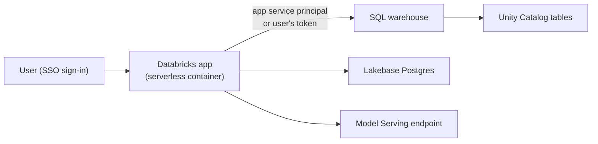

# Databricks Apps

Mastery: `INPUT[inlineSelect(option(new), option(learning), option(solid)):mastery]`

> [!story] Context
> [[AI Functions in SQL]], dashboards, and Genie Agents answer questions about data. Some workflows need an interface instead: a form to enter a stock reorder, a tool to approve price changes, or a chat front end for an AI agent. Databricks Apps host those internal web applications inside the Databricks platform, next to the data.

> [!eli5] Summary
> Databricks Apps lets a team build a small website for colleagues, such as an order form or a review screen, and run it inside Databricks. People sign in with their work account, and the app can read and save company data under the same rules as everything else.

## Background

Internal tools built on company data traditionally needed their own hosting: a virtual machine or container service, a web server, a separate login system, and stored database credentials. Each tool became a small infrastructure project with its own security review.

Databricks Apps run on Databricks [[Serverless Compute|serverless]] infrastructure. Authentication uses the Databricks account's single sign-on, data access goes through [[Unity Catalog]], and the app's identity is a Databricks service principal.

## Overview

A Databricks app is a web application that runs as a containerized service on the Databricks serverless platform.

| Aspect | Details |
|---|---|
| **Python frameworks** | Streamlit, Dash, Gradio, Flask, FastAPI, Shiny |
| **Node.js frameworks** | React, Angular, Svelte, Express |
| **App identity** | A dedicated [[Users Groups and Service Principals\|service principal]] created for each app and deleted with it. You cannot choose an existing one. |
| **User identity** | Optional user authorization: the app acts with the signed-in user's permissions, using a token forwarded in request headers |
| **Resources** | Existing Databricks resources the app may use, such as a [[SQL Warehouses\|SQL warehouse]], a [[Lakebase]] database, a [[Model Serving]] endpoint, or a secret. Apps use existing resources and cannot create new ones. |
| **Compute sizes** | Medium (default), Large, and XLarge |
| **Deployment** | From workspace files, from a Git repository (Git-backed deployments are generally available), or with [[Declarative Automation Bundles]] |
| **Access** | Users open apps from the workspace or from [[Databricks One\|Genie One]] |

### Compute sizes

| Size | vCPUs (up to) | Memory (up to) | DBU consumption |
|---|---|---|---|
| **Medium** (default) | 2 | 6 GB | 0.5 DBU per hour |
| **Large** | 4 | 12 GB | 1 DBU per hour |
| **XLarge** | 12 | 48 GB | 3 DBU per hour |

Databricks advises choosing Large or XLarge only if you see performance issues or know the app needs more resources.

## How it works



### Two authorization models

| Model | The app acts as | Use when |
|---|---|---|
| **App authorization** | The app's service principal | All users see the same data, or the app writes to its own tables |
| **User authorization** | The signed-in user | Each user must see only data they are permitted to see under Unity Catalog |

How the app reads the user's token depends on the framework. For example, Streamlit reads it from request headers and Gradio from the request object.

### Example: a store reorder app

A three-store bakery wants store managers to submit ingredient reorders through a form and see yesterday's sales next to it.

1. In the sidebar, click **New** > **App**.
2. Select a template, for example **Streamlit**, and name the app `store-reorders`.
3. Add resources: the shared serverless SQL warehouse (for reading sales) and a Lakebase database (for saving reorders).
4. Grant the app's service principal `SELECT` on the sales view.
5. Edit the app code, then click **Deploy**.
6. Share the app with the `store_managers` group.

A minimal Streamlit page that reads daily sales through the Databricks SQL Connector for Python:

```python
import os
import streamlit as st
from databricks import sql
from databricks.sdk.core import Config

cfg = Config()  # picks up the app's credentials from the environment
warehouse_id = os.environ["DATABRICKS_WAREHOUSE_ID"]  # set from the app's SQL warehouse resource

with sql.connect(
    server_hostname=cfg.host,
    http_path=f"/sql/1.0/warehouses/{warehouse_id}",
    credentials_provider=lambda: cfg.authenticate,
) as conn, conn.cursor() as cur:
    cur.execute("""
        SELECT store_name, revenue
        FROM shop.analytics.daily_sales
        WHERE order_date = current_date() - INTERVAL 1 DAY
    """)
    rows = cur.fetchall()

st.title("Yesterday's sales by store")
st.table([{"store": r.store_name, "revenue": r.revenue} for r in rows])
```

The environment variable name depends on how you map the resource in the app's configuration file (`app.yaml`). Check the app's resource settings for the exact name.

Saving each reorder is a small, frequent write, which suits a Postgres table in [[Lakebase]] rather than a Delta table. See [[OLTP vs OLAP]].

## Small-business considerations

> [!smallbiz] Small-business considerations
> - **Build an app when a spreadsheet or form is the bottleneck**, for example reorders, price approvals, or a customer lookup screen. For read-only reporting, a dashboard or Genie Agent is simpler.
> - **Start from a template** and keep the default Medium size.
> - **Use app authorization** for an internal tool where every user may see the same data, and user authorization when managers must see only their own store.
> - **Store app data in Lakebase**, and read analytics from gold tables on a SQL warehouse.
>
> Cost: an app consumes DBUs at its size's rate while it runs (Medium is 0.5 DBU per hour), plus the SQL warehouse, Lakebase, or serving resources it calls. Stop apps that are not in use. See the official pricing page and [[How Databricks Pricing Works]].

## Cloud differences

> [!azure]- Azure Databricks
> - Apps are billed under the serverless SKUs on Azure. The Azure pricing reference lists the Medium and Large DBU multipliers.
> - Users sign in with Microsoft Entra ID. See [[Microsoft Entra ID Integration]].
> - Check Azure region support before planning an app, since serverless features vary by region.

> [!aws]- Databricks on AWS
> - Apps run in the serverless compute plane. Networking options for apps (ingress and egress controls) are described on the Apps networking page. See [[Serverless Network Security]].

> [!gcp]- Databricks on Google Cloud
> - Apps are documented for Google Cloud, including a networking page. Check feature and region availability, since some app resources (for example Lakebase) are in Beta on GCP as of October 2026.

## Advanced topics

> [!deepdive]- Advanced topics (301–401)
> - **Least privilege.** Admins approve the resources an app requests at deployment. Grant the app's service principal only the privileges it needs, such as `SELECT` on one view and `CAN USE` on one warehouse.
> - **User tokens and scopes.** With user authorization, the app receives a user token in request headers. Validate the scopes the app needs and never log the token.
> - **Lakebase as a resource.** Since March 16, 2026, Lakebase databases can be added as app resources, which supplies connection details and credentials without storing passwords in code.
> - **Agents.** Apps are a common front end for agents built with the [[Mosaic AI Agent Framework]] and served on [[Model Serving]].
> - **Deployment as code.** Define apps in [[Declarative Automation Bundles]] so the app, its resources, and permissions deploy together across dev and prod.
> - **Compliance workspaces.** Since September 2026, Databricks Apps is on by default for workspaces with the [[Compliance Security Profile]] enabled.

## Common misconceptions

> [!confusion] An app is not a dashboard
> Dashboards display query results. An app is custom code that can accept input, run logic, and write data.

> [!confusion] The app does not run as the developer
> By default, the app acts as its own service principal. Grants given to the developer do not apply to the app.

> [!confusion] Apps are not for public websites
> Apps are for users who sign in to your Databricks account. Use them for internal tools.

## Recall

Which Python frameworks does Databricks Apps support?::Streamlit, Dash, Gradio, Flask, FastAPI, and Shiny.
Which Node.js frameworks does Databricks Apps support?::React, Angular, Svelte, and Express.
What identity does an app use by default?::A dedicated service principal created for the app and deleted with it.
What is user authorization in an app?::The app acts with the signed-in user's permissions, using a token forwarded in request headers.
What is the default app compute size and its limits?::Medium: up to 2 vCPUs and 6 GB of memory, at 0.5 DBU per hour.
Can an app create new Databricks resources?::No. Apps use existing resources that admins approve.
Since when can Lakebase databases be added as app resources?::March 16, 2026.
Why store app form submissions in Lakebase rather than a Delta table?::They are small, frequent transactional writes, which suit an OLTP Postgres database.

## Next steps

> [!path] Learning path
> **Needs first:** [[Python for Data]], [[SQL Warehouses]], [[Users Groups and Service Principals]], [[Unity Catalog]]
> **Unlocks next:** [[Lakebase]], [[Mosaic AI Agent Framework]], [[Path - AI App Developer]]

> [!nextup] Next
> [[Lakebase]] covers the managed Postgres database that stores app data and serves lakehouse tables to apps.

> [!sources]- Sources (last verified: 2026-10-25)
> - [Databricks Apps (AWS)](https://docs.databricks.com/aws/en/dev-tools/databricks-apps/)
> - [Key concepts in Databricks Apps (AWS)](https://docs.databricks.com/aws/en/dev-tools/databricks-apps/key-concepts)
> - [Key concepts in Databricks Apps (Azure Databricks)](https://learn.microsoft.com/en-us/azure/databricks/dev-tools/databricks-apps/key-concepts)
> - [Configure authorization in a Databricks app (AWS)](https://docs.databricks.com/aws/en/dev-tools/databricks-apps/auth)
> - [Configure authorization in a Databricks app (Azure Databricks)](https://learn.microsoft.com/en-us/azure/databricks/dev-tools/databricks-apps/auth)
> - [Configure compute resources for a Databricks app (AWS)](https://docs.databricks.com/aws/en/dev-tools/databricks-apps/compute-size)
> - [Configure compute resources for a Databricks app (Azure Databricks)](https://learn.microsoft.com/en-us/azure/databricks/dev-tools/databricks-apps/compute-size)
> - [Databricks Apps environment (AWS)](https://docs.databricks.com/aws/en/dev-tools/databricks-apps/system-env)
> - [Tutorial: Develop a Databricks app with Streamlit (AWS)](https://docs.databricks.com/aws/en/dev-tools/databricks-apps/tutorial-streamlit)
> - [Add a Lakebase resource to a Databricks app (AWS)](https://docs.databricks.com/aws/en/dev-tools/databricks-apps/lakebase)
> - [Manage Databricks apps using Declarative Automation Bundles (AWS)](https://docs.databricks.com/aws/en/dev-tools/bundles/apps-tutorial)
> - [Databricks Apps networking (AWS)](https://docs.databricks.com/aws/en/dev-tools/databricks-apps/networking)
> - [Databricks Apps networking (GCP)](https://docs.databricks.com/gcp/en/dev-tools/databricks-apps/networking)
> - [Serverless DBU consumption by SKU (Azure Databricks)](https://learn.microsoft.com/en-us/azure/databricks/resources/pricing)
> - [Lakebase release notes (AWS)](https://docs.databricks.com/aws/en/release-notes/lakebase/)
> - [Databricks platform release notes (AWS)](https://docs.databricks.com/aws/en/release-notes/product)
