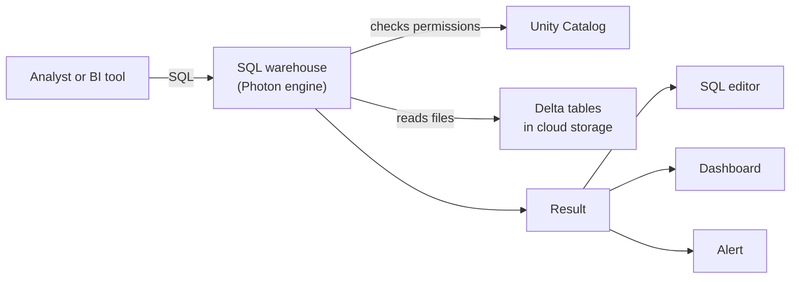

# Databricks SQL

Mastery: `INPUT[inlineSelect(option(new), option(learning), option(solid)):mastery]`

> [!story] Context
> [[Chapter 09 - SQL BI and Apps|Chapter 09]] starts from the governed tables built in [[Chapter 08 - Data Engineering|chapter 08]]. Analysts work in [[SQL]] rather than Python, and they need to query those tables directly, without copying them into a separate [[Data Warehouses|data warehouse]].

> [!eli5] Summary
> Databricks SQL is the part of Databricks that works like a business database. Analysts type questions in a language most of them already know, dedicated computers answer in seconds, and the answers can become charts or warning emails. The data stays in one place.

> [!analogy]- Analogy: a reading room inside the warehouse
> | Reading room | Databricks SQL |
> |---|---|
> | The storage warehouse full of boxes | The lakehouse and its [[Delta Lake]] tables |
> | A reading room built inside it | Databricks SQL |
> | Staff who fetch boxes, sent home when idle | A [[SQL Warehouses\|SQL warehouse]] with auto-stop |
> | The request slip | The [[SQL Editor\|SQL editor]] |
> | The noticeboard and the bell | [[AI-BI Dashboards\|Dashboards]] and [[SQL Alerts\|alerts]] |

## Background

Chapter 04 ended with [[The Two-Tier Architecture Problem]]: companies kept a [[Data Lakes|data lake]] for raw files and data science, and a separate [[Data Warehouses|data warehouse]] such as [[Snowflake]] or [[Amazon Redshift]] for SQL and [[BI Tools|BI]]. Every number had to be copied from one to the other, which cost money, added delay, and created two versions of the truth.

[[The Lakehouse Idea|The lakehouse]] promised one copy of the data for both jobs. That promise only holds if analysts get a SQL experience as good as a classic warehouse: fast answers, many people querying at once, and tools they already know. Databricks SQL is that experience. It is the "warehouse" half of the lakehouse, running directly on the same tables the engineers build.

## Overview

Databricks SQL (often shortened to **DBSQL**) is a set of tools that share one engine:

| Piece | What it does | Note |
|---|---|---|
| **SQL warehouses** | The [[Compute Types\|compute]] that runs SQL queries. Serverless, pro, or classic. | [[SQL Warehouses]] |
| **SQL editor** | Write, run, and share queries in the browser | [[SQL Editor]] |
| **Query history and profile** | See what ran, how long it took, and why | [[Query Performance and Caching]] |
| **Dashboards** | Native charts and reports | [[AI-BI Dashboards]] |
| **Alerts** | Notify someone when a query result crosses a threshold | [[SQL Alerts]] |
| **Connections** | Let Power BI, Tableau, and others query the same warehouse | [[Connecting Power BI]], [[Connecting Tableau and Other BI Tools]] |

Underneath, a SQL warehouse runs the [[Photon]] engine on [[Delta Lake]] tables that [[Unity Catalog]] governs. The same `GRANT`s that protect a table in a notebook protect it in a dashboard.

### The warehouse types

Databricks documents three main SQL warehouse types (plus a beta *Lakehouse Real-Time* type for sub-second, high-concurrency reads):

| Type | Where the compute runs | Start-up time | Extras | When to pick it |
|---|---|---|---|---|
| **Serverless** | Databricks' account | About 2–6 seconds | Photon, Predictive IO, Intelligent Workload Management | The recommended default for most work |
| **Pro** | Your cloud account | About 4 minutes | Photon, Predictive IO | Serverless not available in your region, or you need custom networking (for example federation or hybrid connections) |
| **Classic** | Your cloud account | About 4 minutes | Photon | Basic, older setups |

In the UI the default type is serverless, but a warehouse created through the API with default parameters is classic.

## How it works



1. Someone sends a [[Query|query]], from the editor, a dashboard, or an outside tool over [[JDBC and ODBC]].
2. The warehouse asks [[Unity Catalog]] whether that person may read the tables.
3. Photon reads only the files it needs (helped by [[Data Skipping|data skipping]] and caches) and computes the answer.
4. The result goes back to whoever asked. Repeated questions can be answered from a cache without running again.

**Sizing.** Classic and pro warehouses come in T-shirt sizes from 2X-Small to 5X-Large, and the number of workers doubles at each step. You set how many clusters they may scale to, and Databricks allows one cluster per 10 concurrent queries. For serverless, the docs advise starting with one larger warehouse and sizing down later, and increasing the size if queries [[Spill|spill]] to disk. The 5X-Large size is in Public Preview for pro and serverless as of October 2026.

A first query an analyst might run, on a store-sales table:

```sql
-- Revenue per store for the last 7 days
SELECT
  store_id,
  SUM(amount)              AS revenue,
  COUNT(DISTINCT order_id) AS orders
FROM shop.sales.orders
WHERE order_date >= current_date() - INTERVAL 7 DAYS
GROUP BY store_id
ORDER BY revenue DESC;
```

The query uses standard ANSI-style SQL. Most SQL written for SQL Server, Postgres, or Snowflake carries over.

## Small-business considerations

> [!smallbiz] Small-business considerations
> Databricks SQL is often the first Databricks feature a small business uses. A recommended starting setup:
> 1. **One small serverless warehouse** for everyone, with a short [[Auto Termination|auto-stop]] so it shuts down when nobody is querying. Serverless starts in seconds, so a short idle timeout costs little in waiting time.
> 2. **One catalog for reporting** (for example `analytics`) with read-only grants to an `analysts` group.
> 3. **Point your existing BI tool at the warehouse** instead of rebuilding every report on day one.
>
> Warehouse uptime is billed in [[DBUs]]. The rate depends on type and size. See the official pricing page and [[How Databricks Pricing Works]].

## Cloud differences

The SQL, the editor, and the warehouse types are the same on all three clouds. The differences are about where compute runs and what is available:

> [!azure]- Azure Databricks
> - Pro and classic warehouses run as VMs in your Azure subscription, and Azure's docs list Azure-specific driver and worker instance types for each size.
> - Serverless availability depends on the Azure [[Region|region]]. If it is missing, pro is the documented fallback.
> - Power BI is a common client on Azure and uses Microsoft Entra ID sign-in. See [[Power BI on Azure Databricks]].

> [!aws]- Databricks on AWS
> - Pro and classic warehouses run as EC2 instances in your AWS account, and serverless runs in Databricks' account. See [[Serverless Network Security]] for how serverless reaches your data.

> [!gcp]- Databricks on Google Cloud
> - The model is the same. Check the GCP docs for which warehouse types and sizes your region offers before you plan around serverless.

## Advanced topics

> [!deepdive]- Advanced topics (301–401)
> - **Intelligent Workload Management** is serverless-only. It decides how much capacity to add for the current mix of queries, instead of the fixed "one cluster per 10 concurrent queries" rule that classic and pro follow.
> - **Predictive IO** (pro and serverless) speeds up reads on Delta tables. Classic has Photon but not Predictive IO.
> - **Custom networking** is the main reason to keep pro. Classic and pro sit in your own network, so they can reach private sources that serverless cannot reach without extra network configuration.
> - **Warehouse metadata as data.** A warehouses [[System Tables|system table]] records warehouse configuration over time, which helps with cost reviews.
> - **API defaults differ from UI defaults.** Infrastructure-as-code that creates warehouses (see [[Terraform Provider]]) should set the type explicitly.

## Common misconceptions

> [!confusion] "Databricks SQL" is not "Spark SQL"
> [[Spark SQL]] is the open-source SQL module of Apache Spark. **Databricks SQL** is the product: warehouses, editor, dashboards, and alerts, running the Photon engine. The two share a SQL dialect, but DBSQL is a full analyst product, not only a SQL parser.

> [!confusion] A "SQL warehouse" is compute, not storage
> In older systems a "warehouse" held your data. In Databricks a SQL warehouse holds **no data**. It is compute that reads Delta tables from cloud storage and can be stopped at any time without losing anything.

## Recall

What is Databricks SQL in one sentence?::The warehouse half of the lakehouse: SQL warehouses, an editor, dashboards, and alerts running directly on governed Delta tables.
What are the three main SQL warehouse types?::Serverless, pro, and classic (plus a beta Lakehouse Real-Time type).
Which warehouse type does Databricks recommend for most workloads?::Serverless.
Roughly how long does a serverless warehouse take to start, versus pro or classic?::About 2–6 seconds, versus about 4 minutes.
When would you choose a pro warehouse over serverless?::When serverless is not available in your region, or you need custom networking such as federation or hybrid connections.
What type does a warehouse get if created through the API with default parameters?::Classic.
For classic and pro, how many concurrent queries does one cluster serve before scaling out?::About 10.
Does a SQL warehouse store data?::No. It is compute that reads Delta tables from cloud storage.

## Next steps

> [!path] Learning path
> **Needs first:** [[SQL]], [[SQL Warehouses]], [[Unity Catalog]]
> **Unlocks next:** [[SQL Editor]], [[Query Performance and Caching]], [[AI-BI Dashboards]]

> [!nextup] Next
> [[SQL Editor]] covers the browser-based editor where you write, run, save, and share queries.

> [!sources]- Sources (last verified: 2026-10-25)
> - [SQL warehouse types (AWS)](https://docs.databricks.com/aws/en/compute/sql-warehouse/warehouse-types)
> - [SQL warehouse types (Azure Databricks)](https://learn.microsoft.com/en-us/azure/databricks/compute/sql-warehouse/warehouse-types)
> - [SQL warehouse sizing, scaling, and queuing behavior (AWS)](https://docs.databricks.com/aws/en/compute/sql-warehouse/warehouse-behavior)
> - [SQL warehouse sizing, scaling, and queuing behavior (Azure Databricks)](https://learn.microsoft.com/en-us/azure/databricks/compute/sql-warehouse/warehouse-behavior)
> - [Warehouses system table reference (AWS)](https://docs.databricks.com/aws/en/admin/system-tables/warehouses)
> - [Compute selection recommendations (Azure Databricks)](https://learn.microsoft.com/en-us/azure/databricks/compute/choose-compute)
> - [Warehouse REST API reference](https://docs.databricks.com/api/warehouses/v1/warehouse)
