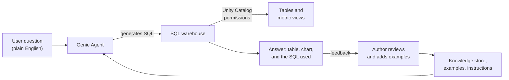

# Genie Agents

Mastery: `INPUT[inlineSelect(option(new), option(learning), option(solid)):mastery]`

> [!story] Context
> [[AI-BI Dashboards]] answer the questions a builder anticipated. Business users also ask questions that no chart covers, such as "Which store sold the most croissants last Tuesday?". A Genie Agent answers those questions in plain language, using the same governed tables.

> [!eli5] Summary
> A Genie Agent is a chat window connected to a chosen set of company tables. You type a question in everyday words, and it writes the database query, runs it, and returns a table or chart. A data expert teaches it the company's terms and checks its answers.

> [!renamed] Renamed
> **Genie spaces** (also called **AI/BI Genie**) were renamed **Genie Agents** in July 2026 (platform release notes dated July 8; AI/BI release notes dated July 9). Databricks states the capabilities did not change. This note keeps the filename `Genie`. Related 2026 renames: Databricks Assistant became **Genie Code** (March 11, 2026), and Databricks One became **Genie One** (see [[Genie One]]).

## Background

Self-service BI tools let business users filter and drill into prepared dashboards, but a question outside the prepared views still goes to an analyst as a request. [[Generative AI and LLMs|Large language models]] can translate a question into SQL, but without context they guess at table meanings, join paths, and business terms, which produces wrong answers (see [[Hallucination]]).

Genie Agents combine an LLM with curated context that a domain expert provides: selected tables, descriptions, example queries, and instructions. Answers are SQL queries that run on a [[SQL Warehouses|SQL warehouse]] under [[Unity Catalog]] governance, so the user can inspect the query behind each answer.

## Overview

A Genie Agent is a configured, shareable conversational interface over a specific set of data.

| Component | Description |
|---|---|
| **Data sources** | Up to 50 tables, views, or [[Metric Views\|metric views]] |
| **SQL warehouse** | A pro or serverless SQL warehouse runs the generated queries |
| **Knowledge store** | Curated semantic definitions: table and column descriptions, synonyms, and join relationships |
| **Example SQL queries** | Reference answers. Genie selects relevant examples from the agent's query library. |
| **Trusted assets** | Parameterized example queries and SQL functions whose logic an author has verified. Answers that use them are labeled **Trusted**. |
| **Instructions** | Plain-text business rules and terminology. Databricks recommends them as a last resort, after documentation, SQL expressions, and examples. |
| **Benchmarks** | Up to 500 test questions with expected answers, used only for evaluation |
| **Agent mode** | Multi-step reasoning for deeper analysis. Generally available since July 2, 2026. **Flash** (Beta) is an Agent mode option for quick answers. |

Additional facts:

- The **Genie Agents API** (Conversation API) became generally available on April 9, 2026. It lets other applications, such as a chat bot, send questions to an agent.
- Every published [[AI-BI Dashboards|AI/BI dashboard]] includes a companion Genie Agent.
- Business users reach Genie Agents through [[Genie One|Genie One]] and the Genie mobile app.

## How it works



### Create an agent for daily sales by store

1. In the sidebar, click **Genie** and create a new Genie Agent.
2. Add the data sources: `shop.sales.orders`, `shop.sales.stores`, or a metric view such as `shop.analytics.sales_metrics`.
3. Select a serverless SQL warehouse.
4. In the knowledge store, add column descriptions and synonyms, for example "location" and "shop" as synonyms for `store_name`.
5. Add example SQL queries for the most common questions (see below).
6. Add at least five benchmark questions with expected SQL, then run the benchmarks.
7. Share the agent with the `viewers` group.

An example query that teaches Genie how the business defines daily sales:

```sql
-- Example question: "What were sales by store yesterday?"
SELECT
  s.store_name,
  SUM(o.amount)              AS revenue,
  COUNT(DISTINCT o.order_id) AS orders
FROM shop.sales.orders AS o
JOIN shop.sales.stores AS s ON o.store_id = s.store_id
WHERE o.order_date = current_date() - INTERVAL 1 DAY
  AND o.status = 'completed'   -- business rule: exclude refunds
GROUP BY s.store_name
ORDER BY revenue DESC;
```

### Improve answers over time

1. Review questions that users marked as unhelpful.
2. Add a missing synonym, description, or example query for each failure.
3. Rerun the benchmarks to confirm accuracy improved and no other answer regressed.

Benchmarks do not change what Genie knows. Only the knowledge store, examples, trusted assets, and instructions do.

## Small-business considerations

> [!smallbiz] Small-business considerations
> - **Start narrow.** One agent over five to ten gold tables (for example, sales, stores, and products) answers more accurately than one agent over every table.
> - **Define metrics first.** If revenue is defined in a [[Metric Views|metric view]], Genie uses that definition instead of inferring one.
> - **Write five example queries** for the questions the owner asks most. This is usually the largest accuracy gain.
> - **Teach users to check the SQL** behind an answer before acting on an unexpected number.
>
> Cost: as of October 2026, billing for Genie One and Genie Agents is paused, and usage by users is free through January 31, 2027 (service principals are still billed). The SQL warehouse that runs Genie queries is billed in [[DBUs]] separately. Genie has its own budget configuration; see [[Budgets and Usage Dashboards]] and the official pricing page.

## Cloud differences

> [!azure]- All clouds
> Nothing differs in the product. Genie Agents work the same on Azure Databricks, Databricks on AWS, and Databricks on Google Cloud. Features can reach each cloud on different dates, so check the AI/BI and Genie One release notes for your cloud.

## Advanced topics

> [!deepdive]- Advanced topics (301–401)
> - **Trusted assets versus examples.** An example query guides generation. A trusted asset (a parameterized query or a Unity Catalog SQL function) returns verified logic, and the response is labeled Trusted. Use trusted assets for numbers that must match finance reports exactly.
> - **Metric views as data sources.** A metric view supplies measures with fixed definitions and semantic metadata (added October 2025), which reduces ambiguity for Genie.
> - **Benchmarks by mode.** A benchmark run uses either Chat or Agent mode for all its questions. Run both if users use both.
> - **Governance.** Generated SQL runs under Unity Catalog. Row filters and column masks apply to the results.
> - **API and embedding.** The Genie Agents API supports building Genie into Slack bots, portals, and [[Databricks Apps]]. Admins control embedding of dashboards and Genie Agents in external sites.
> - **Agent mode and reasoning.** Agent mode runs several queries in sequence to answer one question, so it uses more warehouse time per question than Chat mode.

## Common misconceptions

> [!confusion] "Genie" now names several products
> **Genie Agents** (this note) are the configured chat interfaces over data. **Genie One** is the business-user interface that contains dashboards, agents, and apps. **Genie Code** is the coding assistant in notebooks and the SQL editor, formerly Databricks Assistant.

> [!confusion] Genie is not a general chatbot
> A Genie Agent answers only from the data sources and context its author configured, through SQL. It does not browse the web or read documents outside those sources.

> [!confusion] Benchmarks do not train the agent
> Benchmarks measure accuracy. To change answers, edit the knowledge store, examples, trusted assets, or instructions.

## Recall

What were Genie Agents called before July 2026?::Genie spaces (also AI/BI Genie).
How many tables, views, or metric views can a Genie Agent use?::Up to 50.
Which SQL warehouse types can a Genie Agent use?::Pro or serverless.
What does the knowledge store contain?::Curated semantic definitions such as table and column descriptions, synonyms, and join relationships.
What is a trusted asset in a Genie Agent?::A parameterized example query or SQL function whose logic an author verified. Answers that use it are labeled Trusted.
What is the role of benchmarks?::Evaluation only. They measure accuracy and do not add context.
When did Agent mode become generally available?::July 2, 2026.
When did the Genie Conversation API become generally available?::April 9, 2026.
Who is billed for Genie usage through January 31, 2027?::Only service principals. Usage by users is free during the promotion, and SQL warehouse compute is billed separately.

## Next steps

> [!path] Learning path
> **Needs first:** [[SQL]], [[Unity Catalog]], [[SQL Warehouses]], [[AI-BI Dashboards]]
> **Unlocks next:** [[Metric Views]], [[Genie One]], [[Agent Bricks]]

> [!nextup] Next
> [[Metric Views]] defines measures such as revenue once in Unity Catalog, so Genie Agents, dashboards, and BI tools compute them the same way.

> [!sources]- Sources (last verified: 2026-10-25)
> - [Genie Agents (AWS)](https://docs.databricks.com/aws/en/genie-agents)
> - [Genie Agents concepts (AWS)](https://docs.databricks.com/aws/en/genie-agents/concepts)
> - [Create and manage a Genie Agent (AWS)](https://docs.databricks.com/aws/en/genie-agents/set-up)
> - [Create and manage a Genie Agent (Azure Databricks)](https://learn.microsoft.com/en-us/azure/databricks/genie-agents/set-up)
> - [Curate an effective Genie Agent (AWS)](https://docs.databricks.com/aws/en/genie-agents/best-practices)
> - [Test and monitor a Genie Agent (AWS)](https://docs.databricks.com/aws/en/genie-agents/monitor)
> - [Troubleshoot Genie Agents (AWS)](https://docs.databricks.com/aws/en/genie-agents/troubleshooting)
> - [Use the Genie Agents API (AWS)](https://docs.databricks.com/aws/en/genie-agents/conversation-api)
> - [Use trusted assets in Genie spaces (Azure Databricks)](https://learn.microsoft.com/en-us/azure/databricks/genie/trusted-assets)
> - [Genie (Azure Databricks)](https://learn.microsoft.com/en-us/azure/databricks/genie/)
> - [Monitor and understand your Genie cost (AWS)](https://docs.databricks.com/aws/en/genie/monitor-cost)
> - [Manage budgets and cost controls for Genie (AWS)](https://docs.databricks.com/aws/en/genie/budgets)
> - [AI/BI and Genie One release notes 2026 (AWS)](https://docs.databricks.com/aws/en/ai-bi/release-notes/2026)
> - [AI/BI and Genie One release notes 2026 (GCP)](https://docs.databricks.com/gcp/en/ai-bi/release-notes/2026)
> - [July 2026 release notes (AWS)](https://docs.databricks.com/aws/en/release-notes/product/2026/july)
> - [Genie Code (AWS)](https://docs.databricks.com/aws/en/genie-code/)
