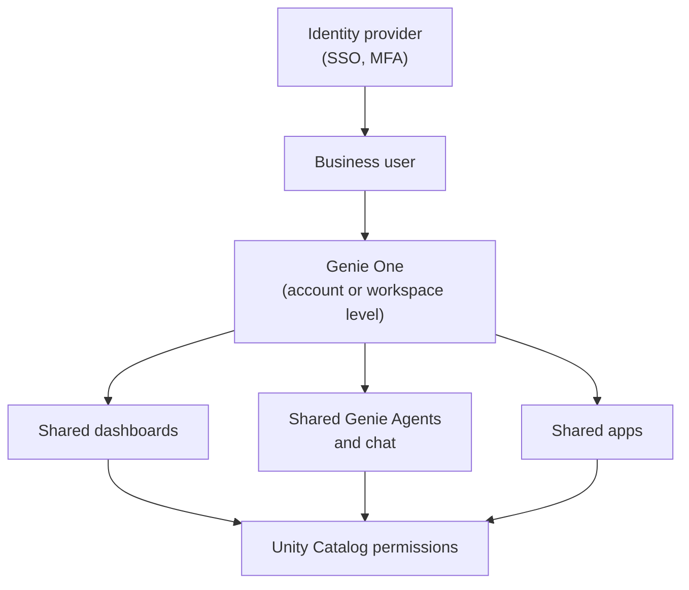

# Genie One

Mastery: `INPUT[inlineSelect(option(new), option(learning), option(solid)):mastery]`

> [!story] Context
> This chapter built [[AI-BI Dashboards]], [[Genie Agents]] Agents, and [[Databricks Apps]] on top of [[Lakebase]] and governed tables. Business users should not need to navigate notebooks, compute, or catalogs to find them. Genie One is the single entry point that shows business users only what has been shared with them.

> [!eli5] Summary
> Genie One is the simple home page of Databricks for people who use data but do not build with it. It shows the dashboards, chat assistants, and apps shared with you, and lets you ask questions in plain language. Technical settings stay out of view.

> [!renamed] Renamed
> This interface was introduced as **Databricks One**. In **April 2026** Databricks renamed it **Genie**, to reflect that Genie is central to the experience. In **June 2026** it was renamed again, to **Genie One**. Databricks states the capabilities are unchanged. This note keeps the filename `Databricks One`. Some pages also call it the **Genie UI**.

## Background

The standard Databricks workspace is built for builders: it shows notebooks, compute, jobs, catalogs, and SQL tools. Business users who only need to read a dashboard or ask a question had to learn that interface or rely on links sent by email.

Genie One gives those users a separate, simplified interface. Databricks describes it as a single entry point for interacting with data and AI without navigating technical concepts such as compute, queries, models, or notebooks.

## Overview

| Capability | Description |
|---|---|
| **Dashboards** | Published [[AI-BI Dashboards]] shared with the user |
| **Genie Agents** | Conversational agents over data (formerly Genie spaces). See [[Genie Agents]]. |
| **Chat** | Ask questions in plain language from the Genie One home page |
| **Apps** | [[Databricks Apps]] shared with the user |
| **Account-level view** | A unified view across all workspaces in the account |
| **Mobile app** | The Genie mobile app, which inherits workspace scoping and Unity Catalog governance |

Users see only assets explicitly shared with them, and Unity Catalog permissions apply to all data.

### Account level and workspace level

| Level | URL | Who can use it |
|---|---|---|
| **Account-level Genie One** | The `/one` path on the account console, for example `accounts.cloud.databricks.com/one`, or the Genie entry on the account landing page | All account users. To view data from a workspace, the user needs the **Consumer access** entitlement in that workspace. |
| **Workspace-level Genie One** | `https://<workspace-url>/one?o=<workspace-id>` | Members of that workspace with at least one workspace entitlement |

In September 2026, a Beta added **account-only user access**: users from a registered [[Identity Provider|identity provider]] can use account-level Genie One without being assigned to a workspace or granted Consumer access.

## How it works



### The Consumer access entitlement

**Consumer access** is the lightest workspace entitlement, and it is enough to use Genie One chat.

- Users whose only workspace entitlement is Consumer access land on the Genie One home page after signing in.
- Entitlements are additive. A user with any other entitlement (for example, workspace access) gets the standard workspace UI, with an app switcher to move to Genie One.
- Workspace admins can make Consumer access the default for new users through group cloning (a preview added in January 2026).

### Set up Genie One for a store owner and managers

1. Create a group named `viewers` and add the owner and store managers. See [[Users Groups and Service Principals]].
2. In the workspace admin settings, give the `viewers` group the **Consumer access** entitlement and no other entitlements.
3. Grant the group `SELECT` on the reporting schema, for example `shop.analytics`, if dashboards use individual data permissions.
4. Share the "Daily sales by store" dashboard, the sales Genie Agent, and the reorder app with `viewers`.
5. Send the users the Genie One URL (`/one`) or ask them to install the Genie mobile app.

```sql
-- Needed when dashboards or Genie Agents use each viewer's own permissions
GRANT USE CATALOG ON CATALOG shop            TO `viewers`;
GRANT USE SCHEMA  ON SCHEMA  shop.analytics  TO `viewers`;
GRANT SELECT      ON SCHEMA  shop.analytics  TO `viewers`;
```

## Small-business considerations

> [!smallbiz] Small-business considerations
> - **Give owners and managers Consumer access only.** They get a simple home page, and the builder keeps the full workspace. This follows [[Least Privilege|least privilege]].
> - **Share three things to start:** one daily dashboard, one Genie Agent over the same tables, and, if needed, one app.
> - **Use the mobile app** for an owner who checks sales before the stores open.
> - **File upload is not available** for consumer-only users or in the mobile app. Users who need to upload files need a builder role.
>
> Cost: as of October 2026, billing for Genie One and Genie Agents is paused, and usage by users is free through January 31, 2027 (service principals are still billed). Dashboards, Genie Agents, and apps still use SQL warehouse or app compute, billed in [[DBUs]]. See [[How Databricks Pricing Works]].

## Cloud differences

> [!azure]- Azure Databricks
> - Genie One works the same as on other clouds. Users sign in with Microsoft Entra ID, and conditional access and MFA policies apply. See [[Microsoft Entra ID Integration]].
> - The account console URL differs from AWS. Use the Genie entry on the Azure Databricks account landing page or the `/one` path documented for Azure.

> [!aws]- Databricks on AWS
> - The account-level URL is `accounts.cloud.databricks.com/one`.

> [!gcp]- Databricks on Google Cloud
> - Genie One and the Genie mobile app are documented for Google Cloud, including mobile app administration. Billing notes in the GCP release notes match the other clouds.

## Advanced topics

> [!deepdive]- Advanced topics (301–401)
> - **Mobile app administration.** Enabling the Genie mobile app at the account level grants no one access. It only allows the official app to authenticate against the account. Membership and entitlements still come from your existing user management, and authentication runs through your identity provider with its MFA and conditional-access policies.
> - **Workspace scoping.** In the mobile app, users see only workspaces where they have at least Consumer access.
> - **Account-only users (Beta, September 2026).** Users who exist only at the account level can use account-level Genie One. Plan which workspace data they can reach, because viewing a workspace's data still requires access to that workspace's assets.
> - **Mixed roles.** An analyst who also builds dashboards needs workspace entitlements and therefore sees the standard UI. They can switch to Genie One with the app switcher to see what consumers see.
> - **Naming in docs.** Release notes before June 2026 use "Databricks One" or "Genie". The AI/BI release notes are now titled "AI/BI and Genie One release notes".

## Common misconceptions

> [!confusion] Genie One is not a Genie Agent
> **Genie One** is the interface. **Genie Agents** are conversational agents shown inside it. **Genie Code** is the coding assistant for builders.

> [!confusion] Genie One does not grant data access
> It shows only assets shared with the user, and Unity Catalog permissions still decide what data each user sees.

> [!confusion] Consumer access is not a read-only workspace
> Consumer access gives the Genie One experience, not a restricted version of the full workspace UI.

## Recall

What was Genie One called before 2026?::Databricks One.
What were the two 2026 renames of Databricks One?::To Genie in April 2026, then to Genie One in June 2026.
Which entitlement is enough to use Genie One chat?::Consumer access.
What happens when a user has Consumer access plus another entitlement?::They get the standard workspace UI, with an app switcher to Genie One.
What URL path opens Genie One?::`/one`, on the account console or the workspace URL.
Does enabling the Genie mobile app grant users access?::No. Membership and entitlements still come from existing user management.
Which feature is not available to consumer-only users or in the mobile app?::File upload.
What does Genie One show a user?::Only the dashboards, Genie Agents, and apps explicitly shared with them.

## Next steps

> [!path] Learning path
> **Needs first:** [[AI-BI Dashboards]], [[Genie Agents]], [[Accounts and Workspaces]]
> **Unlocks next:** [[Path - Business Owner]], [[Chapter 10 - AI and ML]]

> [!nextup] Next
> [[Chapter 10 - AI and ML]] moves from reporting on past results to predictions, models, and AI agents built on the same governed data.

> [!sources]- Sources (last verified: 2026-10-25)
> - [Use Genie One (AWS)](https://docs.databricks.com/aws/en/genie-one)
> - [Use Genie One (Azure Databricks)](https://learn.microsoft.com/en-us/azure/databricks/genie-one/)
> - [Chat in Genie One (AWS)](https://docs.databricks.com/aws/en/genie-one/chat)
> - [What is consumer access? (AWS)](https://docs.databricks.com/aws/en/ai-bi/consumers/)
> - [What is consumer access? (Azure Databricks)](https://learn.microsoft.com/en-us/azure/databricks/ai-bi/consumers/)
> - [Administer the Genie mobile app (GCP)](https://docs.databricks.com/gcp/en/genie-one/mobile-admin)
> - [Genie UI (Azure Databricks)](https://learn.microsoft.com/en-us/azure/databricks/workspace/genie)
> - [Genie UI (GCP)](https://docs.databricks.com/gcp/en/workspace/genie)
> - [Tutorial: Explore dashboards and query data in Genie One (GCP)](https://docs.databricks.com/gcp/en/getting-started/analyst-get-started)
> - [AI/BI and Genie One release notes 2026 (AWS)](https://docs.databricks.com/aws/en/ai-bi/release-notes/2026)
> - [AI/BI and Genie One release notes 2026 (Azure Databricks)](https://learn.microsoft.com/en-us/azure/databricks/ai-bi/release-notes/2026)
> - [AI/BI and Genie One release notes 2026 (GCP)](https://docs.databricks.com/gcp/en/ai-bi/release-notes/2026)
> - [The next generation of Databricks Genie (Databricks blog)](https://www.databricks.com/blog/next-generation-databricks-genie)
