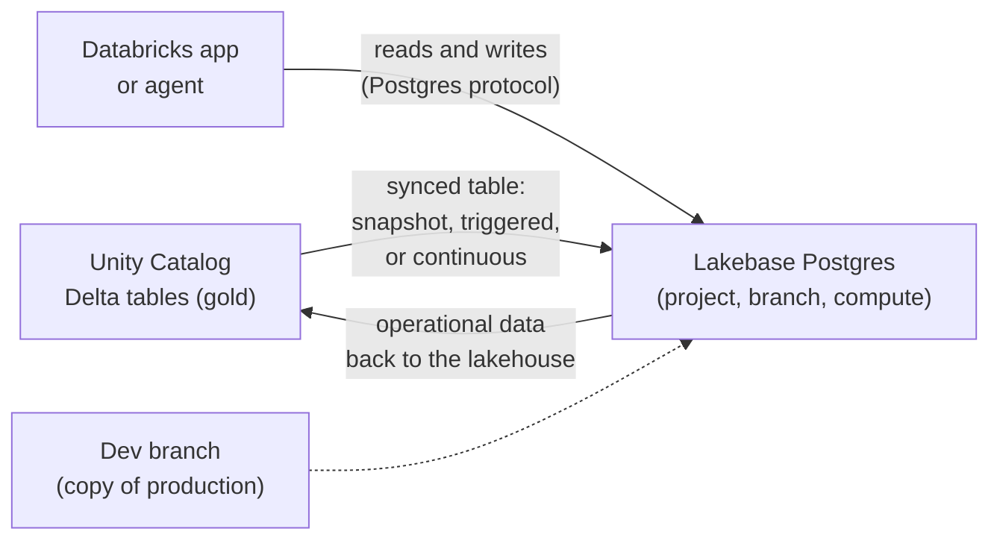

# Lakebase

Mastery: `INPUT[inlineSelect(option(new), option(learning), option(solid)):mastery]`

> [!story] Context
> [[Databricks Apps]] need to save what users enter, such as a reorder form submission, and read data back in milliseconds. Delta tables are designed for large analytical scans, not for many small, concurrent writes ([[OLTP vs OLAP]]). Lakebase adds a managed PostgreSQL database inside the Databricks platform for that transactional workload.

> [!eli5] Summary
> Lakebase is a regular business database, the kind that sits behind an app or a website, run for you inside Databricks. It saves small changes instantly, such as one new order, and can receive copies of the company's analysis tables so apps can look them up quickly.

## Background

Analytical and transactional databases are built for different jobs. [[Relational Databases|Transactional databases]] such as PostgreSQL handle many small reads and writes with low latency. Lakehouse tables handle large scans and aggregations. Most companies run both, connected by [[ETL vs ELT|ETL]] jobs in one direction and [[Reverse ETL|reverse ETL]] tools in the other, with separate security for each.

Lakebase brings the transactional database into the Databricks platform. It is based on PostgreSQL, and its storage is separated from compute, which enables autoscaling, scale-to-zero, and instant branching. (The Postgres company Neon, acquired by Databricks in 2025, underpins Lakebase; the acquisition year is unconfirmed against databricks.com news pages.)

## Overview

Lakebase Postgres became generally available on **January 22, 2026**. The GA release includes autoscaling, scale-to-zero, instant branching, automated backups, point-in-time recovery, an adjustable storage quota, and expanded region availability.

| Concept | Description |
|---|---|
| **Project** | The top-level container for a Lakebase database deployment |
| **Branch** | An isolated copy of the database state. Each project starts with a root branch named `production`, which cannot be deleted. A project can have up to 500 branches. |
| **Compute** | The Postgres compute attached to a branch, sized in Capacity Units (CU). Autoscaling is available for computes up to 64 CU, and computes can scale to zero when idle. |
| **Postgres versions** | 16, 17, and 18. Version 17 is the default. |
| **Synced tables** | Copies of Unity Catalog tables served into Postgres for low-latency reads |
| **Management** | UI, REST API, [[Databricks CLI]], and Databricks SDKs (Python, Java, Go), all generally available, plus [[Declarative Automation Bundles]] |

### Autoscaling and Provisioned

Lakebase originally offered fixed-size **Lakebase Provisioned** instances. New instances now use the **Autoscaling** model (projects, branches, scale-to-zero) by default. The upgrade of Provisioned instances to Autoscaling completed in July 2026, and the Provisioned UI remained available until September 1, 2026. Documentation pages labeled "Lakebase Provisioned" describe the older model.

## How it works



### Synced tables: lakehouse data into Postgres

A synced table copies a Unity Catalog table into Lakebase so an app can look up rows in milliseconds. A managed pipeline maintains it.

| Sync mode | Behavior | Requirement |
|---|---|---|
| **Snapshot** | Each run copies the full source and replaces the target atomically. Most efficient for high-churn tables. | Any source that supports `SELECT`, including views and Iceberg tables |
| **Triggered** | Each run applies only the changes since the last run, on demand or on a schedule | [[Change Data Feed]] on the source |
| **Continuous** | An initial snapshot, then changes applied as they occur (seconds of latency, minimum 15-second intervals) | Change data feed on the source |

Databricks recommends treating synced tables as read-only in Postgres. The Autoscaling documentation gives a throughput of roughly 150 rows per second per CU for triggered and continuous syncs.

### Example: a reorder table for a store app

1. Create a Lakebase project named `shop-ops` (see **Get a Postgres database** in the docs for the current UI steps).
2. Keep the default Postgres version (17).
3. Open the project's connection dialog and copy the connection details.
4. Connect with `psql` or any Postgres client, and create the table below.
5. Add the database as a resource to the `store-reorders` app (see [[Databricks Apps]]).
6. Create a synced table from `shop.analytics.daily_sales` in snapshot mode so the app can show yesterday's sales without querying a SQL warehouse.

```sql
-- Runs in Lakebase (PostgreSQL), not in Databricks SQL
CREATE TABLE reorders (
  reorder_id   BIGSERIAL PRIMARY KEY,
  store_id     INT          NOT NULL,
  item         TEXT         NOT NULL,
  quantity     INT          NOT NULL CHECK (quantity > 0),
  requested_by TEXT         NOT NULL,
  created_at   TIMESTAMPTZ  NOT NULL DEFAULT now()
);

-- A single-row write, the typical OLTP operation
INSERT INTO reorders (store_id, item, quantity, requested_by)
VALUES (2, 'flour 25kg', 4, 'manager.downtown@example.com');

-- A point lookup, served in milliseconds with an index
CREATE INDEX ON reorders (store_id, created_at);
SELECT * FROM reorders WHERE store_id = 2 ORDER BY created_at DESC LIMIT 10;
```

### Branching for development

Create a branch from `production` to test a schema change or a new app version against a copy of real data. Branches are created instantly because storage is shared until data diverges. Delete the branch when the test is done.

## Small-business considerations

> [!smallbiz] Small-business considerations
> - **Use Lakebase when an app writes data.** Forms, approvals, inventory counts, and app state belong in Postgres. Reports and aggregations belong in Delta tables on a SQL warehouse.
> - **Do not move the point-of-sale or main business system** into Lakebase as a first step. Keep the system of record where it is and ingest it with [[Lakeflow Connect]]. See [[Migrating from Postgres and MySQL]].
> - **Use scale-to-zero** for internal tools used only during business hours, so idle compute is not billed.
> - **Serve lookups with synced tables** in snapshot mode on a daily schedule, unless the app needs data fresher than a day.
>
> Lakebase usage is metered for compute (sized in Capacity Units, billed while running, so scale-to-zero matters) and for storage. Synced tables add pipeline compute. See the official pricing page and [[How Databricks Pricing Works]].

## Cloud differences

> [!azure]- Azure Databricks
> - Lakebase is generally available on Azure Databricks. The Azure release notes list GA in 11 new regions in addition to `eastus2`, `westeurope`, and `westus`, with more regions added in August 2026. An early Databricks GA blog post described Azure as Beta; the later Azure release notes supersede it.
> - Check the Azure Lakebase documentation for your region before planning a deployment.

> [!aws]- Databricks on AWS
> - GA on January 22, 2026. Autoscaling regions include `us-east-1`, `us-east-2`, and `us-west-2`, among others.
> - Lakebase supports PCI-DSS and HITRUST in all AWS regions, per the Lakebase release notes.

> [!gcp]- Databricks on Google Cloud
> - Lakebase is in Beta on Google Cloud. The GCP release notes list Beta availability in `us-east4`, `us-central1`, and `europe-west3`. This status was not confirmed as current in October 2026; check the GCP Lakebase release notes.

## Advanced topics

> [!deepdive]- Advanced topics (301–401)
> - **Storage and compute separation.** Lakebase separates Postgres storage from compute ([[Storage vs Compute]]). This is what enables scale-to-zero, instant branches, and point-in-time recovery without full copies.
> - **Synced table throughput.** The Autoscaling docs cite about 150 rows per second per CU for triggered and continuous syncs. The older Provisioned docs cite about 1,200 and a 2 TB logical data limit per database. Check which model a page describes.
> - **Change data feed.** Triggered and continuous modes need a change data feed on the source. Automatic change data feed can cover sources such as Iceberg tables.
> - **Write-back to the lakehouse.** Some direct write-back features (LTAP direct writes) are in Beta as of October 2026. Operational data can also flow back through [[Lakehouse Federation]] or ingestion pipelines.
> - **Observability.** Lakebase telemetry is available in [[System Tables|system tables]].
> - **Disaster recovery.** Automated backups and point-in-time recovery are included. See the Lakebase disaster recovery page and [[Disaster Recovery]].
> - **Compatibility.** Lakebase is Postgres-compatible, but not every extension or setting is available. Check the compatibility page before migrating an existing application.
> - **Infrastructure as code.** Projects, branches, and endpoints can be managed with the REST API, CLI, SDKs, and Declarative Automation Bundles.

## Common misconceptions

> [!confusion] Lakebase does not replace Delta tables
> Lakebase serves transactional reads and writes. Delta tables on the lakehouse remain the place for analytics, history, and large scans. The two work together through synced tables.

> [!confusion] Synced tables are not a place to write
> Treat synced tables as read-only copies. Write app data to ordinary Postgres tables.

> [!confusion] "Lakebase Provisioned" pages may be outdated
> New databases use the Autoscaling model. Provisioned instances were upgraded in July 2026.

## Recall

What is Lakebase?::A managed PostgreSQL (OLTP) database inside Databricks, for apps and agents.
When did Lakebase become generally available?::January 22, 2026 (on AWS; Azure followed, GCP is in Beta).
Which Postgres versions does Lakebase support, and which is the default?::16, 17, and 18. 17 is the default.
What is the root branch of a Lakebase project called?::`production`. It cannot be deleted.
How many branches can a Lakebase project have?::Up to 500.
What are the three synced table modes?::Snapshot (full copy each run), triggered (incremental on demand or schedule), and continuous (incremental as changes occur).
What do triggered and continuous synced tables require on the source?::A change data feed.
Should you write to a synced table in Postgres?::No. Databricks recommends treating synced tables as read-only.
What replaced Lakebase Provisioned instances?::The Autoscaling model (projects, branches, scale-to-zero). The upgrade completed in July 2026.

## Next steps

> [!path] Learning path
> **Needs first:** [[Relational Databases]], [[OLTP vs OLAP]], [[Unity Catalog]], [[Delta Lake]]
> **Unlocks next:** [[Databricks Apps]], [[Mosaic AI Agent Framework]], [[Migrating from Postgres and MySQL]], [[Path - AI App Developer]]

> [!nextup] Next
> [[Databricks One]] covers Genie One, the business-user interface where people find the dashboards, Genie Agents, and apps built in this chapter.

> [!sources]- Sources (last verified: 2026-10-25)
> - [Lakebase release notes (AWS)](https://docs.databricks.com/aws/en/release-notes/lakebase/)
> - [Lakebase release notes (Azure Databricks)](https://learn.microsoft.com/en-us/azure/databricks/release-notes/lakebase/)
> - [Lakebase release notes (GCP)](https://docs.databricks.com/gcp/en/release-notes/lakebase/)
> - [Lakebase Postgres (Azure Databricks)](https://learn.microsoft.com/en-us/azure/databricks/oltp/projects/)
> - [Core concepts (AWS)](https://docs.databricks.com/aws/en/oltp/projects/core-concepts)
> - [Get a Postgres database (AWS)](https://docs.databricks.com/aws/en/oltp/projects/get-started)
> - [Manage projects (AWS)](https://docs.databricks.com/aws/en/oltp/projects/limitations)
> - [Serve lakehouse data with synced tables (AWS)](https://docs.databricks.com/aws/en/oltp/projects/sync-tables)
> - [Serve lakehouse data with synced tables (Azure Databricks)](https://learn.microsoft.com/en-us/azure/databricks/oltp/projects/sync-tables)
> - [Serve lakehouse data with synced tables, Lakebase Provisioned (Azure Databricks)](https://learn.microsoft.com/en-us/azure/databricks/oltp/instances/sync-data/sync-table)
> - [Upgrade to Autoscaling (Azure Databricks)](https://learn.microsoft.com/en-us/azure/databricks/oltp/upgrade-to-autoscaling)
> - [Use cases (AWS)](https://docs.databricks.com/aws/en/oltp/projects/use-cases)
> - [Lakebase Postgres compatibility (AWS)](https://docs.databricks.com/aws/en/oltp/projects/compatibility)
> - [Lakebase disaster recovery (AWS)](https://docs.databricks.com/aws/en/oltp/projects/disaster-recovery)
> - [Lakebase telemetry in system tables (AWS)](https://docs.databricks.com/aws/en/oltp/projects/observability-quickstart)
> - [Manage Lakebase with Declarative Automation Bundles (AWS)](https://docs.databricks.com/aws/en/oltp/projects/manage-with-bundles)
> - [Add a Lakebase resource to a Databricks app (AWS)](https://docs.databricks.com/aws/en/dev-tools/databricks-apps/lakebase)
> - [Databricks Lakebase is now Generally Available (Databricks blog)](https://www.databricks.com/blog/databricks-lakebase-generally-available)
> - [Reverse ETL with Lakebase (Databricks blog)](https://www.databricks.com/blog/reverse-etl-lakebase-activate-your-lakehouse-data-operational-analytics)
