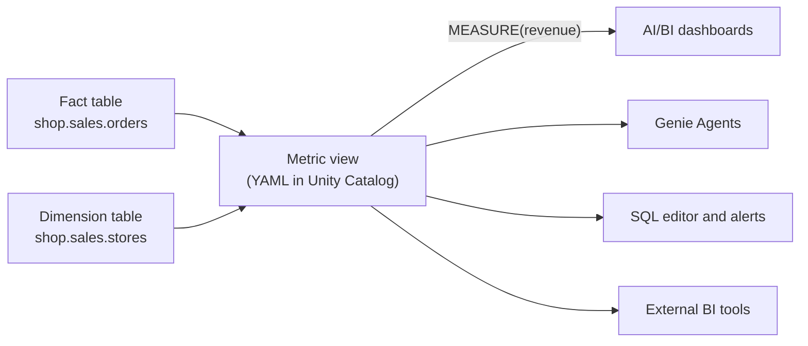

# Metric Views

Mastery: `INPUT[inlineSelect(option(new), option(learning), option(solid)):mastery]`

> [!story] Context
> [[Genie Agents]] and [[AI-BI Dashboards]] both compute numbers such as revenue. If each tool, and each analyst, writes its own `SUM(...)` with its own filters, the same question returns different answers. A metric view defines each measure once in [[Unity Catalog]], and every tool queries that definition.

> [!eli5] Summary
> A metric view is a single, shared definition of the numbers a business tracks, such as revenue or average order size, and the ways it can be broken down, such as by store or by day. Every dashboard, chat tool, and report reads the same definition, so everyone gets the same answer.

> [!analogy]- Analogy: a recipe card
> | Kitchen | Metric view |
> |---|---|
> | One master recipe card | The YAML definition in Unity Catalog |
> | Ingredients | The source table and joins |
> | Ways to portion a dish | Dimensions (store, date, product) |
> | The dish itself | A measure (revenue) |
> | Every cook uses the same card | Every tool calls `MEASURE(revenue)` |

## Background

Business metrics are usually defined in many places: in dashboard queries, in a Power BI semantic model, in a LookML project, and in analysts' saved SQL. Small differences accumulate. One report excludes refunds and another does not. One divides by orders and another by customers. This is the problem a [[Semantic Layer|semantic layer]] solves.

Earlier OLAP systems precomputed "cubes" for consistent slicing ([[OLTP vs OLAP]]). BI-tool semantic models defined metrics inside a single tool. Metric views put the definitions in the catalog, where every engine and tool that reads Unity Catalog can use them, with the same permissions, lineage, and discovery as tables.

## Overview

A metric view is a Unity Catalog object, defined in [[YAML]], that separates **measures** (aggregations) from **dimensions** (the attributes to group by). The aggregation is applied at query time, so one metric view answers questions at any combination of its dimensions.

| Element | Description |
|---|---|
| `source` | The fact table, view, or SQL query the metric view reads |
| `joins` | Dimension tables joined to the source. Star and snowflake schemas are supported. |
| `filter` | A filter applied to every query, such as `status = 'completed'` |
| `dimensions` | Named expressions to group or filter by, such as a store name or the month of an order date |
| `measures` | Named aggregate expressions, such as `SUM(amount)`, queried with `MEASURE()` |
| Semantic metadata | Display names, formats, and synonyms that help BI tools and [[Genie Agents]] interpret the data (added October 2, 2025) |
| Materialization | Optional precomputed [[Materialized Views\|materialized views]] that the engine uses automatically |

### Status and requirements

| Item | Status (October 2026) |
|---|---|
| Unity Catalog metric views | Entered Public Preview on May 29, 2025. No GA announcement for the core feature was found; check the release notes. |
| Runtime | Introduced in Databricks Runtime 16.4. Materialization and snowflake joins need 17.3. One-to-many joins need 18.1. Parameterized metric views need 18.2. |
| Sharing metric views with [[OpenSharing]] | GA on September 24, 2026 (queried with `MEASURE(...)` on serverless compute) |
| Window measures | Listed as GA in the platform release notes |
| Local metric views in dashboards | GA in August 2026 (separate from Unity Catalog metric views) |

## How it works



### Create a metric view for daily sales by store

Run the statement in the [[SQL Editor]] on a SQL warehouse, or use the Catalog Explorer UI.

```sql
CREATE OR REPLACE VIEW shop.analytics.sales_metrics
WITH METRICS
LANGUAGE YAML
AS $$
version: 0.1
comment: "Completed store sales"
source: shop.sales.orders
filter: status = 'completed'
joins:
  - name: stores
    source: shop.sales.stores
    on: source.store_id = stores.store_id
dimensions:
  - name: order_date
    expr: order_date
  - name: order_month
    expr: DATE_TRUNC('MONTH', order_date)
  - name: store_name
    expr: stores.store_name
measures:
  - name: revenue
    expr: SUM(amount)
  - name: orders
    expr: COUNT(DISTINCT order_id)
  - name: average_order_value
    expr: SUM(amount) / COUNT(DISTINCT order_id)
$$;
```

The documentation shows examples with `version: 0.1` and with newer versions (for example `1.1`) that add keys such as `display_name`, `format`, and `synonyms`. Check the YAML syntax reference for the version your workspace supports.

### Query a metric view

Select dimensions directly and wrap measures in `MEASURE()`. `GROUP BY ALL` groups by every selected dimension.

```sql
-- Daily sales by store, last 7 days
SELECT
  order_date,
  store_name,
  MEASURE(revenue)             AS revenue,
  MEASURE(average_order_value) AS aov
FROM shop.analytics.sales_metrics
WHERE order_date >= current_date() - INTERVAL 7 DAYS
GROUP BY ALL
ORDER BY order_date, store_name;

-- The same measure at a different grain: monthly totals
SELECT order_month, MEASURE(revenue) AS revenue
FROM shop.analytics.sales_metrics
GROUP BY ALL;
```

`average_order_value` is computed correctly at each grain: total revenue divided by total distinct orders for the group. Averaging a precomputed daily ratio would give a different, incorrect result.

### Grant access

```sql
GRANT SELECT ON VIEW shop.analytics.sales_metrics TO `analysts`;
```

## Small-business considerations

> [!smallbiz] Small-business considerations
> - **Adopt metric views when two tools or two people report the same number.** That is the point where definitions start to drift.
> - **Start with three to five measures** the owner reviews daily (revenue, orders, average order value, refunds) and the dimensions they group by (store, date, product).
> - **Point dashboards and Genie Agents at the metric view** instead of at raw tables.
> - **Power BI users:** support for metric views in Power BI changed several times in 2026. Check the current Databricks Power BI documentation before relying on it. See [[Connecting Power BI]].
>
> Metric views have no separate charge. Queries run on the SQL warehouse or serverless compute that reads them. Materialization adds a managed pipeline that is billed as pipeline compute.

## Cloud differences

> [!azure]- All clouds
> Nothing differs between clouds. The YAML, `MEASURE()`, and permissions are the same on Azure Databricks, Databricks on AWS, and Databricks on Google Cloud. Sub-features can reach each cloud on different dates.

## Advanced topics

> [!deepdive]- Advanced topics (301–401)
> - **Materialization.** Declare a schedule and one or more materialized views (aggregated or unaggregated) in the YAML. Databricks creates a managed [[Lakeflow Spark Declarative Pipelines|Lakeflow pipeline]] that builds and maintains them, and the query engine rewrites queries to use them when they match.
> - **One-to-many joins.** A join with `cardinality: one_to_many` lets a joined table act as a fact source aggregated at its own grain. Materializations of such metric views qualify for exact-match rewrites only. Databricks Runtime 18.1 also adds the `rely.at_most_one_match` join optimization.
> - **Composed measures.** Measures can reference earlier measures, which keeps ratios consistent with their components.
> - **Window measures** compute values such as trailing 7-day revenue over an ordered dimension.
> - **Level-of-detail (LOD) expressions** fix a measure at a grain different from the query's grouping, for example each store's share of total revenue.
> - **Parameterized metric views** (Databricks Runtime 18.2 and above) accept arguments at query time, for example `FROM discounted_sales_metrics(discount => 0.15)`.
> - **Sharing.** Metric views can be added to an OpenSharing share (GA September 24, 2026) so another account queries the same definitions.
> - **Semantic models versus metric views.** A Power BI semantic model or a LookML project defines metrics for one tool. Choose one primary location for each metric to avoid two sources of truth.

## Common misconceptions

> [!confusion] A metric view is not a materialized view
> A [[Materialized Views|materialized view]] stores the precomputed result of one query. A metric view stores definitions and computes measures at query time for any grouping. A metric view can optionally use materialized views for speed.

> [!confusion] A metric view is not a regular view with aggregates
> A regular view with `GROUP BY` fixes the grain. A metric view leaves the grain to the query, and ratios are recomputed correctly at each grain.

> [!confusion] You cannot `SELECT revenue` directly
> Measures must be wrapped in `MEASURE()`. Dimensions are selected as ordinary columns.

## Recall

What problem do metric views solve?::Different tools and people computing the same business metric differently. The metric is defined once in Unity Catalog.
What language defines a metric view?::YAML, inside `CREATE VIEW ... WITH METRICS LANGUAGE YAML AS $$ ... $$`.
How do you query a measure in a metric view?::Wrap it in `MEASURE()`, for example `MEASURE(revenue)`, with `GROUP BY ALL` over the selected dimensions.
What is the difference between a measure and a dimension?::A measure is an aggregation (SUM, COUNT). A dimension is an attribute to group or filter by (store, date).
When did metric views enter Public Preview?::May 29, 2025.
Which Databricks Runtime introduced metric views?::Databricks Runtime 16.4.
What does metric view materialization create?::A managed Lakeflow pipeline that maintains materialized views, which the engine uses automatically through query rewrite.
When did sharing metric views with OpenSharing become GA?::September 24, 2026.
How does a metric view differ from a materialized view?::A metric view stores definitions and computes at query time for any grain. A materialized view stores one precomputed result.

## Next steps

> [!path] Learning path
> **Needs first:** [[SQL]], [[Unity Catalog]], [[Star Schema]], [[Aggregation]]
> **Unlocks next:** [[Genie Agents]], [[AI-BI Dashboards]], [[Connecting Power BI]], [[SQL Alerts]]

> [!nextup] Next
> [[SQL Alerts]] watches a number, such as yesterday's revenue for each store, and sends a notification when it crosses a threshold.

> [!sources]- Sources (last verified: 2026-10-25)
> - [Unity Catalog metric views (AWS)](https://docs.databricks.com/aws/en/uc-semantics/metric-views/)
> - [Unity Catalog metric views (Azure Databricks)](https://learn.microsoft.com/en-us/azure/databricks/uc-semantics/metric-views/)
> - [Create a metric view (AWS)](https://docs.databricks.com/aws/en/uc-semantics/metric-views/create)
> - [Use SQL to create and manage metric views (AWS)](https://docs.databricks.com/aws/en/metric-views/create/sql)
> - [Metric view YAML syntax reference (AWS)](https://docs.databricks.com/aws/en/uc-semantics/metric-views/yaml-reference)
> - [Metric view YAML syntax reference (Azure Databricks)](https://learn.microsoft.com/en-us/azure/databricks/uc-semantics/metric-views/yaml-reference)
> - [Model metric views (AWS)](https://docs.databricks.com/aws/en/uc-semantics/metric-views/basic-modeling)
> - [Tutorial: build a metric view with joins and data modeling (AWS)](https://docs.databricks.com/aws/en/uc-semantics/metric-views/tpch-example)
> - [Materialization for metric views (AWS)](https://docs.databricks.com/aws/en/uc-semantics/metric-views/materialization)
> - [Metric view feature availability (AWS)](https://docs.databricks.com/aws/en/uc-semantics/metric-views/feature-availability)
> - [Use level of detail (LOD) expressions in metric views (AWS)](https://docs.databricks.com/aws/en/uc-semantics/metric-views/level-of-detail)
> - [Advanced techniques for metric views (Azure Databricks)](https://learn.microsoft.com/en-us/azure/databricks/uc-semantics/metric-views/advanced-techniques)
> - [CREATE VIEW (AWS)](https://docs.databricks.com/aws/en/sql/language-manual/sql-ref-syntax-ddl-create-view)
> - [Databricks SQL release notes 2025 (GCP)](https://docs.databricks.com/gcp/en/sql/release-notes/2025)
> - [September 2026 release notes (AWS)](https://docs.databricks.com/aws/en/release-notes/product/2026/september)
