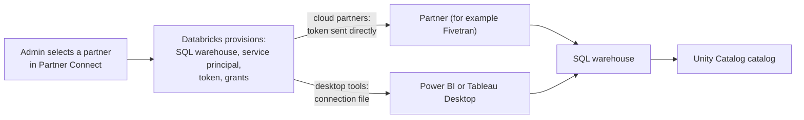

# Partner Connect

Mastery: `INPUT[inlineSelect(option(new), option(learning), option(solid)):mastery]`

> [!story] Context
> [[Connecting Tableau and Other BI Tools]] described the manual setup: find the hostname and HTTP path, create credentials, grant access. Partner Connect automates that setup for a curated list of partner tools, from ingestion services to BI tools.

> [!eli5] Summary
> Partner Connect is a catalog of outside tools that work with Databricks. You pick one, choose which data it may use, and Databricks creates the account, computer, and password the tool needs and hands them over. You can start a trial without configuring anything by hand.

## Background

Connecting a third-party tool to a data platform usually takes several steps across two products: create a technical user, generate a credential, create or choose compute, grant permissions, and copy everything into the partner's setup screen. Mistakes in any step produce failed connections or overly broad access.

Partner Connect performs the Databricks side of those steps and passes the details to the partner. It is a starting point. The resulting connection is a normal connection that you can manage and tighten afterward.

## Overview

When you connect a partner, Partner Connect provisions the following resources:

| Resource | Default name | Purpose |
|---|---|---|
| **SQL warehouse** | `<PARTNER>_WAREHOUSE` (you can rename it before continuing) | Compute the partner uses for queries and writes |
| **Service principal** | `<PARTNER>_USER` | The partner's identity in Databricks |
| **Personal access token** | Belongs to the service principal | The credential the partner uses |
| **Privileges** | `USE CATALOG` and `CREATE SCHEMA` on the selected catalog (varies by partner), and `CAN USE` on the warehouse | Least-privilege access for the partner |

Partner categories include data ingestion, data preparation and transformation, BI and visualization, machine learning, data security, data governance, and semantic layer. Examples named in the docs include Fivetran, Rivery, Prophecy, Labelbox, Power BI, Tableau, and Sigma. The list differs by cloud.

Requirements:

- The Databricks account must be on the **Premium** plan or above, because many partner solutions use Databricks SQL.
- The user who connects a partner needs permissions to create the resources above (typically a workspace admin).

## How it works



### Two connection patterns

| Partner type | Examples | What happens to the token |
|---|---|---|
| **Cloud partners** | Fivetran, Rivery, Sigma | The token value is shared directly with the partner, and you cannot view it afterward. If it expires or is lost, a workspace admin generates a replacement for the service principal. |
| **Desktop tools** | Power BI Desktop, Tableau Desktop | You create your own token or sign in with OAuth, and Partner Connect provides a connection file with the hostname and HTTP path |

### Connect Fivetran (cloud partner)

1. In the sidebar, open **Marketplace** and select **Partner Connect**.
2. Select the **Fivetran** tile.
3. Choose the catalog that Fivetran may write to, for example `raw`.
4. Review and optionally rename the SQL warehouse (`FIVETRAN_WAREHOUSE`).
5. Click **Next**, then **Connect to Fivetran**.
6. Sign in to Fivetran or start a trial. Fivetran opens with the destination already configured.
7. In Fivetran, add a source connector, such as a point-of-sale system, and start the sync.

After connecting, check what the partner can access:

```sql
-- Lists every principal's privileges on the catalog,
-- including the FIVETRAN_USER service principal
SHOW GRANTS ON CATALOG raw;
```

## Small-business considerations

> [!smallbiz] Small-business considerations
> - **Use Partner Connect for trials.** It is the fastest way to test whether a partner tool fits, without a setup project.
> - **Check native options first.** For ingestion, [[Lakeflow Connect]] has built-in connectors for many SaaS sources and databases. For dashboards, [[AI-BI Dashboards]] need no second license. Use a partner when it covers a gap.
> - **Review the provisioned warehouse.** Set a short auto-stop and an appropriate size on `<PARTNER>_WAREHOUSE`, since partner syncs start it on their own schedule.
> - **Restrict the catalog.** Connect ingestion partners to a `raw` catalog, not to the catalog that holds reporting tables.
>
> Partner Connect has no separate charge. Partner tools have their own pricing, and the provisioned SQL warehouse is billed in [[DBUs]] while it runs.

## Cloud differences

> [!azure]- Azure Databricks
> - Partners can authenticate with an Azure Databricks personal access token or a Microsoft Entra ID token, depending on what the partner supports.
> - The partner list differs from AWS and GCP. For example, the BI and visualization category on Azure has listed Sigma only. For Power BI on Azure, see [[Power BI on Azure Databricks]].

> [!aws]- Databricks on AWS
> - Requires the Premium plan or above. The partner list includes the BI and visualization category with Power BI and Sigma.

> [!gcp]- Databricks on Google Cloud
> - The same provisioning model applies. Check the GCP Partner Connect page for the partners available, which can differ from AWS.

## Advanced topics

> [!deepdive]- Advanced topics (301–401)
> - **Prefer OAuth where supported.** Databricks recommends service principal tokens over user tokens for automated tools, and OAuth where the partner supports it. See [[Authentication - Tokens and OAuth]].
> - **Token rotation.** Cloud partners hold the token. Plan rotation with the partner's credential-update screen, and regenerate the service principal's token as a workspace admin when needed.
> - **Disconnecting.** When you stop using a partner, check which provisioned resources remain (service principal, token, warehouse, schemas the partner wrote) and remove the ones you no longer need.
> - **Manual alternative.** Every Partner Connect integration can be configured manually with the same resources. Use the manual path to choose an existing warehouse or to apply stricter grants from the start.
> - **Reverse direction.** Partners that push lakehouse data back into business tools perform [[Reverse ETL]]. Databricks' native option for serving data to apps is [[Lakebase]] synced tables.

## Common misconceptions

> [!confusion] Partner Connect is not the Databricks Marketplace
> Partner Connect connects third-party tools to your workspace. [[Databricks Marketplace]] lists data products, models, and solutions to use or share. Partner Connect is reached through the Marketplace section of the sidebar.

> [!confusion] The partner does not use your personal credentials
> Partner Connect creates a dedicated service principal for each partner, so access can be audited and revoked separately.

## Recall

What three resources does Partner Connect typically provision?::A SQL warehouse, a service principal, and a personal access token for that service principal.
What is the default name pattern for the partner's service principal?::`<PARTNER>_USER`.
What is the default name pattern for the partner's SQL warehouse?::`<PARTNER>_WAREHOUSE`.
Which Databricks plan does Partner Connect require?::Premium or above.
For a cloud partner such as Fivetran, can you view the token afterward?::No. It is shared directly with the partner. A workspace admin can generate a replacement.
Which privileges does a partner service principal get on the warehouse?::`CAN USE`.
On Azure, which token types can partners use?::An Azure Databricks personal access token or a Microsoft Entra ID token, depending on the partner.

## Next steps

> [!path] Learning path
> **Needs first:** [[SQL Warehouses]], [[Users Groups and Service Principals]], [[Unity Catalog]]
> **Unlocks next:** [[Fivetran and ELT Tools]], [[dbt on Databricks]], [[Connecting Power BI]]

> [!nextup] Next
> [[AI Functions in SQL]] covers calling large language models directly from SQL to classify, summarize, extract, and translate text.

> [!sources]- Sources (last verified: 2026-10-25)
> - [What is Databricks Partner Connect? (AWS)](https://docs.databricks.com/aws/en/partner-connect/)
> - [What is Databricks Partner Connect? (GCP)](https://docs.databricks.com/gcp/en/partner-connect)
> - [What is Databricks Partner Connect? (Azure Databricks)](https://learn.microsoft.com/en-us/azure/databricks/partner-connect/)
> - [Connect to ingestion partners using Partner Connect (AWS)](https://docs.databricks.com/aws/en/partner-connect/ingestion)
> - [Connect to data prep partners using Partner Connect (AWS)](https://docs.databricks.com/aws/en/partner-connect/prep)
> - [Connect to security partners using Partner Connect (AWS)](https://docs.databricks.com/aws/en/partner-connect/data-security)
> - [Connect to data governance partners using Partner Connect (AWS)](https://docs.databricks.com/aws/en/partner-connect/data-governance)
> - [Connect to semantic layer partners using Partner Connect (GCP)](https://docs.databricks.com/gcp/en/partner-connect/semantic-layer)
> - [Connect to Fivetran using Partner Connect (AWS)](https://docs.databricks.com/aws/en/partner-connect/walkthrough-fivetran)
> - [Connect to Sigma (AWS)](https://docs.databricks.com/aws/en/partners/bi/sigma)
> - [Technology partners (AWS)](https://docs.databricks.com/aws/en/integrations)
