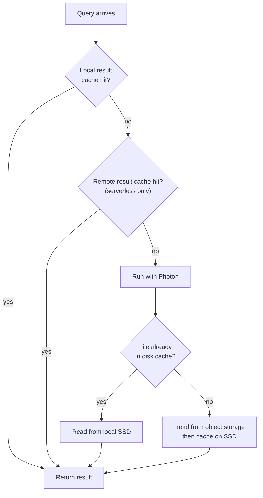

# Query Performance and Caching

Mastery: `INPUT[inlineSelect(option(new), option(learning), option(solid)):mastery]`

> [!story] Previously
> In the [[SQL Editor]] our analyst wrote a working query. Now it has to be fast: it will sit behind a dashboard that twenty people open every morning. Two questions follow. When a query is slow, how do you find out why? And when twenty people ask the same thing, does the warehouse really have to compute it twenty times?

> [!eli5] In one breath
> When a question to the data is slow, Databricks can show you a step-by-step report of where the time went, like a receipt for each stage. And when someone asks a question that was already answered and nothing has changed, Databricks hands back the saved answer instead of working it out again.

> [!analogy] Analogy: a busy kitchen
> - **The query** is a customer's order.
> - **The query profile** is the kitchen's timing sheet: how long the prep, the grill, and the plating took for that order. It shows which station was the bottleneck.
> - **The disk cache** is the ingredients already chopped and sitting on the counter, so the cook does not walk to the walk-in fridge (cloud storage) every time.
> - **The result cache** is a finished dish kept warm under the lamp. If the next customer orders exactly the same thing and the recipe has not changed, they get it at once.
> - **Changing the underlying table** is a new delivery of ingredients. Anything kept warm from the old batch gets thrown out.

## Why it exists

A lakehouse query reads files from [[Object Storage|object storage]], which is cheap and huge but much slower to reach than a local disk. On top of that, a BI workload is repetitive: the same dashboard, the same filters, many people, every morning. Without help you pay twice: once in waiting time ([[Latency|latency]]) and once in compute ([[DBUs]]).

Databricks SQL attacks both:

- **Caches** avoid repeated work. Repeated questions are answered from memory, and repeated reads come from local SSD.
- **The query profile** explains the work that cannot be avoided, so you can fix the table layout or the SQL instead of just buying a bigger warehouse.

## What it actually is

### The caches

Databricks documents several cache layers for SQL warehouses:

| Cache | What it stores | Where | Lives until | Notes |
|---|---|---|---|---|
| **Local result cache** | Final query results | Memory on the warehouse cluster | The cluster stops or restarts | Checked first |
| **Remote result cache** | Final query results | Persisted as workspace system data | 24 hours, survives warehouse restarts | **Serverless only** |
| **Disk cache** | Data file contents read from storage | Local SSDs on the warehouse | Same lifecycle as the local result cache | Detects changed files automatically |
| **Databricks SQL UI cache** | Results shown in the UI, per user | The UI | At most 7 days | Does not apply to AI/BI dashboards |
| **Dashboard cache** | Dashboard dataset results | AI/BI dashboards | Up to 24 hours | Can show results up to 24 hours old even if data changed |

The lookup order is simple. The warehouse checks its local result cache, then the remote result cache (on serverless), and only runs the query if neither has the answer. Both result caches expire after 24 hours and are **invalidated when the underlying tables change**, so the generic query result cache never returns stale data. The dashboard cache is the exception worth remembering: see [[AI-BI Dashboards]].

### The query profile

The **query profile** is a visual breakdown of one query's execution: the operators it ran (scans, [[Join|joins]], [[Aggregation|aggregations]], [[Shuffles|exchanges]]), how many rows and bytes each produced, and how long each took. You can open it from:

- the [[SQL Editor]] (from the results or the execution history),
- a [[Notebooks|notebook]] attached to a SQL warehouse or [[Serverless Compute|serverless compute]],
- the [[Lakeflow Spark Declarative Pipelines|Lakeflow pipelines]] UI,
- the [[Lakeflow Jobs|jobs]] UI.

To view it you must own the query or hold at least `CAN MONITOR` on the warehouse. A query served from the cache has **no profile**, because nothing ran. To force a fresh run, make a trivial change, such as changing or removing the `LIMIT`.

## How it works



### Reading a slow query: a checklist

Open the profile and look for the most expensive operator, then match it to a cause:

| Symptom in the profile | Likely cause | What to try |
|---|---|---|
| A scan reads far more bytes or files than the result needs | Table layout does not match the filter | [[Liquid Clustering]] on the filter columns, [[OPTIMIZE and VACUUM\|OPTIMIZE]] for small files. See [[Data Skipping]]. |
| Many small files | Lots of tiny appends | Compact them with `OPTIMIZE` |
| Spill to disk on a join or aggregation | Not enough memory for the warehouse size | Increase the warehouse size (the documented advice for serverless) |
| One task far slower than the rest | [[Data Skew\|Data skew]] on a join or group key | Check the key's distribution, let [[Adaptive Query Execution]] handle it, or pre-aggregate |
| Big exchange (shuffle) before a join | Large table joined to a large table | Filter earlier, or join to a smaller pre-aggregated table |
| Query waited before starting | Queuing, not slowness | Look at warehouse scaling, not the SQL |

### Analyst habits that help the engine

```sql
-- Slower: reads every column of every row, then filters late
SELECT *
FROM shop.sales.orders
WHERE YEAR(order_date) = 2026;

-- Faster: only needed columns, and a filter on the raw column,
-- so file-level statistics can skip whole files
SELECT store_id, order_date, amount
FROM shop.sales.orders
WHERE order_date >= '2026-01-01' AND order_date < '2027-01-01';
```

Wrapping a column in a function (`YEAR(order_date)`) can hide it from [[Data Skipping|data skipping]]. Comparing the raw column to a range keeps it visible.

For honest benchmarks, turn the result cache off in your session so you measure real work:

```sql
SET use_cached_result = false;  -- testing and benchmarking only
```

Databricks recommends this only for testing or benchmarking. In normal use the cache is free speed.

> [!smallbiz] For a small business
> You rarely need to tune anything. A few habits get most of the benefit:
> - **Use serverless.** Its remote result cache survives restarts, so the first person to open the morning report "warms" it for everyone after them.
> - **Do not disable caching** to "be safe". The result cache is invalidated whenever the table changes, so it never shows stale numbers.
> - **Before buying a bigger warehouse, open the profile.** One `SELECT *` on a wide table or one missing filter often explains a slow report.
> - **Remember the dashboard exception.** A dashboard can show numbers up to 24 hours old. If the owner needs today's sales at 10 a.m., schedule a refresh.

## On each cloud

> [!azure]- All clouds
> Nothing differs. The caches, the profile, and `use_cached_result` work the same on Azure Databricks, AWS, and Google Cloud. The only cloud-dependent detail is that the remote result cache needs serverless warehouses, and serverless availability varies by region.

## Going deeper

> [!deepdive]- Expert notes (301–401)
> - **Two result caches, one rule.** Both expire after 24 hours and both are invalidated by changes to the underlying tables. The remote one persists as workspace system data, which is why it outlives a stopped serverless warehouse.
> - **Disk cache vs `CACHE TABLE`.** The disk cache is automatic: you do nothing to turn it on. `CACHE TABLE` is a separate, explicit SQL statement documented in the SQL language reference. On SQL warehouses you normally rely on the automatic caches and check the reference before reaching for it.
> - **Disk cache correctness.** The disk cache detects changes to the underlying data files and invalidates itself, so it never serves stale file data.
> - **Profile vs Spark UI.** The query profile is the SQL-warehouse counterpart of the [[Spark UI]]. It hides the job, stage, and task plumbing and shows operators, which is what an analyst can act on.
> - **Dashboards have their own optimization.** AI/BI dashboards cache dataset results separately, and the docs describe how datasets are optimized and refreshed. Plan dashboard freshness with that page, not with the generic cache rules.

## Common confusions

> [!confusion] The result cache is not the disk cache
> The **result cache** stores *answers* (the final rows). The **disk cache** stores *ingredients* (data files copied to local SSD). A new query that has never been asked can still benefit from the disk cache, but not from the result cache.

> [!confusion] "Cached" does not mean "stale"
> The generic query result cache is invalidated when the underlying tables change. Only the AI/BI dashboard cache can show results up to 24 hours old.

> [!confusion] No profile is not an error
> If the profile button is missing, the query was probably served from the cache. Change the query slightly and run it again.

## Recall

What are the two result caches in Databricks SQL?::The local result cache (in memory, cleared when the cluster stops) and the remote result cache (persisted as workspace system data, serverless only).
How long do result cache entries live?::Up to 24 hours, and they are invalidated earlier if the underlying tables change.
What does the disk cache store?::Copies of data files read from cloud storage, on the warehouse's local SSDs.
Why might a query have no query profile?::It was answered from the query cache, so nothing ran.
How do you bypass the cache to get a profile?::Make a trivial change to the query, such as changing or removing the LIMIT.
What setting disables the result cache for benchmarking?::`SET use_cached_result = false`.
Which cache can show results up to 24 hours old even after data changed?::The AI/BI dashboard cache.
What permission is needed to view a query profile you do not own?::At least CAN MONITOR on the SQL warehouse.
A profile shows spill to disk on a serverless warehouse. What is the documented fix?::Increase the warehouse size.

## Where next

> [!path] Learning path
> **Needs first:** [[SQL Editor]], [[SQL Warehouses]], [[Shuffles]]
> **Unlocks next:** [[AI-BI Dashboards]], [[Liquid Clustering]], [[Cost Optimization Checklist]]

> [!nextup] Up next in the story
> Our query is fast and cached. But the owner does not read SQL results. They want a page of charts they can open on their phone. That is [[AI-BI Dashboards]].

> [!sources]- Sources (last verified: 2026-10-25)
> - [Query caching (AWS)](https://docs.databricks.com/aws/en/sql/user/queries/query-caching)
> - [Query profile (AWS)](https://docs.databricks.com/aws/en/sql/user/queries/query-profile)
> - [USE_CACHED_RESULT parameter (AWS)](https://docs.databricks.com/aws/en/sql/language-manual/parameters/use_cached_result)
> - [CACHE TABLE (AWS)](https://docs.databricks.com/aws/en/sql/language-manual/sql-ref-syntax-aux-cache-cache-table)
> - [CACHE TABLE (Azure Databricks)](https://learn.microsoft.com/en-us/azure/databricks/sql/language-manual/sql-ref-syntax-aux-cache-cache-table)
> - [Dataset optimization and caching for dashboards (AWS)](https://docs.databricks.com/aws/en/dashboards/caching)
> - [Dataset optimization and caching for dashboards (Azure Databricks)](https://learn.microsoft.com/en-us/azure/databricks/dashboards/caching)
> - [SQL warehouse sizing, scaling, and queuing behavior (AWS)](https://docs.databricks.com/aws/en/compute/sql-warehouse/warehouse-behavior)
> - [Best practices for performance efficiency (AWS)](https://docs.databricks.com/aws/en/lakehouse-architecture/performance-efficiency/best-practices)
