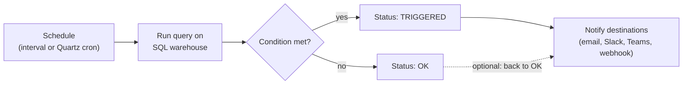

# SQL Alerts

Mastery: `INPUT[inlineSelect(option(new), option(learning), option(solid)):mastery]`

> [!story] Context
> [[Metric Views]] give each number one definition, and [[AI-BI Dashboards]] display those numbers. Dashboards still depend on someone opening them. A SQL alert checks a number on a schedule and notifies people when it crosses a threshold.

> [!eli5] Summary
> A SQL alert is a saved question that Databricks asks on a timetable, such as every morning at 7. If the answer crosses a line you set, for example a store selling less than half its normal amount, it sends a message by email or chat.

## Background

Before alerting tools, monitoring a business metric meant opening a report each day and noticing when a value looked wrong. Problems were found late, or not at all, when nobody looked.

Databricks SQL alerts move that check into the platform. An alert is defined on a SQL query, runs on a [[SQL Warehouses|SQL warehouse]], and uses notification destinations that an admin configures once.

The first version of the feature is now called **legacy alerts**. The `alerts-legacy` CLI command group is deprecated in favor of the current `alerts` commands, and the SQL alert task in [[Lakeflow Jobs]] supports only current alerts. Use the current alerts for all new work.

## Overview

An alert combines a query, a condition, a schedule, and notifications.

| Part | Description |
|---|---|
| **Query** | A SQL query written in the alert editor, tested before saving |
| **SQL warehouse** | The compute that runs the query |
| **Condition** | A comparison on the first value of a result column, or on an aggregation of one column across all rows (such as sum or average), against a threshold |
| **Test condition** | A button that shows whether the alert would trigger on current data |
| **Schedule** | A repeat interval from drop-down menus, or a Quartz cron expression (select **Show cron syntax**) |
| **Notifications** | Users, or notification destinations such as email, Slack, Microsoft Teams, or a [[Webhook\|webhook]], chosen on the **Destinations** tab |
| **Custom template** | Optional subject and body with variables such as `{{ALERT_NAME}}`, `{{ALERT_STATUS}}`, `{{ALERT_THRESHOLD}}`, `{{ALERT_URL}}`, and `{{QUERY_RESULT_TABLE}}` |
| **Notify when back to normal** | An option to notify subscribers when the alert returns to OK |

Alert states are **OK** (condition not met) and **TRIGGERED** (condition met).

## How it works



### Example: alert when a store has a bad day

The query returns the number of stores whose sales yesterday were below 60 percent of their average for the previous 28 days.

```sql
WITH daily AS (
  SELECT store_id, order_date, SUM(amount) AS revenue
  FROM shop.sales.orders
  WHERE order_date >= current_date() - INTERVAL 29 DAYS
    AND status = 'completed'
  GROUP BY store_id, order_date
),
baseline AS (
  SELECT store_id, AVG(revenue) AS avg_revenue
  FROM daily
  WHERE order_date < current_date() - INTERVAL 1 DAY
  GROUP BY store_id
)
SELECT COUNT(*) AS stores_below_normal
FROM daily d
JOIN baseline b USING (store_id)
WHERE d.order_date = current_date() - INTERVAL 1 DAY
  AND d.revenue < 0.6 * b.avg_revenue;
```

### Create the alert

1. In the sidebar, click **Alerts**, then **Create alert**.
2. Paste the query and select a serverless SQL warehouse.
3. Under the condition, select the column `stores_below_normal`, the operator `>`, and the threshold `0`.
4. Click **Test condition** to check the result on current data.
5. Set the schedule to run daily at 7:00 a.m. in your time zone.
6. On the **Destinations** tab, add the owner's email and the `#store-ops` Slack destination. If you skip this step, nobody is notified when the alert triggers.
7. Optionally, write a custom template that includes `{{QUERY_RESULT_TABLE}}`.
8. Save the alert.

To list which stores are affected, change the final `SELECT` to return one row per store and use the condition on an aggregation (count of rows) instead.

### Notification destinations

Workspace admins create, update, and delete notification destinations in the workspace settings. Users then select them when they configure an alert.

- **Slack (webhook):** create an incoming webhook in Slack, then paste its URL into a new Databricks notification destination.
- **Slack (Databricks Genie app, Beta):** connect a Slack workspace through the Databricks Genie app and select a channel. A workspace admin enables the destination type on the **Previews** page.
- **Microsoft Teams, email, generic webhooks:** configured in the same settings page.

## Small-business considerations

> [!smallbiz] Small-business considerations
> - **Start with two or three alerts** tied to decisions: a store with low sales, a pipeline that loaded zero rows, and a refund rate above normal.
> - **Alert on a count, not a list.** A query that returns "number of problem stores" is simple to threshold and to read in a message.
> - **Schedule alerts after the nightly pipeline** so they check fresh data. In Lakeflow Jobs, add a SQL alert task after the pipeline task.
> - **Send to a shared channel** instead of one person's inbox, so alerts are not missed during holidays.
>
> Each scheduled run starts the SQL warehouse if it is stopped, which is billed in [[DBUs]]. An alert every five minutes keeps a warehouse running far longer than a daily alert. For spending alerts, use account budgets instead (see [[Budgets and Usage Dashboards]]).

## Cloud differences

> [!azure]- All clouds
> Nothing differs between clouds. Alerts, conditions, schedules, and notification destinations work the same on Azure Databricks, Databricks on AWS, and Databricks on Google Cloud.

## Advanced topics

> [!deepdive]- Advanced topics (301–401)
> - **Alerts in jobs.** The SQL alert task in [[Lakeflow Jobs]] evaluates an alert as a job step, so the check runs immediately after the data it depends on is refreshed. It supports only current (not legacy) alerts.
> - **Alerts as code.** The Databricks CLI `alerts-v2` command group creates alerts from a display name, query text, warehouse ID, evaluation, and schedule. Alerts can also be deployed as resources in [[Declarative Automation Bundles]].
> - **Alert history.** An alert [[System Tables|system table]] records alert definitions and settings, including whether subscribers are notified when an alert returns to OK.
> - **Permissions.** Editing an alert schedule's notification list requires `CAN MANAGE` on the schedule. Only workspace admins manage notification destinations.
> - **Data quality alerts.** For table-level freshness and anomaly checks, see [[Data Quality Monitoring]], which has its own alerting. SQL alerts suit business thresholds and custom checks.
> - **Legacy behavior.** Legacy alerts notified whenever the status changed between OK and TRIGGERED. Check the current behavior and the notify-on-OK option when migrating.

## Common misconceptions

> [!confusion] An alert does not run without a schedule or a job
> Saving an alert does not evaluate it continuously. It runs on its schedule or as a job task.

> [!confusion] A triggered alert does not always send a message
> Notifications go only to the destinations configured on the **Destinations** tab.

> [!confusion] SQL alerts are not budget alerts
> SQL alerts evaluate query results. Cost thresholds use account budgets.

## Recall

What are the two alert states?::OK and TRIGGERED.
What can an alert condition evaluate?::The first value of a result column, or an aggregation of one column across all rows, compared with a threshold.
Which schedule syntax can an alert use besides the drop-down intervals?::Quartz cron syntax.
Who can create notification destinations?::Only workspace admins.
Which alerts does the SQL alert task in Lakeflow Jobs support?::Only current Databricks SQL alerts, not legacy alerts.
What happens if you skip the Destinations tab when scheduling an alert?::Nobody is notified when the alert triggers.
Which template variable inserts the query result into the message?::`{{QUERY_RESULT_TABLE}}`.
How do you connect a Slack channel through a webhook?::Create an incoming webhook in Slack and paste its URL into a Databricks notification destination.

## Next steps

> [!path] Learning path
> **Needs first:** [[SQL]], [[SQL Editor]], [[SQL Warehouses]]
> **Unlocks next:** [[Lakeflow Jobs]], [[Data Quality Monitoring]], [[Testing Data Pipelines]]

> [!nextup] Next
> [[Connecting Power BI]] covers how existing Power BI reports query the same governed tables on a SQL warehouse.

> [!sources]- Sources (last verified: 2026-10-25)
> - [Create an alert (AWS)](https://docs.databricks.com/aws/en/sql/user/alerts/create)
> - [Create an alert (Azure Databricks)](https://learn.microsoft.com/en-us/azure/databricks/sql/user/alerts/create)
> - [What are legacy alerts? (AWS)](https://docs.databricks.com/aws/en/sql/user/alerts/legacy)
> - [What are legacy alerts? (Azure Databricks)](https://learn.microsoft.com/en-us/azure/databricks/sql/user/alerts/legacy)
> - [Manage notification destinations (AWS)](https://docs.databricks.com/aws/en/admin/workspace-settings/notification-destinations)
> - [Manage notification destinations (Azure Databricks)](https://learn.microsoft.com/en-us/azure/databricks/admin/workspace-settings/notification-destinations)
> - [SQL alert task for jobs (AWS)](https://docs.databricks.com/aws/en/jobs/tasks/alert)
> - [SQL alert task for jobs (Azure Databricks)](https://learn.microsoft.com/en-us/azure/databricks/jobs/alert)
> - [alerts-v2 command group (AWS)](https://docs.databricks.com/aws/en/dev-tools/cli/reference/alerts-v2-commands)
> - [alerts-legacy command group (deprecated) (AWS)](https://docs.databricks.com/aws/en/dev-tools/cli/reference/alerts-legacy-commands)
> - [Alert system tables reference (AWS)](https://docs.databricks.com/aws/en/admin/system-tables/alerts)
> - [Alert REST API reference](https://docs.databricks.com/api/alerts/v1/alert)
