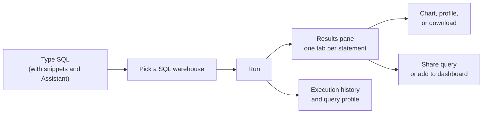

# SQL Editor

Mastery: `INPUT[inlineSelect(option(new), option(learning), option(solid)):mastery]`

> [!story] Context
> [[Databricks SQL]] introduced the SQL warehouse, the compute that runs SQL on lakehouse tables. Analysts also need an interface to write, run, save, and share queries against that compute.

> [!eli5] Summary
> The SQL editor is a page in the web browser where you type a question to your data and run it. The answer appears below as a table that you can sort, chart, download, or share. Several people can work on the same query at once, as in a shared document.

> [!analogy]- Analogy: a shared document for questions
> | Shared document | SQL editor |
> |---|---|
> | A paragraph | One SQL statement |
> | Sending the document to a reviewer | Running the query on a [[SQL Warehouses\|SQL warehouse]] |
> | The reply | The results pane |
> | Margin comments and live cursors | Line comments and real-time co-editing |
> | Version history | Execution history |

## Background

Before a browser-based editor, analysts on a data platform usually installed a desktop SQL client, configured a driver and credentials, and saved queries as `.sql` files on their own laptop. Sharing meant emailing files. Nobody could see which query produced the number in last week's slide.

The SQL editor puts all of this inside the workspace. Queries are saved in the workspace, they run on governed compute, permissions come from [[Unity Catalog]], and sharing is a link.

## Overview

The **new SQL editor** is the default editor in [[Databricks SQL]]. Databricks announced it as generally available on **August 14, 2025**, with multiple statement results, inline execution history, real-time collaboration, and deeper [[Genie Code]] integration. Its main parts:

| Part | What it gives you |
|---|---|
| **Header** | The run button and the catalog picker (moved to the header in July 2025 to give more room for typing) |
| **Compute selector** | Which SQL warehouse runs the query. A workspace default warehouse can be preselected (Beta as of August 2025). |
| **Schema browser** | The catalogs, schemas, and tables you are allowed to see |
| **Editor** | Autocomplete, query snippets, parameters, and the Assistant |
| **Results pane** | One tab per statement, charts, column profiling, and downloads |
| **Execution history** | Earlier runs, their results, timings, and query profiles |

## How it works



**Writing.** Autocomplete suggests table and column names from Unity Catalog. **Query snippets** (added May 2025) let you save reusable fragments such as a `JOIN` or `CASE` pattern and insert them through autocomplete. You create them from the View menu. The [[Genie Code]] (renamed Genie Code in March 2026) writes, explains, or fixes a query from a plain-English request.

**Running.** You can run a whole script or a selection. If the script holds several statements, the results pane lets you step through each statement's output.

**Parameters.** Date and timestamp parameters offer preset ranges such as *This week* and *Last 30 days* (July 2025), so one saved query can serve many date windows.

**Reading results.** Since May 1, 2026 you can select column headers in a results table and open the selection details to see **profiling statistics** for those columns. This is a fast way to spot nulls or strange values before you trust a number. Results can be exported as CSV, TSV, or Excel files up to 5 GB.

**History.** Inline execution history (July 2025) lets you open earlier results without rerunning, open past [[Query Performance and Caching|query profiles]], and compare run times and statuses.

**Collaboration.** Several people can edit the same query at once, and editors can comment on individual lines.

A small worked example a shop analyst might save as `Weekly sales check`:

```sql
-- 1. Total sales by day, last 30 days
SELECT order_date, SUM(amount) AS revenue
FROM shop.sales.orders
WHERE order_date >= current_date() - INTERVAL 30 DAYS
GROUP BY order_date
ORDER BY order_date;

-- 2. Any orders with a missing store? (should return 0)
SELECT COUNT(*) AS orders_without_store
FROM shop.sales.orders
WHERE store_id IS NULL;
```

Running both statements produces two result tabs: a daily trend that you can turn into a line chart, and a [[Data Quality|data quality]] check.

## Small-business considerations

> [!smallbiz] Small-business considerations
> The SQL editor can replace emailed spreadsheets for most recurring reporting questions.
> - Save each recurring question as a named query in a shared folder, so the next person finds it.
> - Use line comments to record questions about a number (for example, why it differs from last month) next to the SQL that produced it.
> - Check the column profile before you share a number. Null counts and minimum and maximum values reveal most data errors.
>
> The editor itself has no separate charge. Running a query uses the SQL warehouse, which bills while it is on. See [[How Databricks Pricing Works]].

## Cloud differences

> [!azure]- All clouds
> Nothing differs between clouds. The editor is the same web page on Azure Databricks, Databricks on AWS, and Databricks on Google Cloud. Some features roll out on different dates per cloud, so check your cloud's [[Databricks SQL]] release notes if a menu item is missing.

## Advanced topics

> [!deepdive]- Advanced topics (301–401)
> - **Profiles and the cache.** A query answered from the result cache has no query profile. To profile it, make a trivial change (for example, change or remove the `LIMIT`). See [[Query Performance and Caching]].
> - **Who can see a profile.** You must own the query or hold at least `CAN MONITOR` on the warehouse.
> - **Editor vs notebook.** A [[Notebooks|notebook]] attached to a SQL warehouse can also run SQL. Use the editor for analyst work and saved queries, and notebooks when SQL is mixed with Python or markdown explanation.
> - **Default warehouse.** A preselected default warehouse helps cost control: new users run on the small shared warehouse instead of starting a large one.
> - **Genie Code.** The [[Genie Code]] was renamed Genie Code on March 11, 2026. Older screenshots show the Assistant name.

## Common misconceptions

> [!confusion] The editor is not the compute
> Closing the editor tab does not stop the warehouse, and stopping the warehouse does not lose your saved queries. The editor is the front end. The [[SQL Warehouses|SQL warehouse]] is the engine, and it stops on its own auto-stop timer.

> [!confusion] "New SQL editor" vs the legacy editor
> Older docs and screenshots show a legacy editor. The "new SQL editor" is now the GA default. If a tutorial's buttons do not match the current UI, the tutorial was likely written for the legacy editor.

## Recall

When did the new SQL editor become generally available?::August 14, 2025.
What are query snippets?::Saved, reusable SQL fragments (such as a JOIN or CASE pattern) that you insert through autocomplete.
How do you see profiling statistics for result columns in the new SQL editor?::Select the column headers in the results table and open the selection details (added May 1, 2026).
What does inline execution history let you do?::Open earlier results without rerunning, open past query profiles, and compare run times and statuses.
What happens in the results pane when a script contains several statements?::Each statement's output gets its own result you can step through.
What file formats can you export results to, and up to what size?::CSV, TSV, and Excel, up to 5 GB.
What permission do you need to view another user's query profile?::At least CAN MONITOR on the SQL warehouse.

## Next steps

> [!path] Learning path
> **Needs first:** [[SQL]], [[Databricks SQL]]
> **Unlocks next:** [[Query Performance and Caching]], [[AI-BI Dashboards]], [[SQL Alerts]]

> [!nextup] Next
> [[Query Performance and Caching]] explains how to read a query profile and how result and disk caches speed up repeated queries.

> [!sources]- Sources (last verified: 2026-10-25)
> - [Run and share queries in the new SQL editor (AWS)](https://docs.databricks.com/aws/en/sql/user/sql-editor/run-queries)
> - [View query results in the new SQL editor (AWS)](https://docs.databricks.com/aws/en/sql/user/sql-editor/results)
> - [Databricks SQL release notes 2025 (AWS)](https://docs.databricks.com/aws/en/sql/release-notes/2025)
> - [Databricks SQL release notes 2025 (Azure Databricks)](https://learn.microsoft.com/en-us/azure/databricks/sql/release-notes/2025)
> - [Databricks SQL release notes 2025 (GCP)](https://docs.databricks.com/gcp/en/sql/release-notes/2025)
> - [Databricks SQL release notes 2026 (AWS)](https://docs.databricks.com/aws/en/sql/release-notes/2026)
> - [Databricks SQL release notes 2026 (Azure Databricks)](https://learn.microsoft.com/en-us/azure/databricks/sql/release-notes/2026)
> - [Databricks SQL release notes 2026 (GCP)](https://docs.databricks.com/gcp/en/sql/release-notes/2026)
> - [Query profile (AWS)](https://docs.databricks.com/aws/en/sql/user/queries/query-profile)
> - [March 2026 release notes (Azure Databricks)](https://learn.microsoft.com/en-us/azure/databricks/release-notes/product/2026/march)
> - [Genie Code (AWS)](https://docs.databricks.com/aws/en/genie-code/)
