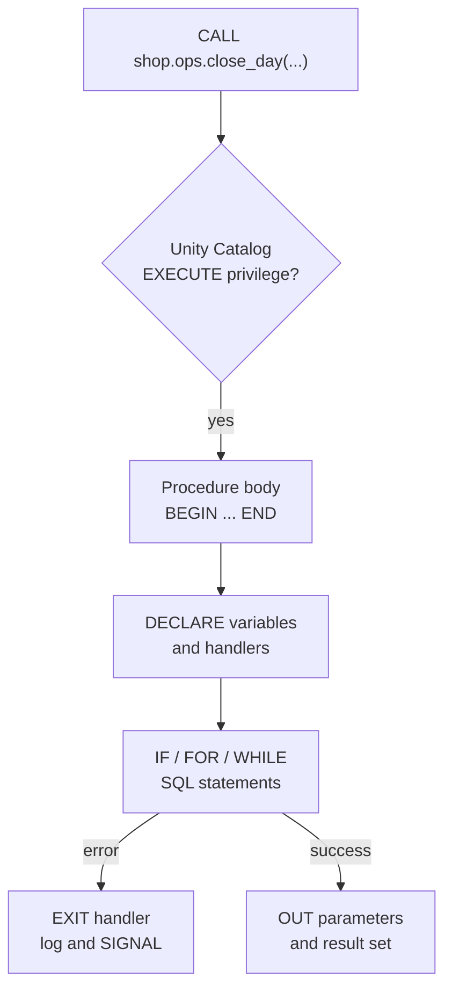

# SQL Scripting and Stored Procedures

Mastery: `INPUT[inlineSelect(option(new), option(learning), option(solid)):mastery]`

> [!story] Context
> [[VARIANT Data Type|VARIANT]] closed one gap between Databricks SQL and traditional warehouses: flexible data. The other common gap is procedural logic. Warehouses such as SQL Server run business logic as T-SQL scripts and stored procedures, and teams migrating need an equivalent in [[Databricks SQL]].

> [!eli5] Summary
> Plain SQL runs one statement at a time. SQL scripting adds the ability to store values in variables, make decisions, repeat steps, and handle errors, all in SQL. A stored procedure saves such a script under a name so anyone with permission can run it again.

## Background

Many companies keep years of business logic in their database: nightly procedures that load, validate, and summarize data, with `IF` checks, loops, and error handlers. Moving that logic to a lakehouse used to mean rewriting it in Python notebooks or an orchestration tool.

Databricks added the pieces in stages:

| Feature | Availability |
|---|---|
| Session variables (`DECLARE VARIABLE`, `SET VAR`) and dynamic SQL (`EXECUTE IMMEDIATE`) | Earlier Databricks Runtime releases |
| SQL scripting (compound statements, control flow, handlers) | Databricks SQL and Databricks Runtime 16.3 and above. Databricks announced it as generally available |
| Stored procedures (`CREATE PROCEDURE`, `CALL`) | Databricks SQL and Databricks Runtime 17.0 and above. Databricks announced them as generally available |
| Atomic multi-statement transactions (`BEGIN ATOMIC`) | Requires Unity Catalog managed tables with catalog commits; calling procedures inside an atomic block requires Databricks Runtime 18.0 and above |

SQL scripting follows the ANSI SQL/PSM standard, and Apache Spark 4.0 added SQL scripting to open-source Spark.

## Overview

### SQL scripting

A SQL script is a compound statement: a `BEGIN ... END` block. Declarations come first, followed by the body.

| Element | Syntax |
|---|---|
| Local variables | `DECLARE total INT DEFAULT 0;` (without `DEFAULT`, the value starts as `NULL`). Before Runtime 17.2, one variable per `DECLARE` |
| Assignment | `SET total = total + 1;` |
| Conditionals | `IF ... THEN ... ELSEIF ... ELSE ... END IF;` and `CASE` statements |
| Loops | `WHILE`, `REPEAT`, `LOOP`, and `FOR row AS query DO ... END FOR;` |
| Loop control | `LEAVE label;` exits a labeled block or loop. `ITERATE label;` starts its next iteration |
| Error handling | `DECLARE EXIT HANDLER FOR SQLEXCEPTION ...`, `SIGNAL`, `RESIGNAL`, `GET DIAGNOSTICS` |
| Dynamic SQL | `EXECUTE IMMEDIATE 'statement' USING ...;` |
| Transactions | `BEGIN ATOMIC ... END;` commits all statements on success and rolls back on failure |

Docs pages disagree on handler versions: the compound-statement reference lists exit handlers from Runtime 16.3, while the scripting overview lists `EXIT` and `CONTINUE` handlers from Runtime 18.1. Use Runtime 18.1 or above, or a current SQL warehouse, if you rely on `CONTINUE` handlers.

### Stored procedures

A stored procedure is a [[Unity Catalog]] object, named `catalog.schema.procedure`, that wraps a script with parameters.

| Property | Detail |
|---|---|
| Create | `CREATE [OR REPLACE] PROCEDURE ... LANGUAGE SQL SQL SECURITY INVOKER AS BEGIN ... END` (or `SQL SECURITY DEFINER`) |
| Parameters | `IN`, `OUT`, and `INOUT`. Arguments for `OUT` and `INOUT` must be session or local variables |
| Run | `CALL catalog.schema.procedure(args);`. Calls can nest up to 64 levels |
| Results | A procedure can return a result set from its final query |
| Security | `INVOKER` runs with the caller's privileges. `DEFINER` runs with the owner's privileges, so a caller needs only `EXECUTE` on the procedure |
| Inspect | `DESCRIBE PROCEDURE [EXTENDED] name;` |
| Language | SQL (`LANGUAGE SQL`) |

## How it works



The script runs on the compute that issues it: a [[SQL Warehouses|SQL warehouse]], or a cluster on a supported Databricks Runtime. Each SQL statement inside it is planned and executed as usual. The script adds variables, branching, and error handling around those statements.

### Example: an ad hoc script

Run this in the [[SQL Editor]] or a notebook SQL cell.

```sql
BEGIN
  DECLARE regions_done INT DEFAULT 0;

  FOR r AS SELECT region FROM shop.ref.regions DO
    INSERT INTO shop.sales.daily_summary
    SELECT r.region, current_date(), SUM(amount)
    FROM shop.sales.orders
    WHERE region = r.region AND order_date = current_date();

    SET regions_done = regions_done + 1;
  END FOR;

  IF regions_done = 0 THEN
    SIGNAL SQLSTATE '45000' SET MESSAGE_TEXT = 'No regions found';
  END IF;

  SELECT regions_done;
END;
```

### Example: a stored procedure

```sql
CREATE OR REPLACE PROCEDURE shop.ops.close_day(
  IN  run_date   DATE,
  OUT rows_moved INT
)
LANGUAGE SQL
SQL SECURITY INVOKER
COMMENT 'Moves one day of staged orders into the orders table'
AS BEGIN
  DECLARE EXIT HANDLER FOR SQLEXCEPTION
  BEGIN
    INSERT INTO shop.ops.job_log VALUES (current_timestamp(), 'close_day failed', run_date);
    RESIGNAL;
  END;

  INSERT INTO shop.sales.orders
  SELECT * FROM shop.staging.orders WHERE order_date = run_date;

  SET rows_moved = (SELECT COUNT(*) FROM shop.staging.orders WHERE order_date = run_date);

  DELETE FROM shop.staging.orders WHERE order_date = run_date;
END;
```

Call it and read the output parameter:

```sql
DECLARE VARIABLE moved INT;
CALL shop.ops.close_day(DATE'2026-10-25', moved);
SELECT moved;
```

Grant it to a group:

```sql
GRANT EXECUTE ON PROCEDURE shop.ops.close_day TO `data_ops`;
```

### Porting a procedure from another warehouse

1. Inventory the procedures and scripts, and group them by what they do (load, validate, report).
2. Translate the syntax. T-SQL constructs such as `@variables`, `TRY ... CATCH`, and temp tables map to `DECLARE`, exit handlers, and temporary views or tables. [[Lakebridge]] can analyze and convert source code.
3. Create each procedure in Unity Catalog with `CREATE PROCEDURE`.
4. Grant `EXECUTE` to groups (see [[Privileges and Grants]]).
5. Schedule it with a SQL task in [[Lakeflow Jobs]].
6. Run old and new side by side and compare results (see [[Migrating from SQL Server]]).

## Small-business considerations

> [!smallbiz] Small-business considerations
> Stored procedures matter most when you are moving off SQL Server, Postgres, or a similar database whose logic already lives in procedures. Porting them as procedures keeps the logic recognizable to the person who wrote it.
>
> - **When to care:** You have existing procedures to migrate, or your one data person works mainly in SQL.
> - **When to skip:** For new pipelines, declarative tools such as [[Lakeflow Spark Declarative Pipelines]] and [[Materialized Views|materialized views]] usually need less code and handle incremental processing for you.
> - **Cost:** Scripts and procedures have no separate charge. They consume the compute that runs them, usually a SQL warehouse; see [[How Databricks Pricing Works]].

## Cloud differences

SQL scripting and stored procedures behave the same on Azure, AWS, and Google Cloud. The only differences are which identities you grant `EXECUTE` to and where you schedule calls from.

> [!azure]- Azure Databricks
> Groups usually come from Microsoft Entra ID (see [[Microsoft Entra ID Integration]]). Teams that already orchestrate with [[Azure Data Factory with Databricks|Azure Data Factory]] can trigger the job that calls the procedure from there; otherwise schedule it with Lakeflow Jobs.

> [!aws]- Databricks on AWS
> No AWS-specific behavior. Schedule calls with Lakeflow Jobs.

> [!gcp]- Databricks on Google Cloud
> No Google Cloud-specific behavior. Schedule calls with Lakeflow Jobs.

## Advanced topics

> [!deepdive]- Advanced topics (301–401)
> - **INVOKER versus DEFINER:** `SQL SECURITY DEFINER` lets you expose a controlled operation, such as writing to an audit table, to users who have no direct privileges on that table. Grant `EXECUTE` narrowly, because the body runs with the owner's rights.
> - **Transactions:** A script is not transactional by default: each statement commits on its own. Wrap statements in `BEGIN ATOMIC ... END` for all-or-nothing behavior. All tables written in the transaction must be Unity Catalog managed tables with catalog commits enabled. On Runtime 18.0 and above, statements in a procedure called from an atomic block join the outer transaction. See [[ACID Transactions]].
> - **Idempotency:** Jobs retry failed tasks. Write procedures so a rerun does not double-load data, for example with `MERGE` instead of `INSERT`, or a delete-then-insert on the target date. See [[Idempotency]].
> - **Error information:** Inside a handler, `GET DIAGNOSTICS` reads the condition's message and SQLSTATE. `RESIGNAL` re-raises it after logging so the caller still sees the failure.
> - **Procedures versus functions:** [[Unity Catalog Functions]] return a value and can be used inside queries; they cannot change data. Procedures can run DDL and DML and are invoked only with `CALL`.
> - **Dynamic SQL:** `EXECUTE IMMEDIATE` builds statements from strings, for example to loop over table names. Pass values with `USING` parameters rather than string concatenation to avoid SQL injection.

## Common misconceptions

> [!confusion] A stored procedure is not a UDF
> A [[UDF]] or Unity Catalog function computes a value inside a query. A procedure is a sequence of statements that can modify tables, invoked with `CALL`.

> [!confusion] Scripts are not transactions
> Without `BEGIN ATOMIC`, a failure halfway through leaves earlier statements committed. Plan for reruns or use an atomic block.

> [!confusion] SQL scripting does not replace orchestration
> A procedure runs logic. Scheduling, retries, dependencies, and alerts still belong to [[Lakeflow Jobs]].

## Recall

Which standard does Databricks SQL scripting follow?::ANSI SQL/PSM.
What block does every SQL script start with?::A `BEGIN ... END` compound statement.
What is the initial value of a variable declared without `DEFAULT`?::`NULL`.
Which runtime version first supports stored procedures?::Databricks Runtime 17.0 (and Databricks SQL).
What is the difference between `SQL SECURITY INVOKER` and `SQL SECURITY DEFINER`?::INVOKER runs with the caller's privileges; DEFINER runs with the procedure owner's privileges.
What must you pass for an `OUT` parameter in `CALL`?::A session or local variable.
How do you make several statements commit or roll back together?::Wrap them in `BEGIN ATOMIC ... END` (Unity Catalog managed tables with catalog commits).
How deep can stored procedure calls nest?::64 levels.
Which statement re-raises an error from inside a handler?::`RESIGNAL`.
Where does a stored procedure live?::In Unity Catalog, as `catalog.schema.procedure`.

## Next steps

> [!path] Learning path
> **Needs first:** [[SQL]], [[Databricks SQL]], [[Privileges and Grants]]
> **Unlocks next:** [[Migrating from SQL Server]], [[Lakeflow Jobs]]

> [!nextup] Next
> [[Chapter 10 - AI and ML]] moves from reporting on past results to predictions, models, and AI agents built on the same governed data.

> [!sources]- Sources (last verified: 2026-10-25)
> - [SQL scripting (AWS)](https://docs.databricks.com/aws/en/sql/language-manual/sql-ref-scripting)
> - [BEGIN END compound statement (AWS)](https://docs.databricks.com/aws/en/sql/language-manual/control-flow/compound-stmt)
> - [BEGIN END compound statement (Azure Databricks)](https://learn.microsoft.com/en-us/azure/databricks/sql/language-manual/control-flow/compound-stmt)
> - [FOR statement (AWS)](https://docs.databricks.com/aws/en/sql/language-manual/control-flow/for-stmt)
> - [FOR statement (Azure Databricks)](https://learn.microsoft.com/en-us/azure/databricks/sql/language-manual/control-flow/for-stmt)
> - [WHILE statement (AWS)](https://docs.databricks.com/aws/en/sql/language-manual/control-flow/while-stmt)
> - [LOOP statement (AWS)](https://docs.databricks.com/aws/en/sql/language-manual/control-flow/loop-stmt)
> - [IF THEN ELSE statement (AWS)](https://docs.databricks.com/aws/en/sql/language-manual/control-flow/if-stmt)
> - [RESIGNAL statement (AWS)](https://docs.databricks.com/aws/en/sql/language-manual/control-flow/resignal-stmt)
> - [GET DIAGNOSTICS statement (AWS)](https://docs.databricks.com/aws/en/sql/language-manual/control-flow/get-diagnostics-stmt)
> - [CREATE PROCEDURE (AWS)](https://docs.databricks.com/aws/en/sql/language-manual/sql-ref-syntax-ddl-create-procedure)
> - [CALL (AWS)](https://docs.databricks.com/aws/en/sql/language-manual/sql-ref-syntax-aux-call)
> - [CALL (Azure Databricks)](https://learn.microsoft.com/en-us/azure/databricks/sql/language-manual/sql-ref-syntax-aux-call)
> - [DESCRIBE PROCEDURE (AWS)](https://docs.databricks.com/aws/en/sql/language-manual/sql-ref-syntax-aux-describe-procedure)
> - [ATOMIC compound statement (AWS)](https://docs.databricks.com/aws/en/sql/language-manual/sql-ref-syntax-txn-begin-atomic)
> - [Tutorial: Coordinate transactions across tables (Azure Databricks)](https://learn.microsoft.com/en-us/azure/databricks/transactions/tutorial)
> - [Introducing SQL Scripting Support in Databricks, Part 1 (Databricks blog)](https://www.databricks.com/blog/introducing-sql-scripting-support-databricks-part-1)
> - [Introducing SQL Stored Procedures in Databricks (Databricks blog)](https://www.databricks.com/blog/introducing-sql-stored-procedures-databricks)
> - [Busting SQL Migration Myths (Databricks blog)](https://www.databricks.com/blog/busting-sql-migration-myths-how-new-sql-features-make-lift-and-shift-lakehouse-easier)
> - [Introducing Apache Spark 4.0 (Databricks blog)](https://www.databricks.com/blog/introducing-apache-spark-40)
