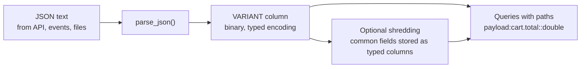

# VARIANT Data Type

Mastery: `INPUT[inlineSelect(option(new), option(learning), option(solid)):mastery]`

> [!story] Context
> [[Genie One]] and the rest of this chapter assume clean tables with fixed columns. Much real data arrives as JSON from APIs, web events, and devices, with fields that vary from record to record. `VARIANT` is the column type Databricks provides for that data.

> [!eli5] Summary
> Some data does not fit neatly into fixed columns, such as event records where each one carries different details. `VARIANT` is a column type that holds this flexible data in a compact form, so you can store it as it arrives and still pull out individual fields quickly with SQL.

## Background

[[Semi-Structured Data|Semi-structured data]], usually [[CSV and JSON|JSON]], has nested objects and arrays, and its fields change over time. Before `VARIANT`, Databricks users had two options:

| Approach | How it works | Drawback |
|---|---|---|
| JSON stored as `STRING` | Keep the raw text and parse it in every query with `from_json` or `:` paths | Every query re-parses the text, so reads are slow |
| Fixed `STRUCT` schema | Parse once into typed columns at ingestion | A new or changed field breaks the pipeline or requires [[Schema Enforcement and Evolution\|schema evolution]] |

`VARIANT` keeps the flexibility of a string and the read speed of typed data. It stores values in a binary encoding that preserves types and allows direct access to a field without parsing the whole document.

## Overview

`VARIANT` is a Databricks SQL [[Data Type|data type]] that holds any semi-structured value: an object, array, string, number, boolean, or null.

| Item | Detail |
|---|---|
| Status | Generally available. The July 2026 release notes list Variant (including variant shredding) as GA on July 22, 2026 |
| Runtime | The type is available from Databricks Runtime 15.3. Delta tables with Variant enabled need Databricks Runtime 15.4 LTS or above. Databricks recommends Runtime 18.1 or above for statistics collection and data skipping |
| Open formats | Part of open-source Apache Spark 4.0 and Delta Lake 4.0. The binary encoding and shredding specification are part of the [[Apache Parquet]] format, and [[Apache Iceberg]] v3 includes a variant type |
| Maximum value size | 128 MiB (16 MiB in Databricks Runtime 17.1 and below) |
| Compliance security profile | The July 2026 release notes describe Variant as coming soon to workspaces with the compliance security profile enabled |

Core functions:

| Function or syntax | Purpose |
|---|---|
| `parse_json(str)` | Converts a JSON string to `VARIANT`; fails on malformed JSON |
| `try_parse_json(str)` | Same, but returns `NULL` on malformed JSON |
| `col:field.sub[0]` | Path syntax to extract a field (returns `VARIANT`) |
| `expr::type` | Casts the extracted value to a SQL type |
| `variant_get(v, '$.path', 'type')` | Extracts and casts in one call; `NULL` if the path is missing, error if the cast fails |
| `try_variant_get(v, '$.path', 'type')` | Same, but returns `NULL` if the cast fails |
| `schema_of_variant(v)`, `schema_of_variant_agg(v)` | Infer the schema of one value, or of a whole column |

## How it works



`parse_json` converts text into the variant binary encoding once, at write time. Queries then navigate the encoding directly. With shredding enabled, Databricks also stores frequently occurring fields as separate typed columns inside the Parquet files, so a query that reads one field reads less data and can use file statistics for [[Data Skipping|data skipping]].

### Example: store and query web events

```sql
CREATE TABLE shop.raw.web_events (
  event_id    BIGINT,
  received_at TIMESTAMP,
  payload     VARIANT
);

INSERT INTO shop.raw.web_events
SELECT 1, current_timestamp(),
       parse_json('{"type":"checkout","device":"ios",
                    "cart":{"total":42.50,"items":[{"sku":"A1","qty":2}]}}');

-- Extract fields with path syntax and casts
SELECT
  payload:type::string           AS event_type,
  payload:cart.total::double     AS cart_total,
  payload:cart.items[0].sku::string AS first_sku
FROM shop.raw.web_events;

-- Function form, tolerant of bad types
SELECT try_variant_get(payload, '$.cart.total', 'decimal(10,2)') AS cart_total
FROM shop.raw.web_events;

-- See what fields actually occur across the column
SELECT schema_of_variant_agg(payload) FROM shop.raw.web_events;
```

Field paths are case sensitive. Use bracket notation, such as `payload:['user-id']`, for field names with special characters.

The same functions exist in PySpark:

```python
from pyspark.sql import functions as F

events = spark.table("shop.raw.web_events")
events.select(
    F.variant_get("payload", "$.cart.total", "double").alias("cart_total")
).show()
```

### Enabling Variant on an existing Delta table

Delta tables store `VARIANT` through the `variantType` table feature, which Databricks documents as requiring explicit enablement. For an existing table:

1. Check that every reader and writer of the table, including any non-Databricks client, supports the Delta Variant feature. Enabling it upgrades the table protocol.
2. Run `ALTER TABLE shop.raw.web_events SET TBLPROPERTIES ('delta.feature.variantType' = 'supported');`.
3. Add or populate the `VARIANT` column.

### Shredding

Starting with Databricks Runtime 17.3, shredding is enabled automatically for new tables that have `VARIANT` columns. For an older table:

1. Run `ALTER TABLE shop.raw.web_events SET TBLPROPERTIES ('delta.enableVariantShredding' = 'true');`.
2. Rewrite existing files, because enabling the property does not change data already written: `REORG TABLE shop.raw.web_events APPLY (SHRED VARIANT);`.

Shredding applies to top-level `VARIANT` columns and `VARIANT` fields inside structs, not to variants inside arrays or maps. The GA announcement states that shredding uses [[Predictive Optimization]] to keep performance high over time.

## Small-business considerations

> [!smallbiz] Small-business considerations
> Use `VARIANT` for the raw, bronze copy of JSON you do not control, such as webhooks from a payments provider or an e-commerce platform's order export. Store the payload as received, then extract the handful of fields your reports need into typed columns in a silver table (see [[Medallion Architecture]]).
>
> - **When to care:** Your sources send JSON whose fields change, and pipelines break when they do.
> - **When to skip:** If your data arrives as stable CSV exports or database tables, ordinary typed columns are simpler.
> - **Cost:** `VARIANT` has no separate charge. Storage and query compute are metered as usual; see [[How Databricks Pricing Works]].

## Cloud differences

The type, functions, and limits are the same on Azure, AWS, and Google Cloud. The differences are in how raw JSON files reach the table.

> [!azure]- Azure Databricks
> JSON files typically land in ADLS Gen2 (`abfss://`) or arrive from Azure Event Hubs. See [[Azure Data Lake Storage]]. The Azure Databricks docs cover the same pages ("Query variant data", "Ingest data as semi-structured variant type").

> [!aws]- Databricks on AWS
> JSON files typically land in S3 (`s3://`) or arrive from Amazon Kinesis or [[Apache Kafka]]. See [[Amazon S3]].

> [!gcp]- Databricks on Google Cloud
> JSON files typically land in Cloud Storage (`gs://`) or arrive from Pub/Sub. See [[Google Cloud Storage]].

## Advanced topics

> [!deepdive]- Advanced topics (301–401)
> - **Not comparable:** `VARIANT` values cannot be used in comparisons, `GROUP BY`, `ORDER BY`, `DISTINCT`, or `INTERSECT`, `UNION`, and `EXCEPT`. Cast the extracted field first: `GROUP BY payload:type::string`.
> - **Not a layout key:** A `VARIANT` column cannot be a partition column, a clustering key, or a Z-order key. Extract the field into a typed column and cluster on that. With shredding and data-skipping statistics, clustering on expressions derived from variant fields is supported; see the error-conditions reference for "variant clustering expressions".
> - **Missing versus wrong type:** `variant_get` returns `NULL` if a path does not exist and raises `INVALID_VARIANT_CAST` if the value exists but cannot be cast. `try_variant_get` returns `NULL` in both cases. In PySpark, `variant_get` likewise returns null for a missing path and raises on a failed cast.
> - **Type conflicts in schema inference:** When `schema_of_variant_agg` sees one field with different types across rows, it reports `VARIANT` for that field rather than `STRING`.
> - **Extract hot fields:** Databricks recommends storing frequently queried fields as ordinary columns alongside the variant, which improves both speed and storage layout.
> - **Interoperability:** Because the encoding is part of the Parquet specification and Iceberg v3, other engines that implement the spec can read the same data. Databricks Iceberg v3 support requires Databricks Runtime 18.0 or above with Unity Catalog.

## Common misconceptions

> [!confusion] `VARIANT` is not a JSON string
> A `STRING` holding JSON is text that each query must parse. A `VARIANT` is parsed once into a typed binary form. Databricks documents the differences on "How is variant different than JSON strings?".

> [!confusion] `VARIANT` does not replace modeling
> It removes the need to fix a schema at ingestion, not the need to model data for reporting. Analysts and BI tools still work best with typed columns.

> [!confusion] Path extraction returns `VARIANT`, not a string
> `payload:type` is a `VARIANT`. Cast it with `::string` to get text you can compare or group by.

## Recall

What is the VARIANT data type?::A Databricks SQL type that stores semi-structured values such as JSON in a typed binary encoding for fast field access.
Which function converts a JSON string into a VARIANT?::`parse_json` (or `try_parse_json`, which returns NULL on malformed input).
How do you extract `cart.total` as a double from a VARIANT column `payload`?::`payload:cart.total::double`, or `variant_get(payload, '$.cart.total', 'double')`.
What does `variant_get` do when the path is missing, and when the cast fails?::Returns NULL for a missing path; raises `INVALID_VARIANT_CAST` when the cast fails.
Can a VARIANT column be a clustering or partition key?::No. Extract the field into a typed column first.
What is variant shredding?::Storing commonly occurring variant fields as separate typed columns in the underlying files to speed up reads.
How do you shred data already written before shredding was enabled?::`REORG TABLE ... APPLY (SHRED VARIANT)`.
What is the maximum VARIANT value size?::128 MiB (16 MiB on Databricks Runtime 17.1 and below).
Which open formats include the variant type?::Apache Parquet (encoding and shredding spec), Delta Lake 4.0, Apache Spark 4.0, and Apache Iceberg v3.

## Next steps

> [!path] Learning path
> **Needs first:** [[CSV and JSON]], [[Semi-Structured Data]], [[Databricks SQL]]
> **Unlocks next:** [[Auto Loader]], [[Medallion Architecture]]

> [!nextup] Next
> [[SQL Scripting and Stored Procedures]] covers variables, loops, error handling, and reusable procedures in Databricks SQL, the remaining pieces needed to port warehouse logic.

> [!sources]- Sources (last verified: 2026-10-25)
> - [VARIANT type (AWS)](https://docs.databricks.com/aws/en/sql/language-manual/data-types/variant-type)
> - [VARIANT type (Azure Databricks)](https://learn.microsoft.com/en-us/azure/databricks/sql/language-manual/data-types/variant-type)
> - [VARIANT type (GCP)](https://docs.databricks.com/gcp/en/sql/language-manual/data-types/variant-type)
> - [Query variant data (AWS)](https://docs.databricks.com/aws/en/semi-structured/variant)
> - [Query variant data (Azure Databricks)](https://learn.microsoft.com/en-us/azure/databricks/semi-structured/variant)
> - [How is variant different than JSON strings? (AWS)](https://docs.databricks.com/aws/en/semi-structured/variant-json-diff)
> - [variant_get function (GCP)](https://docs.databricks.com/gcp/en/sql/language-manual/functions/variant_get)
> - [variant_get, PySpark reference (AWS)](https://docs.databricks.com/aws/en/pyspark/reference/functions/variant_get)
> - [Ingest data as semi-structured variant type (AWS)](https://docs.databricks.com/aws/en/ingestion/variant)
> - [Variant type support for Apache Iceberg and Delta Lake (AWS)](https://docs.databricks.com/aws/en/tables/features/variant)
> - [Use variant shredding to optimize performance (AWS)](https://docs.databricks.com/aws/en/tables/features/variant-shredding)
> - [Error conditions in Databricks (AWS)](https://docs.databricks.com/aws/en/error-messages/error-classes)
> - [July 2026 release notes (AWS)](https://docs.databricks.com/aws/en/release-notes/product/2026/july)
> - [Ingest semi-structured data faster and more efficiently with Variant, now generally available (Databricks blog)](https://www.databricks.com/blog/ingest-semi-structured-data-faster-and-more-efficiently-variant-now-generally-available)
> - [Introducing the Open Variant Data Type in Delta Lake and Apache Spark (Databricks blog)](https://www.databricks.com/blog/introducing-open-variant-data-type-delta-lake-and-apache-spark)
> - [Introducing Variant: a new open standard for semi-structured data (Databricks blog)](https://www.databricks.com/blog/introducing-variant-new-open-standard-semi-structured-data-apache-parquettm-delta-lake)
> - [Delta Lake 4.0 (delta.io)](https://delta.io/blog/2025-09-25-delta-lake-40/)
> - [Spark Release 4.0.0 (spark.apache.org)](https://spark.apache.org/releases/spark-release-4-0-0.html)
