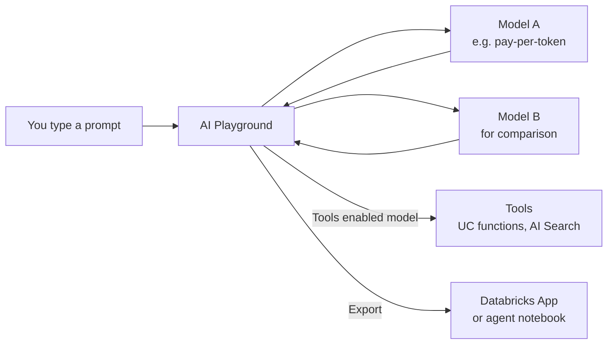

# AI Playground

Mastery: `INPUT[inlineSelect(option(new), option(learning), option(solid)):mastery]`

> [!story] Context
> [[Managed MCP Servers]] described how agents reach tools and data. Before writing any agent code, most people want to try a few models, compare their answers, and test a prompt. AI Playground is the place in the Databricks workspace for that.

> [!eli5] Summary
> AI Playground is a chat window inside Databricks where you can talk to different AI models, see their answers side by side, and test instructions before building anything. It needs no code, so anyone in the company can use it to judge whether AI can help with a task.

## Background

Choosing a model for a task usually starts with experiments: ask the same question to several [[LLM|LLMs]], change the instructions, and compare answers. Without a shared tool, people do this in separate consumer chat apps, outside company governance, with no way to use the company's approved models or data.

AI Playground puts these experiments inside the workspace. It uses the same models that applications call through [[Foundation Model APIs]] and [[Model Serving]], and the same permissions.

## Overview

AI Playground is a chat interface in the Databricks workspace for testing, prompting, and comparing LLMs, and for prototyping simple tool-calling agents.

| Capability | What you can do |
|---|---|
| Chat | Send [[Prompt\|prompts]] to a supported model and read its responses |
| Compare | Add more models with **+** and see their responses side by side |
| Instructions | Set a system prompt that applies to the whole conversation |
| Tools | With a model labeled **Tools enabled**, attach tools such as [[Unity Catalog Functions\|Unity Catalog functions]] or [[AI Search]] indexes |
| Export | Export a prototype agent to [[Databricks Apps]] (recommended) or to an agent notebook (legacy) |

Models you can use:

| Source | Notes |
|---|---|
| Pay-per-token Foundation Model APIs | Databricks-hosted models, available in supported regions. Listed on the **Models** tab under **AI Gateway** in the sidebar |
| Provisioned throughput endpoints | Models you deployed on dedicated capacity |
| External models | Third-party providers configured through [[Unity Gateway]] |

Some models are not supported in AI Playground, for example certain image-generation models. The supported-models page marks these.

### Status (checked October 2026)

The platform release notes announced AI Playground as generally available in 2025, while some doc pages still show a Preview label. Building agents inside AI Playground is now documented as a legacy approach. For new agents, Databricks recommends [[Agent Bricks]] with the Agent Bricks CLI.

## How it works

### Compare two models

1. In the workspace sidebar, select **Playground**.
2. Choose a model from the drop-down at the top of the chat pane.
3. Optional: enter a system prompt, for example "You answer customer questions for a bakery. Keep answers under 80 words."
4. Select **+** to add a second chat pane, and choose a different model.
5. Type a question, such as "What are good opening hours for a neighborhood bakery?", and send it. The question goes to both models.
6. Compare the answers for accuracy, tone, and length.

### Prototype a simple agent

1. Select a model labeled **Tools enabled**.
2. Add a tool. The Databricks example uses the built-in Unity Catalog function `system.ai.python_exec`, which lets the model run Python code.
3. Ask a question that needs the tool, for example "What is 17 percent of 2,340, rounded to two decimals?"
4. Review the tool calls the model made, shown in the conversation.
5. To keep the prototype, select **Export** and choose **Export to Databricks Apps**, which installs a deployable agent app with a chat UI.

The exported code may behave differently from the Playground session. Run it, evaluate it, and then deploy it.

### What happens behind the screen

Each message is a request to a model endpoint. The Playground sends the system prompt, the conversation so far, and your new message. Longer conversations send more [[Token|tokens]], which affects both cost and the model's [[Context Window|context window]].

## Small-business considerations

> [!smallbiz] Small-business considerations
> AI Playground is the lowest-effort way for a small company to find out whether an LLM can help with a task, such as drafting product descriptions or answering common customer questions.
>
> - **When to care:** Before committing to any AI project. Spend an hour comparing two or three models on real examples from your business.
> - **When to skip:** If you need an answer from your own tables, start with [[Genie One]] instead; it is built for questions over data.
> - **Data care:** Do not paste customer [[PII]] into prompts unless your admin has approved the model and its data handling. See [[Unity Gateway]] for guardrails.
> - **Cost:** Each message is billed as model usage. Pay-per-token models are metered on input and output tokens, and comparing two models doubles the requests. See [[Foundation Model APIs]], [[How Databricks Pricing Works]], and the [Databricks pricing page](https://www.databricks.com/product/pricing).

## Cloud differences

AI Playground works the same way on all clouds. The models you see depend on your workspace region.

> [!azure]- Azure Databricks
> Available in Azure Databricks workspaces in regions that support Foundation Model APIs. The model list for Azure can differ from AWS; check the Azure Databricks supported-models page for your region.

> [!aws]- Databricks on AWS
> Available in supported AWS regions. The 2026 GovCloud release notes state that users can use AI Playground with pay-per-token Foundation Model APIs on [[Databricks on AWS GovCloud]].

> [!gcp]- Databricks on Google Cloud
> Available in supported Google Cloud regions. Check the GCP "Get started: Query LLMs and prototype AI agents with no code" page and the model availability by region list.

## Advanced topics

> [!deepdive]- Advanced topics (301–401)
> - **Who can use which models:** By default, all users have `EXECUTE` on the `system.ai` schema, which exposes all Databricks-hosted foundation models. To restrict models, an admin removes that schema-level grant and grants `EXECUTE` on approved models individually. The Playground then shows only what a user can call.
> - **Cross-Geo processing:** Some models are available only in certain geographies. Workspaces outside the US or EU may need cross-Geo data processing enabled to use them.
> - **From prototype to agent:** The legacy **Create agent notebook** export generates a Python notebook that defines the agent and deploys it to a [[Model Serving]] endpoint. The current path for production agents is the Agent Bricks CLI, which runs an agent locally with `agentbricks dev`. See [[Agent Bricks]] and [[Agent Evaluation and Tracing]].
> - **Retrieval prototypes:** Adding an AI Search index as a tool lets you test a basic [[Retrieval-Augmented Generation]] flow before building it.
> - **Evaluation is not built in:** Side-by-side comparison is a quick check, not an evaluation. Use [[Agent Evaluation and Tracing]] with a test set before choosing a model for production.

## Common misconceptions

> [!confusion] AI Playground is not a production chatbot
> It is a testing tool for people in the workspace. To give customers or staff a chatbot, export the prototype or build an agent and deploy it with [[Databricks Apps]].

> [!confusion] AI Playground does not know your data by default
> A model in the Playground answers from its training data. It sees your data only through tools you attach, such as an AI Search index or a Unity Catalog function, and only if you have permission. Answers without tools can contain [[Hallucination|hallucinations]].

> [!confusion] AI Playground is not free to use
> The interface has no separate charge, but every message calls a model, which is billed as model usage.

## Recall

What is AI Playground?::A no-code chat interface in the Databricks workspace for testing, prompting, and comparing LLMs and prototyping simple tool-calling agents.
How do you compare two models in AI Playground?::Select **+** to add a second chat pane, choose another model, and send one prompt to both.
Which models can AI Playground use?::Pay-per-token Foundation Model APIs, provisioned throughput endpoints, and external models, in supported regions.
What label must a model have before you can attach tools?::**Tools enabled**.
Which built-in function does the Databricks example attach as a tool?::`system.ai.python_exec`, which runs Python code.
What is the recommended export target for a Playground agent prototype?::**Export to Databricks Apps**.
What does Databricks recommend instead of building agents in AI Playground?::Agent Bricks with the Agent Bricks CLI (`agentbricks dev`).
How do admins limit which models users can call?::Remove the default `EXECUTE` grant on the `system.ai` schema and grant `EXECUTE` on approved models.
Does AI Playground see your tables by default?::No. Only through tools you attach and have permission to use.

## Next steps

> [!path] Learning path
> **Needs first:** [[Generative AI and LLMs]], [[LLM]], [[Prompt]]
> **Unlocks next:** [[Foundation Model APIs]], [[Agent Bricks]], [[Retrieval-Augmented Generation]]

> [!nextup] Next
> This ends Part 1. [[Chapter 11 - Azure Databricks]] begins Part 2, the clouds, with Azure Databricks: a first-party Microsoft service with its own identity, networking, and billing.

> [!sources]- Sources (last verified: 2026-10-25)
> - [Chat with LLMs and prototype AI apps using AI Playground (AWS)](https://docs.databricks.com/aws/en/large-language-models/ai-playground)
> - [Get started: Query LLMs and prototype agents with no code (AWS)](https://docs.databricks.com/aws/en/getting-started/gen-ai-llm-agent)
> - [Get started: Query LLMs and prototype AI agents with no code (Azure Databricks)](https://learn.microsoft.com/en-us/azure/databricks/getting-started/gen-ai-llm-agent)
> - [Get started: Query LLMs and prototype AI agents with no code (GCP)](https://docs.databricks.com/gcp/en/getting-started/gen-ai-llm-agent)
> - [Use agents on Databricks (AWS)](https://docs.databricks.com/aws/en/agents/custom-agents/build-agents)
> - [Databricks Foundation Model APIs (AWS)](https://docs.databricks.com/aws/en/machine-learning/foundation-model-apis)
> - [Databricks Foundation Model APIs (Azure Databricks)](https://learn.microsoft.com/en-us/azure/databricks/machine-learning/foundation-model-apis/)
> - [Supported models for Foundation Model APIs (AWS)](https://docs.databricks.com/aws/en/machine-learning/foundation-model-apis/supported-models)
> - [Supported models for Foundation Model APIs (Azure Databricks)](https://learn.microsoft.com/en-us/azure/databricks/machine-learning/foundation-model-apis/supported-models)
> - [Foundation model Unity Catalog permissions (AWS)](https://docs.databricks.com/aws/en/machine-learning/foundation-model-apis/model-uc-permissions)
> - [Databricks platform release notes (AWS)](https://docs.databricks.com/aws/en/release-notes/product)
> - [Databricks on AWS GovCloud release notes 2026](https://docs.databricks.com/aws/en/release-notes/gov-cloud/2026)
