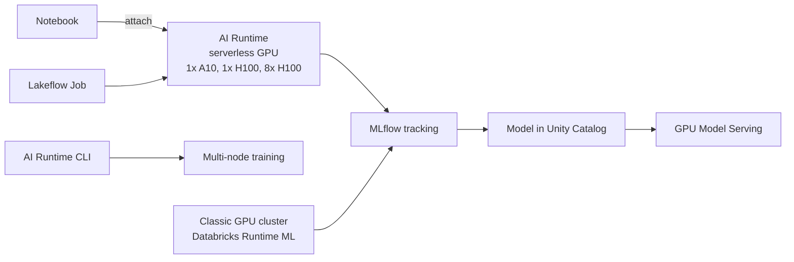

# AI Runtime

Mastery: `INPUT[inlineSelect(option(new), option(learning), option(solid)):mastery]`

> [!story] Context
> [[Data Quality Monitoring]] covered keeping models healthy. Some models, such as neural networks for images or text and fine-tuned LLMs, need [[GPU|GPUs]] to train in reasonable time. Databricks offers GPUs two ways: classic GPU clusters, and AI Runtime, its serverless GPU compute.

> [!eli5] Summary
> GPUs are special chips that do many small calculations at once, which makes training AI models much faster. Databricks can rent them for you by the minute, either as machines you configure yourself or as a ready-made option where you just pick how many chips you want.

> [!renamed] Renamed: serverless GPU compute is now AI Runtime
> **Serverless GPU compute** is now part of **AI Runtime**, which entered preview in March 2026 and is in Public Preview as of October 2026. Starting with GPU environment version 6, the **Databricks AI Runtime SDK** (`databricks-sdk-air`, namespace `databricks.air`) replaces the deprecated `serverless_gpu` package. Arguments `gpus` and `gpu_type` are renamed `num_accelerators` and `accelerator_type`; the old names emit a `FutureWarning` and stop working in version 7.

> [!analogy]- Analogy: renting kitchen equipment
> | Kitchen | GPU compute |
> |---|---|
> | Buying and installing your own industrial oven | Classic GPU cluster with a chosen instance type |
> | Booking an equipped commercial kitchen by the hour | AI Runtime serverless GPU |
> | One oven vs a row of eight | 1x A10, 1x H100, 8x H100 |
> | Several kitchens working one banquet | Multi-node training via the AI Runtime CLI |

## Background

Deep learning trains neural networks with large matrix operations, which GPUs run far faster than CPUs. GPUs are scarce and comparatively expensive, so setting them up well matters: matching CUDA and driver versions, choosing instance types, and shutting them down when idle. Databricks first offered GPU instance types on classic clusters with a GPU-enabled Databricks Runtime ML. AI Runtime brings GPUs to serverless compute, so Databricks manages the hardware and environment.

## Overview

| Option | What it is | Best for |
|---|---|---|
| **AI Runtime** (Public Preview) | Serverless GPU compute with on-demand A10 and H100 accelerators, accessible from notebooks, [[Lakeflow Jobs\|jobs]], the CLI, and Ray | Deep learning, fine-tuning, most new GPU work |
| **Classic GPU clusters** | Clusters with GPU instance types and Databricks Runtime ML (GPU version selected automatically from the worker type) | Workloads needing a specific instance type or classic features |
| **GPU Model Serving** | GPU workload types on [[Model Serving]] endpoints | Serving custom deep learning models or LLMs |

Databricks recommends AI Runtime over classic Databricks Runtime ML GPU compute for custom deep learning workloads such as fine-tuning or training.

AI Runtime accelerator choices (per the Azure quickstart): start with **1x A10** for development and small workloads, then move to **1x H100** or **8x H100** for more GPU memory or multi-GPU training. Notebooks run on one node; notebook multi-GPU distributed training is supported on H100 nodes. Multi-node training uses the AI Runtime Databricks CLI.

Classic GPU instance families on AWS listed in the docs: P5, P4, G6e, G6, G5, G4dn, and P3. Azure and Google Cloud have their own lists. [[Photon]] is not supported with GPU instance types. Databricks Runtime 18 LTS ML (released June 10, 2026, supported until June 10, 2029) lists CUDA 12.9 for GPU clusters.

## How it works



Use AI Runtime from a notebook:

1. Create or open a notebook.
2. In the compute selector, choose **serverless GPU** (AI Runtime) and an accelerator, such as 1x A10.
3. Select GPU environment version 6 or later to use the AI Runtime SDK.
4. Write standard PyTorch code; PyTorch and CUDA are preinstalled.

Distributed training across the GPUs of one node, migrating from the old package:

```python
# Before (deprecated serverless_gpu package)
# from serverless_gpu import distributed
# @distributed(gpus=8, gpu_type="H100")

# After (AI Runtime SDK, GPU environment version 6+)
from databricks.air import distributed

@distributed(num_accelerators=8, accelerator_type="H100")
def train():
    import torch
    ...  # standard PyTorch DDP training loop

train.distributed()
```

The import and argument changes follow the AI Runtime migration notes; the decorator uses every GPU on the node by default, and the notebook's accelerator must match `accelerator_type`. Calling a distributed function inside an active MLflow run creates a nested child run.

## Small-business considerations

> [!smallbiz] Small-business considerations
> - **Most small businesses need no GPUs.** SQL, ETL, forecasts, and tabular models run efficiently on CPUs. Hosted LLMs through [[Foundation Model APIs]] need no GPUs on your side.
> - **Use GPUs for** image models, fine-tuning a small open LLM, or training neural networks on large text or image datasets.
> - **Prefer AI Runtime** for occasional GPU work, so nothing stays running between experiments.
> - **Cap GPU access** with [[Compute Policies|compute policies]] or permissions so only intended users start GPU clusters.
> - **Cost drivers:** GPU time per accelerator, which is much higher than CPU time. See [[How Databricks Pricing Works]].

## Cloud differences

> [!azure]- Azure Databricks
> Classic GPU clusters use Azure GPU virtual machine series listed on the Azure GPU-enabled compute page; the docs note the **NC v3** series is being retired. AI Runtime and GPU availability depend on region and subscription quota.

> [!aws]- Databricks on AWS
> Classic GPU instance families: P5, P4, G6e, G6, G5, G4dn, and P3. See [[EC2 Instance Types and Graviton]]. GPU capacity depends on AWS region and account quotas.

> [!gcp]- Databricks on Google Cloud
> Classic GPU machine types follow Google Cloud's accelerator-optimized families; see the GPU-enabled compute page for Google Cloud and [[Compute on Google Cloud]]. Check AI Runtime availability by region.

## Advanced topics

> [!deepdive]- Advanced topics (301–401)
> - **Environment versions.** GPU environment version 6 is the last to ship `serverless_gpu`; versions 5 and below use it. Plan migration to `databricks.air` before version 7.
> - **Maturity.** Pages disagree on whether the distributed decorator is Beta or Public Preview. Treat AI Runtime APIs as subject to change.
> - **Scheduling.** Jobs can run AI Runtime workloads on a schedule and chain them with upstream data preparation and downstream registration tasks.
> - **Serving on GPU.** `GPU_XLARGE` (1x H100) serving endpoints do not support scale to zero.
> - **Library pinning.** Pin library versions in the serverless environment configuration so training runs are reproducible.
> - **Data loading** often bottlenecks GPU training. Use streaming data loaders from Delta tables or volumes and keep GPUs busy.

## Common misconceptions

> [!confusion] GPUs do not speed up SQL on Databricks
> Photon is the SQL accelerator and is not supported on GPU instances. GPUs help neural network training and inference.

> [!confusion] AI Runtime is not Databricks Runtime ML
> Databricks Runtime ML is a runtime image for classic clusters. AI Runtime is serverless GPU compute with its own environment versions and SDK.

## Recall

What is Databricks serverless GPU compute called now?::AI Runtime (Public Preview as of October 2026).
Which GPUs does AI Runtime offer?::A10 and H100 (1x A10, 1x H100, 8x H100).
Which package replaces `serverless_gpu` from GPU environment version 6?::The Databricks AI Runtime SDK, `databricks-sdk-air` (namespace `databricks.air`).
What are the new names for `gpus` and `gpu_type`?::`num_accelerators` and `accelerator_type`.
How do you train across multiple nodes on AI Runtime?::With the AI Runtime Databricks CLI; notebooks are limited to one node.
Is Photon supported on GPU instance types?::No.
What does Databricks recommend for custom deep learning instead of classic Runtime ML GPU clusters?::AI Runtime.

## Next steps

> [!path] Learning path
> **Needs first:** [[Compute Types]], [[GPU]], [[Machine Learning Basics]]
> **Unlocks next:** [[Fine-Tuning]], [[Model Serving]]

> [!nextup] Next
> [[MosaicML and Open Models]] covers the 2023 acquisition that brought Databricks its LLM training and serving technology, the DBRX model, and its open-model strategy.

> [!sources]- Sources (last verified: 2026-10-25)
> - [AI Runtime (AWS)](https://docs.databricks.com/aws/en/machine-learning/ai-runtime/)
> - [AI Runtime notebook quickstart (Azure Databricks)](https://learn.microsoft.com/en-us/azure/databricks/machine-learning/ai-runtime/quickstart)
> - [Distributed training in notebooks (AWS)](https://docs.databricks.com/aws/en/machine-learning/ai-runtime/connecting/distributed-training)
> - [Multi-GPU distributed training (AWS)](https://docs.databricks.com/aws/en/machine-learning/ai-runtime/examples/gpu-distributed-training)
> - [Serverless GPU environment version 6 (AWS)](https://docs.databricks.com/aws/en/release-notes/serverless/environment-version/six-gpu)
> - [Serverless GPU environment version 5 (AWS)](https://docs.databricks.com/aws/en/release-notes/serverless/environment-version/five-gpu)
> - [October 2026 release notes (AWS)](https://docs.databricks.com/aws/en/release-notes/product/2026/october)
> - [March 2026 release notes (AWS)](https://docs.databricks.com/aws/en/release-notes/product/2026/march)
> - [GPU-enabled compute (AWS)](https://docs.databricks.com/aws/en/compute/gpu)
> - [GPU-enabled compute (Azure Databricks)](https://learn.microsoft.com/en-us/azure/databricks/compute/gpu)
> - [GPU-enabled compute (GCP)](https://docs.databricks.com/gcp/en/compute/gpu)
> - [Databricks Runtime 18 LTS for Machine Learning (AWS)](https://docs.databricks.com/aws/en/release-notes/runtime/18ml)
> - [Databricks Runtime release notes versions and compatibility (AWS)](https://docs.databricks.com/aws/en/release-notes/runtime/)
> - [Databricks Runtime for Machine Learning (AWS)](https://docs.databricks.com/aws/en/machine-learning/databricks-runtime-ml)
> - [Configure the serverless environment (AWS)](https://docs.databricks.com/aws/en/compute/serverless/dependencies)
