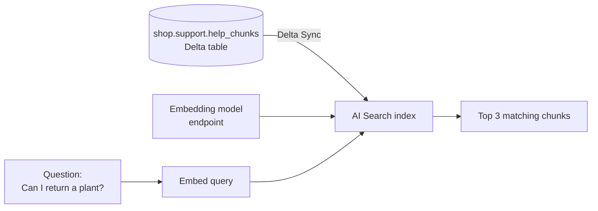

# AI Search

Mastery: `INPUT[inlineSelect(option(new), option(learning), option(solid)):mastery]`

> [!story] Context
> [[Unity Gateway|Unity Gateway]] governs calls to models. Before a model can answer from company documents, something has to find the right documents. Keyword search misses answers that use different words. AI Search finds documents by meaning.

> [!eli5] Summary
> AI Search finds the pieces of text that mean the same thing as a question, even if they use different words. Ask "can I send back a plant?" and it finds the paragraph titled "Returns policy for live goods".

> [!renamed] Renamed: Vector Search is now AI Search
> **Mosaic AI Vector Search** (later **Databricks Vector Search**) was renamed **Databricks AI Search** on June 1, 2026. Some names keep the old form: the SQL function `vector_search()`, some UI labels, some doc URLs (`/vector-search/`), and the REST API path. The current Python SDK uses `AISearchClient` from `databricks.ai_search.client`.

> [!analogy]- Analogy: a librarian who understands topics
> | Library | AI Search |
> |---|---|
> | Each paragraph summarized as a position on a map of topics | [[Embedding]] |
> | The map with every paragraph pinned on it | Index |
> | The librarian's desk | Endpoint |
> | Finding the pins closest to your question | Similarity (nearest neighbor) search |
> | Also checking the exact words in the title | Hybrid search |
> | New books added to the map overnight | Delta Sync |

## Background

Traditional search engines match keywords. They miss synonyms and paraphrases, and they rank poorly for questions written in everyday language. [[Embedding|Embedding models]] turn text into vectors, lists of numbers, so that similar meanings are close together. A vector database finds the nearest vectors to a query quickly, even across millions of items.

Before Databricks offered this, teams copied document chunks out of the lakehouse into a separate vector database, then wrote sync jobs and managed separate permissions. AI Search keeps the index synced from a [[Delta Lake]] table and governed by [[Unity Catalog]].

## Overview

| Concept | What it is |
|---|---|
| **Endpoint** | The compute that serves queries. One endpoint can host many indexes. |
| **Index** | The searchable structure, registered in Unity Catalog |
| **Delta Sync index** | Kept in sync with a source Delta table; Databricks can compute embeddings for you from a text column, or you provide precomputed embeddings |
| **Embedding model** | A serving endpoint that turns text into vectors; a Databricks-managed model is selected by default |
| **Query types** | ANN (approximate nearest neighbor), hybrid (vector plus keyword), and keyword search with `query_type="FULL_TEXT"` (Beta) |

Endpoint types:

| | Standard | Storage-optimized |
|---|---|---|
| Built for | Low latency | Lower cost at large scale |
| Guide figures | About 20 to 50 ms, up to about 320 million vectors | About 300 to 500 ms, up to about 1 billion vectors |
| Sync modes | Continuous or triggered, both incremental | Triggered only; each sync partially rebuilds the index |
| Filters | Dictionary syntax | SQL-style string |
| Other limits | | No columns-to-sync; embedding dimensions must be divisible by 16 |

Figures come from the AI Search performance guide and vary slightly across pages.

## How it works



Steps for a garden center's help center articles:

1. Store chunks in a Delta table with a primary key, such as `shop.support.help_chunks(chunk_id, title, content)`. Enable [[Change Data Feed]] on it so syncs can be incremental.
2. Create an endpoint (once per workspace or team).
3. Create a Delta Sync index on the table, naming the text column to embed.
4. Query by text.

```python
from databricks.ai_search.client import AISearchClient

client = AISearchClient()

client.create_endpoint(name="support-search", endpoint_type="STANDARD")

index = client.create_delta_sync_index(
    endpoint_name="support-search",
    index_name="shop.support.help_chunks_index",
    source_table_name="shop.support.help_chunks",
    primary_key="chunk_id",
    pipeline_type="TRIGGERED",
    embedding_source_column="content",
    embedding_model_endpoint_name="<embedding-endpoint>",
)

results = index.similarity_search(
    query_text="Can I return a plant that arrived damaged?",
    columns=["chunk_id", "title", "content"],
    num_results=3,
    query_type="hybrid",
)
```

Method names follow the AI Search Python SDK example page; check it for your SDK version. From SQL, the same index is queried with the `vector_search()` table function:

```sql
SELECT title, content
FROM vector_search(index => 'shop.support.help_chunks_index',
                   query_text => 'Can I return a plant that arrived damaged?',
                   num_results => 3);
```

## Small-business considerations

> [!smallbiz] Small-business considerations
> - **One Standard endpoint is usually enough.** A help center of a few thousand chunks fits comfortably.
> - **Use triggered sync** and run it after documents change, rather than continuous sync.
> - **Let Databricks compute embeddings** from a text column. It removes a pipeline you would otherwise maintain.
> - **Try hybrid search** when questions contain product codes or names; pure vector search can miss exact identifiers.
> - **Cost drivers:** endpoints bill while they run, sized in search units, plus embedding model usage. The AI Search cost management guide explains the meter. [[Databricks Free Edition and Trials|Free Edition]] includes a limited endpoint for learning.

## Cloud differences

> [!azure]- Azure Databricks
> Same product and APIs. Region availability and quotas differ; check the Azure AI Search docs for Databricks (`learn.microsoft.com/azure/databricks/ai-search/`). Do not confuse it with Microsoft's own Azure AI Search service, which is a separate Azure product.

> [!aws]- Databricks on AWS
> Same product and APIs; region availability varies.

> [!gcp]- Databricks on Google Cloud
> Same product; check the Google Cloud docs for region availability and any features still in preview.

## Advanced topics

> [!deepdive]- Advanced topics (301–401)
> - **Full-text index** (Beta): a keyword-only index with no embeddings, available only on storage-optimized endpoints with triggered sync.
> - **Filtering.** Combine similarity with metadata filters, such as `{"product_line": "plants"}` on Standard endpoints or `"product_line = 'plants'"` on storage-optimized endpoints.
> - **Pagination.** Setting `num_results` above 1,000 makes the SDK fetch all pages.
> - **Reuse index objects.** The performance guide recommends reusing the index object across queries.
> - **OAuth.** Service principals can query indexes with OAuth tokens for production apps.
> - **Embedding reuse.** Delta Sync reuses embeddings for unchanged rows on later syncs.
> - **Retrieval quality.** Parsing and chunking usually matter more than the index settings. See [[Retrieval-Augmented Generation]].

## Common misconceptions

> [!confusion] Databricks AI Search is not Microsoft Azure AI Search
> Databricks AI Search is a Databricks feature on all three clouds. Azure AI Search is a separate Microsoft service.

> [!confusion] AI Search does not generate answers
> It returns matching chunks. An LLM writes the answer in the RAG step.

> [!confusion] Vectors are not stored instead of the text
> The source Delta table keeps the text. The index holds embeddings plus the columns you choose to return.

## Recall

What is Databricks Vector Search called since June 1, 2026?::Databricks AI Search.
Which SQL function queries an AI Search index?::`vector_search()` (it keeps the old name).
What does a Delta Sync index do?::Keeps an index in sync with a source Delta table, optionally computing embeddings from a text column.
What are the two AI Search endpoint types?::Standard (low latency) and storage-optimized (lower cost at larger scale).
Which sync modes does a storage-optimized endpoint support?::Triggered only.
What does hybrid search combine?::Vector similarity and keyword matching.
Which Python class is used in the current AI Search SDK?::`AISearchClient` from `databricks.ai_search.client`.

## Next steps

> [!path] Learning path
> **Needs first:** [[Embedding]], [[Delta Lake]], [[Foundation Model APIs]]
> **Unlocks next:** [[Retrieval-Augmented Generation]], [[Agent Bricks]]

> [!nextup] Next
> [[Retrieval-Augmented Generation]] combines AI Search results with an LLM so answers come from your documents.

> [!sources]- Sources (last verified: 2026-10-25)
> - [Databricks AI Search (AWS)](https://docs.databricks.com/aws/en/ai-search/ai-search)
> - [Databricks AI Search (Azure Databricks)](https://learn.microsoft.com/en-us/azure/databricks/ai-search/ai-search)
> - [Create AI Search endpoints and indexes (AWS)](https://docs.databricks.com/aws/en/vector-search/create-vector-search)
> - [Query an AI Search index (AWS)](https://docs.databricks.com/aws/en/vector-search/query-vector-search)
> - [AI Search Python SDK example usage (AWS)](https://docs.databricks.com/aws/en/ai-search/vector-search-python-sdk-example)
> - [AI Search performance guide (Azure Databricks)](https://learn.microsoft.com/en-us/azure/databricks/generative-ai/vector-search-best-practices)
> - [AI Search cost management guide (AWS)](https://docs.databricks.com/aws/en/vector-search/vector-search-cost-management)
> - [Use AI Search with an OAuth token (AWS)](https://docs.databricks.com/aws/en/ai-search/vector-search-oauth-token)
> - [AI Search retrieval quality guide (AWS)](https://docs.databricks.com/aws/en/ai-search/retrieval-quality)
> - [June 2026 release notes (AWS)](https://docs.databricks.com/aws/en/release-notes/product/2026/june)
> - [Vector Search REST API](https://docs.databricks.com/api/vector-search/v1)
