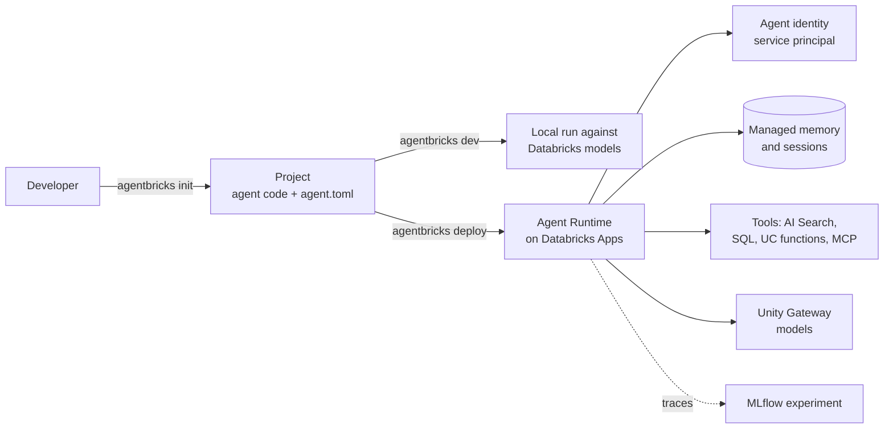

# Agent Bricks

Mastery: `INPUT[inlineSelect(option(new), option(learning), option(solid)):mastery]`

> [!story] Context
> [[Retrieval-Augmented Generation]] answers questions from documents. An [[AI Agent|agent]] goes further: it decides which steps to take, calls tools such as SQL queries or APIs, and completes a task. Agent Bricks is the Databricks platform for building, deploying, and running agents.

> [!eli5] Summary
> Agent Bricks is the part of Databricks for making AI helpers that do jobs, such as looking up an order and drafting a reply. Developers write the helper's logic, and Databricks gives it a safe place to run, a login of its own, memory, and a record of everything it did. People who do not code build similar helpers in Genie Agents instead.

> [!renamed] What changed in 2026
> - **June 2025:** Databricks introduced Agent Bricks as a way to describe a task in plain language, connect data, and have Databricks build the agent, generate evaluations and LLM judges, and optimize for quality and cost. Task types included **Knowledge Assistant**, **Information Extraction**, **Custom LLM**, and **Multi-Agent Supervisor** (later **Supervisor Agent**).
> - **July 8, 2026:** Genie Spaces were renamed **Genie Agents**, the recommended no-code option.
> - **October 12, 2026:** Knowledge Assistant and Supervisor Agent became **legacy** offerings. The Agent Bricks docs now focus on **code-first** development with the **Agent Bricks CLI** (Beta) and **Agent Runtime**. Custom LLM is legacy and in Beta; for custom text tasks Databricks recommends AI Functions such as `ai_query`. The Supervisor API reached end of life on September 30, 2026.
> - **Information Extraction:** status differs across pages; `ai_extract` is generally available. Check the docs before planning on the Information Extraction brick.

> [!analogy]- Analogy: hiring and equipping a new staff member
> | Workplace | Agent Bricks |
> |---|---|
> | Job description and training | Your agent code (LangGraph, OpenAI Agents SDK) |
> | Desk, building badge, and phone line | Agent Runtime: hosting, identity, endpoint |
> | Staff ID number | The app's service principal (agent identity) |
> | Notebook of past customer conversations | Managed sessions and memory |
> | Keys to specific rooms | Tool bindings and Unity Catalog grants |
> | Call recordings for quality review | MLflow tracing |
> | Onboarding checklist | `agent.toml` |

## Background

Early agent projects stitched together a framework, a hosting service, a vector database, secrets, and logging, each with its own setup. Databricks first offered the [[Mosaic AI Agent Framework]] for code-based agents deployed on Model Serving, then Agent Bricks for task-based agents built from a description. In October 2026 Databricks consolidated: no-code agents moved to Genie Agents ([[Genie Agents]]), and Agent Bricks became the code-first developer platform, with older servers and deployment targets moved to a Legacy section that maps each one to its replacement.

## Overview

Databricks describes Agent Bricks as the platform for developers who write their own agent code, bringing any framework or harness and any model.

A deployed agent has three layers:

| Layer | What it is | Example |
|---|---|---|
| **Framework or harness** | Your agent logic | LangGraph, OpenAI Agents SDK |
| **Agent server** | Exposes the invocation API and stores each run's state so runs survive crashes or restarts | `DurableAgentServer` (recommended) |
| **Agent Runtime** | Managed hosting on [[Databricks Apps]]: an authenticated endpoint per deployment, an agent identity tied to the app's service principal, durable runs, and scaling from 1 to 5 instances | Created by `agentbricks deploy` |

The **Agent Bricks CLI** (`databricks-agentbricks`, Beta):

| Command | Does |
|---|---|
| `agentbricks init` | Scaffolds a project from a template (LangGraph or OpenAI Agents SDK) and writes `agent.toml` |
| `agentbricks dev` | Runs the agent locally against Databricks model serving |
| `agentbricks deploy` | Provisions declared resources, grants the agent's service principal access, configures tracing, and deploys as a Databricks App |

`agent.toml` declares the Databricks-managed resources the agent depends on: tool bindings, and memory, session, and durability resources. Managed **memory** provides long-term recall across conversations; managed **sessions** hold conversation transcripts.

Which option to use:

| Need | Use |
|---|---|
| A business user wants a data Q&A or task agent without code | Genie Agents ([[Genie Agents]]) |
| A developer builds a custom agent in code | Agent Bricks CLI and Agent Runtime |
| Batch extraction or classification over a table | [[AI Functions in SQL]] (`ai_extract`, `ai_query`) |
| Existing Knowledge Assistant or Supervisor Agent | Keeps running as legacy; see the Legacy agent offerings page |

## How it works



Set up an order-status agent for a small online shop:

1. Install the [[Databricks CLI]] and authenticate to the workspace. Install Python 3.10 or later and `uv`.
2. Install the Agent Bricks CLI:
   ```bash
   pip install databricks-agentbricks
   ```
3. Scaffold a project from a template:
   ```bash
   agentbricks init
   ```
4. Add tools in the project code, for example a Python function that queries `shop.gold.orders` and one that searches the help center index.
5. Run it locally and test conversations:
   ```bash
   agentbricks dev
   ```
6. Deploy:
   ```bash
   agentbricks deploy
   ```
7. Grant the agent's service principal only the tables and indexes it needs, and review traces in the MLflow experiment.

For an existing agent project, the CLI prepares migration instructions that a coding agent follows; it does not rewrite your code itself.

## Small-business considerations

> [!smallbiz] Small-business considerations
> - **No developer on staff?** Start with Genie Agents for questions over your tables. Genie Agents usage is free through January 31, 2027, according to the July 2026 release notes.
> - **One developer?** The Agent Bricks CLI removes most hosting and identity setup. Start with one narrow agent, such as order status.
> - **Limit what the agent can do.** Give its service principal read access to the specific tables it needs. Avoid write access until evaluation is solid.
> - **Evaluate before launch** with real customer questions ([[Agent Evaluation and Tracing]]).
> - **Cost drivers:** the Databricks App compute that hosts the agent, model tokens through [[Unity Gateway|Unity Gateway]], and any AI Search endpoint. See [[How Databricks Pricing Works]].

## Cloud differences

> [!azure]- Azure Databricks
> Agent Bricks and Agent Runtime are documented for Azure Databricks. Feature availability varies by region; the Azure Agent Runtime page was updated slightly earlier than the AWS and GCP pages, so details may lag.

> [!aws]- Databricks on AWS
> Available in supported regions. Knowledge Assistant and Supervisor Agent were extended to the AWS Mumbai region in March 2026 with cross-geo processing enabled.

> [!gcp]- Databricks on Google Cloud
> The Google Cloud docs describe the same three-layer deployment. Check regional availability.

## Advanced topics

> [!deepdive]- Advanced topics (301–401)
> - **Durable runs.** `DurableAgentServer` keeps each run's state in a Runtime Store, so long tasks can resume after a restart.
> - **Agent identity.** Each deployment acts as the app's service principal, so the agent sees what that principal can see. If the agent must respect each end user's permissions, check the Databricks Apps authorization docs for user-level access before deploying.
> - **Legacy paths.** The MLflow AgentServer, LongRunningAgentServer, and agents deployed to Model Serving are listed as legacy, each with a mapped replacement. See [[Mosaic AI Agent Framework]].
> - **Tools through MCP.** Unity Gateway MCP services expose governed tools; jailbreak screening for MCP tool calls is in Beta.
> - **Sources disagree on maturity.** Some pages label the CLI Beta and others experimental, and the default model differs across pages.

## Common misconceptions

> [!confusion] Agent Bricks is no longer the no-code option
> Since October 2026 the no-code path is Genie Agents. Agent Bricks is the developer platform.

> [!confusion] An agent is not just a chatbot
> An agent calls tools and takes steps. That is why it needs its own identity, scoped permissions, and evaluation.

> [!confusion] Knowledge Assistant is not removed
> It is a legacy offering: existing deployments continue, but new agents should use Genie Agents or the Agent Bricks CLI.

## Recall

What is Agent Bricks as of October 2026?::Databricks' code-first platform for building and deploying custom agents, with the Agent Bricks CLI and Agent Runtime.
What does Databricks recommend for agents built without code?::Genie Agents.
Name the three Agent Bricks CLI commands.::`agentbricks init`, `agentbricks dev`, and `agentbricks deploy`.
What file declares an agent's managed resources?::`agent.toml`.
What are the three layers of a deployed agent?::Framework or harness, agent server (DurableAgentServer), and Agent Runtime.
Where does Agent Runtime host agents?::On Databricks Apps, with an agent identity tied to the app's service principal.
Which Agent Bricks offerings became legacy on October 12, 2026?::Knowledge Assistant and Supervisor Agent.
What were the original Agent Bricks task types in 2025?::Knowledge Assistant, Information Extraction, Custom LLM, and Multi-Agent Supervisor.

## Next steps

> [!path] Learning path
> **Needs first:** [[Retrieval-Augmented Generation]], [[AI Agent]], [[Foundation Model APIs]]
> **Unlocks next:** [[Mosaic AI Agent Framework]], [[Agent Evaluation and Tracing]]

> [!nextup] Next
> [[Mosaic AI Agent Framework]] covers the earlier code-first agent tooling (ResponsesAgent, MLflow AgentServer, Model Serving deployment) and how it maps to Agent Bricks.

> [!sources]- Sources (last verified: 2026-10-25)
> - [What is Agent Bricks? (AWS)](https://docs.databricks.com/aws/en/agents/concepts)
> - [What is Agent Bricks? (Azure Databricks)](https://learn.microsoft.com/en-us/azure/databricks/agents/concepts/)
> - [Develop agents on Databricks (AWS)](https://docs.databricks.com/aws/en/agents)
> - [Agent Bricks CLI (AWS)](https://docs.databricks.com/aws/en/agents/custom-agents/agent-bricks-cli)
> - [Agent Bricks quickstart (AWS)](https://docs.databricks.com/aws/en/agents/quickstart)
> - [Agent Bricks FAQ (AWS)](https://docs.databricks.com/aws/en/agents/concepts/faq)
> - [Agent Runtime (Azure Databricks)](https://learn.microsoft.com/en-us/azure/databricks/agents/deploy/agent-runtime)
> - [Deploy agents on Databricks (GCP)](https://docs.databricks.com/gcp/en/agents/deploy/)
> - [Supervisor API (deprecated) (AWS)](https://docs.databricks.com/aws/en/agents/agent-bricks/supervisor-api)
> - [Use Custom LLM to create an AI agent for text (legacy) (Azure Databricks)](https://learn.microsoft.com/en-us/azure/databricks/agents/agent-bricks/custom-llm)
> - [October 2026 release notes (Azure Databricks)](https://learn.microsoft.com/en-us/azure/databricks/release-notes/product/2026/october)
> - [October 2026 release notes (AWS)](https://docs.databricks.com/aws/en/release-notes/product/2026/october)
> - [March 2026 release notes (AWS)](https://docs.databricks.com/aws/en/release-notes/product/2026/march)
> - [AI/BI and Genie One release notes 2026 (AWS)](https://docs.databricks.com/aws/en/ai-bi/release-notes/2026)
> - [Introducing Agent Bricks (Databricks blog)](https://www.databricks.com/blog/introducing-agent-bricks)
> - [Databricks launches Agent Bricks (press release)](https://www.databricks.com/company/newsroom/press-releases/databricks-launches-agent-bricks-new-approach-building-ai-agents)
