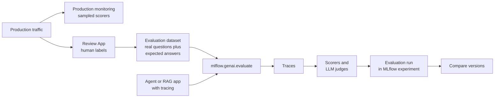

# Agent Evaluation and Tracing

Mastery: `INPUT[inlineSelect(option(new), option(learning), option(solid)):mastery]`

> [!story] Context
> [[Agent Bricks]] and the [[Mosaic AI Agent Framework]] produce agents that work in a demo. Before customers use one, you need evidence that its answers are correct, relevant, and safe, and a way to see why a bad answer happened. MLflow 3 provides tracing for the "why" and evaluation for the "how good".

> [!eli5] Summary
> Tracing records every step an AI assistant takes to answer a question, like a dashcam. Evaluation is a test: you ask the assistant a set of real questions, and automated graders plus human reviewers score each answer, so you know whether a change made it better or worse.

> [!renamed] Renamed and merged
> The MLflow 2 era product **Mosaic AI Agent Evaluation** (the `databricks-agents` evaluation APIs) is replaced by **MLflow 3 GenAI evaluation**. Databricks publishes a migration guide. `mlflow.evaluate` is deprecated for LLMs and AI apps; use `mlflow.genai.evaluate`. **Lakehouse Monitoring for generative AI** (MLflow 2) is replaced by MLflow 3 **production monitoring** (Beta).

> [!analogy]- Analogy: quality control in a bakery
> | Bakery | Agent evaluation |
> |---|---|
> | Camera over the production line | Trace |
> | Each station on the line | Span (retrieval, LLM call, tool call) |
> | Standard test batch every morning | Evaluation dataset |
> | Inspector's checklist | Scorers and LLM judges |
> | Head baker's tasting notes | Human feedback in the Review App |
> | Random sampling from the shop shelf | Production monitoring |

## Background

Classic ML has a single metric such as accuracy against labels. GenAI output is free text, so there is often no single right answer, and failures come from any step: retrieval found the wrong document, a tool returned an error, or the model ignored the context. Teams used to check a handful of answers by eye. That does not scale, and it cannot show whether a prompt change improved quality overall.

## Overview

| Capability | What it does | Key API |
|---|---|---|
| **Tracing** | Records inputs, outputs, timings, and parent-child spans for every step | `mlflow.<framework>.autolog()`, `@mlflow.trace` |
| **Evaluation** | Runs your app on a dataset and scores results | `mlflow.genai.evaluate(data, predict_fn, scorers)` |
| **Built-in LLM judges** | Predefined scorers that use an LLM to grade | `Correctness`, `RelevanceToQuery`, `Safety`, `Guidelines`, `ExpectationsGuidelines`, `RetrievalGroundedness`, `RetrievalRelevance` |
| **Custom scorers** | Your own code-based or LLM-based checks | `@scorer` decorator |
| **Human feedback** | Domain experts review traces and label answers in the Review App through labeling sessions | Review App |
| **App versions** | Link traces and evaluations to a LoggedModel version | `mlflow.set_active_model()` |
| **Production monitoring** (Beta) | Runs registered scorers on a sample of live traces | `.register()` then `.start()` |

Built-in judges at a glance:

| Judge | Checks | Needs ground truth |
|---|---|---|
| `RelevanceToQuery` | The response addresses the request | No |
| `Safety` | No harmful, offensive, or toxic content | No |
| `Guidelines` | Pass or fail against your natural-language rules | No |
| `Correctness` | The response matches a known-good answer | Yes (expectations) |
| `RetrievalGroundedness` | The response is supported by retrieved context | No |
| `RetrievalRelevance` | Retrieved context fits the request | No |

MLflow 3 does not run judges automatically; list every scorer in the evaluation call.

## How it works



Evaluate a support assistant for a plant shop:

```python
import mlflow
from mlflow.genai.scorers import (Correctness, Guidelines, RelevanceToQuery,
                                  RetrievalGroundedness, Safety)

mlflow.set_experiment("/Shared/support-assistant")
mlflow.openai.autolog()   # trace every LLM call made with the OpenAI client

@mlflow.trace
def support_assistant(question: str) -> str:
    return answer(question)   # the RAG function from the RAG note

eval_data = [
    {"inputs": {"question": "How long do I have to return a plant?"},
     "expectations": {"expected_response": "30 days from delivery, with photos if damaged."}},
    {"inputs": {"question": "Do you ship to Alaska?"},
     "expectations": {"expected_response": "No, only the contiguous US."}},
]

results = mlflow.genai.evaluate(
    data=eval_data,
    predict_fn=support_assistant,
    scorers=[
        Correctness(),
        RelevanceToQuery(),
        RetrievalGroundedness(),
        Safety(),
        Guidelines(name="tone", guidelines="Responses must be polite and under 120 words."),
    ],
)
```

A custom code-based scorer:

```python
from mlflow.genai.scorers import scorer

@scorer
def cites_a_source(outputs) -> bool:
    return "[" in outputs and "]" in outputs
```

Steps to add production monitoring (Beta):

1. Define the scorers in a Databricks notebook (scorers in local files cannot be serialized for monitoring).
2. Call `.register()` on each scorer for the experiment.
3. Call `.start()` with a sampling configuration, such as 10 percent of traces.
4. Review scores attached to traces as feedback in the experiment.

## Small-business considerations

> [!smallbiz] Small-business considerations
> - **Write 20 to 50 real questions** from your inbox, with the correct answers, before launch. That is your evaluation set.
> - **Re-run the evaluation after every change** to prompts, documents, or models.
> - **Ask the person who knows the answers** (the store manager, the support lead) to review traces in the Review App. They do not need to write code.
> - **Sample production monitoring** at a low rate. Each judge call uses LLM tokens.
> - **Cost drivers:** LLM judge tokens and trace storage. See [[How Databricks Pricing Works]].

## Cloud differences

> [!azure]- Azure Databricks
> No functional differences. Microsoft documents the same MLflow 3 GenAI pages under `learn.microsoft.com/azure/databricks/mlflow3/`.

> [!aws]- Databricks on AWS
> No differences.

> [!gcp]- Databricks on Google Cloud
> No differences; check judge model availability by region.

## Advanced topics

> [!deepdive]- Advanced topics (301–401)
> - **Answer-sheet evaluation.** Instead of a `predict_fn`, pass existing outputs or traces, for example to score last week's production traces.
> - **Combining autolog and decorators.** Enable `autolog()` for each framework the agent uses; add `@mlflow.trace` to group calls under one parent span or to instrument custom logic. On serverless compute, enable autologging explicitly for each integration.
> - **Monitoring limits.** Up to 20 scorers per experiment for continuous monitoring; only decorator-based scorers can be registered, not class-based `Scorer` subclasses. Traces stored in Unity Catalog require a SQL warehouse for monitoring.
> - **Versions.** `mlflow.set_active_model(name=...)` links traces to an app version; in production set `MLFLOW_ACTIVE_MODEL_ID`.
> - **Git folders.** Agents deployed from a notebook in a Git folder do not get MLflow 3 real-time tracing by default; use an experiment not associated with Git.
> - **Judges are models.** LLM judges can be wrong. Spot-check judge verdicts against human labels before trusting them for release decisions.

## Common misconceptions

> [!confusion] A high judge score is not proof of correctness
> Judges approximate human review. Use `Correctness` with expected answers for facts, and keep human review for high-stakes answers.

> [!confusion] Tracing is not logging
> A log line records an event. A trace records the full tree of steps for one request, with inputs and outputs at each step.

> [!confusion] Evaluation is not only for launch
> Re-run it whenever documents, prompts, or models change, and monitor production continuously.

## Recall

Which function runs GenAI evaluation in MLflow 3?::`mlflow.genai.evaluate`.
Which built-in judge requires expected answers?::`Correctness`.
Which judge checks that an answer is supported by retrieved context?::`RetrievalGroundedness`.
How do you enable tracing for every OpenAI-client call?::`mlflow.openai.autolog()`.
What does `@mlflow.trace` capture?::The function's name, inputs, outputs, execution time, and parent-child span relationships.
Does MLflow 3 run judges automatically?::No; every scorer must be listed in the evaluation call.
How many scorers per experiment can run in production monitoring?::Up to 20.
Where do domain experts label traces without code?::In the Review App, through labeling sessions.

## Next steps

> [!path] Learning path
> **Needs first:** [[MLflow]], [[Retrieval-Augmented Generation]], [[Agent Bricks]]
> **Unlocks next:** [[Fine-Tuning]], [[Data Quality Monitoring]]

> [!nextup] Next
> [[Fine-Tuning]] covers when evaluation shows that prompting and retrieval are not enough, and how to further train a model on your own examples.

> [!sources]- Sources (last verified: 2026-10-25)
> - [MLflow 3 for GenAI (AWS)](https://docs.databricks.com/aws/en/mlflow3/genai/overview/)
> - [Evaluate and improve (AWS)](https://docs.databricks.com/aws/en/mlflow3/genai/eval-monitor)
> - [Evaluate GenAI apps during development (AWS)](https://docs.databricks.com/aws/en/mlflow3/genai/eval-monitor/concepts/eval-harness)
> - [Tutorial: Evaluate and improve an agent (Azure Databricks)](https://learn.microsoft.com/en-us/azure/databricks/mlflow3/genai/eval-monitor/evaluate-app)
> - [Built-in LLM judges (AWS)](https://docs.databricks.com/aws/en/mlflow3/genai/eval-monitor/concepts/judges)
> - [Scorers and LLM judges (Azure Databricks)](https://learn.microsoft.com/en-us/azure/databricks/mlflow3/genai/eval-monitor/concepts/scorers)
> - [Develop code-based scorers (GCP)](https://docs.databricks.com/gcp/en/mlflow3/genai/eval-monitor/custom-scorer-dev-workflow)
> - [Automatic tracing and integrations (AWS)](https://docs.databricks.com/aws/en/mlflow3/genai/tracing/automatic-tracing)
> - [Manual and custom tracing (AWS)](https://docs.databricks.com/aws/en/mlflow3/genai/tracing/manual-tracing)
> - [Set up production monitoring (AWS)](https://docs.databricks.com/aws/en/mlflow3/genai/eval-monitor/production-monitoring)
> - [Review App (AWS)](https://docs.databricks.com/aws/en/mlflow3/genai/human-feedback/concepts/review-app)
> - [Create and manage labeling sessions (AWS)](https://docs.databricks.com/aws/en/mlflow3/genai/human-feedback/concepts/labeling-sessions)
> - [Migrate to MLflow 3 from Agent Evaluation (AWS)](https://docs.databricks.com/aws/en/mlflow3/genai/agent-eval-migration)
> - [Version tracking and LoggedModel (AWS)](https://docs.databricks.com/aws/en/mlflow3/genai/prompt-version-mgmt/version-tracking/version-concepts)
> - [What is Lakehouse Monitoring for generative AI? (MLflow 2) (Azure Databricks)](https://learn.microsoft.com/en-us/azure/databricks/generative-ai/agent-evaluation/monitoring)
