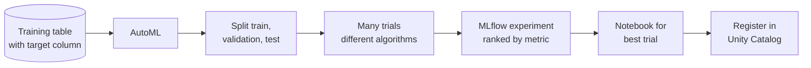

# AutoML

Mastery: `INPUT[inlineSelect(option(new), option(learning), option(solid)):mastery]`

> [!story] Context
> [[Models in Unity Catalog]] gave models a governed home. Getting a first good model still takes many trials. AutoML runs those trials automatically and returns the results as editable notebooks.

> [!eli5] Summary
> AutoML is a "try everything for me" button. You point it at a table and say which column to predict, and it trains many different models, ranks them, and gives you the code for the best one so you can read it and change it.

> [!renamed] Status change
> The [[Databricks Runtime]] 18.0 for Machine Learning release notes state that **AutoML has been removed**. Earlier ML runtimes, including Databricks Runtime 16.4 LTS ML (long-term support), still include it. A separate **serverless forecasting** experience (Public Preview as of October 2026) runs through the Model Training UI. Databricks has not published, in the sources reviewed, a single replacement for classification and regression AutoML. Check the release notes of the runtime you use.

> [!analogy]- Analogy: a test kitchen
> | Test kitchen | AutoML |
> |---|---|
> | "Make the best brownie with these ingredients" | Dataset and target column |
> | Dozens of test batches | Trials with different algorithms and settings |
> | Scorecard on the wall | MLflow experiment ranking by metric |
> | Written recipe for the winner | Generated notebook for the best trial |

## Background

Building a first model involves the same steps every time: explore the data, handle missing values, try several algorithms, tune their settings, and compare results. AutoML tools automate that loop. Databricks AutoML took a "glass box" approach: instead of a black-box model, it generated source notebooks so a data scientist could inspect and modify every step.

## Overview

AutoML is a Databricks tool that automatically trains and compares many models on a table and returns the results as editable notebooks.

It supports three problem types:

| Problem type | Python API | Notes |
|---|---|---|
| Classification | `automl.classify()` | Predicts a category, such as churn yes or no |
| Regression | `automl.regress()` | Predicts a number, such as order value |
| Forecasting | `automl.forecast()` | Predicts values over future time steps; [[Compute Types\|classic compute]] only |

On classic compute, AutoML:

1. Splits the data into training, validation, and test sets (see [[Machine Learning Basics]]).
2. Trains models with several open-source algorithms and tunes them.
3. Logs every trial to an [[MLflow]] experiment.
4. Imports a data exploration notebook and the best trial's notebook into your workspace. For classification and regression, other trials' notebooks are saved as MLflow artifacts; for classic forecasting, all trial notebooks are imported.

**Serverless forecasting** (Public Preview) is different. It runs in the Model Training UI on Databricks-managed compute, registers models and artifacts in Unity Catalog, uses statistical models plus the DeepAR neural network, and produces a batch [[Inference|inference]] notebook for the best model instead of source notebooks for every trial.

## How it works



A demand forecast for a pet supply shop, on a cluster running an ML runtime that still includes AutoML (for example 16.4 LTS ML):

```python
from databricks import automl

df = spark.table("shop.gold.daily_units_by_sku")  # sale_date, sku, units

summary = automl.forecast(
    dataset=df,
    target_col="units",
    time_col="sale_date",
    identity_col="sku",     # one series per product
    horizon=14,             # forecast 14 periods ahead
    frequency="d",
    timeout_minutes=30,
)

print(summary.best_trial.metrics)
```

Open the best trial's notebook from the experiment page, review it, and register the model in Unity Catalog.

## Small-business considerations

> [!smallbiz] Small-business considerations
> - **Use it for a baseline.** AutoML is a fast way to see whether a table can predict anything useful before investing more time.
> - **Check your runtime first.** New clusters on Databricks Runtime 18.0 ML or later do not include AutoML. For forecasting, try serverless forecasting in the UI; for classification or regression, the generated notebooks from an older runtime or a hand-written scikit-learn (a popular Python machine learning library) model are alternatives.
> - **Read the generated notebook.** It shows which columns mattered and how missing values were handled.
> - **Set a timeout.** `timeout_minutes` caps how long trials run, which caps compute cost.

## Cloud differences

> [!azure]- Azure Databricks
> No differences in Databricks AutoML. Azure Machine Learning has its own AutoML service, which is a separate Microsoft product; its SDK v1 integration with Azure Databricks is deprecated.

> [!aws]- Databricks on AWS
> No differences.

> [!gcp]- Databricks on Google Cloud
> No differences.

## Advanced topics

> [!deepdive]- Advanced topics (301–401)
> - **Runtime lifecycle.** Databricks runtimes reach end of support three years after general availability, so runtimes that still include AutoML will age out. Plan a path that does not depend on it.
> - **Imbalanced classes.** For classification with rare positives, AutoML can sample the majority class; check the metric it optimizes against your business goal.
> - **Feature tables.** AutoML can join features from [[Feature Engineering and Feature Store|feature tables]] in Unity Catalog.
> - **Serverless forecasting vs classic.** Serverless adds DeepAR and registers to Unity Catalog, but does not return trial source notebooks.

## Common misconceptions

> [!confusion] AutoML does not replace evaluation
> It ranks trials on a held-out metric. You still need to check the model against a business baseline and for [[Overfitting|overfitting]] on recent data.

> [!confusion] AutoML is not a black box on Databricks
> It generated readable notebooks for trials. That transparency was the design goal.

## Recall

Which three problem types does Databricks AutoML support?::Classification, regression, and forecasting.
What did AutoML produce besides a ranked list of models?::Editable notebooks, including a data exploration notebook and the best trial's notebook.
In which ML runtime do the release notes say AutoML was removed?::Databricks Runtime 18.0 for Machine Learning.
What is serverless forecasting?::A Public Preview forecasting experience in the Model Training UI that uses statistical models plus DeepAR and registers models in Unity Catalog.
Where are AutoML trials logged?::In an MLflow experiment.
Which argument limits how long AutoML runs?::`timeout_minutes`.

## Next steps

> [!path] Learning path
> **Needs first:** [[Machine Learning Basics]], [[Experiment Tracking]]
> **Unlocks next:** [[Models in Unity Catalog]], [[Model Serving]]

> [!nextup] Next
> [[Model Serving]] turns a registered model into a live, autoscaling API endpoint.

> [!sources]- Sources (last verified: 2026-10-25)
> - [What is AutoML? (AWS)](https://docs.databricks.com/aws/en/machine-learning/automl)
> - [What is AutoML? (Azure Databricks)](https://learn.microsoft.com/en-us/azure/databricks/machine-learning/automl/)
> - [AutoML Python API reference (AWS)](https://docs.databricks.com/aws/en/machine-learning/automl/automl-api-reference)
> - [Forecasting with AutoML (classic compute) (AWS)](https://docs.databricks.com/aws/en/machine-learning/automl/forecasting)
> - [Forecasting (serverless) with AutoML (AWS)](https://docs.databricks.com/aws/en/machine-learning/train-model/serverless-forecasting)
> - [Train regression models with AutoML Python API (Azure Databricks)](https://learn.microsoft.com/en-us/azure/databricks/machine-learning/automl/regression-train-api)
> - [Databricks Runtime 18.0 for Machine Learning (GCP)](https://docs.databricks.com/gcp/en/release-notes/runtime/18.0ml)
> - [Databricks Runtime 16.4 LTS for Machine Learning (AWS)](https://docs.databricks.com/aws/en/release-notes/runtime/16.4lts-ml)
> - [Databricks support lifecycles (AWS)](https://docs.databricks.com/aws/en/release-notes/runtime/databricks-runtime-ver)
> - [Develop with AutoML and Azure Databricks (Azure Machine Learning)](https://learn.microsoft.com/en-us/azure/machine-learning/how-to-configure-databricks-automl-environment?view=azureml-api-1)
