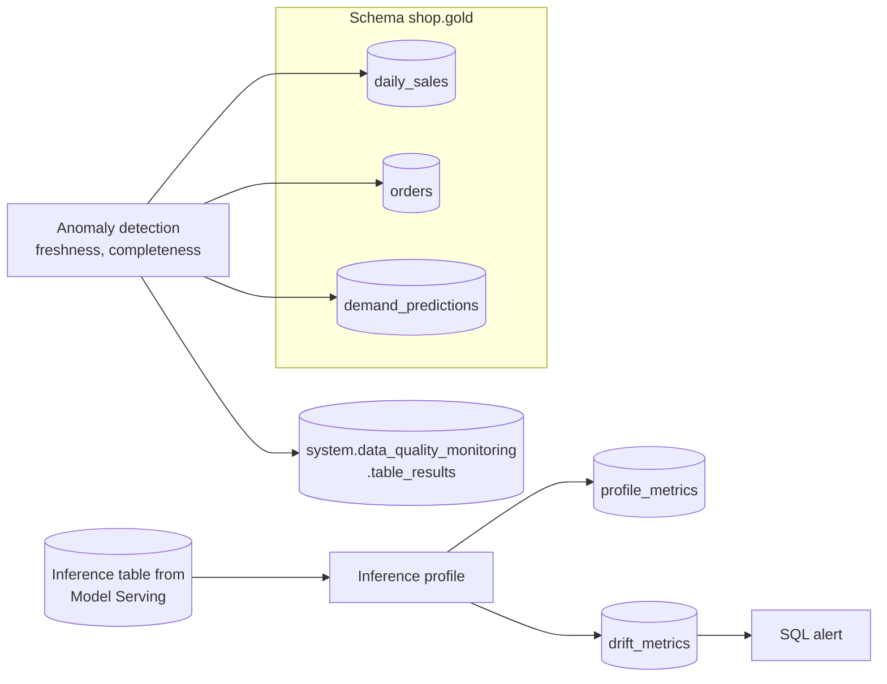

# Data Quality Monitoring

Mastery: `INPUT[inlineSelect(option(new), option(learning), option(solid)):mastery]`

> [!story] Context
> [[Fine-Tuning]] and the earlier notes produced models and agents in production. A model is only as good as the data it receives. If a source table stops updating, or customers start behaving differently, predictions degrade silently. Data quality monitoring detects those changes.

> [!eli5] Summary
> Data quality monitoring is a smoke alarm for your data. It notices when a table did not update on time, when far fewer rows arrived than usual, or when the numbers start looking different from before, and it flags the problem before someone makes a decision with bad data.

> [!renamed] Renamed: Lakehouse Monitoring is now data profiling
> **Lakehouse Monitoring** is now **data profiling**, one of two parts of **data quality monitoring** in Unity Catalog. The other part is **anomaly detection**. The docs describe data quality monitoring as "formerly known as Lakehouse Monitoring". The sources reviewed do not give an exact rename date. Some doc URLs still contain `lakehouse-monitoring`.

> [!analogy]- Analogy: a building's sensors
> | Building | Data quality monitoring |
> |---|---|
> | Smoke detectors in every room, installed by floor | Anomaly detection enabled on a schema or catalog |
> | "Mail not delivered today" alert | Freshness check |
> | "Only half the usual deliveries" alert | Completeness check |
> | Detailed inspection report for one room | Data profile on one table |
> | Comparing this month's readings to last month's | Drift metrics |

## Background

Data pipeline tests, such as [[Expectations and Data Quality|expectations]], check rules you write: "price must be positive". They do not catch problems nobody anticipated, such as a table that silently stops refreshing, or a gradual shift in the mix of customers. For ML, [[Drift|drift]] in inputs or predictions is the common cause of a model getting worse without any error.

Databricks Lakehouse Monitoring introduced table profiling with drift metrics (Public Preview February 2025 and GA March 2025 per the Google Cloud release notes). It is now data profiling, alongside anomaly detection that scales to whole schemas.

## Overview

| Part | Scope | What it checks | Output |
|---|---|---|---|
| **Anomaly detection** | Schema or catalog level, many tables at once | **Freshness** (a per-table model predicts the next commit; late commits mark the table stale) and **completeness** (rows expected in the last 24 hours) | Health status per table; results in `system.data_quality_monitoring.table_results` |
| **Data profiling** | One table | Summary statistics per column and drift over time | Profile metrics table, drift metrics table, and a dashboard |

Anomaly detection health statuses: Healthy, Unhealthy, Training, Error, Excluded, and Not enabled. Incidents can be filtered by reason, root cause, and downstream impact. Percent-null checks and completeness slicing are in Beta.

Data profile types:

| Profile type | Use for | Required settings |
|---|---|---|
| **Snapshot** | Tables without time columns; profiles the full table each refresh (maximum 4 TB) | None beyond the table |
| **Time series** | Tables with a timestamp; metrics per time window | Timestamp column, granularities |
| **Inference** | Model request logs; tracks inputs, predictions, and optional labels | Timestamp, prediction column, model ID column, problem type (classification or regression), granularities |

Drift is computed against the previous window and, optionally, a baseline table, using statistical tests such as Kolmogorov-Smirnov, chi-squared, and population stability index.

## How it works



Set up monitoring for a shop's gold schema and its forecast model:

1. In Catalog Explorer, open the `shop.gold` schema and enable **anomaly detection** for the schema.
2. Wait for tables to finish the **Training** status; Databricks scans each table at the same frequency it is updated.
3. Open the forecast's inference table and create a **data profile** of type **Inference**, with the timestamp, prediction, and model ID columns, problem type `regression`, and a granularity of `1 day`.
4. Optionally add a baseline table, such as the training data, to measure drift from training.
5. Create a [[SQL Alerts|SQL alert]] on the drift metrics table.

Query anomaly results:

```sql
SELECT *
FROM system.data_quality_monitoring.table_results
WHERE catalog_name = 'shop' AND schema_name = 'gold'
ORDER BY event_time DESC
LIMIT 50;
```

Column names follow the system table reference; check it for the current schema. Profiles can also be created with the Databricks SDK for Python through `w.data_quality.create_monitor(...)`, using an `InferenceLogConfig` with `problem_type=InferenceProblemType.INFERENCE_PROBLEM_TYPE_REGRESSION`. Those API fields are in Public Preview.

## Small-business considerations

> [!smallbiz] Small-business considerations
> - **Turn on anomaly detection for your gold schema first.** Freshness alerts catch the most common real problem: a source stopped updating.
> - **Add an inference profile only for models that matter**, such as a forecast that drives ordering.
> - **Use daily granularity** for most small-business tables; finer windows cost more compute and add noise.
> - **Cost drivers:** monitoring runs as serverless jobs that compute metrics. Larger tables and more frequent refreshes cost more. Limit access to the results system table, since it describes your data estate.

## Cloud differences

> [!azure]- Azure Databricks
> Same features. The Azure page states that event freshness is not supported; some Databricks pages describe it as available only in an earlier Beta.

> [!aws]- Databricks on AWS
> Same features.

> [!gcp]- Databricks on Google Cloud
> Same features. The Google Cloud release notes recorded Lakehouse Monitoring Public Preview on February 11, 2025 and GA on March 26, 2025.

## Advanced topics

> [!deepdive]- Advanced topics (301–401)
> - **Lookback.** A new time series or inference profile analyzes only data from the 30 days before its creation.
> - **Slicing.** Profiles and completeness checks can slice by a column (for example, store or product line). Anomaly detection evaluates completeness for a slice column only when it has 50 or fewer distinct values, with up to three slice columns (Beta).
> - **Custom metrics.** Data profiles accept custom aggregate, derived, and drift metrics defined in SQL.
> - **Limits.** Anomaly detection does not support views or foreign tables. Completeness counts rows; it does not consider nulls, zeros, or NaN values.
> - **GenAI quality** is monitored with MLflow production monitoring rather than table profiles. See [[Agent Evaluation and Tracing]].
> - **Retraining loop.** When drift is confirmed, retrain, register a new version in [[Models in Unity Catalog]], and move the alias.

## Common misconceptions

> [!confusion] Monitoring does not replace pipeline expectations
> Expectations enforce known rules at write time. Monitoring detects unknown changes over time. Use both.

> [!confusion] Drift is not always a problem
> Seasonal shifts are expected. Compare against the same season or a suitable baseline before retraining.

## Recall

What was data profiling formerly called?::Lakehouse Monitoring.
What are the two parts of data quality monitoring?::Anomaly detection (schema-level freshness and completeness) and data profiling (table-level statistics and drift).
How does anomaly detection judge freshness?::A per-table model predicts the next commit time; an unusually late commit marks the table stale.
What window does completeness use?::Rows expected in the last 24 hours.
Name the three data profile types.::Snapshot, time series, and inference.
Which two metric tables does a data profile write?::A profile metrics table and a drift metrics table.
Where are anomaly detection results stored?::`system.data_quality_monitoring.table_results`.
What is the maximum table size for a snapshot profile?::4 TB.

## Next steps

> [!path] Learning path
> **Needs first:** [[Unity Catalog]], [[Model Serving]], [[Drift]]
> **Unlocks next:** [[System Tables]], [[SQL Alerts]]

> [!nextup] Next
> [[GPU Compute]] covers the hardware behind deep learning and LLM work: GPU clusters and AI Runtime serverless GPUs.

> [!sources]- Sources (last verified: 2026-10-25)
> - [Data quality monitoring (AWS)](https://docs.databricks.com/aws/en/data-governance/unity-catalog/data-quality-monitoring/)
> - [Data quality monitoring (Azure Databricks)](https://learn.microsoft.com/en-us/azure/databricks/data-governance/unity-catalog/data-quality-monitoring/)
> - [Anomaly detection (AWS)](https://docs.databricks.com/aws/en/data-governance/unity-catalog/data-quality-monitoring/anomaly-detection/)
> - [Anomaly detection (Azure Databricks)](https://learn.microsoft.com/en-us/azure/databricks/data-quality-monitoring/anomaly-detection/)
> - [Data profiling (AWS)](https://docs.databricks.com/aws/en/data-governance/unity-catalog/data-quality-monitoring/data-profiling)
> - [Data profiling metric tables (AWS)](https://docs.databricks.com/aws/en/data-governance/unity-catalog/data-quality-monitoring/data-profiling/monitor-output)
> - [Create a data profile using the API (GCP)](https://docs.databricks.com/gcp/en/data-quality-monitoring/data-profiling/create-monitor-api)
> - [Create a profile using the Databricks UI (Azure Databricks)](https://learn.microsoft.com/en-us/azure/databricks/data-quality-monitoring/data-profiling/create-monitor-ui)
> - [Data quality monitoring results system table reference (AWS)](https://docs.databricks.com/aws/en/admin/system-tables/data-quality-monitoring)
> - [Create a monitor (Data Quality REST API)](https://docs.databricks.com/api/data-quality/v1/create-monitor)
> - [February 2025 release notes (GCP)](https://docs.databricks.com/gcp/en/release-notes/product/2025/february)
> - [March 2025 release notes (GCP)](https://docs.databricks.com/gcp/en/release-notes/product/2025/march)
