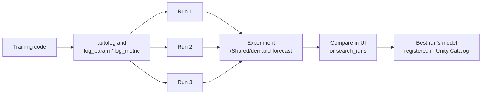

# Experiment Tracking

Mastery: `INPUT[inlineSelect(option(new), option(learning), option(solid)):mastery]`

> [!story] Context
> [[MLflow]] introduced the platform. Its oldest and most used component is tracking: a record of every attempt to train a model, so the best one can be found, explained, and reproduced.

> [!eli5] Summary
> Experiment tracking keeps a diary of every time a model is trained: what settings were used, how accurate it was, and a copy of the result. Later, anyone on the team can line up the attempts side by side and pick the best one.

> [!analogy]- Analogy: a baker's test log
> | Baker's test log | Experiment tracking |
> |---|---|
> | One page per recipe being developed | Experiment |
> | One line per test bake | Run |
> | Oven temperature and flour amount | Parameters |
> | Taste score and rise height | Metrics |
> | Photo of the loaf | Artifact |
> | Copy of the winning recipe card | Logged model |

## Background

Training a model means trying many combinations of algorithms, features, and settings. Without tracking, results live in notebook output that disappears on the next run, or in a spreadsheet updated by hand. Months later nobody can say which data or settings produced the model in production. That is a problem for debugging, and for auditors in regulated businesses.

## Overview

Experiment tracking is the MLflow Tracking component, built into every Databricks workspace.

| Object | What it holds |
|---|---|
| **Experiment** | A named group of runs, such as `/Shared/demand-forecast`. Workspace experiments live in a workspace folder; a notebook experiment is attached to one notebook. |
| **Run** | One execution of training code, with start and end time, source notebook, and Git commit when available |
| **Parameters** | Input settings, such as `max_depth=4` |
| **Metrics** | Numeric results, which can be logged over steps, such as `val_mae` per epoch |
| **Artifacts** | Files: plots, data samples, model files |
| **Tags** | Free-form labels, such as `owner=maria` |
| **LoggedModel** (MLflow 3) | A model object linked to runs and metrics; useful for comparing checkpoints |

Key behaviors on Databricks:

- **Databricks Autologging.** In interactive Python notebooks on Databricks, autologging calls `mlflow.autolog()` for supported libraries, so parameters, metrics, and the model are logged without extra code.
- **Default experiment.** If no experiment is set, runs go to the notebook experiment. `mlflow.set_experiment("/Shared/...")` sets the active experiment.
- **Comparison UI.** The experiment page lists runs in a table and charts metrics, so runs can be filtered, sorted, and compared side by side.

## How it works



A small hyperparameter sweep for a bakery's daily bread forecast:

```python
import mlflow
from sklearn.ensemble import GradientBoostingRegressor
from sklearn.metrics import mean_absolute_error

mlflow.set_experiment("/Shared/bread-forecast")
mlflow.autolog(exclusive=False)  # keep autologging and allow custom logging

for depth in [2, 3, 4]:
    with mlflow.start_run(run_name=f"gbr_depth_{depth}"):
        model = GradientBoostingRegressor(max_depth=depth).fit(X_train, y_train)
        mlflow.log_metric("val_mae", mean_absolute_error(y_val, model.predict(X_val)))
        mlflow.set_tag("data_version", "daily_sales_2026_10")
```

Find the best run in code:

```python
best = mlflow.search_runs(
    experiment_names=["/Shared/bread-forecast"],
    order_by=["metrics.val_mae ASC"],
    max_results=1,
)
print(best.loc[:, ["run_id", "params.max_depth", "metrics.val_mae"]])
```

## Small-business considerations

> [!smallbiz] Small-business considerations
> - **Use shared experiments** under `/Shared` so work survives when someone leaves.
> - **Log the data version** as a tag or parameter, for example the table name and the [[Time Travel]] version used. It makes a run reproducible.
> - **Log validation metrics**, not just training metrics. The gap between them shows [[Overfitting|overfitting]].
> - **Cost:** tracking itself is lightweight; compute for training is the cost. Large artifacts such as many model checkpoints add storage.

## Cloud differences

> [!azure]- Azure Databricks
> No differences in tracking behavior.

> [!aws]- Databricks on AWS
> No differences in tracking behavior.

> [!gcp]- Databricks on Google Cloud
> No differences in tracking behavior.

## Advanced topics

> [!deepdive]- Advanced topics (301–401)
> - **Autologging and fluent runs.** Behavior around `mlflow.start_run()` and autologging has changed between versions and pages. If autologged content is missing from a manually started run, call `mlflow.autolog()` explicitly before training.
> - **Nested runs.** Use nested runs for hyperparameter sweeps (one parent, many children). On [[AI Runtime|AI Runtime]], calling a distributed function inside an active run creates a nested child run.
> - **Notebook code on AI Runtime.** Code run directly in an attached notebook does not create a run automatically; use `mlflow.start_run()` or autologging.
> - **Experiment permissions.** Experiments have their own access controls (for example, can read, can edit, can manage). Grant to groups.
> - **Where data is stored.** Databricks documents options for where MLflow data is stored; review them when you need runs and artifacts in a specific location.
> - **GenAI experiments.** The same experiment also stores traces and evaluation runs for agents. See [[Agent Evaluation and Tracing]].

## Common misconceptions

> [!confusion] Autologging does not log everything
> Autologging covers supported libraries' parameters, metrics, and models. Business context, such as which data snapshot was used, must be logged by you.

> [!confusion] A run is not a deployed model
> A run records an attempt. A model is used in production only after it is registered in [[Models in Unity Catalog]] and deployed.

## Recall

What is the difference between an experiment and a run?::An experiment groups runs; a run is one execution of training code.
What are parameters and metrics in MLflow?::Parameters are input settings; metrics are numeric results.
Where do runs go if no experiment is set in a Databricks notebook?::To the notebook experiment.
Which call sets the active experiment?::`mlflow.set_experiment("/path")`.
Which function finds runs programmatically?::`mlflow.search_runs`.
What does `mlflow.autolog(exclusive=False)` allow?::Autologging plus your own custom parameters and metrics in the same run.
Why log the data version with each run?::So the run can be reproduced and audited later.

## Next steps

> [!path] Learning path
> **Needs first:** [[MLflow]], [[Machine Learning Basics]]
> **Unlocks next:** [[Models in Unity Catalog]], [[AutoML]]

> [!nextup] Next
> [[Models in Unity Catalog]] covers what happens to the winning run's model: versioning, aliases, and permissions.

> [!sources]- Sources (last verified: 2026-10-25)
> - [Databricks Autologging (AWS)](https://docs.databricks.com/aws/en/mlflow/databricks-autologging)
> - [Databricks Autologging (Azure Databricks)](https://learn.microsoft.com/en-us/azure/databricks/mlflow/databricks-autologging)
> - [Experiment tracking and observability on AI Runtime (AWS)](https://docs.databricks.com/aws/en/machine-learning/ai-runtime/monitor-deploy/tracking-observability)
> - [Choose where your MLflow data is stored (AWS)](https://docs.databricks.com/aws/en/mlflow/tracking-server-configuration)
> - [Track and compare models using MLflow Logged Models (AWS)](https://docs.databricks.com/aws/en/mlflow/logged-model)
> - [ML Experiment Tracking (mlflow.org)](https://mlflow.org/docs/latest/ml/tracking/)
