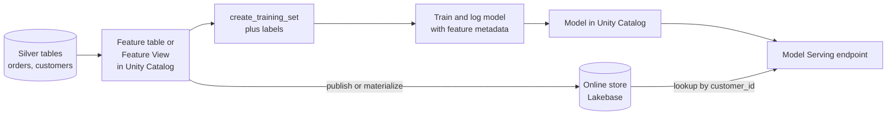

# Feature Engineering and Feature Store

Mastery: `INPUT[inlineSelect(option(new), option(learning), option(solid)):mastery]`

> [!story] Context
> [[Generative AI and LLMs]] showed models that arrive pre-trained. Classic models, such as a demand forecast, are trained on your own [[Feature|features]]. Those features must be computed the same way at training time and at prediction time, or the model's accuracy drops in production.

> [!eli5] Summary
> A feature store is a shared shelf of ready-made model inputs, such as "orders in the last 30 days" for each customer. Everyone uses the same recipe, so a model sees the same numbers when it learns and when it makes live predictions.

> [!analogy]- Analogy: a commissary kitchen
> | Commissary kitchen | Feature store |
> |---|---|
> | Central prep of sauces with one recipe | Feature tables and Feature Views in Unity Catalog |
> | Recipe card stored with the sauce | Feature definitions and lineage |
> | Labeled containers by date | Point-in-time (time series) keys |
> | Walk-in cooler next to the line for fast grabs | Online feature store on [[Lakebase]] |
> | Line cooks taking the sauce without remaking it | [[Model Serving]] looking up features automatically |

## Background

Without a shared feature layer, each data scientist writes their own SQL for "average basket size", the production team rewrites it in another language for the live app, and the two versions drift apart. This is called **training-serving skew**. A second problem is **leakage**: joining features by customer ID without respecting time lets the model see data from after the event it is predicting.

Databricks first offered a Workspace Feature Store, which is now legacy. Feature engineering then moved into [[Unity Catalog]], so feature tables are ordinary governed Delta tables with lineage and permissions. Databricks later added **Feature Views** for declarative feature definitions and moved online stores onto [[Lakebase]].

## Overview

Databricks Feature Store has two main building blocks:

| Building block | What it is | When to use |
|---|---|---|
| **Feature Views** (recommended, Public Preview) | Declarative feature definitions, including time-windowed aggregations and streaming features, materialized to offline and online stores | Most new projects |
| **Feature tables** | Any Delta table in Unity Catalog with a primary key constraint | Sharing through [[OpenSharing]], third-party online stores, existing projects |

Supporting capabilities:

- **Training sets:** `create_training_set` joins a label DataFrame with features by key, with optional point-in-time lookups.
- **Online stores:** Databricks Online Feature Stores provision a Lakebase project as the storage backend for low-latency lookups. Data is synced from offline tables: *materialization* for Feature Views, *publishing* for feature tables.
- **Automatic feature lookup:** A model logged with the feature engineering client records which features it needs, so [[Model Serving]] fetches them by entity ID at request time.
- **Feature Serving endpoints:** Serve features without a model, for example to a rules engine or an app. Databricks recommends serving the model directly when features feed model inference.
- **Governance and lineage:** Unity Catalog records which models and endpoints use which features.

## How it works



A feature table for a churn model at a subscription coffee roaster, using the `databricks-feature-engineering` client:

```python
from databricks.feature_engineering import FeatureEngineeringClient, FeatureLookup

fe = FeatureEngineeringClient()

customer_features = spark.sql("""
  SELECT customer_id,
         COUNT(*)                     AS orders_90d,
         AVG(order_total)             AS avg_order_90d,
         DATEDIFF(current_date(), MAX(order_date)) AS days_since_last_order
  FROM shop.silver.orders
  WHERE order_date >= current_date() - INTERVAL 90 DAYS
  GROUP BY customer_id
""")

fe.create_table(
    name="shop.ml.customer_features",
    primary_keys=["customer_id"],
    df=customer_features,
    description="Order recency and frequency per customer, last 90 days",
)
```

Build a training set and log the model with its feature metadata:

```python
import mlflow
from sklearn.linear_model import LogisticRegression

labels = spark.table("shop.ml.churn_labels")  # customer_id, churned

training_set = fe.create_training_set(
    df=labels,
    feature_lookups=[FeatureLookup(table_name="shop.ml.customer_features",
                                   lookup_key="customer_id")],
    label="churned",
)
pdf = training_set.load_df().toPandas()
X, y = pdf.drop(columns=["customer_id", "churned"]), pdf["churned"]

with mlflow.start_run():
    model = LogisticRegression(max_iter=500).fit(X, y)
    fe.log_model(
        model=model,
        artifact_path="model",
        flavor=mlflow.sklearn,
        training_set=training_set,
        registered_model_name="shop.ml.churn_model",
    )
```

At serving time the request only carries `customer_id`. The endpoint reads the other columns from the online store.

## Small-business considerations

> [!smallbiz] Small-business considerations
> - **A plain Delta table is enough to start:** A gold table keyed by `customer_id` with a primary key constraint already works as a feature table.
> - **Skip the online store for batch scoring:** A nightly job that scores every customer needs no online store. Add one only when an app needs predictions within milliseconds.
> - **Watch online store cost:** An online store runs on Lakebase compute, which is billed while it runs; the Google Cloud docs note that Lakebase scale-to-zero is not supported for online feature stores. See [[How Databricks Pricing Works]].
> - **Use point-in-time joins for anything time-based:** It prevents leakage in forecasts and churn models.

## Cloud differences

> [!azure]- Azure Databricks
> The Azure docs describe the online store backend as Lakebase Autoscaling. APIs and behavior are otherwise the same.

> [!aws]- Databricks on AWS
> Online stores provision a Lakebase project. No other differences.

> [!gcp]- Databricks on Google Cloud
> Online Feature Stores are created as Lakebase Autoscaling projects. Some Google Cloud pages still mark the online store as Beta. The GCP docs list limits: the online table's catalog name must match the Lakebase database name, and an online store supports up to 3 read replicas.

## Advanced topics

> [!deepdive]- Advanced topics (301–401)
> - **Time series feature tables:** Add `timeseries_columns` to a feature table, then use timestamp lookups in `FeatureLookup` for point-in-time correct joins.
> - **Name clashes:** When two tables share a feature name, use `output_name` in `FeatureLookup`. Use `default_values` for features that can be missing.
> - **On-demand features:** Python UDFs registered in Unity Catalog can compute features at request time, for example distance from a store.
> - **Do not change keys:** Changing a feature table's primary key or a feature's type breaks downstream pipelines and models.
> - **Permissions:** An endpoint creator needs `SELECT` on the backing table. A materialized table can hold many features, so `SELECT` on it grants access to all of them.
> - **Multiple online stores:** Existing endpoints that look up features from multiple online stores keep working, but you cannot create new endpoints like this on Lakebase Autoscaling instances.
> - **Feature View restrictions:** A `FeatureSpec` that uses Feature Views cannot also contain `FeatureLookup` or `FeatureFunction` definitions.

## Common misconceptions

> [!confusion] A feature store is not a separate database
> The offline store is Delta tables in Unity Catalog. Only the optional online store is a separate system, and it runs on Lakebase.

> [!confusion] "Feature" here is not a product feature
> In ML, a feature is a model input column, such as days since last order.

> [!confusion] Feature Serving is not Model Serving
> Feature Serving returns feature values. Model Serving returns predictions, and it can look up features itself.

## Recall

What problem does a feature store solve?::Training-serving skew: features computed differently in training and in production.
Which Unity Catalog tables can act as feature tables?::Any Delta table with a primary key constraint.
Which feature definition type does Databricks recommend for most new projects?::Feature Views.
What storage backend does a Databricks online feature store use?::Lakebase (a provisioned Lakebase project).
What is the sync step called for Feature Views and for feature tables?::Materialization for Feature Views; publishing for feature tables.
Which client class is used for feature engineering in Unity Catalog?::`FeatureEngineeringClient` from `databricks.feature_engineering`.
Why log a model with `fe.log_model`?::It records feature metadata so Model Serving can look up features automatically by key.
What prevents data leakage in time-based features?::Point-in-time lookups on time series feature tables.

## Next steps

> [!path] Learning path
> **Needs first:** [[Machine Learning Basics]], [[Unity Catalog]], [[Delta Lake]]
> **Unlocks next:** [[MLflow]], [[Model Serving]]

> [!nextup] Next
> [[MLflow]] is the open-source platform that records every training run, packages models, and evaluates both ML models and agents.

> [!sources]- Sources (last verified: 2026-10-25)
> - [Databricks Feature Store (AWS)](https://docs.databricks.com/aws/en/machine-learning/feature-store/)
> - [Feature Store overview and glossary (AWS)](https://docs.databricks.com/aws/en/machine-learning/feature-store/concepts)
> - [Feature tables in Unity Catalog (AWS)](https://docs.databricks.com/aws/en/machine-learning/feature-store/uc/feature-tables-uc)
> - [Train models with feature tables (AWS)](https://docs.databricks.com/aws/en/machine-learning/feature-store/train-models-with-feature-store)
> - [Point-in-time feature joins (AWS)](https://docs.databricks.com/aws/en/machine-learning/feature-store/time-series)
> - [On-demand feature computation (AWS)](https://docs.databricks.com/aws/en/machine-learning/feature-store/on-demand-features)
> - [Serve Feature Views (AWS)](https://docs.databricks.com/aws/en/machine-learning/feature-store/serve-declarative-features)
> - [Feature Store and Model Serving with Lakebase (AWS)](https://docs.databricks.com/aws/en/oltp/projects/feature-store)
> - [Databricks Online Feature Stores (GCP)](https://docs.databricks.com/gcp/en/machine-learning/feature-store/online-feature-store)
> - [Feature Views API reference (Azure Databricks)](https://learn.microsoft.com/en-us/azure/databricks/machine-learning/feature-store/feature-views-api-reference)
> - [Model Serving with automatic feature lookup (AWS)](https://docs.databricks.com/aws/en/machine-learning/feature-store/automatic-feature-lookup)
> - [Feature Serving endpoints (AWS)](https://docs.databricks.com/aws/en/machine-learning/feature-store/feature-function-serving)
