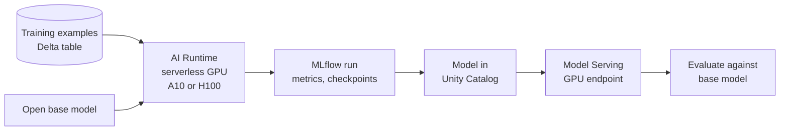

# Fine-Tuning

Mastery: `INPUT[inlineSelect(option(new), option(learning), option(solid)):mastery]`

> [!story] Context
> [[Agent Evaluation and Tracing]] shows where an assistant falls short. Most gaps are fixed with better prompts or better retrieval. When evaluation shows a consistent gap in behavior or format that prompting cannot close, the remaining option is to change the model itself by further training it on examples.

> [!eli5] Summary
> Fine-tuning is extra coaching for an AI model that already knows how to write. You show it hundreds or thousands of examples of exactly how your business wants answers written, and it learns that style. It is slower and costlier than giving the model better instructions, so it is usually the last thing to try.

> [!renamed] Status change: Foundation Model Fine-tuning is end of life
> **Foundation Model Fine-tuning** (also called **Mosaic AI Model Training**, part of Databricks Model Training) has reached end of life. The `databricks_genai` package and the fine-tuning UI are no longer available. Databricks recommends **AI Runtime**, its serverless GPU compute, for training and fine-tuning foundation models. See [[AI Runtime]].

> [!analogy]- Analogy: training a new hire's writing style
> | Coaching | Fine-tuning |
> |---|---|
> | Hire who already writes well | Pre-trained base model |
> | Stack of model emails from your best rep | Training examples (prompt and ideal response) |
> | Rewriting until the style sticks | Training epochs |
> | Hire who parrots the examples word for word | [[Overfitting]] |
> | Policy binder still on the desk | Retrieval ([[Retrieval-Augmented Generation\|RAG]]) for facts |

## Background

Pre-trained LLMs are general. Businesses sometimes need consistent formats (always valid JSON with specific fields), domain terminology the model misreads, or a smaller model that matches a larger one's quality on a narrow task. Fine-tuning adjusts the model's weights using labeled examples.

Databricks offered managed fine-tuning after its MosaicML acquisition ([[MosaicML and Open Models]]). That managed service is now end of life, and fine-tuning runs as ordinary training code on serverless GPUs.

## Overview

Choose the approach by the kind of gap:

| Gap | Best fix | Why |
|---|---|---|
| Unclear or inconsistent instructions | Prompt engineering | Cheapest; no training |
| Missing or changing knowledge (policies, inventory) | [[Retrieval-Augmented Generation\|RAG]] | Update documents without retraining |
| Consistent format or style the model will not follow | Fine-tuning | Changes behavior |
| Domain terms the model keeps misreading | Fine-tuning, plus RAG | Behavior plus knowledge |
| A large model is good enough but too slow or costly | Fine-tune a smaller model | Cheaper, faster inference |

Databricks' guidance: try prompting first, use RAG for knowledge, fine-tune for behavior and format, and combine them when needed. Fine-tuning is a poor fit with very little data. A Databricks blog post suggests 1,000 to 5,000 well-curated examples, which it reports outperform larger noisy datasets.

Methods:

| Method | What changes | Hardware |
|---|---|---|
| Full fine-tuning | All weights | Most GPU memory |
| Parameter-efficient (for example LoRA) | Small adapter weights | Less GPU memory; common for small teams |
| Continued pre-training | All weights, on raw domain text | Large datasets |

## How it works



Steps on Databricks today:

1. **Prove the need:** Run an evaluation set against the base model with good prompts and RAG. Record the scores ([[Agent Evaluation and Tracing]]).
2. **Prepare data:** Store prompt and ideal-response pairs in a Delta table. Hold back a validation split.
3. **Pick a small open model:** Databricks' AI Runtime tutorial fine-tunes Qwen3.5-0.8B on serverless GPU with an H100 accelerator and then serves it.
4. **Train on AI Runtime:** Attach a notebook to serverless GPU compute ([[AI Runtime]]), and train with a standard library (for example Hugging Face Transformers or TRL). Log metrics and checkpoints with [[MLflow]].
5. **Register** the model in [[Models in Unity Catalog]].
6. **Serve** it on a GPU [[Model Serving]] endpoint, or use provisioned throughput where the model family is supported.
7. **Evaluate** the fine-tuned model against the base model on the same evaluation set. Ship only if it wins.

A sketch of a LoRA fine-tune in an AI Runtime notebook (library calls are standard Hugging Face; adapt to the tutorial for exact versions):

```python
import mlflow
from datasets import Dataset
from peft import LoraConfig
from trl import SFTConfig, SFTTrainer

rows = spark.table("shop.ml.reply_examples").select("messages").toPandas()
train_ds = Dataset.from_pandas(rows)

mlflow.set_experiment("/Shared/reply-style-finetune")

trainer = SFTTrainer(
    model="<open-base-model>",
    train_dataset=train_ds,
    peft_config=LoraConfig(r=16, lora_alpha=32, target_modules="all-linear"),
    args=SFTConfig(output_dir="/tmp/out", num_train_epochs=2, report_to="mlflow"),
)
trainer.train()
```

## Small-business considerations

> [!smallbiz] Small-business considerations
> - **Usually, do not fine-tune:** Most small-business needs (support answers, email sorting, summaries) are met with prompting, RAG, and a hosted model.
> - **Consider it when** you have at least a thousand good examples of a narrow, repetitive task and evaluation shows a consistent format or style gap.
> - **Total cost includes serving:** A fine-tuned model needs its own GPU endpoint, which bills while it runs, unlike pay-per-token hosted models. Large GPU endpoints such as `GPU_XLARGE` do not scale to zero.
> - **Re-evaluate after base model updates:** Newer hosted models often close the gap that justified fine-tuning.

## Cloud differences

> [!azure]- Azure Databricks
> AI Runtime and GPU serving availability depend on the Azure region. The Azure docs carry the same end-of-life notice for Foundation Model Fine-tuning.

> [!aws]- Databricks on AWS
> AI Runtime and GPU serving availability depend on the AWS region.

> [!gcp]- Databricks on Google Cloud
> Check AI Runtime availability for Google Cloud regions before planning a fine-tune.

## Advanced topics

> [!deepdive]- Advanced topics (301–401)
> - **Multi-GPU and multi-node:** Notebook multi-GPU training on AI Runtime is supported on H100 nodes (8x H100); multi-node training uses the AI Runtime CLI. See [[AI Runtime]].
> - **Evaluation leakage:** Keep evaluation questions out of the training data, or scores will be inflated.
> - **Catastrophic forgetting:** Heavy fine-tuning on a narrow task can degrade general ability. Include some general examples or use parameter-efficient methods.
> - **Licenses:** Open models carry their own licenses and acceptable-use policies; check them before commercial use.
> - **Serving custom LLMs:** Custom LLM endpoints do not autoscale dynamically; size for peak traffic. For large models Databricks recommends Foundation Model APIs over custom GPU serving.
> - **Legacy runs:** Earlier notices said existing fine-tuning runs continued to work before removal; the current docs state the feature is no longer supported.

## Common misconceptions

> [!confusion] Fine-tuning is not the way to add company knowledge
> Facts that change belong in retrieval. Fine-tuning teaches style and behavior, and fine-tuned facts go stale.

> [!confusion] "Fine-tuning" on Databricks is no longer a button
> The managed Foundation Model Fine-tuning service is end of life. Fine-tuning is now your own training code on AI Runtime.

## Recall

What is fine-tuning?::Further training a pre-trained model's weights on your own labeled examples.
When should you fine-tune instead of using RAG?::When the gap is behavior or output format, not missing or changing knowledge.
What is the status of Databricks Foundation Model Fine-tuning?::End of life; the `databricks_genai` package and UI are no longer available.
What does Databricks recommend instead?::Fine-tuning on AI Runtime, its serverless GPU compute.
Roughly how many curated examples does a Databricks blog suggest for fine-tuning?::1,000 to 5,000.
What is LoRA?::A parameter-efficient method that trains small adapter weights instead of all model weights.
Why compare against the base model after fine-tuning?::To confirm the fine-tuned model actually beats prompting and RAG on the same evaluation set.

## Next steps

> [!path] Learning path
> **Needs first:** [[Generative AI and LLMs]], [[Agent Evaluation and Tracing]], [[AI Runtime]]
> **Unlocks next:** [[Model Serving]], [[AI Runtime]]

> [!nextup] Next
> [[Data Quality Monitoring]] covers how to watch tables, features, and model predictions for freshness, completeness, and drift once models are in production.

> [!sources]- Sources (last verified: 2026-10-25)
> - [Foundation Model Fine-tuning (EoL) (AWS)](https://docs.databricks.com/aws/en/large-language-models/foundation-model-training/)
> - [Foundation Model Fine-tuning (EoL) (Azure Databricks)](https://learn.microsoft.com/en-us/azure/databricks/large-language-models/foundation-model-training/)
> - [Create a training run using the Foundation Model Fine-tuning UI (deprecated) (AWS)](https://docs.databricks.com/aws/en/large-language-models/foundation-model-training/ui)
> - [Supervised fine-tuning and serving of Qwen3.5-0.8B on AI Runtime (AWS)](https://docs.databricks.com/aws/en/machine-learning/ai-runtime/examples/tutorials/sgc-finetune-qwen3.5-0.8b)
> - [Databricks Runtime for Machine Learning (AWS)](https://docs.databricks.com/aws/en/machine-learning/databricks-runtime-ml)
> - [Serve custom LLMs with Custom Model Serving (AWS)](https://docs.databricks.com/aws/en/machine-learning/model-serving/serve-custom-llms)
> - [A practical guide to LLM fine tuning (Databricks blog)](https://www.databricks.com/blog/llm-fine-tuning)
> - [RAG vs fine tuning (Databricks blog)](https://www.databricks.com/blog/rag-vs-fine-tuning)
