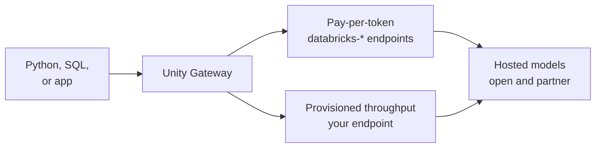

# Foundation Model APIs

Mastery: `INPUT[inlineSelect(option(new), option(learning), option(solid)):mastery]`

> [!story] Context
> [[Model Serving]] hosts models you train. Large language models are too big for most teams to train or host on their own GPUs. Foundation Model APIs give every workspace ready-made LLM and embedding endpoints that Databricks runs, billed by usage.

> [!eli5] Summary
> Foundation Model APIs let you use powerful AI writing and search models without buying or running any special hardware. You send text, get text back, and pay for how much text was processed.

> [!analogy]- Analogy: a utility connection
> | Utility | Foundation Model APIs |
> |---|---|
> | Pay for the electricity you use | Pay-per-token |
> | A dedicated line with guaranteed capacity | Provisioned throughput |
> | Choice of supplier on the same meter | Choice of hosted models |
> | Usage caps per household | Rate limits (tokens and queries per minute) |
> | Old appliances phased out on notice | Model retirement policy |

## Background

Using an LLM in 2023 meant either calling a public API outside your data platform, with separate contracts and governance, or hosting an open model on rented GPUs. Databricks added hosted models to Model Serving so prompts, data, and access control stay inside the workspace. Its acquisition of MosaicML ([[MosaicML and Open Models]]) supplied the serving and training technology.

## Overview

Foundation Model APIs offer two modes:

| Mode | How it works | Good for |
|---|---|---|
| **Pay-per-token** | Shared, preconfigured endpoints (names prefixed `databricks-`) available in every supported workspace; billed per input and output token | Prototypes, low or variable traffic, batch jobs with `ai_query` |
| **Provisioned throughput** | Dedicated capacity measured in model units, for supported models | Production workloads that need guaranteed throughput, or fine-tuned models |

As of October 2026 the supported-models list includes partner models (such as OpenAI GPT-5.x, Google Gemini, and Anthropic Claude variants) and open models (such as GPT OSS 120B, Gemma 3 12B, Llama 4 Maverick, GLM 5.3, and DeepSeek V4.1 Flash). The list changes often, so check the supported-models page for your region.

Limits and policies to know:

- **Rate limits:** Pay-per-token endpoints have per-model input tokens per minute (ITPM), output tokens per minute (OTPM), and queries per hour (QPH) limits. For Enterprise-tier workspaces, many partner models share a tier of 1,000,000 ITPM, 100,000 OTPM, and 360,000 QPH; some open models have different caps.
- **Regions:** Some models are available only in US pay-per-token regions; others in both EU and US regions.
- **Retirement:** Databricks publishes an AI models maintenance policy with retirement dates and recommended replacements. For example, DeepSeek V4 Pro (0813) has a pay-per-token retirement date of October 30, 2026, with DeepSeek V4.1 Flash recommended.
- **Compliance:** A separate page lists which models are covered under compliance profiles.

In Unity Gateway, Databricks-provided model services are registered in the `system.ai` schema of Unity Catalog, so access to them is governed with grants. See [[Unity Gateway]].

## How it works



Call a chat model with the OpenAI client:

```python
import os
from openai import OpenAI

client = OpenAI(
    api_key=os.environ["DATABRICKS_TOKEN"],
    base_url="https://<workspace-url>/serving-endpoints",
)

reply = client.chat.completions.create(
    model="<pay-per-token-endpoint>",  # a databricks-* endpoint from the Serving page
    messages=[{"role": "user", "content": "Summarize this review in one sentence: The roses arrived wilted but support replaced them fast."}],
    max_tokens=60,
)
print(reply.choices[0].message.content)
```

Current Unity Gateway quickstarts use a different base URL, `https://<workspace-url>/ai-gateway/mlflow/v1`, with a model service name such as `system.ai.<model-name>`. Check which pattern your workspace documents.

Inside a Databricks notebook, the `databricks-openai` package configures authentication and the base URL automatically.

Embedding models are called the same way through `client.embeddings.create(...)`, which [[AI Search|AI Search]] uses to embed documents.

Batch in SQL:

```sql
SELECT review_id,
       ai_query('<pay-per-token-endpoint>',
                CONCAT('Sentiment of this review, positive, neutral, or negative: ', review_text)) AS sentiment
FROM shop.silver.product_reviews;
```

## Small-business considerations

> [!smallbiz] Small-business considerations
> - **Start with pay-per-token:** There is no capacity to size and nothing to turn off.
> - **Pick the smallest model that passes your evaluation:** Smaller models cost less per token and respond faster. Test with [[Agent Evaluation and Tracing|evaluation]] before choosing.
> - **Use provisioned throughput only** when traffic is steady and high enough, or when you need guaranteed capacity.
> - **Watch for retirements:** Subscribe to release notes and keep an evaluation set so switching models is a test, not a guess.
> - **Pricing:** see the [Foundation Model Serving pricing page](https://www.databricks.com/product/pricing/foundation-model-serving) and [[How Databricks Pricing Works]].

## Cloud differences

> [!azure]- Azure Databricks
> Same API. The set of available models and regions differs from AWS; check the Azure supported-models page.

> [!aws]- Databricks on AWS
> Same API. Model availability depends on the AWS region.

> [!gcp]- Databricks on Google Cloud
> Same API. Rate limits and model lists are published separately for Google Cloud.

## Advanced topics

> [!deepdive]- Advanced topics (301–401)
> - **Model units:** Provisioned throughput is sized in model units; the throughput per unit depends on the model and on prompt and output lengths.
> - **Priority pay-per-token:** Some models list a priority pay-per-token option in addition to standard pay-per-token.
> - **Responses API:** Endpoints support the OpenAI Responses API on the same base URLs, in addition to Chat Completions.
> - **Structured outputs:** Supported chat models can be constrained to return JSON that matches a schema.
> - **Batch inference:** `ai_query` over a table is the recommended batch pattern; batch usage appears in `system.billing.usage` under the `BATCH_INFERENCE` offering type.
> - **Route optimization** is not supported on Foundation Model API endpoints.

## Common misconceptions

> [!confusion] Pay-per-token endpoints are not your private deployment
> They are shared endpoints with rate limits. Provisioned throughput gives dedicated capacity.

> [!confusion] Foundation Model APIs are not the same as external models
> Foundation Model APIs host models in Databricks. External providers, such as your own OpenAI account, are reached through model provider services in Unity Gateway.

## Recall

What are the two modes of Foundation Model APIs?::Pay-per-token and provisioned throughput.
What prefix do Databricks pay-per-token endpoint names use?::`databricks-`.
Which three rate limits apply to pay-per-token endpoints?::Input tokens per minute (ITPM), output tokens per minute (OTPM), and queries per hour (QPH).
Which unit sizes provisioned throughput?::Model units.
Where are Databricks-provided model services registered in Unity Catalog?::In `system.ai`.
Which Python client works with Databricks LLM endpoints?::The OpenAI client, with the workspace URL as base URL and a Databricks token.
What happens to hosted models over time?::They are retired on a published schedule with recommended replacements.

## Next steps

> [!path] Learning path
> **Needs first:** [[Model Serving]], [[Generative AI and LLMs]]
> **Unlocks next:** [[Unity Gateway]], [[Retrieval-Augmented Generation]], [[Agent Bricks]]

> [!nextup] Next
> [[Unity Gateway]] covers Unity Gateway, which governs, rate-limits, logs, and guards every model call, including calls to outside providers.

> [!sources]- Sources (last verified: 2026-10-25)
> - [Supported models for Foundation Model APIs (AWS)](https://docs.databricks.com/aws/en/machine-learning/foundation-model-apis/supported-models)
> - [Supported models for Foundation Model APIs (Azure Databricks)](https://learn.microsoft.com/en-us/azure/databricks/machine-learning/foundation-model-apis/supported-models)
> - [Foundation Model APIs limits and quotas (AWS)](https://docs.databricks.com/aws/en/machine-learning/foundation-model-apis/limits)
> - [Foundation Model APIs limits and quotas (GCP)](https://docs.databricks.com/gcp/en/machine-learning/foundation-model-apis/limits)
> - [Model units in provisioned throughput (AWS)](https://docs.databricks.com/aws/en/machine-learning/foundation-model-apis/model-units)
> - [AI models maintenance policy (AWS)](https://docs.databricks.com/aws/en/machine-learning/retired-models-policy)
> - [Foundation Model APIs compliance and security (AWS)](https://docs.databricks.com/aws/en/machine-learning/foundation-model-apis/compliance)
> - [Query a chat model (AWS)](https://docs.databricks.com/aws/en/machine-learning/model-serving/query-chat-models)
> - [Query foundation and embedding models (AWS)](https://docs.databricks.com/aws/en/ai-gateway/query-model-services)
> - [Query with the OpenAI Responses API (AWS)](https://docs.databricks.com/aws/en/machine-learning/model-serving/query-openai-responses)
> - [Query an embedding model (AWS)](https://docs.databricks.com/aws/en/machine-learning/model-serving/query-embedding-models)
> - [ai_query function (AWS)](https://docs.databricks.com/aws/en/sql/language-manual/functions/ai_query)
> - [Foundation Model Serving pricing](https://www.databricks.com/product/pricing/foundation-model-serving)
