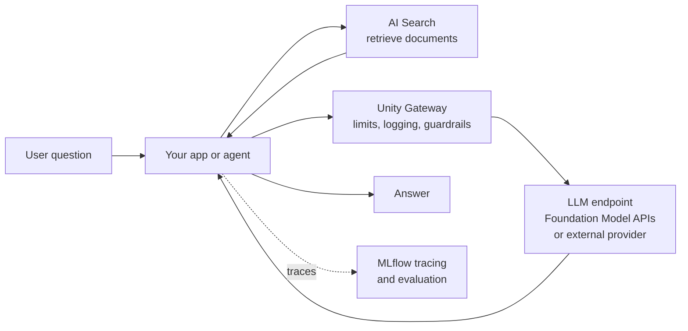

# Generative AI and LLMs

Mastery: `INPUT[inlineSelect(option(new), option(learning), option(solid)):mastery]`

> [!story] Context
> [[Machine Learning Basics]] covered models that predict a number or a category from table columns. Generative models produce new text, code, or images instead. They are trained once on public data at very large scale, so the work for a business shifts from training models to connecting a ready-made model to its own data.

> [!eli5] Summary
> A large language model is a program that has read a huge amount of text and learned to write like a person. It can answer questions, summarize, and draft replies. It does not know anything about your business until you give it your documents and data, and it can sound sure while being wrong, so its answers need checking.

> [!analogy]- Analogy: a well-read temp worker
> | Temp worker | Generative AI |
> |---|---|
> | Has read thousands of books, but not your files | Pre-trained [[LLM]] |
> | The instructions you hand them | [[Prompt]] |
> | The binder of company policies on the desk | Retrieved documents ([[Retrieval-Augmented Generation\|RAG]]) |
> | Confidently making up an answer | [[Hallucination]] |
> | Allowed to use the order system and phone | Tools given to an [[AI Agent]] |
> | Supervisor spot-checking their work | [[Agent Evaluation and Tracing\|Evaluation]] |

## Background

Language models existed for years, but they were small and narrow. In the late 2010s, the transformer architecture (a neural network design for processing text) made it practical to train much larger models on much more text. Scaling those models produced general-purpose assistants that follow instructions in plain language. By 2023, businesses could call such models over an [[APIs|API]] without training anything.

Two problems appeared immediately:

1. **No private knowledge.** A public model does not know a company's return policy, product catalog, or last month's orders.
2. **No guarantees.** A model can produce fluent, wrong answers, leak sensitive data in a prompt, or cost more than expected.

Most of the generative AI (GenAI) tooling on Databricks addresses one of these two problems: connecting models to governed data, and measuring and controlling what they do.

## Overview

Generative AI is AI that produces new content, such as text, code, or images, rather than a single prediction.

A **large language model (LLM)** is a [[Model|model]] trained on very large text collections to predict the next [[Token|token]]. Given a [[Prompt|prompt]], it generates a continuation. That single capability supports chat, summarization, classification, extraction, translation, and code generation.

There are four common ways to put an LLM to work, from simplest to most involved:

| Approach | What you do | On Databricks |
|---|---|---|
| **Prompting** | Write clear instructions and examples | AI Playground, [[Foundation Model APIs]], [[AI Functions in SQL]] (`ai_query`) |
| **Retrieval (RAG)** | Fetch relevant documents and add them to the prompt | [[AI Search]], [[Retrieval-Augmented Generation]] |
| **Agents** | Let the model call tools, such as SQL queries or APIs, in a loop | [[Agent Bricks]], [[Mosaic AI Agent Framework]], [[Genie Agents]] |
| **Fine-tuning** | Further train a model on your own examples | [[Fine-Tuning]] on [[AI Runtime]] |

Databricks guidance is to start with prompting, add retrieval when the model needs knowledge that changes, and fine-tune only when the gap is behavior or output format rather than knowledge.

Databricks also uses LLMs inside the product. [[Genie Agents]] answer business questions by generating SQL. [[Genie Code]] (formerly Databricks Assistant, renamed March 11, 2026) writes and runs code, builds pipelines and dashboards, and debugs errors in notebooks and editors.

## How it works



The minimal case is a direct call. Databricks [[Model Serving|serving endpoints]] accept the OpenAI client format, so standard code works with a workspace URL and an access token:

```python
import os
from openai import OpenAI

client = OpenAI(
    api_key=os.environ["DATABRICKS_TOKEN"],
    base_url="https://<workspace-url>/serving-endpoints",
)

resp = client.chat.completions.create(
    model="<endpoint-name>",  # a pay-per-token endpoint, prefixed databricks-
    messages=[
        {"role": "system", "content": "Classify the email as quote, complaint, or scheduling. Reply with one word."},
        {"role": "user", "content": "Hi, can someone come Tuesday to look at the leaking tap?"},
    ],
)
print(resp.choices[0].message.content)
```

The same call from SQL, over a whole table, uses `ai_query`:

```sql
SELECT email_id,
       ai_query('<endpoint-name>',
                CONCAT('Classify as quote, complaint, or scheduling. One word only: ', body)) AS category
FROM shop.silver.support_emails;
```

## Small-business considerations

> [!smallbiz] Small-business considerations
> - **Good first uses:** sorting incoming email, summarizing reviews, drafting replies from past answers, extracting fields from invoices, and a support assistant over help documents.
> - **Keep a human in the loop** for anything sent to customers until evaluation shows the quality is consistent.
> - **Use hosted models.** Pay-per-token [[Foundation Model APIs]] require no [[GPU|GPUs]] and no training.
> - **Do not paste sensitive data into public chat tools.** Calls through Databricks stay under workspace governance, and [[Unity Gateway]] can log and filter them.
> - **Cost drivers:** LLM usage is metered in input and output tokens. Long prompts and long documents cost more. See [[How Databricks Pricing Works]].

## Cloud differences

> [!azure]- Azure Databricks
> The GenAI tools work the same way. Model availability varies by region, and some models are offered only in specific US or EU regions. Azure OpenAI and Azure AI Foundry models can be reached as external providers through [[Unity Gateway]].

> [!aws]- Databricks on AWS
> Same tools. Amazon Bedrock models can be reached as an external provider through Unity Gateway. Model lists differ by region.

> [!gcp]- Databricks on Google Cloud
> Same tools. Google Gemini models are among the hosted and external options. Model lists differ by region.

## Advanced topics

> [!deepdive]- Advanced topics (301–401)
> - **Context window.** Each model has a maximum number of tokens per request (prompt plus output). RAG must fit retrieved chunks inside it.
> - **Temperature and determinism.** Lower temperature makes output more repeatable, which suits classification and extraction.
> - **Structured outputs.** Databricks serving supports structured outputs, so a model can be constrained to return JSON matching a schema.
> - **Model retirement.** Hosted models are retired on a published schedule. Pin evaluation sets so you can test a replacement model before the retirement date. See [[Foundation Model APIs]].
> - **Compound AI systems.** Production GenAI apps combine retrieval, several model calls, tools, and guardrails. Quality is measured on the whole system with traces, not on the model alone. See [[Agent Evaluation and Tracing]].

## Common misconceptions

> [!confusion] An LLM is not a database
> An LLM does not look facts up. It generates likely text. For facts about your business, retrieve them from tables or documents and give them to the model.

> [!confusion] Fine-tuning is not how you teach a model your documents
> Knowledge that changes, such as policies or inventory, belongs in retrieval. Fine-tuning changes style and behavior.

> [!confusion] Genie and Genie Code are different products
> Genie ([[Genie One]] and [[Genie Agents]]) answers business questions about data. Genie Code, formerly Databricks Assistant, helps people write code inside the workspace.

## Recall

What does an LLM actually predict?::The next token, given the prompt and the text generated so far.
Why does a public LLM not know your return policy?::It was trained on public data; your documents must be supplied at question time.
What is a hallucination?::A fluent, confident answer that is wrong or invented.
In what order does Databricks suggest trying GenAI approaches?::Prompting first, then retrieval (RAG), then fine-tuning only for behavior or format gaps.
Which SQL function calls an LLM over a table?::`ai_query`.
What is Databricks Assistant called since March 2026?::Genie Code.
How is LLM usage metered?::In input and output tokens.

## Next steps

> [!path] Learning path
> **Needs first:** [[Machine Learning Basics]]
> **Unlocks next:** [[Foundation Model APIs]], [[Retrieval-Augmented Generation]], [[Agent Bricks]]

> [!nextup] Next
> [[Feature Engineering and Feature Store]] returns to classic ML and covers how model inputs are defined once and reused for training and serving.

> [!sources]- Sources (last verified: 2026-10-25)
> - [Get started querying LLMs on Databricks (AWS)](https://docs.databricks.com/aws/en/large-language-models/llm-serving-intro)
> - [Query a chat model (AWS)](https://docs.databricks.com/aws/en/machine-learning/model-serving/query-chat-models)
> - [Structured outputs on Databricks (AWS)](https://docs.databricks.com/aws/en/machine-learning/model-serving/structured-outputs)
> - [Chat with LLMs and prototype AI apps using AI Playground (AWS)](https://docs.databricks.com/aws/en/large-language-models/ai-playground)
> - [Transform unstructured data using AI Functions (AWS)](https://docs.databricks.com/aws/en/large-language-models/ai-functions)
> - [Genie Code (AWS)](https://docs.databricks.com/aws/en/genie-code/)
> - [March 2026 release notes (AWS)](https://docs.databricks.com/aws/en/release-notes/product/2026/march)
> - [Genie Agents (Azure Databricks)](https://learn.microsoft.com/en-us/azure/databricks/genie-agents/)
> - [RAG vs fine tuning (Databricks blog)](https://www.databricks.com/blog/rag-vs-fine-tuning)
> - [Query external model providers (Azure Databricks)](https://learn.microsoft.com/en-us/azure/databricks/ai-gateway/query-model-provider-services)
