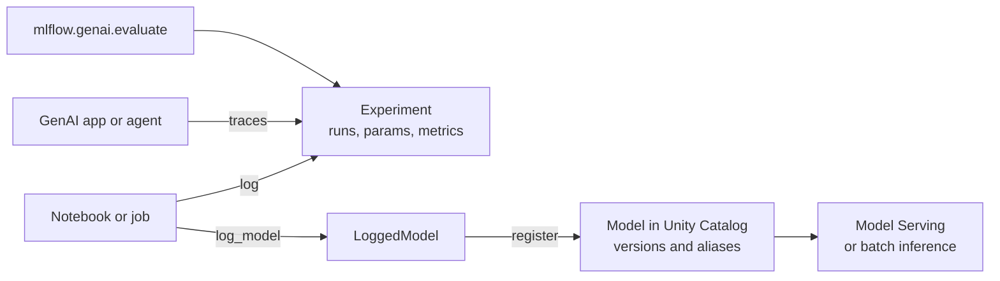

# MLflow

Mastery: `INPUT[inlineSelect(option(new), option(learning), option(solid)):mastery]`

> [!story] Context
> [[Feature Engineering and Feature Store]] gave models consistent inputs. The next problem is the models themselves: which run produced which model, with which settings, and how good it was. MLflow is the record-keeping layer for that work, and in version 3 it also covers GenAI apps and agents.

> [!eli5] Summary
> MLflow is a lab notebook for AI work that fills itself in. Every time someone trains a model or tests an AI assistant, it writes down what they tried, how well it worked, and keeps a copy of the result, so the team can compare attempts and ship the best one.

> [!analogy]- Analogy: a lab notebook plus a sample freezer
> | Lab | MLflow |
> |---|---|
> | Notebook page per experiment | Experiment |
> | One entry per attempt, with settings and results | Run (parameters, metrics) |
> | Labeled sample in the freezer | Logged model (LoggedModel) |
> | Approved sample shelf with version labels | Model registry in [[Models in Unity Catalog\|Unity Catalog]] |
> | Video of each step in a procedure | Trace |
> | Inspector's checklist | Evaluation with scorers and LLM judges |

## Background

Before MLflow, ML teams tracked experiments in spreadsheets and file names such as `model_final_v3_really_final.pkl`. Each library saved models in its own format, so deploying a scikit-learn model and a TensorFlow model needed different code.

Databricks announced MLflow on June 5, 2018 as an open-source alpha with three components: **Tracking** (log runs), **Projects** (package code), and **Models** (a standard model format with "flavors" for each library). In 2020 MLflow joined the [[Linux Foundation]]. MLflow 3 was released in June 2025 (the MLflow release page is dated June 11, 2025). Databricks describes it as redesigned for GenAI, adding tracing, LLM-judge evaluation, and prompt and app versioning.

## Overview

MLflow on Databricks is **managed MLflow**: the tracking server, UI, and storage are built into every workspace, and the model registry is Unity Catalog. Components in MLflow 3:

| Component | What it does | Note |
|---|---|---|
| **Tracking** | Logs runs: parameters, metrics, artifacts | [[Experiment Tracking]] |
| **Models and LoggedModel** | A standard packaging format; in MLflow 3, a `LoggedModel` is a first-class object that links to runs, metrics, traces, and evaluations | This note |
| **Model registry** | Versions and aliases for models; default registry URI in MLflow 3 is `databricks-uc` | [[Models in Unity Catalog]] |
| **Tracing** | Records each step of a GenAI app or agent, with autologging for 20+ frameworks | [[Agent Evaluation and Tracing]] |
| **Evaluation** | `mlflow.genai.evaluate()` runs scorers and LLM judges against a dataset | [[Agent Evaluation and Tracing]] |
| **Prompt registry and app versions** | Version prompts and link traces to an app version | [[Agent Evaluation and Tracing]] |
| **Production monitoring** (Beta) | Runs scorers on a sample of live traces | [[Agent Evaluation and Tracing]] |
| **Deployment** | Logged models deploy to [[Model Serving]] endpoints or batch jobs | [[Model Serving]] |

The MLflow project's 3.0 release page noted that parts of the new GenAI evaluation suite were first available only in managed MLflow on Databricks, with open-source support to follow. Check the current feature matrix before relying on a specific capability outside Databricks.

## How it works



Classic ML: train, log, and register in one run.

```python
import mlflow
from sklearn.ensemble import RandomForestRegressor

mlflow.set_experiment("/Shared/demand-forecast")

with mlflow.start_run(run_name="rf_v1"):
    model = RandomForestRegressor(n_estimators=300).fit(X_train, y_train)
    mlflow.log_param("n_estimators", 300)
    mlflow.log_metric("val_mae", mae(y_val, model.predict(X_val)))
    mlflow.sklearn.log_model(
        model,
        name="model",
        input_example=X_train.head(5),
        registered_model_name="shop.ml.demand_forecast",  # catalog.schema.model
    )
```

GenAI: trace an app and evaluate it.

```python
import mlflow
from mlflow.genai.scorers import RelevanceToQuery, Safety

mlflow.openai.autolog()  # trace every OpenAI-client call

@mlflow.trace
def answer(question: str) -> str:
    ...  # retrieve help docs, call the LLM, return text

eval_data = [{"inputs": {"question": "How long do I have to return a plant?"}}]
mlflow.genai.evaluate(data=eval_data, predict_fn=answer,
                      scorers=[RelevanceToQuery(), Safety()])
```

## Small-business considerations

> [!smallbiz] Small-business considerations
> - **It is already there.** Every Databricks workspace includes managed MLflow. There is nothing to install or host.
> - **Turn on autologging and name experiments.** Use one shared experiment per business problem, such as `/Shared/demand-forecast`.
> - **Register only the models you use.** Keep the registry for models that feed a job or an endpoint.
> - **Cost:** MLflow tracking has no separate charge in the docs reviewed; costs come from compute and from storage of artifacts and traces. Evaluations that use LLM judges consume model tokens. See [[How Databricks Pricing Works]].

## Cloud differences

> [!azure]- Azure Databricks
> No functional differences. Azure Machine Learning can also use an MLflow tracking server; this note covers the one built into Azure Databricks.

> [!aws]- Databricks on AWS
> No differences.

> [!gcp]- Databricks on Google Cloud
> No differences.

## Advanced topics

> [!deepdive]- Advanced topics (301–401)
> - **LoggedModel for app versions.** `mlflow.set_active_model(name=...)` links traces to a named app version; in production, set the `MLFLOW_ACTIVE_MODEL_ID` environment variable instead.
> - **LoggedModel for checkpoints.** Deep learning runs can log multiple checkpoints as LoggedModels and compare their metrics, rather than one model per run.
> - **Migration from MLflow 2.** `mlflow.evaluate` is deprecated for LLMs and AI apps; use `mlflow.genai.evaluate`. Custom models may need a predict function wrapper for parameter mapping.
> - **Registry URI.** MLflow 3 defaults to `databricks-uc`. On older clients, call `mlflow.set_registry_uri("databricks-uc")`. The Workspace Model Registry is legacy.
> - **Trace storage.** Traces can be stored in Unity Catalog; production monitoring of those traces requires a SQL warehouse.

## Common misconceptions

> [!confusion] MLflow is not only for classic ML
> MLflow 3 covers GenAI apps and agents: tracing, LLM judges, prompt versioning, and production monitoring.

> [!confusion] Managed MLflow and open-source MLflow are not identical
> The APIs are the same project, but some GenAI evaluation and human-feedback features shipped first in managed MLflow on Databricks.

> [!confusion] An MLflow experiment is not a single training run
> An experiment groups many runs. Each run is one attempt.

## Recall

When and by whom was MLflow announced?::By Databricks, on June 5, 2018, as an open-source alpha.
What were MLflow's three original components?::Tracking, Projects, and Models.
What does MLflow 3 add for GenAI?::Tracing, LLM-judge evaluation with `mlflow.genai.evaluate`, and prompt and app versioning.
What is the default registry URI in MLflow 3 on Databricks?::`databricks-uc` (Models in Unity Catalog).
What is a LoggedModel?::An MLflow 3 object representing a model or app version, linked to its runs, metrics, traces, and evaluations.
Which function replaces `mlflow.evaluate` for GenAI apps?::`mlflow.genai.evaluate`.
Which foundation hosts the MLflow project?::The Linux Foundation (since 2020).

## Next steps

> [!path] Learning path
> **Needs first:** [[Machine Learning Basics]], [[Python for Data]]
> **Unlocks next:** [[Experiment Tracking]], [[Models in Unity Catalog]], [[Agent Evaluation and Tracing]]

> [!nextup] Next
> [[Experiment Tracking]] covers the first MLflow component in detail: experiments, runs, autologging, and comparing results.

> [!sources]- Sources (last verified: 2026-10-25)
> - [MLflow on Databricks (AWS)](https://docs.databricks.com/aws/en/mlflow/)
> - [Get started with MLflow 3 for models (AWS)](https://docs.databricks.com/aws/en/mlflow/mlflow-3-install)
> - [Track and compare models using MLflow Logged Models (AWS)](https://docs.databricks.com/aws/en/mlflow/logged-model)
> - [Version tracking and LoggedModel (AWS)](https://docs.databricks.com/aws/en/mlflow3/genai/prompt-version-mgmt/version-tracking/version-concepts)
> - [MLflow 3 for GenAI (AWS)](https://docs.databricks.com/aws/en/mlflow3/genai/overview/)
> - [Migrate to MLflow 3 from Agent Evaluation (AWS)](https://docs.databricks.com/aws/en/mlflow3/genai/agent-eval-migration)
> - [Log, load, and register MLflow models (AWS)](https://docs.databricks.com/aws/en/mlflow/models)
> - [Introducing MLflow (Databricks blog, 2018)](https://www.databricks.com/blog/2018/06/05/introducing-mlflow-an-open-source-machine-learning-platform.html)
> - [MLflow joins the Linux Foundation (Databricks blog, 2020)](https://www.databricks.com/blog/2020/06/25/mlflow-joins-the-linux-foundation-to-become-the-open-standard-for-machine-learning-platforms.html)
> - [MLflow 3.0 (Databricks blog)](https://www.databricks.com/blog/mlflow-30-unified-ai-experimentation-observability-and-governance)
> - [MLflow 3 release (mlflow.org)](https://mlflow.org/releases/3/)
