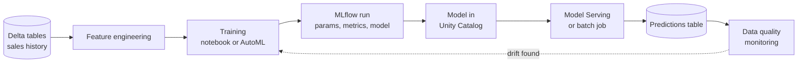

# Machine Learning Basics

Mastery: `INPUT[inlineSelect(option(new), option(learning), option(solid)):mastery]`

> [!story] Context
> [[Chapter 10 - AI and ML|Chapter 10]] starts from the clean, governed tables built in chapters 08 and 09. Those tables describe what already happened. Machine learning uses the same tables to predict what happens next.

> [!eli5] Summary
> Machine learning is a way to build software by showing it many past examples instead of writing every rule by hand. The software finds the pattern in the examples and then uses that pattern to make a good guess about new cases, such as how many loaves a bakery will sell on Saturday.

> [!analogy]- Analogy: a new employee learning from past orders
> | New employee | Machine learning |
> |---|---|
> | Stack of last year's order slips | Training data |
> | Details on each slip (day, weather, holiday) | [[Feature\|Features]] |
> | Quantity actually sold, written on the slip | [[Label]] |
> | Rule of thumb the employee forms | [[Model]] |
> | Guessing next week's order | [[Inference]] (prediction) |
> | Rule of thumb going stale after a new shop opens nearby | [[Drift]] |

## Background

Traditional software follows rules a programmer writes: "if the order total is over 100, apply free shipping". Many business questions have no clean rule. How many bags of potting soil will sell next week? Which customers are about to stop ordering? Which support email is a complaint? The answer depends on many signals at once, and the relationship changes over time.

Statistics and machine learning answer these questions by fitting a model to historical data. Before the lakehouse, this work usually happened on a data scientist's laptop or on a separate ML platform. Data was exported from the warehouse into CSV files, models were trained on a sample, and the result was handed to engineers to rebuild in production. Open-source libraries such as scikit-learn and, for large data, Spark's [[MLlib]] made the algorithms available, but tracking experiments, versioning models, and deploying them stayed manual.

Databricks puts these steps on the same platform as the data, so the tables, the training code, the models, and the predictions share one set of permissions in [[Unity Catalog]].

## Overview

Machine learning (ML) is the practice of training a [[Model|model]] from examples so it can make predictions on new data. The core vocabulary:

| Term | Meaning | Small-business example |
|---|---|---|
| **Feature** | An input the model uses | Day of week, last week's sales, is it a holiday |
| **Label** | The known answer the model learns to predict | Units sold that day |
| **Training** | Fitting the model to labeled examples | Learning from three years of daily sales |
| **Model** | The learned function from features to a prediction | A gradient-boosted tree |
| **Inference** | Using the model on new inputs | Forecasting the next 14 days |
| **Evaluation** | Measuring accuracy on data the model has not seen | Error on the last 8 weeks, held back |
| **Overfitting** | Memorizing training data instead of the pattern | Great on history, wrong on next month |
| **Drift** | New data stops looking like the training data | A new competitor changes buying habits |

Common problem types:

| Type | Predicts | Example |
|---|---|---|
| Regression | A number | Next month's revenue |
| Classification | A category | Will this customer churn (yes or no) |
| Forecasting | A number over future time steps | Daily demand per product for two weeks |
| Clustering | Groups with no labels | Customer segments |
| Generative | New text, images, or code | A reply to a support email (see [[Generative AI and LLMs]]) |

Databricks documents the ML lifecycle as eight stages: scope the use case, explore data, prepare features, train with experiment tracking, evaluate, register the model, deploy, and monitor and retrain. Code, data, and models move through development, staging, and production environments.

## How it works



Each stage maps to a note in this chapter:

1. **Prepare features.** Turn raw tables into model inputs. See [[Feature Engineering and Feature Store]].
2. **Train and track.** Train in a [[Notebooks|notebook]] on [[Databricks Runtime]] for Machine Learning, which preinstalls libraries such as scikit-learn, XGBoost, PyTorch, and [[MLflow]]. Every run is logged. See [[Experiment Tracking]], or let [[AutoML]] run the trials.
3. **Register.** Save the chosen model as a versioned object in Unity Catalog. See [[Models in Unity Catalog]].
4. **Deploy.** Score a table on a schedule with a [[Lakeflow Jobs|job]], or expose a REST endpoint with [[Model Serving]].
5. **Monitor.** Watch input and prediction tables for drift. See [[Data Quality Monitoring]].

### Worked example: a weekly demand forecast

A garden center wants to predict daily units sold per product. A minimal training run in a Databricks notebook:

```python
import mlflow
from sklearn.ensemble import GradientBoostingRegressor
from sklearn.metrics import mean_absolute_error

mlflow.autolog()  # log params, metrics, and the model automatically

df = spark.table("shop.gold.daily_sales_features").toPandas()
features = ["day_of_week", "is_holiday", "avg_temp_c", "units_last_7d"]
train = df[df["sale_date"] < "2026-09-01"]
test = df[df["sale_date"] >= "2026-09-01"]

with mlflow.start_run(run_name="gbr_baseline"):
    model = GradientBoostingRegressor(n_estimators=200, max_depth=3)
    model.fit(train[features], train["units_sold"])
    mae = mean_absolute_error(test["units_sold"], model.predict(test[features]))
    mlflow.log_metric("test_mae", mae)
```

The split by date matters. For forecasting, test data must come after training data, or the evaluation leaks the future into the past.

## Small-business considerations

> [!smallbiz] Small-business considerations
> - **Start with a question that has a cost attached.** Over-ordering perishable stock, missed reorders, or churn are good first targets. "Use AI" is not a use case.
> - **Check the data first.** A forecast needs at least one or two years of clean daily or weekly history to capture seasonality.
> - **Begin with a baseline.** Compare any model with a simple rule, such as "same week last year". If the model does not beat it, do not deploy it.
> - **Use batch predictions.** A nightly job that writes a predictions table is cheaper and simpler than a live endpoint. Most forecasts do not need real-time answers.
> - **Cost drivers** are the compute that trains and scores models. See [[How Databricks Pricing Works]].

## Cloud differences

> [!azure]- Azure Databricks
> The ML workflow is the same on all three clouds. Only the GPU virtual machine families differ (see [[GPU Compute]]). Azure Machine Learning is a separate Microsoft service and is not required to do ML on Azure Databricks.

> [!aws]- Databricks on AWS
> No differences in the ML workflow. GPU instance families are listed in [[GPU Compute]].

> [!gcp]- Databricks on Google Cloud
> No differences in the ML workflow. GPU machine types and regional availability are listed in [[GPU Compute]].

## Advanced topics

> [!deepdive]- Advanced topics (301–401)
> - **Train, validation, and test splits.** Tune on the validation set and report on the test set exactly once. For time series, use rolling or expanding windows.
> - **Leakage.** A feature that would not be known at prediction time (for example, "refund issued" when predicting churn) inflates accuracy. Point-in-time joins in [[Feature Engineering and Feature Store]] prevent it.
> - **Training-serving skew.** Features computed differently in training and in production degrade accuracy. Using the same feature definitions for both is the purpose of a feature store.
> - **Distributed training.** Most tabular models fit on one machine. Spark MLlib, Ray, and distributed PyTorch on [[GPU Compute]] are for data or models that do not.
> - **Choosing a metric.** Mean absolute error is easy to explain for forecasts. For imbalanced classification, such as fraud, accuracy is misleading; use precision, recall, or area under the precision-recall curve.

## Common misconceptions

> [!confusion] Machine learning is not the same as AI chatbots
> Generative AI is one branch of machine learning. Most business value from ML still comes from tabular models such as forecasts, churn scores, and classifiers.

> [!confusion] A more complex model is not automatically better
> Complex models overfit small datasets. A simple model that beats the baseline and is easy to explain is often the right choice.

> [!confusion] A "data model" is not an ML model
> A data model is a table design ([[Data Modeling Basics]]). An ML model is a learned function that makes predictions.

## Recall

What is the difference between a feature and a label?::A feature is an input to the model; the label is the known answer the model learns to predict.
What is inference?::Using a trained model to make predictions on new data.
What is overfitting?::A model that memorizes its training data and performs poorly on new data.
For a forecast, how should you split training and test data?::By time: the test data must come after the training data.
Which Databricks runtime preinstalls scikit-learn, XGBoost, PyTorch, and MLflow?::Databricks Runtime for Machine Learning.
Name the five Databricks steps from data to monitored model.::Prepare features, train and track with MLflow, register in Unity Catalog, deploy (job or Model Serving), and monitor for drift.
Why compare a model with a simple baseline?::If it does not beat a rule such as "same week last year", it is not worth deploying.

## Next steps

> [!path] Learning path
> **Needs first:** [[What Is Data]], [[Python for Data]], [[Delta Lake]]
> **Unlocks next:** [[Generative AI and LLMs]], [[Feature Engineering and Feature Store]], [[MLflow]]

> [!nextup] Next
> [[Generative AI and LLMs]] covers the branch of machine learning that generates text and code, and why it needs your business data to be useful.

> [!sources]- Sources (last verified: 2026-10-25)
> - [Machine learning on Databricks (AWS)](https://docs.databricks.com/aws/en/machine-learning)
> - [Machine learning lifecycle (AWS)](https://docs.databricks.com/aws/en/machine-learning/concepts/ml-lifecycle)
> - [Concepts: Data science and machine learning on Databricks (AWS)](https://docs.databricks.com/aws/en/machine-learning/concepts/)
> - [Machine learning on Azure Databricks](https://learn.microsoft.com/en-us/azure/databricks/machine-learning/)
> - [Databricks Runtime for Machine Learning (AWS)](https://docs.databricks.com/aws/en/machine-learning/databricks-runtime-ml)
> - [Databricks Autologging (AWS)](https://docs.databricks.com/aws/en/mlflow/databricks-autologging)
