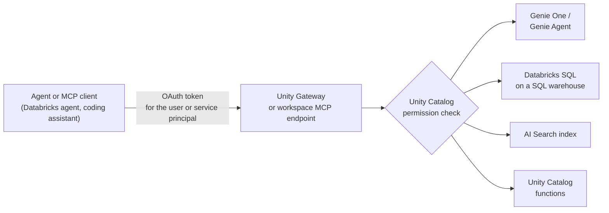

# Managed MCP Servers

Mastery: `INPUT[inlineSelect(option(new), option(learning), option(solid)):mastery]`

> [!story] Context
> [[MosaicML and Open Models]] covered where Databricks' models come from. A model alone can only produce text. To answer questions about company data or take actions, an [[AI Agent|agent]] needs tools. Managed MCP servers are Databricks-hosted tool endpoints that any agent can call through the [[Model Context Protocol]], with [[Unity Catalog]] permissions enforced.

> [!eli5] Summary
> An AI assistant is more useful when it can look things up in your company's data. Managed MCP servers are ready-made connection points, run by Databricks, that let assistants search your documents, ask questions of your tables, or run approved functions. The assistant can only see what the person using it is allowed to see.

## Background

The [[Model Context Protocol]] (MCP) is an open protocol for connecting LLM applications to external tools and data. Its specification defines three roles (hosts, clients, and servers) and uses JSON-RPC 2.0. A server offers **tools** (functions a model can call), **resources** (read-only context such as files or schemas), and **prompts** (templates).

Before managed servers, a team that wanted an agent to query Databricks had to write and host its own MCP server, store credentials for it, and reimplement access control. Each team's server was different, and permissions were enforced in custom code instead of by Unity Catalog.

Databricks now hosts MCP servers for its own services. Agents built on Databricks, and external clients such as AI coding assistants, connect to a URL and receive tools whose access is checked against the caller's identity.

## Overview

Databricks provides these managed servers. Replace `<workspace-hostname>` with your workspace URL.

| Server | What its tools do | Endpoint | OAuth scope |
|---|---|---|---|
| **Genie One** (`system.ai.genie_one_mcp`) | Natural-language questions over governed data, through [[Genie One]] | `/ai-gateway/mcp-services/system.ai.genie_one_mcp` | `ai-gateway` |
| **Genie Agent** (one space) | Questions against one [[Genie Agents\|Genie Agent]]; read-only | `/api/2.0/mcp/genie/{genie_space_id}` | `genie` |
| **Databricks SQL** (`system.ai.dbsql`) | Runs AI-generated SQL against Unity Catalog tables on a [[SQL Warehouses\|SQL warehouse]] | Recommended: the `system.ai.dbsql` MCP through [[Unity Gateway]]. Legacy: `/api/2.0/mcp/sql` | `sql` (legacy endpoint) |
| **AI Search** | Similarity search over an [[AI Search]] index | `/api/2.0/mcp/ai-search/{catalog}/{schema}/{index_name}` (the older `/vector-search/` prefix still works) | `ai-search` |
| **Unity Catalog functions** | Runs [[Unity Catalog Functions\|Unity Catalog functions]] as tools, including the built-ins in `system.ai` | `/api/2.0/mcp/functions/{catalog}/{schema}/{function_name}` | `unity-catalog` |

### Status (checked October 2026)

| Item | Status |
|---|---|
| Managed MCP servers (overall) | Public Preview |
| Genie One MCP (`system.ai.genie_one_mcp`) | Generally available |
| Legacy Genie endpoint `/api/2.0/mcp/genie` (without a space ID) | Deprecated; sunset on October 31, 2026 |
| MCP Services for external servers | Beta, requires the Unity Gateway beta |

Status labels differ between doc pages. Check the page for the specific server before you build on it.

### Two access paths

| | Legacy workspace endpoints (`/api/2.0/mcp/...`) | Unity Gateway MCPs (`system.ai.*`, MCP Services) |
|---|---|---|
| Enablement | A workspace admin enables **Managed MCP Servers** on the workspace **Previews** page | An account admin enables the Unity Gateway beta on the account console **Previews** page |
| Access control | Permissions on the underlying resources (tables, functions, indexes, warehouses, Genie spaces) | `EXECUTE` on the MCP securable, plus `USE CATALOG` and `USE SCHEMA` on its parents, plus the underlying resource permissions |
| Tracing and policies | Not recorded in Unity Gateway tracing tables; no MCP-level grants, policies, or guardrails | Recorded by Unity Gateway; supports MCP-level grants, policies, and guardrails |

Databricks recommends the `system.ai` MCPs for new Genie One and Databricks SQL connections.

## How it works



1. The client connects to the server URL and authenticates with OAuth as a user or [[Users Groups and Service Principals|service principal]].
2. The client calls `list_tools` to discover the tools and their input schemas.
3. The model chooses a tool and the client calls it with arguments.
4. Databricks checks Unity Catalog permissions for the caller, runs the operation on the matching compute, and returns the result.

### Example: list tools from Python

```python
# %pip install databricks-mcp databricks-sdk
from databricks.sdk import WorkspaceClient
from databricks_mcp import DatabricksMCPClient

w = WorkspaceClient()  # uses your configured Databricks authentication
server_url = f"{w.config.host}/api/2.0/mcp/functions/system/ai/python_exec"

client = DatabricksMCPClient(server_url=server_url, workspace_client=w)
for tool in client.list_tools():
    print(tool.name, ":", tool.description)
```

`DatabricksMCPClient().get_databricks_resources(server_url)` returns the Databricks resources a server depends on, which you declare when you deploy an agent so it receives the right credentials.

### Databricks SQL server behavior

- **Writes:** Writes are allowed by default. To make the server read-only, set `disallow_writes` in the `system.ai.dbsql_policy` policy.
- **Asynchronous:** Queries run asynchronously, so the agent polls until a statement finishes.
- **Warehouse selection:** The `_meta` parameter `warehouse_id` selects a warehouse. If omitted, Databricks selects one based on resources and permissions.
- **Limits:** The server has no semantic context about your business and truncates large result sets. For natural-language analytics, Databricks points to Genie One instead.

### External and custom servers

- **Third-party servers:** Register a self-hosted or third-party server that supports Streamable HTTP as an **MCP Service**, a Unity Catalog securable named `catalog.schema.service`. It points to a Unity Catalog HTTP connection that stores the URL and credentials (bearer token, OAuth M2M, OAuth U2M, or Dynamic Client Registration).
- **Custom servers on Databricks Apps:** You can host your own MCP server on [[Databricks Apps]]. Registering an app-hosted server as an MCP Service is not supported; agents connect to the app directly.

## Small-business considerations

> [!smallbiz] Small-business considerations
> Managed MCP servers matter when you want an AI assistant, such as a coding assistant or a custom chatbot, to answer questions from your Databricks data without building integration code.
>
> - **When to care:** You already use Genie or Unity Catalog and want the same governed answers inside another AI tool.
> - **When to skip:** If nobody on the team builds agents, start with [[Genie One]] in the browser. It needs no MCP setup.
> - **Safety first:** Connect assistants as a user or service principal with [[Least Privilege|least privilege]], and make the Databricks SQL server read-only unless writes are required.
> - **Cost:** There is no separate MCP charge. Each server bills the compute behind it: Unity Catalog functions use serverless general compute, Genie uses serverless SQL compute, and the Databricks SQL server uses Databricks SQL pricing. See [[How Databricks Pricing Works]] and the [Databricks pricing page](https://www.databricks.com/product/pricing).

## Cloud differences

The servers, URL patterns, and permission model are the same on all clouds. Availability can lag by cloud and region.

> [!azure]- Azure Databricks
> Azure Databricks documents the same servers ("Azure Databricks managed MCP servers") in Public Preview. Users, groups, and service principals that call the servers typically come from Microsoft Entra ID. See [[Microsoft Entra ID Integration]].

> [!aws]- Databricks on AWS
> The AWS docs are the reference set for managed MCP and Unity Gateway MCP Services. Confirm availability for your region on the feature region support page.

> [!gcp]- Databricks on Google Cloud
> The GCP docs include the Databricks SQL MCP server and the guide "Connect MCPs to AI assistants and coding agents". Confirm availability for your region before relying on a specific server.

## Advanced topics

> [!deepdive]- Advanced topics (301–401)
> - **Identity propagation:** With on-behalf-of-user authentication, the tool runs with the end user's permissions, so two users asking the same agent can get different answers. With a service principal, everyone shares that principal's access. Choose deliberately.
> - **`USE CONNECTION` is not for end users:** For MCP Services, grant end users `EXECUTE` on the service only. `USE CONNECTION` lets the holder use the underlying HTTP connection directly, bypassing the service's tool selection and policies.
> - **Guardrails:** Unity Gateway MCPs support policies and guardrails at the MCP level. Jailbreak screening for MCP tool calls is in Beta (see [[Unity Gateway]]).
> - **Protocol versions:** The MCP specification is versioned by date (2024-11-05, 2025-06-18, 2026-07-28). The 2026-07-28 revision moves the protocol to a stateless request/response core and deprecates sampling. Check which revision your client library implements.
> - **Tool descriptions are untrusted input:** The MCP specification says clients must treat tool annotations as untrusted unless they come from trusted servers. Register only servers you control or have reviewed.
> - **Migration from the deprecated Genie endpoint:** Move clients from `/api/2.0/mcp/genie` to `system.ai.genie_one_mcp` before October 31, 2026.

## Common misconceptions

> [!confusion] MCP is not a Databricks product
> MCP is an open protocol. Managed MCP servers are Databricks' implementation of MCP servers for its own services. Any MCP-compatible client can use them.

> [!confusion] An MCP server does not grant access by itself
> The server enforces the permissions of whoever calls it. An agent cannot read a table through MCP that its identity cannot read in SQL.

> [!confusion] Legacy endpoints and Unity Gateway MCPs are not equivalent
> Legacy `/api/2.0/mcp/...` endpoints bypass Unity Gateway, so their calls are not traced there and MCP-level policies do not apply.

## Recall

What is a managed MCP server on Databricks?::A Databricks-hosted Model Context Protocol server that exposes Genie, Databricks SQL, AI Search, or Unity Catalog functions as tools, with Unity Catalog permissions enforced.
Which three kinds of features can an MCP server offer?::Tools, resources, and prompts.
What is the URL pattern for the Unity Catalog functions MCP server?::`https://<workspace-hostname>/api/2.0/mcp/functions/{catalog}/{schema}/{function_name}`.
Which Genie MCP endpoint is deprecated, and when is it sunset?::`/api/2.0/mcp/genie` (without a space ID); sunset October 31, 2026.
How do you make the Databricks SQL MCP server read-only?::Set `disallow_writes` in the `system.ai.dbsql_policy` policy.
What privileges does a caller need on a Unity Gateway MCP?::`EXECUTE` on the MCP, plus `USE CATALOG` and `USE SCHEMA` on its parents.
Why should end users not receive `USE CONNECTION` on an MCP Service's connection?::It lets them use the connection directly, bypassing the service's tool selection and policies.
Which transport must an external MCP server support to be registered as an MCP Service?::Streamable HTTP.
Which Python class lists tools on a Databricks MCP server?::`DatabricksMCPClient` from the `databricks_mcp` package.

## Next steps

> [!path] Learning path
> **Needs first:** [[Model Context Protocol]], [[AI Agent]], [[Unity Catalog Functions]], [[Unity Gateway]]
> **Unlocks next:** [[Agent Bricks]], [[Mosaic AI Agent Framework]]

> [!nextup] Next
> [[AI Playground]] is the no-code place to try models and tools before you wire them into an agent.

> [!sources]- Sources (last verified: 2026-10-25)
> - [Databricks managed MCP servers (AWS)](https://docs.databricks.com/aws/en/agents/mcp-tools/managed-mcp)
> - [Databricks-provided MCPs (AWS)](https://docs.databricks.com/aws/en/generative-ai/mcp/managed-mcp)
> - [Azure Databricks managed MCP servers](https://learn.microsoft.com/en-us/azure/databricks/agents/mcp-tools/managed-mcp)
> - [Databricks-provided MCPs (Azure Databricks)](https://learn.microsoft.com/en-us/azure/databricks/generative-ai/mcp/managed-mcp)
> - [MCPs (AWS)](https://docs.databricks.com/aws/en/agents/mcp-tools)
> - [Genie One MCP server (AWS)](https://docs.databricks.com/aws/en/agents/mcp-tools/genie-mcp)
> - [Genie Agent MCP server (AWS)](https://docs.databricks.com/aws/en/agents/mcp-tools/genie-agent)
> - [Databricks SQL MCP server (AWS)](https://docs.databricks.com/aws/en/agents/mcp-tools/databricks-sql)
> - [Databricks SQL MCP server (Azure Databricks)](https://learn.microsoft.com/en-us/azure/databricks/agents/mcp-tools/databricks-sql)
> - [Databricks SQL MCP server (GCP)](https://docs.databricks.com/gcp/en/agents/mcp-tools/databricks-sql)
> - [Meta parameters for managed MCP servers (Azure Databricks)](https://learn.microsoft.com/en-us/azure/databricks/agents/mcp/managed-mcp-meta-param)
> - [Use MCP servers in Custom Agents (AWS)](https://docs.databricks.com/aws/en/agents/mcp-tools/use-mcp-in-agents)
> - [External MCP servers (AWS)](https://docs.databricks.com/aws/en/ai-gateway/register-mcp-service)
> - [Connect agents to tools with MCP Services (AWS)](https://docs.databricks.com/aws/en/agents/mcp-tools/mcp-services)
> - [Connect MCPs to AI assistants and coding agents (GCP)](https://docs.databricks.com/gcp/en/generative-ai/mcp/connect-external-services)
> - [October 2025 release notes (GCP)](https://docs.databricks.com/gcp/en/release-notes/product/2025/october)
> - [Model Context Protocol specification, 2025-06-18](https://modelcontextprotocol.io/specification/2025-06-18)
> - [MCP tools specification, 2025-06-18](https://modelcontextprotocol.io/specification/2025-06-18/server/tools)
> - [The 2026-07-28 Specification (MCP blog)](https://blog.modelcontextprotocol.io/posts/2026-07-28/)
