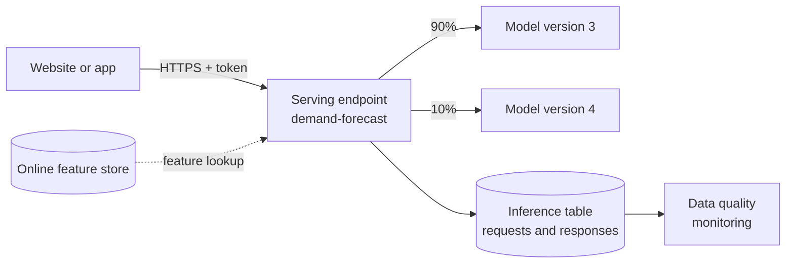

# Model Serving

Mastery: `INPUT[inlineSelect(option(new), option(learning), option(solid)):mastery]`

> [!story] Context
> [[AutoML]] and [[Models in Unity Catalog]] produced a registered model with a `Champion` alias. A nightly job can score a table with it, but a website or app that needs an answer within a second needs the model running behind an API. Model Serving provides that endpoint.

> [!eli5] Summary
> Model Serving puts a trained model behind a web address. An app sends a question, such as "how many of this product will we sell next week?", and gets the model's answer back in a fraction of a second. Databricks runs the servers and adds more when traffic grows.

> [!analogy]- Analogy: a takeout window
> | Takeout window | Model Serving |
> |---|---|
> | Window with a street address | Endpoint URL |
> | Kitchen staff on shift | Provisioned concurrency |
> | Calling in more cooks at rush hour | Autoscaling |
> | Closing the window when nobody comes | Scale to zero |
> | Order slips kept for review | Inference tables |
> | Two kitchens splitting orders | Traffic split between model versions |

## Background

Deploying a model used to mean packaging it in a container, provisioning servers or a [[Kubernetes]] cluster, writing an API wrapper, setting up autoscaling, and wiring in authentication and logging. Each step was separate engineering work, and the deployed model often drifted from the one data scientists had tested.

Databricks Model Serving deploys a model directly from Unity Catalog onto [[Serverless Compute|serverless]] infrastructure managed by Databricks, with authentication and logging built in.

## Overview

Model Serving exposes models as [[REST]] endpoints. Endpoint types:

| Endpoint type | Serves | Note |
|---|---|---|
| **Custom model endpoints** | Your MLflow models from Unity Catalog (scikit-learn, XGBoost, PyTorch, custom Python) on CPU or GPU | This note |
| **Foundation Model API endpoints** | Databricks-hosted LLMs and embedding models | [[Foundation Model APIs]] |
| **External model endpoints** (legacy) | Proxies to providers such as OpenAI; now handled by model provider services in Unity Gateway | [[AI Gateway]] |
| **Feature Serving endpoints** | Feature values without a model | [[Feature Engineering and Feature Store]] |
| **Agent endpoints** (legacy for new agents) | Agents deployed to Model Serving | [[Mosaic AI Agent Framework]] |

Core settings for a custom model endpoint:

| Setting | Values |
|---|---|
| **Workload type** | CPU, or GPU types where available |
| **Workload size** | `Small` (4 provisioned concurrency), `Medium` (8 to 16), `Large` (16 to 64) |
| **Scale to zero** | Lowers the minimum concurrency to 0; not recommended for production |
| **Served entities** | One or more model versions, with a traffic split percentage |
| **Route optimization** | A more direct network path for high-QPS endpoints; requires OAuth tokens |

Databricks suggests sizing concurrency at roughly requests per second multiplied by model run time.

## How it works



Create an endpoint with the Databricks SDK for Python:

```python
from databricks.sdk import WorkspaceClient
from databricks.sdk.service.serving import EndpointCoreConfigInput, ServedEntityInput

w = WorkspaceClient()

w.serving_endpoints.create_and_wait(
    name="demand-forecast",
    config=EndpointCoreConfigInput(
        served_entities=[
            ServedEntityInput(
                entity_name="shop.ml.demand_forecast",  # model in Unity Catalog
                entity_version="3",
                workload_size="Small",
                scale_to_zero_enabled=True,             # fine for dev, not for production
            )
        ]
    ),
)
```

Query it:

```python
resp = w.serving_endpoints.query(
    name="demand-forecast",
    dataframe_records=[{"sku": "SOIL-20L", "day_of_week": 6, "is_holiday": 0, "units_last_7d": 41}],
)
print(resp.predictions)
```

Any HTTP client works too. The endpoint URL is `https://<workspace-url>/serving-endpoints/demand-forecast/invocations`, and the request carries a bearer token. Databricks recommends machine-to-machine [[OAuth]] tokens for production.

## Small-business considerations

> [!smallbiz] Small-business considerations
> - **Ask whether you need real time.** If predictions are used once a day, a batch job that writes a table is simpler and cheaper. Use an endpoint when an app or website needs an answer per request.
> - **Use scale to zero for internal tools** with occasional traffic, and accept a cold start delay on the first request.
> - **Start with `Small` CPU.** Most tabular models do not need GPUs.
> - **Cost drivers:** endpoints bill for provisioned concurrency over time, so an endpoint that never scales to zero bills continuously. See [[How Databricks Pricing Works]] and the official pricing page.

## Cloud differences

> [!azure]- Azure Databricks
> Same features. GPU workload types and route optimization availability vary by Azure region; check the regional availability table.

> [!aws]- Databricks on AWS
> Same features. GPU availability varies by AWS region. Unity Gateway, which provides the newer inference tables and governance, is not supported on AWS GovCloud; see [[Databricks on AWS GovCloud]].

> [!gcp]- Databricks on Google Cloud
> Same features, with region-dependent GPU availability. Check the Google Cloud regional availability page before planning GPU endpoints.

## Advanced topics

> [!deepdive]- Advanced topics (301–401)
> - **Traffic splitting.** Serve several versions on one endpoint and shift the percentage to run an A/B test or a gradual rollout.
> - **Inference tables.** Unity Gateway-enabled inference tables log requests and responses to Delta tables and are recommended for new custom model endpoints. They feed [[Data Quality Monitoring|inference profiles]].
> - **Custom LLMs on GPU.** Custom LLM endpoints do not autoscale dynamically, so size `workload_size` for peak traffic. `GPU_XLARGE` (1x H100) endpoints do not support scale to zero. For large LLMs, Databricks recommends [[Foundation Model APIs]] over custom GPU serving.
> - **Secrets and resources.** Endpoints can read secrets as environment variables to call external services.
> - **Route optimization.** Available only for custom model and Feature Serving endpoints, not Foundation Model APIs or external models. Personal access tokens are not supported on route-optimized endpoints.

## Common misconceptions

> [!confusion] Model Serving is not batch inference
> Endpoints answer one request at a time. To score a whole table, use a job, or `ai_query` in SQL against an endpoint ([[AI Functions in SQL]]).

> [!confusion] Scale to zero is not free capacity
> When an endpoint is at zero, the first request waits for a cold start, and capacity is not guaranteed.

## Recall

What does Model Serving do?::Exposes a model as an autoscaling REST endpoint on Databricks-managed serverless compute.
What are the three workload sizes and their provisioned concurrency?::Small (4), Medium (8 to 16), Large (16 to 64).
Why is scale to zero not recommended for production?::Capacity is not guaranteed and the first request after idle has a cold start delay.
How do you test a new model version on part of the traffic?::Serve both versions on one endpoint with a traffic split.
What logs every request and response to a Delta table?::Inference tables.
Which authentication does route optimization require?::OAuth tokens; personal access tokens are not supported.
How can SQL users score a table against an endpoint?::With the `ai_query` function.

## Next steps

> [!path] Learning path
> **Needs first:** [[Models in Unity Catalog]], [[APIs]]
> **Unlocks next:** [[Foundation Model APIs]], [[AI Gateway]], [[Data Quality Monitoring]]

> [!nextup] Next
> [[Foundation Model APIs]] uses the same serving infrastructure to host large language models that Databricks runs for you.

> [!sources]- Sources (last verified: 2026-10-25)
> - [Create custom model serving endpoints (AWS)](https://docs.databricks.com/aws/en/machine-learning/model-serving/create-manage-serving-endpoints)
> - [Create custom model serving endpoints (Azure Databricks)](https://learn.microsoft.com/en-us/azure/databricks/machine-learning/model-serving/create-manage-serving-endpoints)
> - [Create custom model serving endpoints (GCP)](https://docs.databricks.com/gcp/en/machine-learning/model-serving/create-manage-serving-endpoints)
> - [Tutorial: Deploy and query a custom model (AWS)](https://docs.databricks.com/aws/en/machine-learning/model-serving/model-serving-intro)
> - [Serving endpoint API reference](https://docs.databricks.com/api/model-serving/v1/serving-endpoint)
> - [Serve custom LLMs with Custom Model Serving (AWS)](https://docs.databricks.com/aws/en/machine-learning/model-serving/serve-custom-llms)
> - [Route optimization on serving endpoints (AWS)](https://docs.databricks.com/aws/en/machine-learning/model-serving/route-optimization)
> - [Optimize Model Serving endpoints for production (AWS)](https://docs.databricks.com/aws/en/machine-learning/model-serving/production-optimization)
> - [Configure access to resources from model serving endpoints (AWS)](https://docs.databricks.com/aws/en/machine-learning/model-serving/store-env-variable-model-serving)
> - [Serve multiple models to a model serving endpoint (AWS)](https://docs.databricks.com/aws/en/machine-learning/model-serving/serve-multiple-models-to-serving-endpoint)
> - [Monitor served models using inference tables (Azure Databricks)](https://learn.microsoft.com/en-us/azure/databricks/ai-gateway/inference-tables-serving-endpoints)
