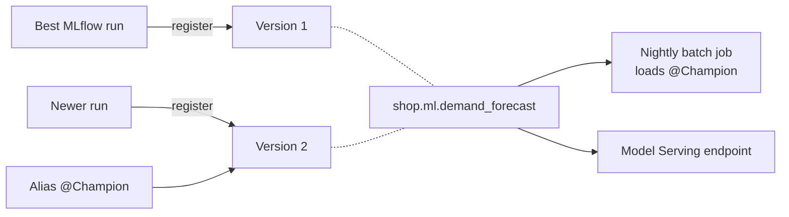

# Models in Unity Catalog

Mastery: `INPUT[inlineSelect(option(new), option(learning), option(solid)):mastery]`

> [!story] Context
> [[Experiment Tracking]] found the best training run. The model from that run now needs a stable name, a version history, and permissions, so that jobs and endpoints can use it and a newer version can replace it safely.

> [!eli5] Summary
> Models in Unity Catalog is the company's official shelf for trained models. Each model has a name, every new version is kept, and a sticky label such as "Champion" points at the version currently in use. Moving the label switches production to a new model without changing any code.

> [!analogy]- Analogy: a product catalog with shelf labels
> | Store | Models in Unity Catalog |
> |---|---|
> | Product in the catalog | Registered model (`shop.ml.demand_forecast`) |
> | Each new batch with a lot number | Model version (1, 2, 3...) |
> | "Featured" sign you move to a new batch | Alias (`@Champion`) |
> | Staff-only aisle | `EXECUTE` privilege |
> | Supplier record for each batch | Lineage to the run and source data |

## Background

MLflow originally had a **Workspace Model Registry** with four fixed stages: None, Staging, Production, and Archived. It lived inside one workspace, so sharing a model between development and production workspaces meant copying it, and its permissions were separate from data permissions.

Models in Unity Catalog moves the registry to the account-level governance layer. A model is a securable object like a table, named with the [[Three-Level Namespace|three-level namespace]] and governed by the same grants. The Workspace Model Registry is now legacy, and in MLflow 3 the default registry URI is `databricks-uc`.

## Overview

| Capability | What it means |
|---|---|
| **Three-level names** | `catalog.schema.model`, for example `prod.ml.demand_forecast` |
| **Versions** | Each registration creates a new numbered, immutable version |
| **Aliases** | Movable named pointers to a version, such as `Champion` or `Challenger`; up to 10 per model |
| **Permissions** | `EXECUTE` to load or serve, plus `USE CATALOG` and `USE SCHEMA` on the containers |
| **Lineage** | Links from a model version to the run, notebook, and upstream tables or features |
| **Cross-workspace access** | Any workspace attached to the same metastore can load the model, subject to grants |
| **Tags and descriptions** | Metadata for search and documentation |

Aliases replace stages. Instead of four fixed stages, you choose your own names and reassign them.

## How it works



Register, alias, and load:

```python
import mlflow
from mlflow import MlflowClient

mlflow.set_registry_uri("databricks-uc")  # default in MLflow 3; needed on older clients

# 1. Register the model from a run
mv = mlflow.register_model(f"runs:/{run_id}/model", "shop.ml.demand_forecast")

# 2. Point the Champion alias at the new version
client = MlflowClient()
client.set_registered_model_alias("shop.ml.demand_forecast", "Champion", mv.version)

# 3. Any job loads by alias, not by version number
model = mlflow.pyfunc.load_model("models:/shop.ml.demand_forecast@Champion")
```

Grant access in SQL:

```sql
GRANT USE CATALOG ON CATALOG shop    TO `forecast-jobs`;
GRANT USE SCHEMA  ON SCHEMA  shop.ml TO `forecast-jobs`;
GRANT EXECUTE     ON MODEL   shop.ml.demand_forecast TO `forecast-jobs`;
```

A batch job that loads `@Champion` picks up the new version on its next run after the alias moves. Rolling back is moving the alias back.

## Small-business considerations

> [!smallbiz] Small-business considerations
> - **Use two aliases:** `Champion` for production and `Challenger` for the candidate being tested. Promote by moving `Champion`.
> - **Keep models next to their data:** For example, put `shop.ml.*` in the same catalog as the gold tables they read.
> - **Grant to a service principal** that runs jobs, not to individual people. See [[Users Groups and Service Principals]].
> - **Cost:** the registry has no separate charge in the docs reviewed. Model files are stored in Unity Catalog managed storage.

## Cloud differences

> [!azure]- Azure Databricks
> No differences. Model files are stored in the catalog's managed storage in ADLS.

> [!aws]- Databricks on AWS
> No differences. Model files are stored in the catalog's managed storage in S3.

> [!gcp]- Databricks on Google Cloud
> No differences. Model files are stored in the catalog's managed storage in GCS.

## Advanced topics

> [!deepdive]- Advanced topics (301–401)
> - **Environment separation:** A common pattern is one catalog per environment (`dev`, `prod`). A CI/CD pipeline copies an approved version from `dev.ml.model` to `prod.ml.model` after tests pass. See [[CI-CD]].
> - **Loading by version:** `models:/prod.ml.demand_forecast/3` pins one version, which is useful for reproducible backtests.
> - **Signatures required:** Models in Unity Catalog require a model signature; pass `input_example` or a signature when logging.
> - **Migration:** Databricks documents how to migrate models and workflows from the Workspace Model Registry to Unity Catalog, mapping stages to aliases.
> - **GenAI apps and agents** can also be registered as models, and their versions linked to traces through LoggedModel. See [[Agent Evaluation and Tracing]].

## Common misconceptions

> [!confusion] An alias is not a copy
> An alias is a pointer to one version. Moving it does not copy files.

> [!confusion] Stages still exist only in the legacy registry
> Staging and Production stages belong to the Workspace Model Registry. In Unity Catalog, use aliases.

## Recall

What is the full name format for a model in Unity Catalog?::`catalog.schema.model`, for example `prod.ml.demand_forecast`.
What is a model alias?::A movable named pointer to one model version, such as `@Champion`.
How many aliases can a model have?::Up to 10.
What URI loads the Champion version?::`models:/catalog.schema.model@Champion`.
Which privilege is needed on the model to load it?::`EXECUTE`, plus `USE CATALOG` and `USE SCHEMA` on its containers.
What replaced the stages of the Workspace Model Registry?::Aliases in Unity Catalog.
What is the default registry URI in MLflow 3 on Databricks?::`databricks-uc`.

## Next steps

> [!path] Learning path
> **Needs first:** [[Unity Catalog]], [[Experiment Tracking]]
> **Unlocks next:** [[Model Serving]], [[Data Quality Monitoring]]

> [!nextup] Next
> [[AutoML]] shows how Databricks can run the training trials for you and produce a baseline model and notebook.

> [!sources]- Sources (last verified: 2026-10-25)
> - [Manage model lifecycle in Unity Catalog (AWS)](https://docs.databricks.com/aws/en/machine-learning/manage-model-lifecycle)
> - [Manage model lifecycle in Unity Catalog (Azure Databricks)](https://learn.microsoft.com/en-us/azure/databricks/machine-learning/manage-model-lifecycle/)
> - [Workspace Model Registry (legacy) (AWS)](https://docs.databricks.com/aws/en/machine-learning/manage-model-lifecycle/workspace-model-registry)
> - [Migrate workflows and models to Unity Catalog (AWS)](https://docs.databricks.com/aws/en/machine-learning/manage-model-lifecycle/migrate-to-uc)
> - [Log, load, and register MLflow models (AWS)](https://docs.databricks.com/aws/en/mlflow/models)
> - [Model alias API (Databricks REST API)](https://docs.databricks.com/api/uc-registered-models/v1/model-alias)
