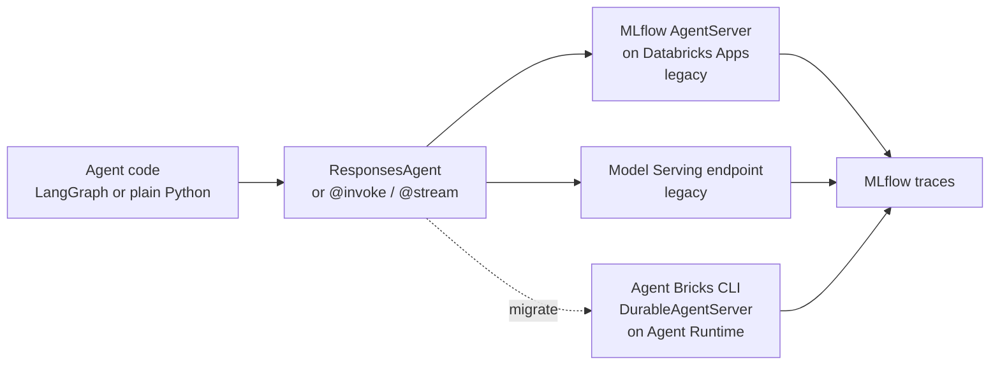

# Mosaic AI Agent Framework

Mastery: `INPUT[inlineSelect(option(new), option(learning), option(solid)):mastery]`

> [!story] Context
> [[Agent Bricks]] is the current code-first agent platform. Many agents in production were built before it with the Mosaic AI Agent Framework: an MLflow `ResponsesAgent` interface, served by the MLflow AgentServer on Databricks Apps or deployed to Model Serving. This note explains that tooling, because existing code and many examples still use it.

> [!eli5] Summary
> The Agent Framework was the earlier toolkit for programmers who build AI helpers on Databricks. It gave their code a standard shape so Databricks could log, test, and host it. Databricks now recommends a newer tool, the Agent Bricks CLI, for new helpers, but agents built the old way keep working.

> [!renamed] Status: legacy for new agents
> As of the October 2026 release notes, the Agent Bricks documentation focuses on code-first development, and the **MLflow AgentServer**, **LongRunningAgentServer**, and **agents deployed to Model Serving** are in a **Legacy** section that maps each one to its replacement. For new code agents, Databricks recommends the **Agent Bricks CLI**, which deploys to **Agent Runtime** with `DurableAgentServer`. The current docs title the Apps-based pattern "the legacy agent server". The "Mosaic AI" product prefix appears less often in current docs.

> [!analogy]- Analogy: a standard shipping container
> | Shipping | Agent Framework |
> |---|---|
> | Any cargo inside | Any framework: LangGraph, OpenAI Agents SDK, plain Python |
> | Standard container dimensions | The `ResponsesAgent` interface |
> | Port crane that handles any standard container | MLflow logging, tracing, evaluation, and serving |
> | Older port (still operating) | Model Serving deployment |
> | Newer terminal | Agent Runtime via the Agent Bricks CLI |

## Background

Agent frameworks such as LangChain, LangGraph, and LlamaIndex each define their own way to write an agent. To log, evaluate, and serve agents from any of them, Databricks standardized on an MLflow model interface. Agents were first deployed to Model Serving endpoints; later the recommended target became [[Databricks Apps]], using an MLflow-provided agent server. In 2026 Databricks introduced the Agent Bricks CLI and Agent Runtime and moved the earlier paths to legacy.

## Overview

| Component | What it is | Status (October 2026) |
|---|---|---|
| **`ResponsesAgent`** | MLflow interface that wraps an agent from any framework and provides logging, tracing, evaluation, and monitoring | Documented; used by the legacy agent server |
| **MLflow AgentServer on Databricks Apps** | An async FastAPI server that serves the `/responses` endpoint, with built-in tracing; agents use functions decorated with `@invoke()` and `@stream()` | Legacy |
| **LongRunningAgentServer** | Server for long-running agent tasks | Legacy |
| **Agents on Model Serving** | Class-based `predict()` agents logged with MLflow and deployed to a serving endpoint | Legacy; a migration guide moves them to Apps |
| **AI Playground export** | Prototype a tool-calling agent in AI Playground and export it to code | Legacy; Databricks recommends `agentbricks dev` |

Agents on Databricks Apps deploy with [[Declarative Automation Bundles]]: `databricks bundle validate`, `databricks bundle deploy`, then `databricks bundle run` to start the app (deploy only uploads files).

## How it works



A minimal `ResponsesAgent` for a support assistant (the legacy class-based shape, as found in existing projects):

```python
import mlflow
from mlflow.pyfunc import ResponsesAgent
from mlflow.types.responses import ResponsesAgentRequest, ResponsesAgentResponse

class SupportAgent(ResponsesAgent):
    @mlflow.trace(span_type="AGENT")
    def predict(self, request: ResponsesAgentRequest) -> ResponsesAgentResponse:
        question = request.input[-1].content
        reply = answer_from_help_docs(question)  # your RAG function
        return ResponsesAgentResponse(
            output=[self.create_text_output_item(text=reply, id="msg_1")]
        )

mlflow.models.set_model(SupportAgent())
```

Migrating such an agent:

1. Read the Legacy agent offerings page to find the mapped replacement for your current server.
2. Install the Agent Bricks CLI (`pip install databricks-agentbricks`).
3. Run the CLI against the existing project. It prepares migration instructions that a coding agent follows; it does not rewrite the code itself.
4. Test with `agentbricks dev`, then deploy with `agentbricks deploy`.
5. Re-run your evaluation set against the new deployment before switching traffic ([[Agent Evaluation and Tracing]]).

## Small-business considerations

> [!smallbiz] Small-business considerations
> - **Starting today?** Skip this note's tooling and use the [[Agent Bricks]] CLI, or Genie Agents if nobody writes code.
> - **Inherited an agent from a consultant?** It probably uses `ResponsesAgent` on Model Serving or the AgentServer on Apps. It keeps running; plan a migration when you next change it.
> - **Keep evaluation data** from the old agent so you can compare quality after migrating.

## Cloud differences

> [!azure]- Azure Databricks
> Microsoft documents the Model Serving authoring path at `learn.microsoft.com/azure/databricks/agents/custom-agents/model-serving/`. Behavior matches the other clouds.

> [!aws]- Databricks on AWS
> No differences.

> [!gcp]- Databricks on Google Cloud
> No differences; the GCP deploy page describes the recommended Agent Runtime path alongside the legacy paths.

## Advanced topics

> [!deepdive]- Advanced topics (301–401)
> - **Model Serving to Apps migration:** Moving from Model Serving means moving from a class-based `predict()` design to functions decorated with `@invoke()` and `@stream()`.
> - **Inference tables for agents:** Agent deployments on Model Serving created inference tables for requests and responses; agent endpoints support only inference tables for their AI Gateway configuration.
> - **Querying deployed agents:** Agents expose an OpenAI Responses-compatible API, so clients use the same OpenAI SDK patterns as for models.
> - **Multi-agent systems** on Apps are documented as a pattern; for new supervisors, use code agents with Agent Bricks rather than the deprecated Supervisor API (end of life September 30, 2026).
> - **Git folders and tracing:** For agents deployed from a notebook in a Git folder, MLflow 3 real-time tracing does not work by default; point the agent at an experiment not associated with Git.

## Common misconceptions

> [!confusion] Legacy does not mean switched off
> Legacy offerings keep working. They are not recommended for new agents, and new features go to Agent Bricks.

> [!confusion] ResponsesAgent is not a framework
> It is an interface that wraps agents built with any framework, so MLflow can trace, evaluate, and serve them.

## Recall

What MLflow interface did Databricks recommend for wrapping agents from any framework?::`ResponsesAgent`.
Which endpoint does the MLflow AgentServer serve?::`/responses`.
Which agent deployment paths are legacy as of October 2026?::MLflow AgentServer, LongRunningAgentServer, and agents deployed to Model Serving.
What replaces them for new code agents?::The Agent Bricks CLI deploying to Agent Runtime with DurableAgentServer.
Which three bundle commands deploy and start an agent on Databricks Apps?::`databricks bundle validate`, `databricks bundle deploy`, and `databricks bundle run`.
Moving an agent from Model Serving to Apps changes `predict()` into what?::Functions decorated with `@invoke()` and `@stream()`.

## Next steps

> [!path] Learning path
> **Needs first:** [[Agent Bricks]], [[MLflow]], [[Python for Data]]
> **Unlocks next:** [[Agent Evaluation and Tracing]]

> [!nextup] Next
> [[Agent Evaluation and Tracing]] covers how to measure any agent's quality with MLflow traces, LLM judges, and human feedback.

> [!sources]- Sources (last verified: 2026-10-25)
> - [Run agents on Databricks Apps using the legacy agent server (AWS)](https://docs.databricks.com/aws/en/agents/custom-agents/author-agent)
> - [Author an AI agent and deploy it on Databricks Apps (AWS)](https://docs.databricks.com/aws/en/agents/agent-framework/author-agent)
> - [Migrate an agent from Model Serving to Databricks Apps (AWS)](https://docs.databricks.com/aws/en/agents/agent-framework/migrate-agent-to-apps)
> - [Author an agent and deploy it on Model Serving (Azure Databricks)](https://learn.microsoft.com/en-us/azure/databricks/agents/custom-agents/model-serving/author-agent-model-serving)
> - [Query agents deployed on Databricks (AWS)](https://docs.databricks.com/aws/en/agents/custom-agents/query-agent)
> - [Build a multi-agent system on Databricks Apps (AWS)](https://docs.databricks.com/aws/en/generative-ai/agent-framework/multi-agent-apps)
> - [Deploy agents on Databricks (GCP)](https://docs.databricks.com/gcp/en/agents/deploy/)
> - [Get started: Query LLMs and prototype agents with no code (AWS)](https://docs.databricks.com/aws/en/getting-started/gen-ai-llm-agent)
> - [October 2026 release notes (AWS)](https://docs.databricks.com/aws/en/release-notes/product/2026/october)
> - [Trace agents deployed on Databricks (Azure Databricks)](https://learn.microsoft.com/en-us/azure/databricks/mlflow3/genai/tracing/prod-tracing)
> - [Log requests and responses for serving endpoints (legacy) (AWS)](https://docs.databricks.com/aws/en/ai-gateway/inference-tables-serving-endpoints)
