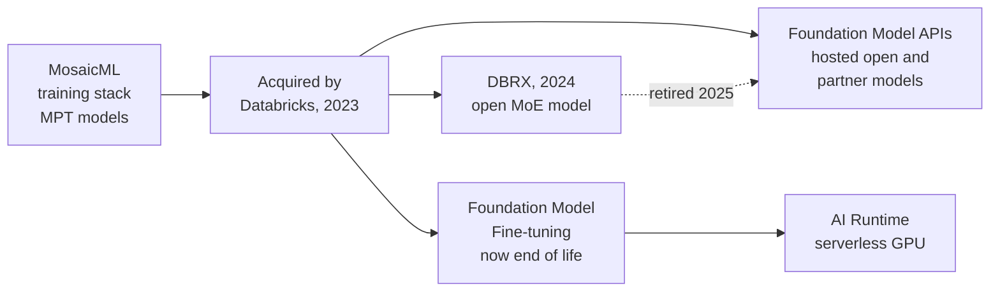

# MosaicML and Open Models

Mastery: `INPUT[inlineSelect(option(new), option(learning), option(solid)):mastery]`

> [!story] Context
> [[AI Runtime]] covered the hardware for training large models. In 2023 Databricks bought MosaicML, a company that specialized in training large models efficiently. This note covers that history, the open models that came out of it, and where that work lives in the platform today.

> [!eli5] Summary
> In 2023 Databricks bought a company called MosaicML that was good at building AI language models cheaply. Together they released free, open AI models anyone could use. Today the main result for customers is that Databricks can host many companies' AI models for you, and you can train your own on its computers.

> [!analogy]- Analogy: a restaurant group buying a bakery
> | Restaurant group | Databricks |
> |---|---|
> | Buys a bakery known for efficient ovens | Acquires MosaicML for its training technology |
> | Bakery publishes its bread recipe for free | Open-weight models MPT and DBRX |
> | Later stocks bread from many bakeries too | Foundation Model APIs host open and partner models |
> | Lets customers rent the ovens | AI Runtime for your own training |

## Background

By 2023, training a large language model required thousands of GPUs and specialist software. MosaicML built that software and offered training as a service. It also released open models to show what its stack could do:

- **MPT-7B** (2023): described by MosaicML as open source, available for commercial use, and matching the quality of LLaMA-7B. Trained from scratch on 1 trillion tokens of text and code, in 9.5 days with zero human intervention.
- **MPT-30B** followed, and **MPT-7B-8K** extended the context length to 8k tokens.
- Its open-source tooling included **Composer**, **StreamingDataset**, and **LLM Foundry**.

## Overview

Timeline:

| Date | Event |
|---|---|
| June 2023 | Databricks signs a definitive agreement to acquire MosaicML, valued at approximately 1.3 billion US dollars including retention packages |
| July 19, 2023 | Databricks completes the acquisition |
| March 2024 | Databricks releases **DBRX** (Base and Instruct), an open [[Mixture of Experts\|mixture-of-experts]] LLM built by Databricks AI Research, and adds it to Model Serving |
| June 2024 | Databricks says it has fully integrated and expanded the model-building capabilities from the acquisition; products carry the **Mosaic AI** name |
| April 30, 2025 | DBRX Instruct retired from Foundation Model APIs pay-per-token (replacement: Llama 4 Maverick) |
| December 19, 2025 | DBRX retired from provisioned throughput |
| 2026 | Foundation Model Fine-tuning reaches end of life; AI Runtime replaces it. "Mosaic AI" product names give way to names such as Unity Gateway and AI Search |

DBRX specifications from the Databricks announcement:

| Property | Value |
|---|---|
| Architecture | Fine-grained mixture of experts |
| Total parameters | 132 billion |
| Active parameters per input | 36 billion |
| Experts | 16, of which 4 are chosen per token |
| Pre-training data | 12 trillion tokens of text and code |

**Mixture of experts** means the model contains many sub-networks and routes each token to a few of them, so only part of the model runs per token. That makes inference cheaper than a dense model of the same total size.

## How it works

The strategy shifted over three years:

1. **Build open models** (MPT, DBRX) to show efficient training and to give customers models they could own.
2. **Host many models:** As open and commercial models improved quickly, [[Foundation Model APIs]] began offering a broad catalog, including open models such as Llama, Gemma, GPT OSS, GLM, and DeepSeek, and partner models from OpenAI, Google, and Anthropic.
3. **Govern and evaluate, whatever the model:** [[Unity Gateway|Unity Gateway]], [[MLflow]] evaluation, and [[Agent Bricks]] work across providers, so a business can switch models without rebuilding its application.

## Small-business considerations

> [!smallbiz] Small-business considerations
> - **You do not need to train an LLM:** The practical outcome of this history is a menu of hosted models you can call by the token.
> - **Model choice is reversible:** Because models are retired and replaced on a schedule, keep an evaluation set and treat the model as a setting you can change.
> - **Open models reduce [[Vendor Lock-In|lock-in]]** for the model itself, but check each model's license and acceptable-use policy.

> [!bridge]- In Databricks today
> MosaicML's training service became Databricks Model Training and Foundation Model Fine-tuning, which is now end of life; custom training runs on [[AI Runtime|AI Runtime]]. Its serving work underpins [[Model Serving]] and [[Foundation Model APIs]]. DBRX is no longer offered on Foundation Model APIs. The open-source libraries (Composer, StreamingDataset, LLM Foundry) remain separate projects outside the Databricks product.

## Cloud differences

> [!azure]- Azure Databricks
> No differences in this history. Current hosted models differ by Azure region.

> [!aws]- Databricks on AWS
> No differences in this history.

> [!gcp]- Databricks on Google Cloud
> No differences in this history.

## Advanced topics

> [!deepdive]- Advanced topics (301–401)
> - **Why mixture of experts:** DBRX's 16-expert, choose-4 design gives 65 times more possible expert combinations than designs with 8 experts choosing 2 (such as Mixtral), per Databricks.
> - **MegaBlocks:** Databricks brought the MegaBlocks project, an efficient mixture-of-experts training library, into its stack.
> - **Retirement policy:** The AI models maintenance policy lists retirement dates and replacements for each hosted model, separately for pay-per-token and provisioned throughput.
> - **Training costs:** MosaicML published training time and cost for MPT to show efficiency; for current costs of training on Databricks, see the AI Runtime pricing meter rather than historical figures.

## Common misconceptions

> [!confusion] DBRX is not the model behind Databricks AI features today
> DBRX was retired from Foundation Model APIs in 2025. Databricks features use a range of hosted open and partner models.

> [!confusion] "Mosaic AI" is not a separate product to buy
> It was the brand for Databricks' AI capabilities after the acquisition. Those capabilities are part of the platform, and many now have new names.

## Recall

When did Databricks complete the MosaicML acquisition?::July 19, 2023.
What was MosaicML's first widely used open model?::MPT-7B, trained on 1 trillion tokens and licensed for commercial use.
What is DBRX?::An open mixture-of-experts LLM released by Databricks in March 2024.
How many total and active parameters does DBRX have?::132 billion total, 36 billion active per input.
How many experts does DBRX have and how many are used per token?::16 experts, 4 chosen per token.
When was DBRX Instruct retired from pay-per-token Foundation Model APIs?::April 30, 2025.
What replaced Foundation Model Fine-tuning?::AI Runtime, Databricks' serverless GPU compute.

## Next steps

> [!path] Learning path
> **Needs first:** [[Generative AI and LLMs]], [[The Founding of Databricks]]
> **Unlocks next:** [[Foundation Model APIs]], [[Chapter 11 - Azure Databricks]]

> [!nextup] Next
> [[Managed MCP Servers]] covers how agents built on these models reach governed data and tools through the Model Context Protocol.

> [!sources]- Sources (last verified: 2026-10-25)
> - [Databricks signs definitive agreement to acquire MosaicML (press release)](https://www.databricks.com/company/newsroom/press-releases/databricks-signs-definitive-agreement-acquire-mosaicml-leading-generative-ai-platform)
> - [Databricks completes acquisition of MosaicML (press release)](https://www.databricks.com/company/newsroom/press-releases/databricks-completes-acquisition-mosaicml)
> - [Databricks + MosaicML (Databricks blog)](https://www.databricks.com/blog/databricks-mosaicml)
> - [Introducing MPT-7B (Databricks blog)](https://www.databricks.com/blog/mpt-7b)
> - [MPT-30B (Databricks blog)](https://www.databricks.com/blog/mpt-30b)
> - [Announcing MPT-7B-8K (Databricks blog)](https://www.databricks.com/blog/long-context-mpt-7b-8k)
> - [Introducing DBRX: a new state-of-the-art open LLM (Databricks blog)](https://www.databricks.com/blog/introducing-dbrx-new-state-art-open-llm)
> - [Announcing DBRX (Databricks blog)](https://www.databricks.com/blog/announcing-dbrx-new-standard-efficient-open-source-customizable-llms)
> - [Bringing MegaBlocks to Databricks (Databricks blog)](https://www.databricks.com/blog/bringing-megablocks-databricks)
> - [Databricks GenAI announcements at Data + AI Summit 2024 (Databricks blog)](https://www.databricks.com/blog/mosaic-ai-build-and-deploy-production-quality-compound-ai-systems)
> - [March 2024 release notes (AWS)](https://docs.databricks.com/aws/en/release-notes/product/2024/march)
> - [April 2025 release notes (AWS)](https://docs.databricks.com/aws/en/release-notes/product/2025/april)
> - [AI models maintenance policy (AWS)](https://docs.databricks.com/aws/en/machine-learning/retired-models-policy)
> - [Foundation Model Fine-tuning (EoL) (AWS)](https://docs.databricks.com/aws/en/large-language-models/foundation-model-training/)
